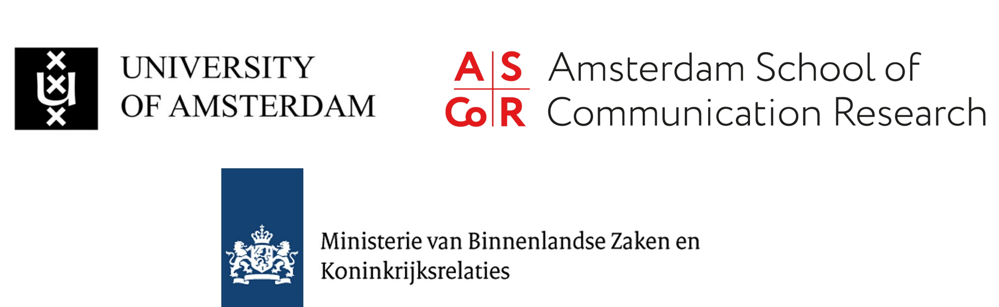

```{r, echo=FALSE, results='asis', message=FALSE, warning=FALSE}
dashboardr::.page_config(accessibility = TRUE, crosstab_prefix = "about")
```

```{=html}
<style>
  /* DigIQ Unified Theme & Editorial Observatory Styling */
  html { scroll-behavior: smooth; }
  section.level2 { scroll-margin-top: 85px; }

  /* Navbar hover readability */
  .navbar a:hover, .navbar .navbar-brand:hover, .navbar .navbar-nav .nav-link:hover {
    color: #3D7271 !important;
  }
  .navbar a:hover svg, .navbar .aa-DetachedSearchButton:hover svg, .navbar button:hover svg {
    fill: #3D7271 !important;
    stroke: #3D7271 !important;
  }

  /* Underline tabsets in DigIQ Teal & Terracotta instead of default royal blue */
  .panel-tabset .nav-item a::after {
    background-color: #E28D50 !important;
  }
  .panel-tabset .nav-tabs .nav-link.active {
    color: #0F6B5A !important;
    font-weight: 700 !important;
  }
  .panel-tabset .nav-tabs .nav-link.active::after {
    background-color: #3D7271 !important;
    height: 3px !important;
  }

  /* Question blockquotes in clean DigIQ Teal */
  blockquote.blockquote {
    border-left: 4px solid #3D7271 !important;
    background: linear-gradient(90deg, #f4f9f8 0%, #fafcfc 100%) !important;
    color: #1e3332 !important;
    border-radius: 0 8px 8px 0 !important;
    padding: 13px 20px !important;
    box-shadow: 0 1px 4px rgba(15, 45, 43, 0.04) !important;
  }

  /* Clickable modal links inside question blockquotes */
  a.modal-link {
    color: #0F6B5A !important;
    font-weight: 600;
    text-decoration: underline !important;
    text-decoration-color: rgba(15, 107, 90, 0.45) !important;
    text-underline-offset: 3px;
    transition: color 0.15s ease, text-decoration-color 0.15s ease;
  }
  a.modal-link:hover {
    color: #E28D50 !important;
    text-decoration-color: #E28D50 !important;
  }

  /* Wave 3 missing-data callout note on Performance sections */
  .dc-wave3-note {
    display: flex;
    align-items: flex-start;
    gap: 0.65rem;
    border: 1px solid #ebd5c3;
    border-left: 4px solid #E28D50;
    background: linear-gradient(90deg, #fdf8f3 0%, #fffcfa 100%);
    color: #5c3314;
    padding: 0.7rem 1.05rem;
    border-radius: 0 8px 8px 0;
    margin: 0.75rem 0 1.1rem 0;
    font-size: 0.92rem;
    line-height: 1.5;
  }
  .dc-wave3-note iconify-icon {
    color: #E28D50;
    font-size: 1.15rem;
    flex-shrink: 0;
    margin-top: 0.14rem;
  }

  /* Landing page: hide redundant Quarto title header & style Editorial Observatory Hero */
  body:has(.dc-observatory-hero) #title-block-header {
    display: none;
  }
  .dc-observatory-hero {
    position: relative;
    overflow: hidden;
    margin: 0.5rem 0 2rem 0;
    padding: 2.2rem 2.5rem 1.75rem 2.5rem;
    border-radius: 16px;
    background:
      radial-gradient(circle at 96% 8%, rgba(61, 114, 113, 0.11) 0%, transparent 45%),
      radial-gradient(circle at 4% 95%, rgba(226, 141, 80, 0.08) 0%, transparent 40%),
      linear-gradient(180deg, #ffffff 0%, #f7fbfa 100%);
    border: 1px solid #d5e3e0;
    box-shadow: 0 1px 3px rgba(15, 45, 43, 0.03), 0 10px 30px -8px rgba(15, 45, 43, 0.07);
  }
  .dc-observatory-hero::before {
    content: '';
    position: absolute;
    top: 0; left: 0; right: 0;
    height: 4px;
    background: linear-gradient(90deg, #0F6B5A 0%, #3D7271 62%, #E28D50 100%);
  }
  .dc-hero-eyebrow {
    display: inline-flex;
    align-items: center;
    gap: 0.5rem;
    font-size: 0.75rem;
    font-weight: 700;
    letter-spacing: 0.09em;
    text-transform: uppercase;
    color: #0F6B5A;
    background: #eaf4f1;
    border: 1px solid #cbe2dc;
    padding: 0.28rem 0.75rem;
    border-radius: 999px;
    margin-bottom: 0.95rem;
  }
  .dc-hero-dot {
    width: 7px;
    height: 7px;
    border-radius: 50%;
    background-color: #E28D50;
    box-shadow: 0 0 0 3px rgba(226, 141, 80, 0.22);
  }
  .dc-hero-title {
    font-size: 2rem;
    font-weight: 800;
    letter-spacing: -0.025em;
    color: #122928;
    margin: 0 0 0.75rem 0;
    line-height: 1.2;
  }
  .dc-hero-lead p {
    font-size: 1.03rem;
    line-height: 1.65;
    color: #364f4d;
    max-width: 880px;
    margin: 0 0 0.55rem 0;
  }
  .dc-hero-lead p:first-child {
    font-weight: 600;
    color: #1c3b39;
  }
  .dc-hero-metrics {
    display: grid;
    grid-template-columns: repeat(auto-fit, minmax(195px, 1fr));
    gap: 0.9rem;
    margin-top: 1.45rem;
    padding-top: 1.25rem;
    border-top: 1px solid #e1ecea;
  }
  .dc-metric-item {
    display: flex;
    align-items: center;
    gap: 0.75rem;
    padding: 0.65rem 0.9rem;
    background: rgba(255, 255, 255, 0.85);
    border: 1px solid #e2ecea;
    border-radius: 10px;
  }
  .dc-metric-icon {
    width: 36px;
    height: 36px;
    border-radius: 8px;
    background: #eef6f4;
    color: #3D7271;
    display: inline-flex;
    align-items: center;
    justify-content: center;
    font-size: 1.2rem;
    flex-shrink: 0;
  }
  .dc-metric-val {
    font-size: 0.98rem;
    font-weight: 700;
    color: #142d2c;
    line-height: 1.2;
  }
  .dc-metric-sub {
    font-size: 0.78rem;
    color: #5b7472;
    margin-top: 0.1rem;
  }

  /* Landing page 11-tile Bento Grid */
  .dc-links {
    display: grid;
    grid-template-columns: repeat(auto-fit, minmax(285px, 1fr));
    gap: 1.15rem;
    margin: 1.25rem 0 2.25rem 0;
  }
  @media (min-width: 1100px) {
    .dc-links {
      grid-template-columns: repeat(6, minmax(0, 1fr));
    }
    .dc-links > .dc-link {
      grid-column: span 2;
    }
    /* Center the final 2 AI cards (10 & 11) on the bottom row */
    .dc-links > .dc-link:nth-child(10) {
      grid-column: 2 / span 2;
    }
    .dc-links > .dc-link:nth-child(11) {
      grid-column: 4 / span 2;
    }
  }
  .dc-link {
    position: relative;
    overflow: hidden;
    display: flex;
    flex-direction: column;
    justify-content: space-between;
    padding: 1.35rem 1.4rem 1.15rem 1.4rem;
    border-radius: 13px;
    border: 1px solid #dce7e5;
    border-left: 4px solid #3D7271;
    background: #ffffff;
    color: inherit !important;
    text-decoration: none !important;
    text-align: left;
    box-shadow: 0 1px 2px rgba(15, 40, 38, 0.03), 0 6px 18px -4px rgba(15, 40, 38, 0.05);
    transition: transform 0.22s cubic-bezier(0.16, 1, 0.3, 1), box-shadow 0.22s cubic-bezier(0.16, 1, 0.3, 1), border-color 0.2s ease;
  }
  .dc-link::after {
    content: '';
    position: absolute;
    top: 0; left: 0; right: 0;
    height: 2px;
    background: linear-gradient(90deg, #3D7271, #E28D50);
    opacity: 0;
    transition: opacity 0.22s ease;
  }
  .dc-link:hover {
    transform: translateY(-4px);
    box-shadow: 0 4px 8px rgba(15, 40, 38, 0.04), 0 16px 32px -6px rgba(15, 40, 38, 0.11);
    border-color: #b8cfcc;
    border-left-color: #E28D50;
  }
  .dc-link:hover::after {
    opacity: 1;
  }
  .dc-card-watermark {
    position: absolute;
    right: -10px;
    bottom: -14px;
    font-size: 5.4rem;
    color: #3D7271;
    opacity: 0.04;
    pointer-events: none;
    transition: transform 0.3s ease, opacity 0.3s ease, color 0.3s ease;
  }
  .dc-link:hover .dc-card-watermark {
    transform: scale(1.08) rotate(-5deg);
    opacity: 0.075;
    color: #0F6B5A;
  }
  .dc-card-top {
    display: flex;
    align-items: center;
    justify-content: space-between;
    gap: 0.75rem;
    margin-bottom: 0.75rem;
  }
  .dc-card-title-group {
    display: flex;
    align-items: center;
    gap: 0.7rem;
    min-width: 0;
  }
  .dc-card-emblem {
    width: 38px;
    height: 38px;
    border-radius: 9px;
    background: #eef5f3;
    border: 1px solid #d5e6e2;
    color: #0F6B5A;
    display: inline-flex;
    align-items: center;
    justify-content: center;
    font-size: 1.22rem;
    flex-shrink: 0;
    transition: background-color 0.2s ease, color 0.2s ease, border-color 0.2s ease, transform 0.2s ease;
  }
  .dc-link:hover .dc-card-emblem {
    background: #3D7271;
    border-color: #3D7271;
    color: #ffffff;
    transform: scale(1.04);
  }
  .dc-link-title {
    font-weight: 700;
    color: #142c2b;
    font-size: 1.05rem;
    letter-spacing: -0.01em;
    line-height: 1.25;
    transition: color 0.2s ease;
  }
  .dc-link:hover .dc-link-title {
    color: #0F6B5A;
  }
  .dc-card-num {
    font-family: 'Fira Code', monospace;
    font-size: 0.73rem;
    font-weight: 600;
    color: #7c9694;
    background: #f3f7f6;
    border: 1px solid #e3ecea;
    padding: 0.14rem 0.48rem;
    border-radius: 6px;
    flex-shrink: 0;
    transition: color 0.2s ease, border-color 0.2s ease, background-color 0.2s ease;
  }
  .dc-link:hover .dc-card-num {
    color: #9c4215;
    background: #fdf3eb;
    border-color: #f0cdb4;
  }
  .dc-link-text {
    position: relative;
    z-index: 1;
    font-size: 0.91rem;
    line-height: 1.54;
    color: #495e5d;
    margin-bottom: 1rem;
    flex-grow: 1;
  }
  .dc-card-footer {
    position: relative;
    z-index: 1;
    display: flex;
    align-items: center;
    justify-content: space-between;
    padding-top: 0.65rem;
    border-top: 1px solid #eff4f3;
    font-size: 0.8rem;
    font-weight: 600;
    color: #3D7271;
    letter-spacing: 0.01em;
    transition: color 0.2s ease;
  }
  .dc-card-cta-arrow {
    display: inline-flex;
    align-items: center;
    font-size: 0.95rem;
    color: #88a3a0;
    transition: transform 0.2s ease, color 0.2s ease;
  }
  .dc-link:hover .dc-card-footer {
    color: #0F6B5A;
  }
  .dc-link:hover .dc-card-cta-arrow {
    transform: translateX(4px);
    color: #E28D50;
  }

  /* Dimension page intro panel & unified architectural jump-chips */
  .dc-dim-intro {
    background: #ffffff;
    border: 1px solid #d8e4e2;
    border-left: 5px solid #3D7271;
    border-radius: 12px;
    padding: 1.2rem 1.45rem;
    margin: 0.65rem 0 1.65rem 0;
    box-shadow: 0 2px 12px rgba(15, 45, 43, 0.04);
  }
  .dc-dim-intro > p {
    font-size: 1.01rem;
    line-height: 1.65;
    color: #213736;
    margin-bottom: 0.8rem;
  }
  .dc-jump-row {
    display: flex;
    flex-wrap: wrap;
    align-items: center;
    gap: 0.45rem;
    padding-top: 0.7rem;
    border-top: 1px solid #e7f0ee;
    font-size: 0.92rem;
    color: #425958;
    margin: 0;
  }
  .dc-jump-label {
    font-weight: 600;
    color: #1b3332;
    margin-right: 0.15rem;
  }
  a.dc-jump-link {
    display: inline-flex;
    align-items: center;
    gap: 0.35rem;
    padding: 0.24rem 0.7rem;
    border-radius: 7px;
    background: #f3f8f7;
    border: 1px solid #cde0dd;
    color: #0F6B5A !important;
    font-size: 0.86rem;
    font-weight: 600;
    text-decoration: none !important;
    transition: all 0.16s ease;
  }
  a.dc-jump-link:hover {
    background: #3D7271;
    border-color: #3D7271;
    color: #ffffff !important;
    transform: translateY(-1px);
    box-shadow: 0 3px 8px rgba(61, 114, 113, 0.18);
  }
</style>

<script>
(function() {
  function initDigIQNavEnhancements() {
    // Page-aware Language Switcher (preserves current page filename & #hash)
    var langLinks = document.querySelectorAll('a.nav-link[href*="favstats.github.io/digicomp"]');
    var path = window.location.pathname || '';
    var parts = path.split('/').filter(Boolean);
    var lastPart = parts.length ? parts[parts.length - 1] : 'index.html';
    var pageFile = (lastPart.indexOf('.html') !== -1) ? lastPart : 'index.html';
    var isEN = path.indexOf('/en/') !== -1 || (parts.length && parts[parts.length - 1] === 'en');

    function updateLangHrefs() {
      var hash = window.location.hash || '';
      langLinks.forEach(function(link) {
        if (isEN) {
          link.setAttribute('href', '../' + pageFile + hash);
          link.setAttribute('title', 'Bekijk deze pagina in het Nederlands');
        } else {
          link.setAttribute('href', './en/' + pageFile + hash);
          link.setAttribute('title', 'View this page in English');
        }
      });
    }
    updateLangHrefs();
    window.addEventListener('hashchange', updateLangHrefs);
  }
  if (document.readyState === 'loading') {
    document.addEventListener('DOMContentLoaded', initDigIQNavEnhancements);
  } else {
    initDigIQNavEnhancements();
  }
})();
</script>

```

<div style='text-align: justify;'>
## Over Project CID

Project CID (Competency Insight Dashboard) is een nationaal initiatief om de digitale competentie van mensen in Nederland te monitoren en te versterken, zodat zij veilig en effectief kunnen deelnemen aan een steeds digitalere samenleving. Voortbouwend op de gevalideerde DigIQ-tool, en de uitbreiding DigIQ2.0, die elf belangrijke dimensies van digitale vaardigheden meet (van online veiligheid en digitale gezondheid tot AI en duurzame technologie), volgt Project CID hoe verschillende groepen in de bevolking omgaan met snelle technologische veranderingen, inclusief ontwikkelingen zoals generatieve AI. Dit gebeurt door zes dataverzamelingsrondes uit te voeren tussen 2024 en 2027, en alle resulterende data worden geïntegreerd in dit dashboard.

Met deze tijdige inzichten kunnen beleidsmakers en praktijkmensen gerichte workshops en trainingen ontwerpen voor verschillende leeftijds- en opleidingsgroepen, toegankelijke programma's ontwikkelen voor kwetsbare populaties, en bewustwordingscampagnes lanceren over onderwerpen zoals AI, privacy en informatiebetrouwbaarheid.

## Methodologie

Project CID brengt de digitale competenties van de Nederlandse bevolking in kaart met behulp van een gemengde steekproefstrategie die een online panel combineert met een adressensteekproef. De adressensteekproef richt zich specifiek op buurten met hogere proporties mensen met lagere opleidingsniveaus en/of een migratieachtergrond, om inclusie te waarborgen van groepen die ondervertegenwoordigd zijn in online panelonderzoek en van mensen met lagere (digitale) geletterdheid. Data worden verzameld via een vragenlijst beschikbaar in het Nederlands en Engels, die online (smartphone, tablet, computer) of op papier kan worden ingevuld. Dataverzameling voor Project CID wordt uitgevoerd door het externe onderzoeksbureau Ipsos I&O, wat professioneel en gestandaardiseerd veldwerk garandeert.

Omdat de resulterende steekproef verschilde van nationale benchmarks (MOA Gouden Standaard 2024) op belangrijke demografische kenmerken, werden statistische wegingen toegepast zodat de resultaten de Nederlandse bevolking nauwkeuriger weerspiegelen.

Meer informatie over enquêteontwikkeling en steekproeftrekking is te vinden op: https://osf.io/d5c7n/

## Over het Onderzoeksteam

**Dr. Annemarie van Oosten** is senior onderzoeker, dagelijks projectmanager en contactpersoon voor het CID-project. Ze is tevens universitair docent communicatiewetenschappen aan de Universiteit van Amsterdam, waar ze in 2015 promoveerde. Naast haar onderzoek naar digitale competentie onderzoekt ze de rol van (sociale) media in de seksuele en genderhoudingen en -gedragingen van jongeren.

**Roos Korderijnk, MSc.** is junior onderzoeker voor het CID-project. Roos studeerde Communicatie- en Informatiewetenschappen aan de Universiteit Utrecht en Communicatiewetenschappen aan de Vrije Universiteit Amsterdam.

**Prof. Dr. Jessica Taylor Piotrowski** is hoofdonderzoeker van het DIGCOM-project en het CID-project. Jessica is hoogleraar Digitale Maatschappij aan de Universiteit van Amsterdam, directeur van het Center for research on Children, Adolescents and the Media (CcaM) en directeur van de Graduate School for Communication. Haar onderzoek richt zich op de wisselwerking tussen de digitale maatschappij en de ontwikkeling van (jongeren).

**Dr. Dian A. de Vries** is Associate Professor Digital Skills aan de Hogeschool Utrecht, bij het lectoraat Organisaties in de Digitale Transitie. Dian promoveerde aan de Universiteit van Amsterdam (2014) en is co-auteur van De Schermwijzer: Een praktische gids voor (groot)ouders over schermtijd, sociale media, gamen en online veiligheid.

**Prof. Dr. Claes H. de Vreese** is co-aanvrager van het DIGCOM-project. Claes is hoogleraar Kunstmatige Intelligentie en Maatschappij aan de Universiteit van Amsterdam. Hij is tevens oprichter en directeur van het Digital Democracy Center en medeoprichter van het AI, Media and Democracy Lab. Claes doet onderzoek naar de rol van media en kunstmatige intelligentie in de democratie.

## Over de Makers van het Dashboard

::: {.panel-tabset}

#### Fabio Votta

```{r, echo=FALSE}
suppressWarnings(library(htmltools))

card <- div(
  class = 'card',
  div(
    class = 'row no-gutters align-items-center',
    div(
      class = 'col-md-2',
      div(
        style = 'display: flex; justify-content: center;',
        img(
          class = 'card-img',
          src = 'https://algosoc.org/uploads/_card/fabio-votta-1.jpg',
          style = 'max-width: 500px;'
        )
      )
    ),
    div(
      class = 'col-md-10',
      div(
        class = 'card-body',
        p(
          class = 'card-text',
          'Fabio Votta is a Postdoc at the University of Amsterdam who studies digital political campaigns and the role of ad delivery algorithms. He is particularly interested in how political actors use targeted campaign messages to reach specific voters and how social media platforms enable these practices.'
        ),
        div(
          style = 'display: flex; justify-content: flex-end',
          a(href = 'https://www.favstats.eu/', 'Website: favstats.eu')
        )
      )
    )
  )
)

card
```

#### Ernesto de León

```{r, echo=FALSE}
card <- shiny::fluidPage(
  tags$head(
    tags$link(rel = 'stylesheet', href = 'https://cdnjs.cloudflare.com/ajax/libs/font-awesome/5.15.4/css/all.min.css')
  ),
  div(
    class = 'card',
    div(
      class = 'row no-gutters align-items-center',
      div(
        class = 'col-md-2',
        div(
          style = 'display: flex; justify-content: center;',
          img(
            class = 'card-img',
            src = 'https://algosoc.org/uploads/_card/Ernesto-de-Leon.jpeg',
            style = 'max-width: 500px;'
          )
        )
      ),
      div(
        class = 'col-md-10',
        div(
          class = 'card-body',
          p(
            class = 'card-text',
            'Ernesto de León focuses on political information flows in a digital age and its effects on political attitudes. In these projects, he makes use of computational methodologies to explore web behaviour, use of algorithmic intermediaries to news (such as social media and search engines), and to conduct large-scale automated content analyses through text-as-data approaches.'
          ),
          div(
            style = 'display: flex; justify-content: flex-end',
            a(href = 'https://www.ernesto-deleon.com/', 'Website: ernesto-deleon.com')
          )
        )
      )
    )
  )
)

card
```

:::

<br>
<br>
<center></center>
</div>

