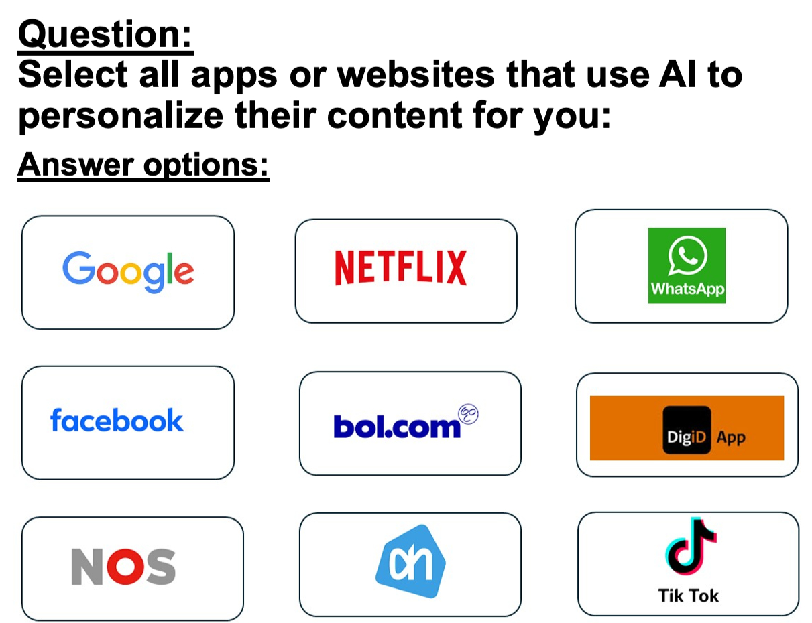

```{r, echo=FALSE, results='asis', message=FALSE, warning=FALSE}
dashboardr::.page_config(accessibility = TRUE, modals = TRUE, crosstab_prefix = "ai")
```

```{=html}
<style>
  /* DigIQ Unified Theme & Editorial Observatory Styling */
  html { scroll-behavior: smooth; }
  section.level2 { scroll-margin-top: 85px; }

  /* Navbar hover readability */
  .navbar a:hover, .navbar .navbar-brand:hover, .navbar .navbar-nav .nav-link:hover {
    color: #3D7271 !important;
  }
  .navbar a:hover svg, .navbar .aa-DetachedSearchButton:hover svg, .navbar button:hover svg {
    fill: #3D7271 !important;
    stroke: #3D7271 !important;
  }

  /* Underline tabsets in DigIQ Teal & Terracotta instead of default royal blue */
  .panel-tabset .nav-item a::after {
    background-color: #E28D50 !important;
  }
  .panel-tabset .nav-tabs .nav-link.active {
    color: #0F6B5A !important;
    font-weight: 700 !important;
  }
  .panel-tabset .nav-tabs .nav-link.active::after {
    background-color: #3D7271 !important;
    height: 3px !important;
  }

  /* Question blockquotes in clean DigIQ Teal */
  blockquote.blockquote {
    border-left: 4px solid #3D7271 !important;
    background: linear-gradient(90deg, #f4f9f8 0%, #fafcfc 100%) !important;
    color: #1e3332 !important;
    border-radius: 0 8px 8px 0 !important;
    padding: 13px 20px !important;
    box-shadow: 0 1px 4px rgba(15, 45, 43, 0.04) !important;
  }

  /* Clickable modal links inside question blockquotes */
  a.modal-link {
    color: #0F6B5A !important;
    font-weight: 600;
    text-decoration: underline !important;
    text-decoration-color: rgba(15, 107, 90, 0.45) !important;
    text-underline-offset: 3px;
    transition: color 0.15s ease, text-decoration-color 0.15s ease;
  }
  a.modal-link:hover {
    color: #E28D50 !important;
    text-decoration-color: #E28D50 !important;
  }

  /* Wave 3 missing-data callout note on Performance sections */
  .dc-wave3-note {
    display: flex;
    align-items: flex-start;
    gap: 0.65rem;
    border: 1px solid #ebd5c3;
    border-left: 4px solid #E28D50;
    background: linear-gradient(90deg, #fdf8f3 0%, #fffcfa 100%);
    color: #5c3314;
    padding: 0.7rem 1.05rem;
    border-radius: 0 8px 8px 0;
    margin: 0.75rem 0 1.1rem 0;
    font-size: 0.92rem;
    line-height: 1.5;
  }
  .dc-wave3-note iconify-icon {
    color: #E28D50;
    font-size: 1.15rem;
    flex-shrink: 0;
    margin-top: 0.14rem;
  }

  /* Landing page: hide redundant Quarto title header & style Editorial Observatory Hero */
  body:has(.dc-observatory-hero) #title-block-header {
    display: none;
  }
  .dc-observatory-hero {
    position: relative;
    overflow: hidden;
    margin: 0.5rem 0 2rem 0;
    padding: 2.2rem 2.5rem 1.75rem 2.5rem;
    border-radius: 16px;
    background:
      radial-gradient(circle at 96% 8%, rgba(61, 114, 113, 0.11) 0%, transparent 45%),
      radial-gradient(circle at 4% 95%, rgba(226, 141, 80, 0.08) 0%, transparent 40%),
      linear-gradient(180deg, #ffffff 0%, #f7fbfa 100%);
    border: 1px solid #d5e3e0;
    box-shadow: 0 1px 3px rgba(15, 45, 43, 0.03), 0 10px 30px -8px rgba(15, 45, 43, 0.07);
  }
  .dc-observatory-hero::before {
    content: '';
    position: absolute;
    top: 0; left: 0; right: 0;
    height: 4px;
    background: linear-gradient(90deg, #0F6B5A 0%, #3D7271 62%, #E28D50 100%);
  }
  .dc-hero-eyebrow {
    display: inline-flex;
    align-items: center;
    gap: 0.5rem;
    font-size: 0.75rem;
    font-weight: 700;
    letter-spacing: 0.09em;
    text-transform: uppercase;
    color: #0F6B5A;
    background: #eaf4f1;
    border: 1px solid #cbe2dc;
    padding: 0.28rem 0.75rem;
    border-radius: 999px;
    margin-bottom: 0.95rem;
  }
  .dc-hero-dot {
    width: 7px;
    height: 7px;
    border-radius: 50%;
    background-color: #E28D50;
    box-shadow: 0 0 0 3px rgba(226, 141, 80, 0.22);
  }
  .dc-hero-title {
    font-size: 2rem;
    font-weight: 800;
    letter-spacing: -0.025em;
    color: #122928;
    margin: 0 0 0.75rem 0;
    line-height: 1.2;
  }
  .dc-hero-lead p {
    font-size: 1.03rem;
    line-height: 1.65;
    color: #364f4d;
    max-width: 880px;
    margin: 0 0 0.55rem 0;
  }
  .dc-hero-lead p:first-child {
    font-weight: 600;
    color: #1c3b39;
  }
  .dc-hero-metrics {
    display: grid;
    grid-template-columns: repeat(auto-fit, minmax(195px, 1fr));
    gap: 0.9rem;
    margin-top: 1.45rem;
    padding-top: 1.25rem;
    border-top: 1px solid #e1ecea;
  }
  .dc-metric-item {
    display: flex;
    align-items: center;
    gap: 0.75rem;
    padding: 0.65rem 0.9rem;
    background: rgba(255, 255, 255, 0.85);
    border: 1px solid #e2ecea;
    border-radius: 10px;
  }
  .dc-metric-icon {
    width: 36px;
    height: 36px;
    border-radius: 8px;
    background: #eef6f4;
    color: #3D7271;
    display: inline-flex;
    align-items: center;
    justify-content: center;
    font-size: 1.2rem;
    flex-shrink: 0;
  }
  .dc-metric-val {
    font-size: 0.98rem;
    font-weight: 700;
    color: #142d2c;
    line-height: 1.2;
  }
  .dc-metric-sub {
    font-size: 0.78rem;
    color: #5b7472;
    margin-top: 0.1rem;
  }

  /* Landing page 11-tile Bento Grid */
  .dc-links {
    display: grid;
    grid-template-columns: repeat(auto-fit, minmax(285px, 1fr));
    gap: 1.15rem;
    margin: 1.25rem 0 2.25rem 0;
  }
  @media (min-width: 1100px) {
    .dc-links {
      grid-template-columns: repeat(6, minmax(0, 1fr));
    }
    .dc-links > .dc-link {
      grid-column: span 2;
    }
    /* Center the final 2 AI cards (10 & 11) on the bottom row */
    .dc-links > .dc-link:nth-child(10) {
      grid-column: 2 / span 2;
    }
    .dc-links > .dc-link:nth-child(11) {
      grid-column: 4 / span 2;
    }
  }
  .dc-link {
    position: relative;
    overflow: hidden;
    display: flex;
    flex-direction: column;
    justify-content: space-between;
    padding: 1.35rem 1.4rem 1.15rem 1.4rem;
    border-radius: 13px;
    border: 1px solid #dce7e5;
    border-left: 4px solid #3D7271;
    background: #ffffff;
    color: inherit !important;
    text-decoration: none !important;
    text-align: left;
    box-shadow: 0 1px 2px rgba(15, 40, 38, 0.03), 0 6px 18px -4px rgba(15, 40, 38, 0.05);
    transition: transform 0.22s cubic-bezier(0.16, 1, 0.3, 1), box-shadow 0.22s cubic-bezier(0.16, 1, 0.3, 1), border-color 0.2s ease;
  }
  .dc-link::after {
    content: '';
    position: absolute;
    top: 0; left: 0; right: 0;
    height: 2px;
    background: linear-gradient(90deg, #3D7271, #E28D50);
    opacity: 0;
    transition: opacity 0.22s ease;
  }
  .dc-link:hover {
    transform: translateY(-4px);
    box-shadow: 0 4px 8px rgba(15, 40, 38, 0.04), 0 16px 32px -6px rgba(15, 40, 38, 0.11);
    border-color: #b8cfcc;
    border-left-color: #E28D50;
  }
  .dc-link:hover::after {
    opacity: 1;
  }
  .dc-card-watermark {
    position: absolute;
    right: -10px;
    bottom: -14px;
    font-size: 5.4rem;
    color: #3D7271;
    opacity: 0.04;
    pointer-events: none;
    transition: transform 0.3s ease, opacity 0.3s ease, color 0.3s ease;
  }
  .dc-link:hover .dc-card-watermark {
    transform: scale(1.08) rotate(-5deg);
    opacity: 0.075;
    color: #0F6B5A;
  }
  .dc-card-top {
    display: flex;
    align-items: center;
    justify-content: space-between;
    gap: 0.75rem;
    margin-bottom: 0.75rem;
  }
  .dc-card-title-group {
    display: flex;
    align-items: center;
    gap: 0.7rem;
    min-width: 0;
  }
  .dc-card-emblem {
    width: 38px;
    height: 38px;
    border-radius: 9px;
    background: #eef5f3;
    border: 1px solid #d5e6e2;
    color: #0F6B5A;
    display: inline-flex;
    align-items: center;
    justify-content: center;
    font-size: 1.22rem;
    flex-shrink: 0;
    transition: background-color 0.2s ease, color 0.2s ease, border-color 0.2s ease, transform 0.2s ease;
  }
  .dc-link:hover .dc-card-emblem {
    background: #3D7271;
    border-color: #3D7271;
    color: #ffffff;
    transform: scale(1.04);
  }
  .dc-link-title {
    font-weight: 700;
    color: #142c2b;
    font-size: 1.05rem;
    letter-spacing: -0.01em;
    line-height: 1.25;
    transition: color 0.2s ease;
  }
  .dc-link:hover .dc-link-title {
    color: #0F6B5A;
  }
  .dc-card-num {
    font-family: 'Fira Code', monospace;
    font-size: 0.73rem;
    font-weight: 600;
    color: #7c9694;
    background: #f3f7f6;
    border: 1px solid #e3ecea;
    padding: 0.14rem 0.48rem;
    border-radius: 6px;
    flex-shrink: 0;
    transition: color 0.2s ease, border-color 0.2s ease, background-color 0.2s ease;
  }
  .dc-link:hover .dc-card-num {
    color: #9c4215;
    background: #fdf3eb;
    border-color: #f0cdb4;
  }
  .dc-link-text {
    position: relative;
    z-index: 1;
    font-size: 0.91rem;
    line-height: 1.54;
    color: #495e5d;
    margin-bottom: 1rem;
    flex-grow: 1;
  }
  .dc-card-footer {
    position: relative;
    z-index: 1;
    display: flex;
    align-items: center;
    justify-content: space-between;
    padding-top: 0.65rem;
    border-top: 1px solid #eff4f3;
    font-size: 0.8rem;
    font-weight: 600;
    color: #3D7271;
    letter-spacing: 0.01em;
    transition: color 0.2s ease;
  }
  .dc-card-cta-arrow {
    display: inline-flex;
    align-items: center;
    font-size: 0.95rem;
    color: #88a3a0;
    transition: transform 0.2s ease, color 0.2s ease;
  }
  .dc-link:hover .dc-card-footer {
    color: #0F6B5A;
  }
  .dc-link:hover .dc-card-cta-arrow {
    transform: translateX(4px);
    color: #E28D50;
  }

  /* Dimension page intro panel & unified architectural jump-chips */
  .dc-dim-intro {
    background: #ffffff;
    border: 1px solid #d8e4e2;
    border-left: 5px solid #3D7271;
    border-radius: 12px;
    padding: 1.2rem 1.45rem;
    margin: 0.65rem 0 1.65rem 0;
    box-shadow: 0 2px 12px rgba(15, 45, 43, 0.04);
  }
  .dc-dim-intro > p {
    font-size: 1.01rem;
    line-height: 1.65;
    color: #213736;
    margin-bottom: 0.8rem;
  }
  .dc-jump-row {
    display: flex;
    flex-wrap: wrap;
    align-items: center;
    gap: 0.45rem;
    padding-top: 0.7rem;
    border-top: 1px solid #e7f0ee;
    font-size: 0.92rem;
    color: #425958;
    margin: 0;
  }
  .dc-jump-label {
    font-weight: 600;
    color: #1b3332;
    margin-right: 0.15rem;
  }
  a.dc-jump-link {
    display: inline-flex;
    align-items: center;
    gap: 0.35rem;
    padding: 0.24rem 0.7rem;
    border-radius: 7px;
    background: #f3f8f7;
    border: 1px solid #cde0dd;
    color: #0F6B5A !important;
    font-size: 0.86rem;
    font-weight: 600;
    text-decoration: none !important;
    transition: all 0.16s ease;
  }
  a.dc-jump-link:hover {
    background: #3D7271;
    border-color: #3D7271;
    color: #ffffff !important;
    transform: translateY(-1px);
    box-shadow: 0 3px 8px rgba(61, 114, 113, 0.18);
  }
</style>

<script>
(function() {
  function initDigIQNavEnhancements() {
    // 1. Page-aware Language Switcher (preserves current page filename & #hash)
    var langLinks = document.querySelectorAll('a.nav-link[href*="favstats.github.io/digicomp"]');
    var path = window.location.pathname || '';
    var parts = path.split('/').filter(Boolean);
    var lastPart = parts.length ? parts[parts.length - 1] : 'index.html';
    var pageFile = (lastPart.indexOf('.html') !== -1) ? lastPart : 'index.html';
    var isEN = path.indexOf('/en/') !== -1 || (parts.length && parts[parts.length - 1] === 'en');

    function updateLangHrefs() {
      var hash = window.location.hash || '';
      langLinks.forEach(function(link) {
        if (isEN) {
          link.setAttribute('href', '../' + pageFile + hash);
          link.setAttribute('title', 'Bekijk deze pagina in het Nederlands');
        } else {
          link.setAttribute('href', './en/' + pageFile + hash);
          link.setAttribute('title', 'View this page in English');
        }
      });
    }
    updateLangHrefs();
    window.addEventListener('hashchange', updateLangHrefs);

    // 2. Cross-Navigation Link to Sister Dashboard (/burgerschap & /citizenship)
    var moreMenus = document.querySelectorAll('ul.dropdown-menu[aria-labelledby*="more-info"], ul.dropdown-menu[aria-labelledby*="meer-informatie"]');
    moreMenus.forEach(function(menu) {
      if (menu.querySelector('.dc-sister-dashboard-link')) return;
      var dividerLi = document.createElement('li');
      dividerLi.innerHTML = '<hr class="dropdown-divider">';
      var itemLi = document.createElement('li');
      var targetHref = isEN ? '../citizenship/index.html' : './burgerschap/index.html';
      var targetLabel = isEN ? 'Digital Citizenship' : 'Digitaal Burgerschap';
      itemLi.innerHTML = '<a class="dropdown-item dc-sister-dashboard-link" href="' + targetHref + '"><span class="dropdown-text"><iconify-icon role="img" inline="" icon="ph:users-three-fill"></iconify-icon> ' + targetLabel + '</span></a>';
      menu.appendChild(dividerLi);
      menu.appendChild(itemLi);
    });
  }
  if (document.readyState === 'loading') {
    document.addEventListener('DOMContentLoaded', initDigIQNavEnhancements);
  } else {
    initDigIQNavEnhancements();
  }
})();
</script>

```

::: {.dc-dim-intro}
**AI competentie** omvat het vermogen om te herkennen wanneer websites en apps artificiële intelligentie gebruiken om content en aanbevelingen te personaliseren.

```{=html}
<div class='dc-jump-row'><span class='dc-jump-label'>Dit wordt op drie manieren gemeten:</span> <a class='dc-jump-link' href='#ai-vaardigheden'><iconify-icon inline icon='ph:lightning-fill'></iconify-icon> <span>zelfingeschatte vaardigheden</span> &#8595;</a> <a class='dc-jump-link' href='#ai-kennis'><iconify-icon inline icon='ph:book-open-fill'></iconify-icon> <span>items die kennis testen</span> &#8595;</a> <span>en</span> <a class='dc-jump-link' href='#ai-prestatie'><iconify-icon inline icon='ph:clipboard-text'></iconify-icon> <span>prestaties/gedrag</span> &#8595;</a></div>
```
:::

```{r setup}
#| echo: false
#| warning: false
#| message: false
#| error: false
#| results: 'hide'

# Load dashboardr (includes dplyr, highcharter as dependencies)
library(dashboardr)

# Global chunk options
knitr::opts_chunk$set(
  echo = FALSE,
  warning = FALSE,
  message = FALSE,
  error = FALSE,
  fig.width = 12,
  fig.height = 8,
  dpi = 300
)

# Load data
data <- readRDS('dataset_large_5307obs.rds')

# Data summary
cat('Dataset loaded:', nrow(data), 'rows,', ncol(data), 'columns\n')

# Create filtered datasets
# Each filter is applied once and reused across visualizations

data_filtered_984a0efe <- dashboardr::.convert_haven(data) %>% dplyr::filter(wave == 1)
data_filtered_4af682fd <- dashboardr::.convert_haven(data) %>% dplyr::filter(wave == 2)
data_filtered_5311412c <- dashboardr::.convert_haven(data) %>% dplyr::filter(wave == 3)
data_filtered_f45d3309 <- dashboardr::.convert_haven(data) %>% dplyr::filter(wave %in% c(1, 2))

```

##  AI Vaardigheden


**Vaardigheden** meet het *zelfgerapporteerde vermogen* van deelnemers om een breed scala aan digitale taken uit te voeren. Deze items leggen vast hoe zelfverzekerd mensen zich voelen bij het zoeken naar informatie.
```{r, echo=FALSE, message=FALSE, warning=FALSE}
create_blockquote("Bedenk in hoeverre elke zin klopt of waar is voor jou persoonlijk, als je de activiteit nu en in je eentje zou moeten doen. Wees vooral eerlijk, het is heel normaal dat je sommige dingen nooit doet. Dat willen we juist weten! Als je niet begrijpt wat de vraag inhoudt, kruis dan aan 'Ik begrijp de vraag niet'.", preset = "question")
```


::: {.panel-tabset}

###  Ronde 1


::: {.panel-tabset}

#####  Algemeen


```{r ai-wave1-overall}
# AI Vaardigheden
result <- viz_stackedbars(
  data = data_filtered_984a0efe,
  title = "AI Vaardigheden",
  x_vars = c("SAI1", "SAI2"),
  x_var_labels = c("Ik weet wanneer een website of app AI gebruikt om de inhoud aan mij aan te passen", "Ik weet wanneer bepaalde inhoud mij wordt aanbevolen door AI"),
  stacked_type = "percent",
  color_palette = c("#3D7271", "#E28D50", "#F5D76E", "#C7E6D5", "#0F6B5A", "#BABACD"),
  horizontal = TRUE,
  x_label = "",
  stack_breaks = c(0.5, 2.5, 3.5, 5.5),
  stack_bin_labels = c("Helemaal Onwaar (1-2)", "Niet onwaar en niet waar (3)", "Helemaal Waar (4-5)"),
  stack_order = c("Helemaal Waar (4-5)", "Niet onwaar en niet waar (3)", "Helemaal Onwaar (1-2)"),
  stack_label = NULL,
  weight_var = "weging_GAMO"
)

result
```


#####  Leeftijd


::: {.panel-tabset}

######  Vraag 1


```{r ai-wave1-age-item1}
# Ik weet wanneer een website of app AI gebruikt om de inhoud aan mij aan te passen
result <- viz_stackedbar(
  data = data_filtered_984a0efe,
  title = "Ik weet wanneer een website of app AI gebruikt om de inhoud aan mij aan te passen",
  stacked_type = "percent",
  horizontal = TRUE,
  stack_breaks = c(0.5, 2.5, 3.5, 5.5),
  stack_bin_labels = c("Helemaal Onwaar (1-2)", "Niet onwaar en niet waar (3)", "Helemaal Waar (4-5)"),
  stack_order = c("Helemaal Waar (4-5)", "Niet onwaar en niet waar (3)", "Helemaal Onwaar (1-2)"),
  color_palette = c("#3D7271", "#E28D50", "#F5D76E", "#C7E6D5", "#0F6B5A", "#BABACD"),
  weight_var = "weging_GAMO",
  x_var = "AgeGroup",
  x_label = "Leeftijd",
  stack_var = "SAI1"
)

result
```


######  Vraag 2


```{r ai-wave1-age-item2}
# Ik weet wanneer bepaalde inhoud mij wordt aanbevolen door AI
result <- viz_stackedbar(
  data = data_filtered_984a0efe,
  title = "Ik weet wanneer bepaalde inhoud mij wordt aanbevolen door AI",
  stacked_type = "percent",
  horizontal = TRUE,
  stack_breaks = c(0.5, 2.5, 3.5, 5.5),
  stack_bin_labels = c("Helemaal Onwaar (1-2)", "Niet onwaar en niet waar (3)", "Helemaal Waar (4-5)"),
  stack_order = c("Helemaal Waar (4-5)", "Niet onwaar en niet waar (3)", "Helemaal Onwaar (1-2)"),
  color_palette = c("#3D7271", "#E28D50", "#F5D76E", "#C7E6D5", "#0F6B5A", "#BABACD"),
  weight_var = "weging_GAMO",
  x_var = "AgeGroup",
  x_label = "Leeftijd",
  stack_var = "SAI2"
)

result
```


:::


#####  Geslacht


::: {.panel-tabset}

######  Vraag 1


```{r ai-wave1-gender-item1}
# Ik weet wanneer een website of app AI gebruikt om de inhoud aan mij aan te passen
result <- viz_stackedbar(
  data = data_filtered_984a0efe,
  title = "Ik weet wanneer een website of app AI gebruikt om de inhoud aan mij aan te passen",
  stacked_type = "percent",
  horizontal = TRUE,
  stack_breaks = c(0.5, 2.5, 3.5, 5.5),
  stack_bin_labels = c("Helemaal Onwaar (1-2)", "Niet onwaar en niet waar (3)", "Helemaal Waar (4-5)"),
  stack_order = c("Helemaal Waar (4-5)", "Niet onwaar en niet waar (3)", "Helemaal Onwaar (1-2)"),
  color_palette = c("#3D7271", "#E28D50", "#F5D76E", "#C7E6D5", "#0F6B5A", "#BABACD"),
  weight_var = "weging_GAMO",
  x_var = "geslacht",
  x_label = "Geslacht",
  stack_var = "SAI1"
)

result
```


######  Vraag 2


```{r ai-wave1-gender-item2}
# Ik weet wanneer bepaalde inhoud mij wordt aanbevolen door AI
result <- viz_stackedbar(
  data = data_filtered_984a0efe,
  title = "Ik weet wanneer bepaalde inhoud mij wordt aanbevolen door AI",
  stacked_type = "percent",
  horizontal = TRUE,
  stack_breaks = c(0.5, 2.5, 3.5, 5.5),
  stack_bin_labels = c("Helemaal Onwaar (1-2)", "Niet onwaar en niet waar (3)", "Helemaal Waar (4-5)"),
  stack_order = c("Helemaal Waar (4-5)", "Niet onwaar en niet waar (3)", "Helemaal Onwaar (1-2)"),
  color_palette = c("#3D7271", "#E28D50", "#F5D76E", "#C7E6D5", "#0F6B5A", "#BABACD"),
  weight_var = "weging_GAMO",
  x_var = "geslacht",
  x_label = "Geslacht",
  stack_var = "SAI2"
)

result
```


:::


#####  Opleidingsniveau


::: {.panel-tabset}

######  Vraag 1


```{r ai-wave1-edu-item1}
# Ik weet wanneer een website of app AI gebruikt om de inhoud aan mij aan te passen
result <- viz_stackedbar(
  data = data_filtered_984a0efe,
  title = "Ik weet wanneer een website of app AI gebruikt om de inhoud aan mij aan te passen",
  stacked_type = "percent",
  horizontal = TRUE,
  stack_breaks = c(0.5, 2.5, 3.5, 5.5),
  stack_bin_labels = c("Helemaal Onwaar (1-2)", "Niet onwaar en niet waar (3)", "Helemaal Waar (4-5)"),
  stack_order = c("Helemaal Waar (4-5)", "Niet onwaar en niet waar (3)", "Helemaal Onwaar (1-2)"),
  color_palette = c("#3D7271", "#E28D50", "#F5D76E", "#C7E6D5", "#0F6B5A", "#BABACD"),
  weight_var = "weging_GAMO",
  x_var = "Education",
  x_label = "Opleidingsniveau",
  stack_var = "SAI1"
)

result
```


######  Vraag 2


```{r ai-wave1-edu-item2}
# Ik weet wanneer bepaalde inhoud mij wordt aanbevolen door AI
result <- viz_stackedbar(
  data = data_filtered_984a0efe,
  title = "Ik weet wanneer bepaalde inhoud mij wordt aanbevolen door AI",
  stacked_type = "percent",
  horizontal = TRUE,
  stack_breaks = c(0.5, 2.5, 3.5, 5.5),
  stack_bin_labels = c("Helemaal Onwaar (1-2)", "Niet onwaar en niet waar (3)", "Helemaal Waar (4-5)"),
  stack_order = c("Helemaal Waar (4-5)", "Niet onwaar en niet waar (3)", "Helemaal Onwaar (1-2)"),
  color_palette = c("#3D7271", "#E28D50", "#F5D76E", "#C7E6D5", "#0F6B5A", "#BABACD"),
  weight_var = "weging_GAMO",
  x_var = "Education",
  x_label = "Opleidingsniveau",
  stack_var = "SAI2"
)

result
```


:::


#####  Migratieachtergrond


::: {.panel-tabset}

######  Vraag 1


```{r ai-wave1-mig-item1}
# Ik weet wanneer een website of app AI gebruikt om de inhoud aan mij aan te passen
result <- viz_stackedbar(
  data = data_filtered_984a0efe,
  title = "Ik weet wanneer een website of app AI gebruikt om de inhoud aan mij aan te passen",
  stacked_type = "percent",
  horizontal = TRUE,
  stack_breaks = c(0.5, 2.5, 3.5, 5.5),
  stack_bin_labels = c("Helemaal Onwaar (1-2)", "Niet onwaar en niet waar (3)", "Helemaal Waar (4-5)"),
  stack_order = c("Helemaal Waar (4-5)", "Niet onwaar en niet waar (3)", "Helemaal Onwaar (1-2)"),
  color_palette = c("#3D7271", "#E28D50", "#F5D76E", "#C7E6D5", "#0F6B5A", "#BABACD"),
  weight_var = "weging_GAMO",
  x_var = "MigrationBackground",
  x_label = "Migratieachtergrond",
  stack_var = "SAI1"
)

result
```


######  Vraag 2


```{r ai-wave1-mig-item2}
# Ik weet wanneer bepaalde inhoud mij wordt aanbevolen door AI
result <- viz_stackedbar(
  data = data_filtered_984a0efe,
  title = "Ik weet wanneer bepaalde inhoud mij wordt aanbevolen door AI",
  stacked_type = "percent",
  horizontal = TRUE,
  stack_breaks = c(0.5, 2.5, 3.5, 5.5),
  stack_bin_labels = c("Helemaal Onwaar (1-2)", "Niet onwaar en niet waar (3)", "Helemaal Waar (4-5)"),
  stack_order = c("Helemaal Waar (4-5)", "Niet onwaar en niet waar (3)", "Helemaal Onwaar (1-2)"),
  color_palette = c("#3D7271", "#E28D50", "#F5D76E", "#C7E6D5", "#0F6B5A", "#BABACD"),
  weight_var = "weging_GAMO",
  x_var = "MigrationBackground",
  x_label = "Migratieachtergrond",
  stack_var = "SAI2"
)

result
```


:::


:::


###  Ronde 2


::: {.panel-tabset}

#####  Algemeen


```{r ai-wave2-overall}
# AI Vaardigheden
result <- viz_stackedbars(
  data = data_filtered_4af682fd,
  title = "AI Vaardigheden",
  x_vars = c("SAI1", "SAI2"),
  x_var_labels = c("Ik weet wanneer een website of app AI gebruikt om de inhoud aan mij aan te passen", "Ik weet wanneer bepaalde inhoud mij wordt aanbevolen door AI"),
  stacked_type = "percent",
  color_palette = c("#3D7271", "#E28D50", "#F5D76E", "#C7E6D5", "#0F6B5A", "#BABACD"),
  horizontal = TRUE,
  x_label = "",
  stack_breaks = c(0.5, 2.5, 3.5, 5.5),
  stack_bin_labels = c("Helemaal Onwaar (1-2)", "Niet onwaar en niet waar (3)", "Helemaal Waar (4-5)"),
  stack_order = c("Helemaal Waar (4-5)", "Niet onwaar en niet waar (3)", "Helemaal Onwaar (1-2)"),
  stack_label = NULL,
  weight_var = "weging_GAMO"
)

result
```


#####  Leeftijd


::: {.panel-tabset}

######  Vraag 1


```{r ai-wave2-age-item1}
# Ik weet wanneer een website of app AI gebruikt om de inhoud aan mij aan te passen
result <- viz_stackedbar(
  data = data_filtered_4af682fd,
  title = "Ik weet wanneer een website of app AI gebruikt om de inhoud aan mij aan te passen",
  stacked_type = "percent",
  horizontal = TRUE,
  stack_breaks = c(0.5, 2.5, 3.5, 5.5),
  stack_bin_labels = c("Helemaal Onwaar (1-2)", "Niet onwaar en niet waar (3)", "Helemaal Waar (4-5)"),
  stack_order = c("Helemaal Waar (4-5)", "Niet onwaar en niet waar (3)", "Helemaal Onwaar (1-2)"),
  color_palette = c("#3D7271", "#E28D50", "#F5D76E", "#C7E6D5", "#0F6B5A", "#BABACD"),
  weight_var = "weging_GAMO",
  x_var = "AgeGroup",
  x_label = "Leeftijd",
  stack_var = "SAI1"
)

result
```


######  Vraag 2


```{r ai-wave2-age-item2}
# Ik weet wanneer bepaalde inhoud mij wordt aanbevolen door AI
result <- viz_stackedbar(
  data = data_filtered_4af682fd,
  title = "Ik weet wanneer bepaalde inhoud mij wordt aanbevolen door AI",
  stacked_type = "percent",
  horizontal = TRUE,
  stack_breaks = c(0.5, 2.5, 3.5, 5.5),
  stack_bin_labels = c("Helemaal Onwaar (1-2)", "Niet onwaar en niet waar (3)", "Helemaal Waar (4-5)"),
  stack_order = c("Helemaal Waar (4-5)", "Niet onwaar en niet waar (3)", "Helemaal Onwaar (1-2)"),
  color_palette = c("#3D7271", "#E28D50", "#F5D76E", "#C7E6D5", "#0F6B5A", "#BABACD"),
  weight_var = "weging_GAMO",
  x_var = "AgeGroup",
  x_label = "Leeftijd",
  stack_var = "SAI2"
)

result
```


:::


#####  Geslacht


::: {.panel-tabset}

######  Vraag 1


```{r ai-wave2-gender-item1}
# Ik weet wanneer een website of app AI gebruikt om de inhoud aan mij aan te passen
result <- viz_stackedbar(
  data = data_filtered_4af682fd,
  title = "Ik weet wanneer een website of app AI gebruikt om de inhoud aan mij aan te passen",
  stacked_type = "percent",
  horizontal = TRUE,
  stack_breaks = c(0.5, 2.5, 3.5, 5.5),
  stack_bin_labels = c("Helemaal Onwaar (1-2)", "Niet onwaar en niet waar (3)", "Helemaal Waar (4-5)"),
  stack_order = c("Helemaal Waar (4-5)", "Niet onwaar en niet waar (3)", "Helemaal Onwaar (1-2)"),
  color_palette = c("#3D7271", "#E28D50", "#F5D76E", "#C7E6D5", "#0F6B5A", "#BABACD"),
  weight_var = "weging_GAMO",
  x_var = "geslacht",
  x_label = "Geslacht",
  stack_var = "SAI1"
)

result
```


######  Vraag 2


```{r ai-wave2-gender-item2}
# Ik weet wanneer bepaalde inhoud mij wordt aanbevolen door AI
result <- viz_stackedbar(
  data = data_filtered_4af682fd,
  title = "Ik weet wanneer bepaalde inhoud mij wordt aanbevolen door AI",
  stacked_type = "percent",
  horizontal = TRUE,
  stack_breaks = c(0.5, 2.5, 3.5, 5.5),
  stack_bin_labels = c("Helemaal Onwaar (1-2)", "Niet onwaar en niet waar (3)", "Helemaal Waar (4-5)"),
  stack_order = c("Helemaal Waar (4-5)", "Niet onwaar en niet waar (3)", "Helemaal Onwaar (1-2)"),
  color_palette = c("#3D7271", "#E28D50", "#F5D76E", "#C7E6D5", "#0F6B5A", "#BABACD"),
  weight_var = "weging_GAMO",
  x_var = "geslacht",
  x_label = "Geslacht",
  stack_var = "SAI2"
)

result
```


:::


#####  Opleidingsniveau


::: {.panel-tabset}

######  Vraag 1


```{r ai-wave2-edu-item1}
# Ik weet wanneer een website of app AI gebruikt om de inhoud aan mij aan te passen
result <- viz_stackedbar(
  data = data_filtered_4af682fd,
  title = "Ik weet wanneer een website of app AI gebruikt om de inhoud aan mij aan te passen",
  stacked_type = "percent",
  horizontal = TRUE,
  stack_breaks = c(0.5, 2.5, 3.5, 5.5),
  stack_bin_labels = c("Helemaal Onwaar (1-2)", "Niet onwaar en niet waar (3)", "Helemaal Waar (4-5)"),
  stack_order = c("Helemaal Waar (4-5)", "Niet onwaar en niet waar (3)", "Helemaal Onwaar (1-2)"),
  color_palette = c("#3D7271", "#E28D50", "#F5D76E", "#C7E6D5", "#0F6B5A", "#BABACD"),
  weight_var = "weging_GAMO",
  x_var = "Education",
  x_label = "Opleidingsniveau",
  stack_var = "SAI1"
)

result
```


######  Vraag 2


```{r ai-wave2-edu-item2}
# Ik weet wanneer bepaalde inhoud mij wordt aanbevolen door AI
result <- viz_stackedbar(
  data = data_filtered_4af682fd,
  title = "Ik weet wanneer bepaalde inhoud mij wordt aanbevolen door AI",
  stacked_type = "percent",
  horizontal = TRUE,
  stack_breaks = c(0.5, 2.5, 3.5, 5.5),
  stack_bin_labels = c("Helemaal Onwaar (1-2)", "Niet onwaar en niet waar (3)", "Helemaal Waar (4-5)"),
  stack_order = c("Helemaal Waar (4-5)", "Niet onwaar en niet waar (3)", "Helemaal Onwaar (1-2)"),
  color_palette = c("#3D7271", "#E28D50", "#F5D76E", "#C7E6D5", "#0F6B5A", "#BABACD"),
  weight_var = "weging_GAMO",
  x_var = "Education",
  x_label = "Opleidingsniveau",
  stack_var = "SAI2"
)

result
```


:::


#####  Migratieachtergrond


::: {.panel-tabset}

######  Vraag 1


```{r ai-wave2-mig-item1}
# Ik weet wanneer een website of app AI gebruikt om de inhoud aan mij aan te passen
result <- viz_stackedbar(
  data = data_filtered_4af682fd,
  title = "Ik weet wanneer een website of app AI gebruikt om de inhoud aan mij aan te passen",
  stacked_type = "percent",
  horizontal = TRUE,
  stack_breaks = c(0.5, 2.5, 3.5, 5.5),
  stack_bin_labels = c("Helemaal Onwaar (1-2)", "Niet onwaar en niet waar (3)", "Helemaal Waar (4-5)"),
  stack_order = c("Helemaal Waar (4-5)", "Niet onwaar en niet waar (3)", "Helemaal Onwaar (1-2)"),
  color_palette = c("#3D7271", "#E28D50", "#F5D76E", "#C7E6D5", "#0F6B5A", "#BABACD"),
  weight_var = "weging_GAMO",
  x_var = "MigrationBackground",
  x_label = "Migratieachtergrond",
  stack_var = "SAI1"
)

result
```


######  Vraag 2


```{r ai-wave2-mig-item2}
# Ik weet wanneer bepaalde inhoud mij wordt aanbevolen door AI
result <- viz_stackedbar(
  data = data_filtered_4af682fd,
  title = "Ik weet wanneer bepaalde inhoud mij wordt aanbevolen door AI",
  stacked_type = "percent",
  horizontal = TRUE,
  stack_breaks = c(0.5, 2.5, 3.5, 5.5),
  stack_bin_labels = c("Helemaal Onwaar (1-2)", "Niet onwaar en niet waar (3)", "Helemaal Waar (4-5)"),
  stack_order = c("Helemaal Waar (4-5)", "Niet onwaar en niet waar (3)", "Helemaal Onwaar (1-2)"),
  color_palette = c("#3D7271", "#E28D50", "#F5D76E", "#C7E6D5", "#0F6B5A", "#BABACD"),
  weight_var = "weging_GAMO",
  x_var = "MigrationBackground",
  x_label = "Migratieachtergrond",
  stack_var = "SAI2"
)

result
```


:::


:::


###  Ronde 3


::: {.panel-tabset}

#####  Algemeen


```{r ai-wave3-overall}
# AI Vaardigheden
result <- viz_stackedbars(
  data = data_filtered_5311412c,
  title = "AI Vaardigheden",
  x_vars = c("SAI1", "SAI2"),
  x_var_labels = c("Ik weet wanneer een website of app AI gebruikt om de inhoud aan mij aan te passen", "Ik weet wanneer bepaalde inhoud mij wordt aanbevolen door AI"),
  stacked_type = "percent",
  color_palette = c("#3D7271", "#E28D50", "#F5D76E", "#C7E6D5", "#0F6B5A", "#BABACD"),
  horizontal = TRUE,
  x_label = "",
  stack_breaks = c(0.5, 2.5, 3.5, 5.5),
  stack_bin_labels = c("Helemaal Onwaar (1-2)", "Niet onwaar en niet waar (3)", "Helemaal Waar (4-5)"),
  stack_order = c("Helemaal Waar (4-5)", "Niet onwaar en niet waar (3)", "Helemaal Onwaar (1-2)"),
  stack_label = NULL,
  weight_var = "weging_GAMO"
)

result
```


#####  Leeftijd


::: {.panel-tabset}

######  Vraag 1


```{r ai-wave3-age-item1}
# Ik weet wanneer een website of app AI gebruikt om de inhoud aan mij aan te passen
result <- viz_stackedbar(
  data = data_filtered_5311412c,
  title = "Ik weet wanneer een website of app AI gebruikt om de inhoud aan mij aan te passen",
  stacked_type = "percent",
  horizontal = TRUE,
  stack_breaks = c(0.5, 2.5, 3.5, 5.5),
  stack_bin_labels = c("Helemaal Onwaar (1-2)", "Niet onwaar en niet waar (3)", "Helemaal Waar (4-5)"),
  stack_order = c("Helemaal Waar (4-5)", "Niet onwaar en niet waar (3)", "Helemaal Onwaar (1-2)"),
  color_palette = c("#3D7271", "#E28D50", "#F5D76E", "#C7E6D5", "#0F6B5A", "#BABACD"),
  weight_var = "weging_GAMO",
  x_var = "AgeGroup",
  x_label = "Leeftijd",
  stack_var = "SAI1"
)

result
```


######  Vraag 2


```{r ai-wave3-age-item2}
# Ik weet wanneer bepaalde inhoud mij wordt aanbevolen door AI
result <- viz_stackedbar(
  data = data_filtered_5311412c,
  title = "Ik weet wanneer bepaalde inhoud mij wordt aanbevolen door AI",
  stacked_type = "percent",
  horizontal = TRUE,
  stack_breaks = c(0.5, 2.5, 3.5, 5.5),
  stack_bin_labels = c("Helemaal Onwaar (1-2)", "Niet onwaar en niet waar (3)", "Helemaal Waar (4-5)"),
  stack_order = c("Helemaal Waar (4-5)", "Niet onwaar en niet waar (3)", "Helemaal Onwaar (1-2)"),
  color_palette = c("#3D7271", "#E28D50", "#F5D76E", "#C7E6D5", "#0F6B5A", "#BABACD"),
  weight_var = "weging_GAMO",
  x_var = "AgeGroup",
  x_label = "Leeftijd",
  stack_var = "SAI2"
)

result
```


:::


#####  Geslacht


::: {.panel-tabset}

######  Vraag 1


```{r ai-wave3-gender-item1}
# Ik weet wanneer een website of app AI gebruikt om de inhoud aan mij aan te passen
result <- viz_stackedbar(
  data = data_filtered_5311412c,
  title = "Ik weet wanneer een website of app AI gebruikt om de inhoud aan mij aan te passen",
  stacked_type = "percent",
  horizontal = TRUE,
  stack_breaks = c(0.5, 2.5, 3.5, 5.5),
  stack_bin_labels = c("Helemaal Onwaar (1-2)", "Niet onwaar en niet waar (3)", "Helemaal Waar (4-5)"),
  stack_order = c("Helemaal Waar (4-5)", "Niet onwaar en niet waar (3)", "Helemaal Onwaar (1-2)"),
  color_palette = c("#3D7271", "#E28D50", "#F5D76E", "#C7E6D5", "#0F6B5A", "#BABACD"),
  weight_var = "weging_GAMO",
  x_var = "geslacht",
  x_label = "Geslacht",
  stack_var = "SAI1"
)

result
```


######  Vraag 2


```{r ai-wave3-gender-item2}
# Ik weet wanneer bepaalde inhoud mij wordt aanbevolen door AI
result <- viz_stackedbar(
  data = data_filtered_5311412c,
  title = "Ik weet wanneer bepaalde inhoud mij wordt aanbevolen door AI",
  stacked_type = "percent",
  horizontal = TRUE,
  stack_breaks = c(0.5, 2.5, 3.5, 5.5),
  stack_bin_labels = c("Helemaal Onwaar (1-2)", "Niet onwaar en niet waar (3)", "Helemaal Waar (4-5)"),
  stack_order = c("Helemaal Waar (4-5)", "Niet onwaar en niet waar (3)", "Helemaal Onwaar (1-2)"),
  color_palette = c("#3D7271", "#E28D50", "#F5D76E", "#C7E6D5", "#0F6B5A", "#BABACD"),
  weight_var = "weging_GAMO",
  x_var = "geslacht",
  x_label = "Geslacht",
  stack_var = "SAI2"
)

result
```


:::


#####  Opleidingsniveau


::: {.panel-tabset}

######  Vraag 1


```{r ai-wave3-edu-item1}
# Ik weet wanneer een website of app AI gebruikt om de inhoud aan mij aan te passen
result <- viz_stackedbar(
  data = data_filtered_5311412c,
  title = "Ik weet wanneer een website of app AI gebruikt om de inhoud aan mij aan te passen",
  stacked_type = "percent",
  horizontal = TRUE,
  stack_breaks = c(0.5, 2.5, 3.5, 5.5),
  stack_bin_labels = c("Helemaal Onwaar (1-2)", "Niet onwaar en niet waar (3)", "Helemaal Waar (4-5)"),
  stack_order = c("Helemaal Waar (4-5)", "Niet onwaar en niet waar (3)", "Helemaal Onwaar (1-2)"),
  color_palette = c("#3D7271", "#E28D50", "#F5D76E", "#C7E6D5", "#0F6B5A", "#BABACD"),
  weight_var = "weging_GAMO",
  x_var = "Education",
  x_label = "Opleidingsniveau",
  stack_var = "SAI1"
)

result
```


######  Vraag 2


```{r ai-wave3-edu-item2}
# Ik weet wanneer bepaalde inhoud mij wordt aanbevolen door AI
result <- viz_stackedbar(
  data = data_filtered_5311412c,
  title = "Ik weet wanneer bepaalde inhoud mij wordt aanbevolen door AI",
  stacked_type = "percent",
  horizontal = TRUE,
  stack_breaks = c(0.5, 2.5, 3.5, 5.5),
  stack_bin_labels = c("Helemaal Onwaar (1-2)", "Niet onwaar en niet waar (3)", "Helemaal Waar (4-5)"),
  stack_order = c("Helemaal Waar (4-5)", "Niet onwaar en niet waar (3)", "Helemaal Onwaar (1-2)"),
  color_palette = c("#3D7271", "#E28D50", "#F5D76E", "#C7E6D5", "#0F6B5A", "#BABACD"),
  weight_var = "weging_GAMO",
  x_var = "Education",
  x_label = "Opleidingsniveau",
  stack_var = "SAI2"
)

result
```


:::


#####  Migratieachtergrond


::: {.panel-tabset}

######  Vraag 1


```{r ai-wave3-mig-item1}
# Ik weet wanneer een website of app AI gebruikt om de inhoud aan mij aan te passen
result <- viz_stackedbar(
  data = data_filtered_5311412c,
  title = "Ik weet wanneer een website of app AI gebruikt om de inhoud aan mij aan te passen",
  stacked_type = "percent",
  horizontal = TRUE,
  stack_breaks = c(0.5, 2.5, 3.5, 5.5),
  stack_bin_labels = c("Helemaal Onwaar (1-2)", "Niet onwaar en niet waar (3)", "Helemaal Waar (4-5)"),
  stack_order = c("Helemaal Waar (4-5)", "Niet onwaar en niet waar (3)", "Helemaal Onwaar (1-2)"),
  color_palette = c("#3D7271", "#E28D50", "#F5D76E", "#C7E6D5", "#0F6B5A", "#BABACD"),
  weight_var = "weging_GAMO",
  x_var = "MigrationBackground",
  x_label = "Migratieachtergrond",
  stack_var = "SAI1"
)

result
```


######  Vraag 2


```{r ai-wave3-mig-item2}
# Ik weet wanneer bepaalde inhoud mij wordt aanbevolen door AI
result <- viz_stackedbar(
  data = data_filtered_5311412c,
  title = "Ik weet wanneer bepaalde inhoud mij wordt aanbevolen door AI",
  stacked_type = "percent",
  horizontal = TRUE,
  stack_breaks = c(0.5, 2.5, 3.5, 5.5),
  stack_bin_labels = c("Helemaal Onwaar (1-2)", "Niet onwaar en niet waar (3)", "Helemaal Waar (4-5)"),
  stack_order = c("Helemaal Waar (4-5)", "Niet onwaar en niet waar (3)", "Helemaal Onwaar (1-2)"),
  color_palette = c("#3D7271", "#E28D50", "#F5D76E", "#C7E6D5", "#0F6B5A", "#BABACD"),
  weight_var = "weging_GAMO",
  x_var = "MigrationBackground",
  x_label = "Migratieachtergrond",
  stack_var = "SAI2"
)

result
```


:::


:::


###  Verloop over tijd


::: {.panel-tabset}

#####  Algemeen


::: {.panel-tabset}

######  Vraag 1


```{r ai-overtime-overall-item1}
# Ik weet wanneer een website of app AI gebruikt om de inhoud aan mij aan te passen
result <- viz_timeline(
  data = data,
  title = "Ik weet wanneer een website of app AI gebruikt om de inhoud aan mij aan te passen",
  time_var = "wave_time_label",
  chart_type = "line",
  y_filter = c(4, 5),
  y_filter_label = "Percentage of Respondents",
  y_filter_combine = TRUE,
  x_label = "",
  y_label = "Percentage of Respondents",
  color_palette = c("#3D7271", "#E28D50", "#F5D76E", "#C7E6D5", "#0F6B5A", "#BABACD"),
  y_min = 0,
  y_max = 100,
  weight_var = "weging_GAMO",
  y_var = "SAI1"
)

result
```


######  Vraag 2


```{r ai-overtime-overall-item2}
# Ik weet wanneer bepaalde inhoud mij wordt aanbevolen door AI
result <- viz_timeline(
  data = data,
  title = "Ik weet wanneer bepaalde inhoud mij wordt aanbevolen door AI",
  time_var = "wave_time_label",
  chart_type = "line",
  y_filter = c(4, 5),
  y_filter_label = "Percentage of Respondents",
  y_filter_combine = TRUE,
  x_label = "",
  y_label = "Percentage of Respondents",
  color_palette = c("#3D7271", "#E28D50", "#F5D76E", "#C7E6D5", "#0F6B5A", "#BABACD"),
  y_min = 0,
  y_max = 100,
  weight_var = "weging_GAMO",
  y_var = "SAI2"
)

result
```


:::


#####  Leeftijd


::: {.panel-tabset}

######  Vraag 1


```{r ai-overtime-age-item1}
# Ik weet wanneer een website of app AI gebruikt om de inhoud aan mij aan te passen
result <- viz_timeline(
  data = data,
  title = "Ik weet wanneer een website of app AI gebruikt om de inhoud aan mij aan te passen",
  time_var = "wave_time_label",
  chart_type = "line",
  y_filter = c(4, 5),
  x_label = "",
  y_label = "Percentage of Respondents",
  color_palette = c("#3D7271", "#E28D50", "#F5D76E", "#C7E6D5", "#0F6B5A", "#BABACD"),
  y_min = 0,
  y_max = 100,
  weight_var = "weging_GAMO",
  y_var = "SAI1",
  group_var = "AgeGroup"
)

result
```


######  Vraag 2


```{r ai-overtime-age-item2}
# Ik weet wanneer bepaalde inhoud mij wordt aanbevolen door AI
result <- viz_timeline(
  data = data,
  title = "Ik weet wanneer bepaalde inhoud mij wordt aanbevolen door AI",
  time_var = "wave_time_label",
  chart_type = "line",
  y_filter = c(4, 5),
  x_label = "",
  y_label = "Percentage of Respondents",
  color_palette = c("#3D7271", "#E28D50", "#F5D76E", "#C7E6D5", "#0F6B5A", "#BABACD"),
  y_min = 0,
  y_max = 100,
  weight_var = "weging_GAMO",
  y_var = "SAI2",
  group_var = "AgeGroup"
)

result
```


:::


#####  Geslacht


::: {.panel-tabset}

######  Vraag 1


```{r ai-overtime-gender-item1}
# Ik weet wanneer een website of app AI gebruikt om de inhoud aan mij aan te passen
result <- viz_timeline(
  data = data,
  title = "Ik weet wanneer een website of app AI gebruikt om de inhoud aan mij aan te passen",
  time_var = "wave_time_label",
  chart_type = "line",
  y_filter = c(4, 5),
  x_label = "",
  y_label = "Percentage of Respondents",
  color_palette = c("#3D7271", "#E28D50", "#F5D76E", "#C7E6D5", "#0F6B5A", "#BABACD"),
  y_min = 0,
  y_max = 100,
  weight_var = "weging_GAMO",
  y_var = "SAI1",
  group_var = "geslacht"
)

result
```


######  Vraag 2


```{r ai-overtime-gender-item2}
# Ik weet wanneer bepaalde inhoud mij wordt aanbevolen door AI
result <- viz_timeline(
  data = data,
  title = "Ik weet wanneer bepaalde inhoud mij wordt aanbevolen door AI",
  time_var = "wave_time_label",
  chart_type = "line",
  y_filter = c(4, 5),
  x_label = "",
  y_label = "Percentage of Respondents",
  color_palette = c("#3D7271", "#E28D50", "#F5D76E", "#C7E6D5", "#0F6B5A", "#BABACD"),
  y_min = 0,
  y_max = 100,
  weight_var = "weging_GAMO",
  y_var = "SAI2",
  group_var = "geslacht"
)

result
```


:::


#####  Opleidingsniveau


::: {.panel-tabset}

######  Vraag 1


```{r ai-overtime-edu-item1}
# Ik weet wanneer een website of app AI gebruikt om de inhoud aan mij aan te passen
result <- viz_timeline(
  data = data,
  title = "Ik weet wanneer een website of app AI gebruikt om de inhoud aan mij aan te passen",
  time_var = "wave_time_label",
  chart_type = "line",
  y_filter = c(4, 5),
  x_label = "",
  y_label = "Percentage of Respondents",
  color_palette = c("#3D7271", "#E28D50", "#F5D76E", "#C7E6D5", "#0F6B5A", "#BABACD"),
  y_min = 0,
  y_max = 100,
  weight_var = "weging_GAMO",
  y_var = "SAI1",
  group_var = "Education"
)

result
```


######  Vraag 2


```{r ai-overtime-edu-item2}
# Ik weet wanneer bepaalde inhoud mij wordt aanbevolen door AI
result <- viz_timeline(
  data = data,
  title = "Ik weet wanneer bepaalde inhoud mij wordt aanbevolen door AI",
  time_var = "wave_time_label",
  chart_type = "line",
  y_filter = c(4, 5),
  x_label = "",
  y_label = "Percentage of Respondents",
  color_palette = c("#3D7271", "#E28D50", "#F5D76E", "#C7E6D5", "#0F6B5A", "#BABACD"),
  y_min = 0,
  y_max = 100,
  weight_var = "weging_GAMO",
  y_var = "SAI2",
  group_var = "Education"
)

result
```


:::


#####  Migratieachtergrond


::: {.panel-tabset}

######  Vraag 1


```{r ai-overtime-mig-item1}
# Ik weet wanneer een website of app AI gebruikt om de inhoud aan mij aan te passen
result <- viz_timeline(
  data = data,
  title = "Ik weet wanneer een website of app AI gebruikt om de inhoud aan mij aan te passen",
  time_var = "wave_time_label",
  chart_type = "line",
  y_filter = c(4, 5),
  x_label = "",
  y_label = "Percentage of Respondents",
  color_palette = c("#3D7271", "#E28D50", "#F5D76E", "#C7E6D5", "#0F6B5A", "#BABACD"),
  y_min = 0,
  y_max = 100,
  weight_var = "weging_GAMO",
  y_var = "SAI1",
  group_var = "MigrationBackground"
)

result
```


######  Vraag 2


```{r ai-overtime-mig-item2}
# Ik weet wanneer bepaalde inhoud mij wordt aanbevolen door AI
result <- viz_timeline(
  data = data,
  title = "Ik weet wanneer bepaalde inhoud mij wordt aanbevolen door AI",
  time_var = "wave_time_label",
  chart_type = "line",
  y_filter = c(4, 5),
  x_label = "",
  y_label = "Percentage of Respondents",
  color_palette = c("#3D7271", "#E28D50", "#F5D76E", "#C7E6D5", "#0F6B5A", "#BABACD"),
  y_min = 0,
  y_max = 100,
  weight_var = "weging_GAMO",
  y_var = "SAI2",
  group_var = "MigrationBackground"
)

result
```


:::


:::


:::

##  AI Kennis


**Kennis** meet wat deelnemers *weten* over de digitale wereld. Deze items testen het feitelijke begrip door respondenten te laten aangeven of beweringen waar of onwaar zijn.
```{r, echo=FALSE, message=FALSE, warning=FALSE}
create_blockquote("Nu volgen een aantal uitspraken die gaan over het online media en digitale technologie. Geef aan of de zin volgens jou feitelijk wel waar of juist niet waar is (dus in het algemeen, niet voor jou persoonlijk). Als je het niet weet, kruis dan aan 'ik weet het niet'. Je hoeft dus niet te gokken.", preset = "question")
```


::: {.panel-tabset}

###  Ronde 1


::: {.panel-tabset}

#####  Algemeen


```{r kai-wave1-overall}
# 
result <- viz_stackedbars(
  data = data_filtered_984a0efe,
  title = "",
  x_vars = c("KAI1RC", "KAI2RC", "KAI3RC", "KAI4RC"),
  x_var_labels = c("Sommige websites en apps voor nieuws en entertainment gebruiken artificiële intelligentie (AI)", "Websites en apps voor nieuws en entertainment laten aan iedereen hetzelfde zien", "Sommige beslissingen over de inhoud van websites en apps voor nieuws en entertainment gaan automatisch, zonder dat een mens iets doet", "Je online gedrag bepaalt wat je te zien krijgt op websites en apps voor nieuws en entertainment"),
  stacked_type = "percent",
  color_palette = c("#3D7271", "#E28D50", "#F5D76E", "#C7E6D5", "#0F6B5A", "#BABACD"),
  horizontal = TRUE,
  x_label = "",
  stack_breaks = c(0, 10, 20, 30),
  stack_bin_labels = c("Correct beantwoord", "Incorrect beantwoord", "Weet/begrijp niet"),
  stack_map_values = list("1" = "Correct beantwoord", "0" = "Incorrect beantwoord"),
  stack_order = c("Correct beantwoord", "Incorrect beantwoord", "Weet/begrijp niet"),
  stack_label = NULL,
  weight_var = "weging_GAMO"
)

result
```


#####  Leeftijd


::: {.panel-tabset}

######  Vraag 1


```{r kai-wave1-age-item1}
# Sommige websites en apps voor nieuws en entertainment gebruiken artificiële intelligentie (AI)
result <- viz_stackedbar(
  data = data_filtered_984a0efe,
  title = "Sommige websites en apps voor nieuws en entertainment gebruiken artificiële intelligentie (AI)",
  stacked_type = "percent",
  horizontal = TRUE,
  stack_breaks = c(0, 10, 20, 30),
  stack_bin_labels = c("Correct beantwoord", "Incorrect beantwoord", "Weet/begrijp niet"),
  stack_map_values = list("1" = "Correct beantwoord", "0" = "Incorrect beantwoord"),
  stack_order = c("Correct beantwoord", "Incorrect beantwoord", "Weet/begrijp niet"),
  color_palette = c("#3D7271", "#E28D50", "#F5D76E", "#C7E6D5", "#0F6B5A", "#BABACD"),
  weight_var = "weging_GAMO",
  x_var = "AgeGroup",
  x_label = "Leeftijd",
  stack_var = "KAI1RC"
)

result
```


######  Vraag 2


```{r kai-wave1-age-item2}
# Websites en apps voor nieuws en entertainment laten aan iedereen hetzelfde zien
result <- viz_stackedbar(
  data = data_filtered_984a0efe,
  title = "Websites en apps voor nieuws en entertainment laten aan iedereen hetzelfde zien",
  stacked_type = "percent",
  horizontal = TRUE,
  stack_breaks = c(0, 10, 20, 30),
  stack_bin_labels = c("Correct beantwoord", "Incorrect beantwoord", "Weet/begrijp niet"),
  stack_map_values = list("1" = "Correct beantwoord", "0" = "Incorrect beantwoord"),
  stack_order = c("Correct beantwoord", "Incorrect beantwoord", "Weet/begrijp niet"),
  color_palette = c("#3D7271", "#E28D50", "#F5D76E", "#C7E6D5", "#0F6B5A", "#BABACD"),
  weight_var = "weging_GAMO",
  x_var = "AgeGroup",
  x_label = "Leeftijd",
  stack_var = "KAI2RC"
)

result
```


######  Vraag 3


```{r kai-wave1-age-item3}
# Sommige beslissingen over de inhoud van websites en apps voor nieuws en entertainment gaan automatisch, zonder dat een mens iets doet
result <- viz_stackedbar(
  data = data_filtered_984a0efe,
  title = "Sommige beslissingen over de inhoud van websites en apps voor nieuws en entertainment gaan automatisch, zonder dat een mens iets doet",
  stacked_type = "percent",
  horizontal = TRUE,
  stack_breaks = c(0, 10, 20, 30),
  stack_bin_labels = c("Correct beantwoord", "Incorrect beantwoord", "Weet/begrijp niet"),
  stack_map_values = list("1" = "Correct beantwoord", "0" = "Incorrect beantwoord"),
  stack_order = c("Correct beantwoord", "Incorrect beantwoord", "Weet/begrijp niet"),
  color_palette = c("#3D7271", "#E28D50", "#F5D76E", "#C7E6D5", "#0F6B5A", "#BABACD"),
  weight_var = "weging_GAMO",
  x_var = "AgeGroup",
  x_label = "Leeftijd",
  stack_var = "KAI3RC"
)

result
```


######  Vraag 4


```{r kai-wave1-age-item4}
# Je online gedrag bepaalt wat je te zien krijgt op websites en apps voor nieuws en entertainment
result <- viz_stackedbar(
  data = data_filtered_984a0efe,
  title = "Je online gedrag bepaalt wat je te zien krijgt op websites en apps voor nieuws en entertainment",
  stacked_type = "percent",
  horizontal = TRUE,
  stack_breaks = c(0, 10, 20, 30),
  stack_bin_labels = c("Correct beantwoord", "Incorrect beantwoord", "Weet/begrijp niet"),
  stack_map_values = list("1" = "Correct beantwoord", "0" = "Incorrect beantwoord"),
  stack_order = c("Correct beantwoord", "Incorrect beantwoord", "Weet/begrijp niet"),
  color_palette = c("#3D7271", "#E28D50", "#F5D76E", "#C7E6D5", "#0F6B5A", "#BABACD"),
  weight_var = "weging_GAMO",
  x_var = "AgeGroup",
  x_label = "Leeftijd",
  stack_var = "KAI4RC"
)

result
```


:::


#####  Geslacht


::: {.panel-tabset}

######  Vraag 1


```{r kai-wave1-gender-item1}
# Sommige websites en apps voor nieuws en entertainment gebruiken artificiële intelligentie (AI)
result <- viz_stackedbar(
  data = data_filtered_984a0efe,
  title = "Sommige websites en apps voor nieuws en entertainment gebruiken artificiële intelligentie (AI)",
  stacked_type = "percent",
  horizontal = TRUE,
  stack_breaks = c(0, 10, 20, 30),
  stack_bin_labels = c("Correct beantwoord", "Incorrect beantwoord", "Weet/begrijp niet"),
  stack_map_values = list("1" = "Correct beantwoord", "0" = "Incorrect beantwoord"),
  stack_order = c("Correct beantwoord", "Incorrect beantwoord", "Weet/begrijp niet"),
  color_palette = c("#3D7271", "#E28D50", "#F5D76E", "#C7E6D5", "#0F6B5A", "#BABACD"),
  weight_var = "weging_GAMO",
  x_var = "geslacht",
  x_label = "Geslacht",
  stack_var = "KAI1RC"
)

result
```


######  Vraag 2


```{r kai-wave1-gender-item2}
# Websites en apps voor nieuws en entertainment laten aan iedereen hetzelfde zien
result <- viz_stackedbar(
  data = data_filtered_984a0efe,
  title = "Websites en apps voor nieuws en entertainment laten aan iedereen hetzelfde zien",
  stacked_type = "percent",
  horizontal = TRUE,
  stack_breaks = c(0, 10, 20, 30),
  stack_bin_labels = c("Correct beantwoord", "Incorrect beantwoord", "Weet/begrijp niet"),
  stack_map_values = list("1" = "Correct beantwoord", "0" = "Incorrect beantwoord"),
  stack_order = c("Correct beantwoord", "Incorrect beantwoord", "Weet/begrijp niet"),
  color_palette = c("#3D7271", "#E28D50", "#F5D76E", "#C7E6D5", "#0F6B5A", "#BABACD"),
  weight_var = "weging_GAMO",
  x_var = "geslacht",
  x_label = "Geslacht",
  stack_var = "KAI2RC"
)

result
```


######  Vraag 3


```{r kai-wave1-gender-item3}
# Sommige beslissingen over de inhoud van websites en apps voor nieuws en entertainment gaan automatisch, zonder dat een mens iets doet
result <- viz_stackedbar(
  data = data_filtered_984a0efe,
  title = "Sommige beslissingen over de inhoud van websites en apps voor nieuws en entertainment gaan automatisch, zonder dat een mens iets doet",
  stacked_type = "percent",
  horizontal = TRUE,
  stack_breaks = c(0, 10, 20, 30),
  stack_bin_labels = c("Correct beantwoord", "Incorrect beantwoord", "Weet/begrijp niet"),
  stack_map_values = list("1" = "Correct beantwoord", "0" = "Incorrect beantwoord"),
  stack_order = c("Correct beantwoord", "Incorrect beantwoord", "Weet/begrijp niet"),
  color_palette = c("#3D7271", "#E28D50", "#F5D76E", "#C7E6D5", "#0F6B5A", "#BABACD"),
  weight_var = "weging_GAMO",
  x_var = "geslacht",
  x_label = "Geslacht",
  stack_var = "KAI3RC"
)

result
```


######  Vraag 4


```{r kai-wave1-gender-item4}
# Je online gedrag bepaalt wat je te zien krijgt op websites en apps voor nieuws en entertainment
result <- viz_stackedbar(
  data = data_filtered_984a0efe,
  title = "Je online gedrag bepaalt wat je te zien krijgt op websites en apps voor nieuws en entertainment",
  stacked_type = "percent",
  horizontal = TRUE,
  stack_breaks = c(0, 10, 20, 30),
  stack_bin_labels = c("Correct beantwoord", "Incorrect beantwoord", "Weet/begrijp niet"),
  stack_map_values = list("1" = "Correct beantwoord", "0" = "Incorrect beantwoord"),
  stack_order = c("Correct beantwoord", "Incorrect beantwoord", "Weet/begrijp niet"),
  color_palette = c("#3D7271", "#E28D50", "#F5D76E", "#C7E6D5", "#0F6B5A", "#BABACD"),
  weight_var = "weging_GAMO",
  x_var = "geslacht",
  x_label = "Geslacht",
  stack_var = "KAI4RC"
)

result
```


:::


#####  Opleidingsniveau


::: {.panel-tabset}

######  Vraag 1


```{r kai-wave1-edu-item1}
# Sommige websites en apps voor nieuws en entertainment gebruiken artificiële intelligentie (AI)
result <- viz_stackedbar(
  data = data_filtered_984a0efe,
  title = "Sommige websites en apps voor nieuws en entertainment gebruiken artificiële intelligentie (AI)",
  stacked_type = "percent",
  horizontal = TRUE,
  stack_breaks = c(0, 10, 20, 30),
  stack_bin_labels = c("Correct beantwoord", "Incorrect beantwoord", "Weet/begrijp niet"),
  stack_map_values = list("1" = "Correct beantwoord", "0" = "Incorrect beantwoord"),
  stack_order = c("Correct beantwoord", "Incorrect beantwoord", "Weet/begrijp niet"),
  color_palette = c("#3D7271", "#E28D50", "#F5D76E", "#C7E6D5", "#0F6B5A", "#BABACD"),
  weight_var = "weging_GAMO",
  x_var = "Education",
  x_label = "Opleidingsniveau",
  stack_var = "KAI1RC"
)

result
```


######  Vraag 2


```{r kai-wave1-edu-item2}
# Websites en apps voor nieuws en entertainment laten aan iedereen hetzelfde zien
result <- viz_stackedbar(
  data = data_filtered_984a0efe,
  title = "Websites en apps voor nieuws en entertainment laten aan iedereen hetzelfde zien",
  stacked_type = "percent",
  horizontal = TRUE,
  stack_breaks = c(0, 10, 20, 30),
  stack_bin_labels = c("Correct beantwoord", "Incorrect beantwoord", "Weet/begrijp niet"),
  stack_map_values = list("1" = "Correct beantwoord", "0" = "Incorrect beantwoord"),
  stack_order = c("Correct beantwoord", "Incorrect beantwoord", "Weet/begrijp niet"),
  color_palette = c("#3D7271", "#E28D50", "#F5D76E", "#C7E6D5", "#0F6B5A", "#BABACD"),
  weight_var = "weging_GAMO",
  x_var = "Education",
  x_label = "Opleidingsniveau",
  stack_var = "KAI2RC"
)

result
```


######  Vraag 3


```{r kai-wave1-edu-item3}
# Sommige beslissingen over de inhoud van websites en apps voor nieuws en entertainment gaan automatisch, zonder dat een mens iets doet
result <- viz_stackedbar(
  data = data_filtered_984a0efe,
  title = "Sommige beslissingen over de inhoud van websites en apps voor nieuws en entertainment gaan automatisch, zonder dat een mens iets doet",
  stacked_type = "percent",
  horizontal = TRUE,
  stack_breaks = c(0, 10, 20, 30),
  stack_bin_labels = c("Correct beantwoord", "Incorrect beantwoord", "Weet/begrijp niet"),
  stack_map_values = list("1" = "Correct beantwoord", "0" = "Incorrect beantwoord"),
  stack_order = c("Correct beantwoord", "Incorrect beantwoord", "Weet/begrijp niet"),
  color_palette = c("#3D7271", "#E28D50", "#F5D76E", "#C7E6D5", "#0F6B5A", "#BABACD"),
  weight_var = "weging_GAMO",
  x_var = "Education",
  x_label = "Opleidingsniveau",
  stack_var = "KAI3RC"
)

result
```


######  Vraag 4


```{r kai-wave1-edu-item4}
# Je online gedrag bepaalt wat je te zien krijgt op websites en apps voor nieuws en entertainment
result <- viz_stackedbar(
  data = data_filtered_984a0efe,
  title = "Je online gedrag bepaalt wat je te zien krijgt op websites en apps voor nieuws en entertainment",
  stacked_type = "percent",
  horizontal = TRUE,
  stack_breaks = c(0, 10, 20, 30),
  stack_bin_labels = c("Correct beantwoord", "Incorrect beantwoord", "Weet/begrijp niet"),
  stack_map_values = list("1" = "Correct beantwoord", "0" = "Incorrect beantwoord"),
  stack_order = c("Correct beantwoord", "Incorrect beantwoord", "Weet/begrijp niet"),
  color_palette = c("#3D7271", "#E28D50", "#F5D76E", "#C7E6D5", "#0F6B5A", "#BABACD"),
  weight_var = "weging_GAMO",
  x_var = "Education",
  x_label = "Opleidingsniveau",
  stack_var = "KAI4RC"
)

result
```


:::


#####  Migratieachtergrond


::: {.panel-tabset}

######  Vraag 1


```{r kai-wave1-mig-item1}
# Sommige websites en apps voor nieuws en entertainment gebruiken artificiële intelligentie (AI)
result <- viz_stackedbar(
  data = data_filtered_984a0efe,
  title = "Sommige websites en apps voor nieuws en entertainment gebruiken artificiële intelligentie (AI)",
  stacked_type = "percent",
  horizontal = TRUE,
  stack_breaks = c(0, 10, 20, 30),
  stack_bin_labels = c("Correct beantwoord", "Incorrect beantwoord", "Weet/begrijp niet"),
  stack_map_values = list("1" = "Correct beantwoord", "0" = "Incorrect beantwoord"),
  stack_order = c("Correct beantwoord", "Incorrect beantwoord", "Weet/begrijp niet"),
  color_palette = c("#3D7271", "#E28D50", "#F5D76E", "#C7E6D5", "#0F6B5A", "#BABACD"),
  weight_var = "weging_GAMO",
  x_var = "MigrationBackground",
  x_label = "Migratieachtergrond",
  stack_var = "KAI1RC"
)

result
```


######  Vraag 2


```{r kai-wave1-mig-item2}
# Websites en apps voor nieuws en entertainment laten aan iedereen hetzelfde zien
result <- viz_stackedbar(
  data = data_filtered_984a0efe,
  title = "Websites en apps voor nieuws en entertainment laten aan iedereen hetzelfde zien",
  stacked_type = "percent",
  horizontal = TRUE,
  stack_breaks = c(0, 10, 20, 30),
  stack_bin_labels = c("Correct beantwoord", "Incorrect beantwoord", "Weet/begrijp niet"),
  stack_map_values = list("1" = "Correct beantwoord", "0" = "Incorrect beantwoord"),
  stack_order = c("Correct beantwoord", "Incorrect beantwoord", "Weet/begrijp niet"),
  color_palette = c("#3D7271", "#E28D50", "#F5D76E", "#C7E6D5", "#0F6B5A", "#BABACD"),
  weight_var = "weging_GAMO",
  x_var = "MigrationBackground",
  x_label = "Migratieachtergrond",
  stack_var = "KAI2RC"
)

result
```


######  Vraag 3


```{r kai-wave1-mig-item3}
# Sommige beslissingen over de inhoud van websites en apps voor nieuws en entertainment gaan automatisch, zonder dat een mens iets doet
result <- viz_stackedbar(
  data = data_filtered_984a0efe,
  title = "Sommige beslissingen over de inhoud van websites en apps voor nieuws en entertainment gaan automatisch, zonder dat een mens iets doet",
  stacked_type = "percent",
  horizontal = TRUE,
  stack_breaks = c(0, 10, 20, 30),
  stack_bin_labels = c("Correct beantwoord", "Incorrect beantwoord", "Weet/begrijp niet"),
  stack_map_values = list("1" = "Correct beantwoord", "0" = "Incorrect beantwoord"),
  stack_order = c("Correct beantwoord", "Incorrect beantwoord", "Weet/begrijp niet"),
  color_palette = c("#3D7271", "#E28D50", "#F5D76E", "#C7E6D5", "#0F6B5A", "#BABACD"),
  weight_var = "weging_GAMO",
  x_var = "MigrationBackground",
  x_label = "Migratieachtergrond",
  stack_var = "KAI3RC"
)

result
```


######  Vraag 4


```{r kai-wave1-mig-item4}
# Je online gedrag bepaalt wat je te zien krijgt op websites en apps voor nieuws en entertainment
result <- viz_stackedbar(
  data = data_filtered_984a0efe,
  title = "Je online gedrag bepaalt wat je te zien krijgt op websites en apps voor nieuws en entertainment",
  stacked_type = "percent",
  horizontal = TRUE,
  stack_breaks = c(0, 10, 20, 30),
  stack_bin_labels = c("Correct beantwoord", "Incorrect beantwoord", "Weet/begrijp niet"),
  stack_map_values = list("1" = "Correct beantwoord", "0" = "Incorrect beantwoord"),
  stack_order = c("Correct beantwoord", "Incorrect beantwoord", "Weet/begrijp niet"),
  color_palette = c("#3D7271", "#E28D50", "#F5D76E", "#C7E6D5", "#0F6B5A", "#BABACD"),
  weight_var = "weging_GAMO",
  x_var = "MigrationBackground",
  x_label = "Migratieachtergrond",
  stack_var = "KAI4RC"
)

result
```


:::


:::


###  Ronde 2


::: {.panel-tabset}

#####  Algemeen


```{r kai-wave2-overall}
# 
result <- viz_stackedbars(
  data = data_filtered_4af682fd,
  title = "",
  x_vars = c("KAI1RC", "KAI2RC", "KAI3RC", "KAI4RC"),
  x_var_labels = c("Sommige websites en apps voor nieuws en entertainment gebruiken artificiële intelligentie (AI)", "Websites en apps voor nieuws en entertainment laten aan iedereen hetzelfde zien", "Sommige beslissingen over de inhoud van websites en apps voor nieuws en entertainment gaan automatisch, zonder dat een mens iets doet", "Je online gedrag bepaalt wat je te zien krijgt op websites en apps voor nieuws en entertainment"),
  stacked_type = "percent",
  color_palette = c("#3D7271", "#E28D50", "#F5D76E", "#C7E6D5", "#0F6B5A", "#BABACD"),
  horizontal = TRUE,
  x_label = "",
  stack_breaks = c(0, 10, 20, 30),
  stack_bin_labels = c("Correct beantwoord", "Incorrect beantwoord", "Weet/begrijp niet"),
  stack_map_values = list("1" = "Correct beantwoord", "0" = "Incorrect beantwoord"),
  stack_order = c("Correct beantwoord", "Incorrect beantwoord", "Weet/begrijp niet"),
  stack_label = NULL,
  weight_var = "weging_GAMO"
)

result
```


#####  Leeftijd


::: {.panel-tabset}

######  Vraag 1


```{r kai-wave2-age-item1}
# Sommige websites en apps voor nieuws en entertainment gebruiken artificiële intelligentie (AI)
result <- viz_stackedbar(
  data = data_filtered_4af682fd,
  title = "Sommige websites en apps voor nieuws en entertainment gebruiken artificiële intelligentie (AI)",
  stacked_type = "percent",
  horizontal = TRUE,
  stack_breaks = c(0, 10, 20, 30),
  stack_bin_labels = c("Correct beantwoord", "Incorrect beantwoord", "Weet/begrijp niet"),
  stack_map_values = list("1" = "Correct beantwoord", "0" = "Incorrect beantwoord"),
  stack_order = c("Correct beantwoord", "Incorrect beantwoord", "Weet/begrijp niet"),
  color_palette = c("#3D7271", "#E28D50", "#F5D76E", "#C7E6D5", "#0F6B5A", "#BABACD"),
  weight_var = "weging_GAMO",
  x_var = "AgeGroup",
  x_label = "Leeftijd",
  stack_var = "KAI1RC"
)

result
```


######  Vraag 2


```{r kai-wave2-age-item2}
# Websites en apps voor nieuws en entertainment laten aan iedereen hetzelfde zien
result <- viz_stackedbar(
  data = data_filtered_4af682fd,
  title = "Websites en apps voor nieuws en entertainment laten aan iedereen hetzelfde zien",
  stacked_type = "percent",
  horizontal = TRUE,
  stack_breaks = c(0, 10, 20, 30),
  stack_bin_labels = c("Correct beantwoord", "Incorrect beantwoord", "Weet/begrijp niet"),
  stack_map_values = list("1" = "Correct beantwoord", "0" = "Incorrect beantwoord"),
  stack_order = c("Correct beantwoord", "Incorrect beantwoord", "Weet/begrijp niet"),
  color_palette = c("#3D7271", "#E28D50", "#F5D76E", "#C7E6D5", "#0F6B5A", "#BABACD"),
  weight_var = "weging_GAMO",
  x_var = "AgeGroup",
  x_label = "Leeftijd",
  stack_var = "KAI2RC"
)

result
```


######  Vraag 3


```{r kai-wave2-age-item3}
# Sommige beslissingen over de inhoud van websites en apps voor nieuws en entertainment gaan automatisch, zonder dat een mens iets doet
result <- viz_stackedbar(
  data = data_filtered_4af682fd,
  title = "Sommige beslissingen over de inhoud van websites en apps voor nieuws en entertainment gaan automatisch, zonder dat een mens iets doet",
  stacked_type = "percent",
  horizontal = TRUE,
  stack_breaks = c(0, 10, 20, 30),
  stack_bin_labels = c("Correct beantwoord", "Incorrect beantwoord", "Weet/begrijp niet"),
  stack_map_values = list("1" = "Correct beantwoord", "0" = "Incorrect beantwoord"),
  stack_order = c("Correct beantwoord", "Incorrect beantwoord", "Weet/begrijp niet"),
  color_palette = c("#3D7271", "#E28D50", "#F5D76E", "#C7E6D5", "#0F6B5A", "#BABACD"),
  weight_var = "weging_GAMO",
  x_var = "AgeGroup",
  x_label = "Leeftijd",
  stack_var = "KAI3RC"
)

result
```


######  Vraag 4


```{r kai-wave2-age-item4}
# Je online gedrag bepaalt wat je te zien krijgt op websites en apps voor nieuws en entertainment
result <- viz_stackedbar(
  data = data_filtered_4af682fd,
  title = "Je online gedrag bepaalt wat je te zien krijgt op websites en apps voor nieuws en entertainment",
  stacked_type = "percent",
  horizontal = TRUE,
  stack_breaks = c(0, 10, 20, 30),
  stack_bin_labels = c("Correct beantwoord", "Incorrect beantwoord", "Weet/begrijp niet"),
  stack_map_values = list("1" = "Correct beantwoord", "0" = "Incorrect beantwoord"),
  stack_order = c("Correct beantwoord", "Incorrect beantwoord", "Weet/begrijp niet"),
  color_palette = c("#3D7271", "#E28D50", "#F5D76E", "#C7E6D5", "#0F6B5A", "#BABACD"),
  weight_var = "weging_GAMO",
  x_var = "AgeGroup",
  x_label = "Leeftijd",
  stack_var = "KAI4RC"
)

result
```


:::


#####  Geslacht


::: {.panel-tabset}

######  Vraag 1


```{r kai-wave2-gender-item1}
# Sommige websites en apps voor nieuws en entertainment gebruiken artificiële intelligentie (AI)
result <- viz_stackedbar(
  data = data_filtered_4af682fd,
  title = "Sommige websites en apps voor nieuws en entertainment gebruiken artificiële intelligentie (AI)",
  stacked_type = "percent",
  horizontal = TRUE,
  stack_breaks = c(0, 10, 20, 30),
  stack_bin_labels = c("Correct beantwoord", "Incorrect beantwoord", "Weet/begrijp niet"),
  stack_map_values = list("1" = "Correct beantwoord", "0" = "Incorrect beantwoord"),
  stack_order = c("Correct beantwoord", "Incorrect beantwoord", "Weet/begrijp niet"),
  color_palette = c("#3D7271", "#E28D50", "#F5D76E", "#C7E6D5", "#0F6B5A", "#BABACD"),
  weight_var = "weging_GAMO",
  x_var = "geslacht",
  x_label = "Geslacht",
  stack_var = "KAI1RC"
)

result
```


######  Vraag 2


```{r kai-wave2-gender-item2}
# Websites en apps voor nieuws en entertainment laten aan iedereen hetzelfde zien
result <- viz_stackedbar(
  data = data_filtered_4af682fd,
  title = "Websites en apps voor nieuws en entertainment laten aan iedereen hetzelfde zien",
  stacked_type = "percent",
  horizontal = TRUE,
  stack_breaks = c(0, 10, 20, 30),
  stack_bin_labels = c("Correct beantwoord", "Incorrect beantwoord", "Weet/begrijp niet"),
  stack_map_values = list("1" = "Correct beantwoord", "0" = "Incorrect beantwoord"),
  stack_order = c("Correct beantwoord", "Incorrect beantwoord", "Weet/begrijp niet"),
  color_palette = c("#3D7271", "#E28D50", "#F5D76E", "#C7E6D5", "#0F6B5A", "#BABACD"),
  weight_var = "weging_GAMO",
  x_var = "geslacht",
  x_label = "Geslacht",
  stack_var = "KAI2RC"
)

result
```


######  Vraag 3


```{r kai-wave2-gender-item3}
# Sommige beslissingen over de inhoud van websites en apps voor nieuws en entertainment gaan automatisch, zonder dat een mens iets doet
result <- viz_stackedbar(
  data = data_filtered_4af682fd,
  title = "Sommige beslissingen over de inhoud van websites en apps voor nieuws en entertainment gaan automatisch, zonder dat een mens iets doet",
  stacked_type = "percent",
  horizontal = TRUE,
  stack_breaks = c(0, 10, 20, 30),
  stack_bin_labels = c("Correct beantwoord", "Incorrect beantwoord", "Weet/begrijp niet"),
  stack_map_values = list("1" = "Correct beantwoord", "0" = "Incorrect beantwoord"),
  stack_order = c("Correct beantwoord", "Incorrect beantwoord", "Weet/begrijp niet"),
  color_palette = c("#3D7271", "#E28D50", "#F5D76E", "#C7E6D5", "#0F6B5A", "#BABACD"),
  weight_var = "weging_GAMO",
  x_var = "geslacht",
  x_label = "Geslacht",
  stack_var = "KAI3RC"
)

result
```


######  Vraag 4


```{r kai-wave2-gender-item4}
# Je online gedrag bepaalt wat je te zien krijgt op websites en apps voor nieuws en entertainment
result <- viz_stackedbar(
  data = data_filtered_4af682fd,
  title = "Je online gedrag bepaalt wat je te zien krijgt op websites en apps voor nieuws en entertainment",
  stacked_type = "percent",
  horizontal = TRUE,
  stack_breaks = c(0, 10, 20, 30),
  stack_bin_labels = c("Correct beantwoord", "Incorrect beantwoord", "Weet/begrijp niet"),
  stack_map_values = list("1" = "Correct beantwoord", "0" = "Incorrect beantwoord"),
  stack_order = c("Correct beantwoord", "Incorrect beantwoord", "Weet/begrijp niet"),
  color_palette = c("#3D7271", "#E28D50", "#F5D76E", "#C7E6D5", "#0F6B5A", "#BABACD"),
  weight_var = "weging_GAMO",
  x_var = "geslacht",
  x_label = "Geslacht",
  stack_var = "KAI4RC"
)

result
```


:::


#####  Opleidingsniveau


::: {.panel-tabset}

######  Vraag 1


```{r kai-wave2-edu-item1}
# Sommige websites en apps voor nieuws en entertainment gebruiken artificiële intelligentie (AI)
result <- viz_stackedbar(
  data = data_filtered_4af682fd,
  title = "Sommige websites en apps voor nieuws en entertainment gebruiken artificiële intelligentie (AI)",
  stacked_type = "percent",
  horizontal = TRUE,
  stack_breaks = c(0, 10, 20, 30),
  stack_bin_labels = c("Correct beantwoord", "Incorrect beantwoord", "Weet/begrijp niet"),
  stack_map_values = list("1" = "Correct beantwoord", "0" = "Incorrect beantwoord"),
  stack_order = c("Correct beantwoord", "Incorrect beantwoord", "Weet/begrijp niet"),
  color_palette = c("#3D7271", "#E28D50", "#F5D76E", "#C7E6D5", "#0F6B5A", "#BABACD"),
  weight_var = "weging_GAMO",
  x_var = "Education",
  x_label = "Opleidingsniveau",
  stack_var = "KAI1RC"
)

result
```


######  Vraag 2


```{r kai-wave2-edu-item2}
# Websites en apps voor nieuws en entertainment laten aan iedereen hetzelfde zien
result <- viz_stackedbar(
  data = data_filtered_4af682fd,
  title = "Websites en apps voor nieuws en entertainment laten aan iedereen hetzelfde zien",
  stacked_type = "percent",
  horizontal = TRUE,
  stack_breaks = c(0, 10, 20, 30),
  stack_bin_labels = c("Correct beantwoord", "Incorrect beantwoord", "Weet/begrijp niet"),
  stack_map_values = list("1" = "Correct beantwoord", "0" = "Incorrect beantwoord"),
  stack_order = c("Correct beantwoord", "Incorrect beantwoord", "Weet/begrijp niet"),
  color_palette = c("#3D7271", "#E28D50", "#F5D76E", "#C7E6D5", "#0F6B5A", "#BABACD"),
  weight_var = "weging_GAMO",
  x_var = "Education",
  x_label = "Opleidingsniveau",
  stack_var = "KAI2RC"
)

result
```


######  Vraag 3


```{r kai-wave2-edu-item3}
# Sommige beslissingen over de inhoud van websites en apps voor nieuws en entertainment gaan automatisch, zonder dat een mens iets doet
result <- viz_stackedbar(
  data = data_filtered_4af682fd,
  title = "Sommige beslissingen over de inhoud van websites en apps voor nieuws en entertainment gaan automatisch, zonder dat een mens iets doet",
  stacked_type = "percent",
  horizontal = TRUE,
  stack_breaks = c(0, 10, 20, 30),
  stack_bin_labels = c("Correct beantwoord", "Incorrect beantwoord", "Weet/begrijp niet"),
  stack_map_values = list("1" = "Correct beantwoord", "0" = "Incorrect beantwoord"),
  stack_order = c("Correct beantwoord", "Incorrect beantwoord", "Weet/begrijp niet"),
  color_palette = c("#3D7271", "#E28D50", "#F5D76E", "#C7E6D5", "#0F6B5A", "#BABACD"),
  weight_var = "weging_GAMO",
  x_var = "Education",
  x_label = "Opleidingsniveau",
  stack_var = "KAI3RC"
)

result
```


######  Vraag 4


```{r kai-wave2-edu-item4}
# Je online gedrag bepaalt wat je te zien krijgt op websites en apps voor nieuws en entertainment
result <- viz_stackedbar(
  data = data_filtered_4af682fd,
  title = "Je online gedrag bepaalt wat je te zien krijgt op websites en apps voor nieuws en entertainment",
  stacked_type = "percent",
  horizontal = TRUE,
  stack_breaks = c(0, 10, 20, 30),
  stack_bin_labels = c("Correct beantwoord", "Incorrect beantwoord", "Weet/begrijp niet"),
  stack_map_values = list("1" = "Correct beantwoord", "0" = "Incorrect beantwoord"),
  stack_order = c("Correct beantwoord", "Incorrect beantwoord", "Weet/begrijp niet"),
  color_palette = c("#3D7271", "#E28D50", "#F5D76E", "#C7E6D5", "#0F6B5A", "#BABACD"),
  weight_var = "weging_GAMO",
  x_var = "Education",
  x_label = "Opleidingsniveau",
  stack_var = "KAI4RC"
)

result
```


:::


#####  Migratieachtergrond


::: {.panel-tabset}

######  Vraag 1


```{r kai-wave2-mig-item1}
# Sommige websites en apps voor nieuws en entertainment gebruiken artificiële intelligentie (AI)
result <- viz_stackedbar(
  data = data_filtered_4af682fd,
  title = "Sommige websites en apps voor nieuws en entertainment gebruiken artificiële intelligentie (AI)",
  stacked_type = "percent",
  horizontal = TRUE,
  stack_breaks = c(0, 10, 20, 30),
  stack_bin_labels = c("Correct beantwoord", "Incorrect beantwoord", "Weet/begrijp niet"),
  stack_map_values = list("1" = "Correct beantwoord", "0" = "Incorrect beantwoord"),
  stack_order = c("Correct beantwoord", "Incorrect beantwoord", "Weet/begrijp niet"),
  color_palette = c("#3D7271", "#E28D50", "#F5D76E", "#C7E6D5", "#0F6B5A", "#BABACD"),
  weight_var = "weging_GAMO",
  x_var = "MigrationBackground",
  x_label = "Migratieachtergrond",
  stack_var = "KAI1RC"
)

result
```


######  Vraag 2


```{r kai-wave2-mig-item2}
# Websites en apps voor nieuws en entertainment laten aan iedereen hetzelfde zien
result <- viz_stackedbar(
  data = data_filtered_4af682fd,
  title = "Websites en apps voor nieuws en entertainment laten aan iedereen hetzelfde zien",
  stacked_type = "percent",
  horizontal = TRUE,
  stack_breaks = c(0, 10, 20, 30),
  stack_bin_labels = c("Correct beantwoord", "Incorrect beantwoord", "Weet/begrijp niet"),
  stack_map_values = list("1" = "Correct beantwoord", "0" = "Incorrect beantwoord"),
  stack_order = c("Correct beantwoord", "Incorrect beantwoord", "Weet/begrijp niet"),
  color_palette = c("#3D7271", "#E28D50", "#F5D76E", "#C7E6D5", "#0F6B5A", "#BABACD"),
  weight_var = "weging_GAMO",
  x_var = "MigrationBackground",
  x_label = "Migratieachtergrond",
  stack_var = "KAI2RC"
)

result
```


######  Vraag 3


```{r kai-wave2-mig-item3}
# Sommige beslissingen over de inhoud van websites en apps voor nieuws en entertainment gaan automatisch, zonder dat een mens iets doet
result <- viz_stackedbar(
  data = data_filtered_4af682fd,
  title = "Sommige beslissingen over de inhoud van websites en apps voor nieuws en entertainment gaan automatisch, zonder dat een mens iets doet",
  stacked_type = "percent",
  horizontal = TRUE,
  stack_breaks = c(0, 10, 20, 30),
  stack_bin_labels = c("Correct beantwoord", "Incorrect beantwoord", "Weet/begrijp niet"),
  stack_map_values = list("1" = "Correct beantwoord", "0" = "Incorrect beantwoord"),
  stack_order = c("Correct beantwoord", "Incorrect beantwoord", "Weet/begrijp niet"),
  color_palette = c("#3D7271", "#E28D50", "#F5D76E", "#C7E6D5", "#0F6B5A", "#BABACD"),
  weight_var = "weging_GAMO",
  x_var = "MigrationBackground",
  x_label = "Migratieachtergrond",
  stack_var = "KAI3RC"
)

result
```


######  Vraag 4


```{r kai-wave2-mig-item4}
# Je online gedrag bepaalt wat je te zien krijgt op websites en apps voor nieuws en entertainment
result <- viz_stackedbar(
  data = data_filtered_4af682fd,
  title = "Je online gedrag bepaalt wat je te zien krijgt op websites en apps voor nieuws en entertainment",
  stacked_type = "percent",
  horizontal = TRUE,
  stack_breaks = c(0, 10, 20, 30),
  stack_bin_labels = c("Correct beantwoord", "Incorrect beantwoord", "Weet/begrijp niet"),
  stack_map_values = list("1" = "Correct beantwoord", "0" = "Incorrect beantwoord"),
  stack_order = c("Correct beantwoord", "Incorrect beantwoord", "Weet/begrijp niet"),
  color_palette = c("#3D7271", "#E28D50", "#F5D76E", "#C7E6D5", "#0F6B5A", "#BABACD"),
  weight_var = "weging_GAMO",
  x_var = "MigrationBackground",
  x_label = "Migratieachtergrond",
  stack_var = "KAI4RC"
)

result
```


:::


:::


###  Ronde 3


::: {.panel-tabset}

#####  Algemeen


```{r kai-wave3-overall}
# 
result <- viz_stackedbars(
  data = data_filtered_5311412c,
  title = "",
  x_vars = c("KAI1RC", "KAI2RC", "KAI3RC", "KAI4RC"),
  x_var_labels = c("Sommige websites en apps voor nieuws en entertainment gebruiken artificiële intelligentie (AI)", "Websites en apps voor nieuws en entertainment laten aan iedereen hetzelfde zien", "Sommige beslissingen over de inhoud van websites en apps voor nieuws en entertainment gaan automatisch, zonder dat een mens iets doet", "Je online gedrag bepaalt wat je te zien krijgt op websites en apps voor nieuws en entertainment"),
  stacked_type = "percent",
  color_palette = c("#3D7271", "#E28D50", "#F5D76E", "#C7E6D5", "#0F6B5A", "#BABACD"),
  horizontal = TRUE,
  x_label = "",
  stack_breaks = c(0, 10, 20, 30),
  stack_bin_labels = c("Correct beantwoord", "Incorrect beantwoord", "Weet/begrijp niet"),
  stack_map_values = list("1" = "Correct beantwoord", "0" = "Incorrect beantwoord"),
  stack_order = c("Correct beantwoord", "Incorrect beantwoord", "Weet/begrijp niet"),
  stack_label = NULL,
  weight_var = "weging_GAMO"
)

result
```


#####  Leeftijd


::: {.panel-tabset}

######  Vraag 1


```{r kai-wave3-age-item1}
# Sommige websites en apps voor nieuws en entertainment gebruiken artificiële intelligentie (AI)
result <- viz_stackedbar(
  data = data_filtered_5311412c,
  title = "Sommige websites en apps voor nieuws en entertainment gebruiken artificiële intelligentie (AI)",
  stacked_type = "percent",
  horizontal = TRUE,
  stack_breaks = c(0, 10, 20, 30),
  stack_bin_labels = c("Correct beantwoord", "Incorrect beantwoord", "Weet/begrijp niet"),
  stack_map_values = list("1" = "Correct beantwoord", "0" = "Incorrect beantwoord"),
  stack_order = c("Correct beantwoord", "Incorrect beantwoord", "Weet/begrijp niet"),
  color_palette = c("#3D7271", "#E28D50", "#F5D76E", "#C7E6D5", "#0F6B5A", "#BABACD"),
  weight_var = "weging_GAMO",
  x_var = "AgeGroup",
  x_label = "Leeftijd",
  stack_var = "KAI1RC"
)

result
```


######  Vraag 2


```{r kai-wave3-age-item2}
# Websites en apps voor nieuws en entertainment laten aan iedereen hetzelfde zien
result <- viz_stackedbar(
  data = data_filtered_5311412c,
  title = "Websites en apps voor nieuws en entertainment laten aan iedereen hetzelfde zien",
  stacked_type = "percent",
  horizontal = TRUE,
  stack_breaks = c(0, 10, 20, 30),
  stack_bin_labels = c("Correct beantwoord", "Incorrect beantwoord", "Weet/begrijp niet"),
  stack_map_values = list("1" = "Correct beantwoord", "0" = "Incorrect beantwoord"),
  stack_order = c("Correct beantwoord", "Incorrect beantwoord", "Weet/begrijp niet"),
  color_palette = c("#3D7271", "#E28D50", "#F5D76E", "#C7E6D5", "#0F6B5A", "#BABACD"),
  weight_var = "weging_GAMO",
  x_var = "AgeGroup",
  x_label = "Leeftijd",
  stack_var = "KAI2RC"
)

result
```


######  Vraag 3


```{r kai-wave3-age-item3}
# Sommige beslissingen over de inhoud van websites en apps voor nieuws en entertainment gaan automatisch, zonder dat een mens iets doet
result <- viz_stackedbar(
  data = data_filtered_5311412c,
  title = "Sommige beslissingen over de inhoud van websites en apps voor nieuws en entertainment gaan automatisch, zonder dat een mens iets doet",
  stacked_type = "percent",
  horizontal = TRUE,
  stack_breaks = c(0, 10, 20, 30),
  stack_bin_labels = c("Correct beantwoord", "Incorrect beantwoord", "Weet/begrijp niet"),
  stack_map_values = list("1" = "Correct beantwoord", "0" = "Incorrect beantwoord"),
  stack_order = c("Correct beantwoord", "Incorrect beantwoord", "Weet/begrijp niet"),
  color_palette = c("#3D7271", "#E28D50", "#F5D76E", "#C7E6D5", "#0F6B5A", "#BABACD"),
  weight_var = "weging_GAMO",
  x_var = "AgeGroup",
  x_label = "Leeftijd",
  stack_var = "KAI3RC"
)

result
```


######  Vraag 4


```{r kai-wave3-age-item4}
# Je online gedrag bepaalt wat je te zien krijgt op websites en apps voor nieuws en entertainment
result <- viz_stackedbar(
  data = data_filtered_5311412c,
  title = "Je online gedrag bepaalt wat je te zien krijgt op websites en apps voor nieuws en entertainment",
  stacked_type = "percent",
  horizontal = TRUE,
  stack_breaks = c(0, 10, 20, 30),
  stack_bin_labels = c("Correct beantwoord", "Incorrect beantwoord", "Weet/begrijp niet"),
  stack_map_values = list("1" = "Correct beantwoord", "0" = "Incorrect beantwoord"),
  stack_order = c("Correct beantwoord", "Incorrect beantwoord", "Weet/begrijp niet"),
  color_palette = c("#3D7271", "#E28D50", "#F5D76E", "#C7E6D5", "#0F6B5A", "#BABACD"),
  weight_var = "weging_GAMO",
  x_var = "AgeGroup",
  x_label = "Leeftijd",
  stack_var = "KAI4RC"
)

result
```


:::


#####  Geslacht


::: {.panel-tabset}

######  Vraag 1


```{r kai-wave3-gender-item1}
# Sommige websites en apps voor nieuws en entertainment gebruiken artificiële intelligentie (AI)
result <- viz_stackedbar(
  data = data_filtered_5311412c,
  title = "Sommige websites en apps voor nieuws en entertainment gebruiken artificiële intelligentie (AI)",
  stacked_type = "percent",
  horizontal = TRUE,
  stack_breaks = c(0, 10, 20, 30),
  stack_bin_labels = c("Correct beantwoord", "Incorrect beantwoord", "Weet/begrijp niet"),
  stack_map_values = list("1" = "Correct beantwoord", "0" = "Incorrect beantwoord"),
  stack_order = c("Correct beantwoord", "Incorrect beantwoord", "Weet/begrijp niet"),
  color_palette = c("#3D7271", "#E28D50", "#F5D76E", "#C7E6D5", "#0F6B5A", "#BABACD"),
  weight_var = "weging_GAMO",
  x_var = "geslacht",
  x_label = "Geslacht",
  stack_var = "KAI1RC"
)

result
```


######  Vraag 2


```{r kai-wave3-gender-item2}
# Websites en apps voor nieuws en entertainment laten aan iedereen hetzelfde zien
result <- viz_stackedbar(
  data = data_filtered_5311412c,
  title = "Websites en apps voor nieuws en entertainment laten aan iedereen hetzelfde zien",
  stacked_type = "percent",
  horizontal = TRUE,
  stack_breaks = c(0, 10, 20, 30),
  stack_bin_labels = c("Correct beantwoord", "Incorrect beantwoord", "Weet/begrijp niet"),
  stack_map_values = list("1" = "Correct beantwoord", "0" = "Incorrect beantwoord"),
  stack_order = c("Correct beantwoord", "Incorrect beantwoord", "Weet/begrijp niet"),
  color_palette = c("#3D7271", "#E28D50", "#F5D76E", "#C7E6D5", "#0F6B5A", "#BABACD"),
  weight_var = "weging_GAMO",
  x_var = "geslacht",
  x_label = "Geslacht",
  stack_var = "KAI2RC"
)

result
```


######  Vraag 3


```{r kai-wave3-gender-item3}
# Sommige beslissingen over de inhoud van websites en apps voor nieuws en entertainment gaan automatisch, zonder dat een mens iets doet
result <- viz_stackedbar(
  data = data_filtered_5311412c,
  title = "Sommige beslissingen over de inhoud van websites en apps voor nieuws en entertainment gaan automatisch, zonder dat een mens iets doet",
  stacked_type = "percent",
  horizontal = TRUE,
  stack_breaks = c(0, 10, 20, 30),
  stack_bin_labels = c("Correct beantwoord", "Incorrect beantwoord", "Weet/begrijp niet"),
  stack_map_values = list("1" = "Correct beantwoord", "0" = "Incorrect beantwoord"),
  stack_order = c("Correct beantwoord", "Incorrect beantwoord", "Weet/begrijp niet"),
  color_palette = c("#3D7271", "#E28D50", "#F5D76E", "#C7E6D5", "#0F6B5A", "#BABACD"),
  weight_var = "weging_GAMO",
  x_var = "geslacht",
  x_label = "Geslacht",
  stack_var = "KAI3RC"
)

result
```


######  Vraag 4


```{r kai-wave3-gender-item4}
# Je online gedrag bepaalt wat je te zien krijgt op websites en apps voor nieuws en entertainment
result <- viz_stackedbar(
  data = data_filtered_5311412c,
  title = "Je online gedrag bepaalt wat je te zien krijgt op websites en apps voor nieuws en entertainment",
  stacked_type = "percent",
  horizontal = TRUE,
  stack_breaks = c(0, 10, 20, 30),
  stack_bin_labels = c("Correct beantwoord", "Incorrect beantwoord", "Weet/begrijp niet"),
  stack_map_values = list("1" = "Correct beantwoord", "0" = "Incorrect beantwoord"),
  stack_order = c("Correct beantwoord", "Incorrect beantwoord", "Weet/begrijp niet"),
  color_palette = c("#3D7271", "#E28D50", "#F5D76E", "#C7E6D5", "#0F6B5A", "#BABACD"),
  weight_var = "weging_GAMO",
  x_var = "geslacht",
  x_label = "Geslacht",
  stack_var = "KAI4RC"
)

result
```


:::


#####  Opleidingsniveau


::: {.panel-tabset}

######  Vraag 1


```{r kai-wave3-edu-item1}
# Sommige websites en apps voor nieuws en entertainment gebruiken artificiële intelligentie (AI)
result <- viz_stackedbar(
  data = data_filtered_5311412c,
  title = "Sommige websites en apps voor nieuws en entertainment gebruiken artificiële intelligentie (AI)",
  stacked_type = "percent",
  horizontal = TRUE,
  stack_breaks = c(0, 10, 20, 30),
  stack_bin_labels = c("Correct beantwoord", "Incorrect beantwoord", "Weet/begrijp niet"),
  stack_map_values = list("1" = "Correct beantwoord", "0" = "Incorrect beantwoord"),
  stack_order = c("Correct beantwoord", "Incorrect beantwoord", "Weet/begrijp niet"),
  color_palette = c("#3D7271", "#E28D50", "#F5D76E", "#C7E6D5", "#0F6B5A", "#BABACD"),
  weight_var = "weging_GAMO",
  x_var = "Education",
  x_label = "Opleidingsniveau",
  stack_var = "KAI1RC"
)

result
```


######  Vraag 2


```{r kai-wave3-edu-item2}
# Websites en apps voor nieuws en entertainment laten aan iedereen hetzelfde zien
result <- viz_stackedbar(
  data = data_filtered_5311412c,
  title = "Websites en apps voor nieuws en entertainment laten aan iedereen hetzelfde zien",
  stacked_type = "percent",
  horizontal = TRUE,
  stack_breaks = c(0, 10, 20, 30),
  stack_bin_labels = c("Correct beantwoord", "Incorrect beantwoord", "Weet/begrijp niet"),
  stack_map_values = list("1" = "Correct beantwoord", "0" = "Incorrect beantwoord"),
  stack_order = c("Correct beantwoord", "Incorrect beantwoord", "Weet/begrijp niet"),
  color_palette = c("#3D7271", "#E28D50", "#F5D76E", "#C7E6D5", "#0F6B5A", "#BABACD"),
  weight_var = "weging_GAMO",
  x_var = "Education",
  x_label = "Opleidingsniveau",
  stack_var = "KAI2RC"
)

result
```


######  Vraag 3


```{r kai-wave3-edu-item3}
# Sommige beslissingen over de inhoud van websites en apps voor nieuws en entertainment gaan automatisch, zonder dat een mens iets doet
result <- viz_stackedbar(
  data = data_filtered_5311412c,
  title = "Sommige beslissingen over de inhoud van websites en apps voor nieuws en entertainment gaan automatisch, zonder dat een mens iets doet",
  stacked_type = "percent",
  horizontal = TRUE,
  stack_breaks = c(0, 10, 20, 30),
  stack_bin_labels = c("Correct beantwoord", "Incorrect beantwoord", "Weet/begrijp niet"),
  stack_map_values = list("1" = "Correct beantwoord", "0" = "Incorrect beantwoord"),
  stack_order = c("Correct beantwoord", "Incorrect beantwoord", "Weet/begrijp niet"),
  color_palette = c("#3D7271", "#E28D50", "#F5D76E", "#C7E6D5", "#0F6B5A", "#BABACD"),
  weight_var = "weging_GAMO",
  x_var = "Education",
  x_label = "Opleidingsniveau",
  stack_var = "KAI3RC"
)

result
```


######  Vraag 4


```{r kai-wave3-edu-item4}
# Je online gedrag bepaalt wat je te zien krijgt op websites en apps voor nieuws en entertainment
result <- viz_stackedbar(
  data = data_filtered_5311412c,
  title = "Je online gedrag bepaalt wat je te zien krijgt op websites en apps voor nieuws en entertainment",
  stacked_type = "percent",
  horizontal = TRUE,
  stack_breaks = c(0, 10, 20, 30),
  stack_bin_labels = c("Correct beantwoord", "Incorrect beantwoord", "Weet/begrijp niet"),
  stack_map_values = list("1" = "Correct beantwoord", "0" = "Incorrect beantwoord"),
  stack_order = c("Correct beantwoord", "Incorrect beantwoord", "Weet/begrijp niet"),
  color_palette = c("#3D7271", "#E28D50", "#F5D76E", "#C7E6D5", "#0F6B5A", "#BABACD"),
  weight_var = "weging_GAMO",
  x_var = "Education",
  x_label = "Opleidingsniveau",
  stack_var = "KAI4RC"
)

result
```


:::


#####  Migratieachtergrond


::: {.panel-tabset}

######  Vraag 1


```{r kai-wave3-mig-item1}
# Sommige websites en apps voor nieuws en entertainment gebruiken artificiële intelligentie (AI)
result <- viz_stackedbar(
  data = data_filtered_5311412c,
  title = "Sommige websites en apps voor nieuws en entertainment gebruiken artificiële intelligentie (AI)",
  stacked_type = "percent",
  horizontal = TRUE,
  stack_breaks = c(0, 10, 20, 30),
  stack_bin_labels = c("Correct beantwoord", "Incorrect beantwoord", "Weet/begrijp niet"),
  stack_map_values = list("1" = "Correct beantwoord", "0" = "Incorrect beantwoord"),
  stack_order = c("Correct beantwoord", "Incorrect beantwoord", "Weet/begrijp niet"),
  color_palette = c("#3D7271", "#E28D50", "#F5D76E", "#C7E6D5", "#0F6B5A", "#BABACD"),
  weight_var = "weging_GAMO",
  x_var = "MigrationBackground",
  x_label = "Migratieachtergrond",
  stack_var = "KAI1RC"
)

result
```


######  Vraag 2


```{r kai-wave3-mig-item2}
# Websites en apps voor nieuws en entertainment laten aan iedereen hetzelfde zien
result <- viz_stackedbar(
  data = data_filtered_5311412c,
  title = "Websites en apps voor nieuws en entertainment laten aan iedereen hetzelfde zien",
  stacked_type = "percent",
  horizontal = TRUE,
  stack_breaks = c(0, 10, 20, 30),
  stack_bin_labels = c("Correct beantwoord", "Incorrect beantwoord", "Weet/begrijp niet"),
  stack_map_values = list("1" = "Correct beantwoord", "0" = "Incorrect beantwoord"),
  stack_order = c("Correct beantwoord", "Incorrect beantwoord", "Weet/begrijp niet"),
  color_palette = c("#3D7271", "#E28D50", "#F5D76E", "#C7E6D5", "#0F6B5A", "#BABACD"),
  weight_var = "weging_GAMO",
  x_var = "MigrationBackground",
  x_label = "Migratieachtergrond",
  stack_var = "KAI2RC"
)

result
```


######  Vraag 3


```{r kai-wave3-mig-item3}
# Sommige beslissingen over de inhoud van websites en apps voor nieuws en entertainment gaan automatisch, zonder dat een mens iets doet
result <- viz_stackedbar(
  data = data_filtered_5311412c,
  title = "Sommige beslissingen over de inhoud van websites en apps voor nieuws en entertainment gaan automatisch, zonder dat een mens iets doet",
  stacked_type = "percent",
  horizontal = TRUE,
  stack_breaks = c(0, 10, 20, 30),
  stack_bin_labels = c("Correct beantwoord", "Incorrect beantwoord", "Weet/begrijp niet"),
  stack_map_values = list("1" = "Correct beantwoord", "0" = "Incorrect beantwoord"),
  stack_order = c("Correct beantwoord", "Incorrect beantwoord", "Weet/begrijp niet"),
  color_palette = c("#3D7271", "#E28D50", "#F5D76E", "#C7E6D5", "#0F6B5A", "#BABACD"),
  weight_var = "weging_GAMO",
  x_var = "MigrationBackground",
  x_label = "Migratieachtergrond",
  stack_var = "KAI3RC"
)

result
```


######  Vraag 4


```{r kai-wave3-mig-item4}
# Je online gedrag bepaalt wat je te zien krijgt op websites en apps voor nieuws en entertainment
result <- viz_stackedbar(
  data = data_filtered_5311412c,
  title = "Je online gedrag bepaalt wat je te zien krijgt op websites en apps voor nieuws en entertainment",
  stacked_type = "percent",
  horizontal = TRUE,
  stack_breaks = c(0, 10, 20, 30),
  stack_bin_labels = c("Correct beantwoord", "Incorrect beantwoord", "Weet/begrijp niet"),
  stack_map_values = list("1" = "Correct beantwoord", "0" = "Incorrect beantwoord"),
  stack_order = c("Correct beantwoord", "Incorrect beantwoord", "Weet/begrijp niet"),
  color_palette = c("#3D7271", "#E28D50", "#F5D76E", "#C7E6D5", "#0F6B5A", "#BABACD"),
  weight_var = "weging_GAMO",
  x_var = "MigrationBackground",
  x_label = "Migratieachtergrond",
  stack_var = "KAI4RC"
)

result
```


:::


:::


###  Verloop over tijd


::: {.panel-tabset}

#####  Algemeen


::: {.panel-tabset}

######  Vraag 1


```{r kai-overtime-overall-item1}
# Sommige websites en apps voor nieuws en entertainment gebruiken artificiële intelligentie (AI)
result <- viz_timeline(
  data = data,
  title = "Sommige websites en apps voor nieuws en entertainment gebruiken artificiële intelligentie (AI)",
  time_var = "wave_time_label",
  chart_type = "line",
  y_filter = 1,
  y_min = 0,
  y_max = 100,
  y_filter_label = "Percentage dat correct heeft geantwoord",
  y_filter_combine = TRUE,
  x_label = "",
  y_label = "Percentage dat correct heeft geantwoord",
  color_palette = c("#3D7271", "#E28D50", "#F5D76E", "#C7E6D5", "#0F6B5A", "#BABACD"),
  weight_var = "weging_GAMO",
  y_var = "KAI1RC"
)

result
```


######  Vraag 2


```{r kai-overtime-overall-item2}
# Websites en apps voor nieuws en entertainment laten aan iedereen hetzelfde zien
result <- viz_timeline(
  data = data,
  title = "Websites en apps voor nieuws en entertainment laten aan iedereen hetzelfde zien",
  time_var = "wave_time_label",
  chart_type = "line",
  y_filter = 1,
  y_min = 0,
  y_max = 100,
  y_filter_label = "Percentage dat correct heeft geantwoord",
  y_filter_combine = TRUE,
  x_label = "",
  y_label = "Percentage dat correct heeft geantwoord",
  color_palette = c("#3D7271", "#E28D50", "#F5D76E", "#C7E6D5", "#0F6B5A", "#BABACD"),
  weight_var = "weging_GAMO",
  y_var = "KAI2RC"
)

result
```


######  Vraag 3


```{r kai-overtime-overall-item3}
# Sommige beslissingen over de inhoud van websites en apps voor nieuws en entertainment gaan automatisch, zonder dat een mens iets doet
result <- viz_timeline(
  data = data,
  title = "Sommige beslissingen over de inhoud van websites en apps voor nieuws en entertainment gaan automatisch, zonder dat een mens iets doet",
  time_var = "wave_time_label",
  chart_type = "line",
  y_filter = 1,
  y_min = 0,
  y_max = 100,
  y_filter_label = "Percentage dat correct heeft geantwoord",
  y_filter_combine = TRUE,
  x_label = "",
  y_label = "Percentage dat correct heeft geantwoord",
  color_palette = c("#3D7271", "#E28D50", "#F5D76E", "#C7E6D5", "#0F6B5A", "#BABACD"),
  weight_var = "weging_GAMO",
  y_var = "KAI3RC"
)

result
```


######  Vraag 4


```{r kai-overtime-overall-item4}
# Je online gedrag bepaalt wat je te zien krijgt op websites en apps voor nieuws en entertainment
result <- viz_timeline(
  data = data,
  title = "Je online gedrag bepaalt wat je te zien krijgt op websites en apps voor nieuws en entertainment",
  time_var = "wave_time_label",
  chart_type = "line",
  y_filter = 1,
  y_min = 0,
  y_max = 100,
  y_filter_label = "Percentage dat correct heeft geantwoord",
  y_filter_combine = TRUE,
  x_label = "",
  y_label = "Percentage dat correct heeft geantwoord",
  color_palette = c("#3D7271", "#E28D50", "#F5D76E", "#C7E6D5", "#0F6B5A", "#BABACD"),
  weight_var = "weging_GAMO",
  y_var = "KAI4RC"
)

result
```


:::


#####  Leeftijd


::: {.panel-tabset}

######  Vraag 1


```{r kai-overtime-age-item1}
# Sommige websites en apps voor nieuws en entertainment gebruiken artificiële intelligentie (AI)
result <- viz_timeline(
  data = data,
  title = "Sommige websites en apps voor nieuws en entertainment gebruiken artificiële intelligentie (AI)",
  time_var = "wave_time_label",
  chart_type = "line",
  y_filter = 1,
  y_min = 0,
  y_max = 100,
  x_label = "",
  y_label = "Percentage dat correct heeft geantwoord",
  color_palette = c("#3D7271", "#E28D50", "#F5D76E", "#C7E6D5", "#0F6B5A", "#BABACD"),
  y_filter_label = NULL,
  weight_var = "weging_GAMO",
  y_var = "KAI1RC",
  group_var = "AgeGroup"
)

result
```


######  Vraag 2


```{r kai-overtime-age-item2}
# Websites en apps voor nieuws en entertainment laten aan iedereen hetzelfde zien
result <- viz_timeline(
  data = data,
  title = "Websites en apps voor nieuws en entertainment laten aan iedereen hetzelfde zien",
  time_var = "wave_time_label",
  chart_type = "line",
  y_filter = 1,
  y_min = 0,
  y_max = 100,
  x_label = "",
  y_label = "Percentage dat correct heeft geantwoord",
  color_palette = c("#3D7271", "#E28D50", "#F5D76E", "#C7E6D5", "#0F6B5A", "#BABACD"),
  y_filter_label = NULL,
  weight_var = "weging_GAMO",
  y_var = "KAI2RC",
  group_var = "AgeGroup"
)

result
```


######  Vraag 3


```{r kai-overtime-age-item3}
# Sommige beslissingen over de inhoud van websites en apps voor nieuws en entertainment gaan automatisch, zonder dat een mens iets doet
result <- viz_timeline(
  data = data,
  title = "Sommige beslissingen over de inhoud van websites en apps voor nieuws en entertainment gaan automatisch, zonder dat een mens iets doet",
  time_var = "wave_time_label",
  chart_type = "line",
  y_filter = 1,
  y_min = 0,
  y_max = 100,
  x_label = "",
  y_label = "Percentage dat correct heeft geantwoord",
  color_palette = c("#3D7271", "#E28D50", "#F5D76E", "#C7E6D5", "#0F6B5A", "#BABACD"),
  y_filter_label = NULL,
  weight_var = "weging_GAMO",
  y_var = "KAI3RC",
  group_var = "AgeGroup"
)

result
```


######  Vraag 4


```{r kai-overtime-age-item4}
# Je online gedrag bepaalt wat je te zien krijgt op websites en apps voor nieuws en entertainment
result <- viz_timeline(
  data = data,
  title = "Je online gedrag bepaalt wat je te zien krijgt op websites en apps voor nieuws en entertainment",
  time_var = "wave_time_label",
  chart_type = "line",
  y_filter = 1,
  y_min = 0,
  y_max = 100,
  x_label = "",
  y_label = "Percentage dat correct heeft geantwoord",
  color_palette = c("#3D7271", "#E28D50", "#F5D76E", "#C7E6D5", "#0F6B5A", "#BABACD"),
  y_filter_label = NULL,
  weight_var = "weging_GAMO",
  y_var = "KAI4RC",
  group_var = "AgeGroup"
)

result
```


:::


#####  Geslacht


::: {.panel-tabset}

######  Vraag 1


```{r kai-overtime-gender-item1}
# Sommige websites en apps voor nieuws en entertainment gebruiken artificiële intelligentie (AI)
result <- viz_timeline(
  data = data,
  title = "Sommige websites en apps voor nieuws en entertainment gebruiken artificiële intelligentie (AI)",
  time_var = "wave_time_label",
  chart_type = "line",
  y_filter = 1,
  y_min = 0,
  y_max = 100,
  x_label = "",
  y_label = "Percentage dat correct heeft geantwoord",
  color_palette = c("#3D7271", "#E28D50", "#F5D76E", "#C7E6D5", "#0F6B5A", "#BABACD"),
  y_filter_label = NULL,
  weight_var = "weging_GAMO",
  y_var = "KAI1RC",
  group_var = "geslacht"
)

result
```


######  Vraag 2


```{r kai-overtime-gender-item2}
# Websites en apps voor nieuws en entertainment laten aan iedereen hetzelfde zien
result <- viz_timeline(
  data = data,
  title = "Websites en apps voor nieuws en entertainment laten aan iedereen hetzelfde zien",
  time_var = "wave_time_label",
  chart_type = "line",
  y_filter = 1,
  y_min = 0,
  y_max = 100,
  x_label = "",
  y_label = "Percentage dat correct heeft geantwoord",
  color_palette = c("#3D7271", "#E28D50", "#F5D76E", "#C7E6D5", "#0F6B5A", "#BABACD"),
  y_filter_label = NULL,
  weight_var = "weging_GAMO",
  y_var = "KAI2RC",
  group_var = "geslacht"
)

result
```


######  Vraag 3


```{r kai-overtime-gender-item3}
# Sommige beslissingen over de inhoud van websites en apps voor nieuws en entertainment gaan automatisch, zonder dat een mens iets doet
result <- viz_timeline(
  data = data,
  title = "Sommige beslissingen over de inhoud van websites en apps voor nieuws en entertainment gaan automatisch, zonder dat een mens iets doet",
  time_var = "wave_time_label",
  chart_type = "line",
  y_filter = 1,
  y_min = 0,
  y_max = 100,
  x_label = "",
  y_label = "Percentage dat correct heeft geantwoord",
  color_palette = c("#3D7271", "#E28D50", "#F5D76E", "#C7E6D5", "#0F6B5A", "#BABACD"),
  y_filter_label = NULL,
  weight_var = "weging_GAMO",
  y_var = "KAI3RC",
  group_var = "geslacht"
)

result
```


######  Vraag 4


```{r kai-overtime-gender-item4}
# Je online gedrag bepaalt wat je te zien krijgt op websites en apps voor nieuws en entertainment
result <- viz_timeline(
  data = data,
  title = "Je online gedrag bepaalt wat je te zien krijgt op websites en apps voor nieuws en entertainment",
  time_var = "wave_time_label",
  chart_type = "line",
  y_filter = 1,
  y_min = 0,
  y_max = 100,
  x_label = "",
  y_label = "Percentage dat correct heeft geantwoord",
  color_palette = c("#3D7271", "#E28D50", "#F5D76E", "#C7E6D5", "#0F6B5A", "#BABACD"),
  y_filter_label = NULL,
  weight_var = "weging_GAMO",
  y_var = "KAI4RC",
  group_var = "geslacht"
)

result
```


:::


#####  Opleidingsniveau


::: {.panel-tabset}

######  Vraag 1


```{r kai-overtime-edu-item1}
# Sommige websites en apps voor nieuws en entertainment gebruiken artificiële intelligentie (AI)
result <- viz_timeline(
  data = data,
  title = "Sommige websites en apps voor nieuws en entertainment gebruiken artificiële intelligentie (AI)",
  time_var = "wave_time_label",
  chart_type = "line",
  y_filter = 1,
  y_min = 0,
  y_max = 100,
  x_label = "",
  y_label = "Percentage dat correct heeft geantwoord",
  color_palette = c("#3D7271", "#E28D50", "#F5D76E", "#C7E6D5", "#0F6B5A", "#BABACD"),
  y_filter_label = NULL,
  weight_var = "weging_GAMO",
  y_var = "KAI1RC",
  group_var = "Education"
)

result
```


######  Vraag 2


```{r kai-overtime-edu-item2}
# Websites en apps voor nieuws en entertainment laten aan iedereen hetzelfde zien
result <- viz_timeline(
  data = data,
  title = "Websites en apps voor nieuws en entertainment laten aan iedereen hetzelfde zien",
  time_var = "wave_time_label",
  chart_type = "line",
  y_filter = 1,
  y_min = 0,
  y_max = 100,
  x_label = "",
  y_label = "Percentage dat correct heeft geantwoord",
  color_palette = c("#3D7271", "#E28D50", "#F5D76E", "#C7E6D5", "#0F6B5A", "#BABACD"),
  y_filter_label = NULL,
  weight_var = "weging_GAMO",
  y_var = "KAI2RC",
  group_var = "Education"
)

result
```


######  Vraag 3


```{r kai-overtime-edu-item3}
# Sommige beslissingen over de inhoud van websites en apps voor nieuws en entertainment gaan automatisch, zonder dat een mens iets doet
result <- viz_timeline(
  data = data,
  title = "Sommige beslissingen over de inhoud van websites en apps voor nieuws en entertainment gaan automatisch, zonder dat een mens iets doet",
  time_var = "wave_time_label",
  chart_type = "line",
  y_filter = 1,
  y_min = 0,
  y_max = 100,
  x_label = "",
  y_label = "Percentage dat correct heeft geantwoord",
  color_palette = c("#3D7271", "#E28D50", "#F5D76E", "#C7E6D5", "#0F6B5A", "#BABACD"),
  y_filter_label = NULL,
  weight_var = "weging_GAMO",
  y_var = "KAI3RC",
  group_var = "Education"
)

result
```


######  Vraag 4


```{r kai-overtime-edu-item4}
# Je online gedrag bepaalt wat je te zien krijgt op websites en apps voor nieuws en entertainment
result <- viz_timeline(
  data = data,
  title = "Je online gedrag bepaalt wat je te zien krijgt op websites en apps voor nieuws en entertainment",
  time_var = "wave_time_label",
  chart_type = "line",
  y_filter = 1,
  y_min = 0,
  y_max = 100,
  x_label = "",
  y_label = "Percentage dat correct heeft geantwoord",
  color_palette = c("#3D7271", "#E28D50", "#F5D76E", "#C7E6D5", "#0F6B5A", "#BABACD"),
  y_filter_label = NULL,
  weight_var = "weging_GAMO",
  y_var = "KAI4RC",
  group_var = "Education"
)

result
```


:::


#####  Migratieachtergrond


::: {.panel-tabset}

######  Vraag 1


```{r kai-overtime-mig-item1}
# Sommige websites en apps voor nieuws en entertainment gebruiken artificiële intelligentie (AI)
result <- viz_timeline(
  data = data,
  title = "Sommige websites en apps voor nieuws en entertainment gebruiken artificiële intelligentie (AI)",
  time_var = "wave_time_label",
  chart_type = "line",
  y_filter = 1,
  y_min = 0,
  y_max = 100,
  x_label = "",
  y_label = "Percentage dat correct heeft geantwoord",
  color_palette = c("#3D7271", "#E28D50", "#F5D76E", "#C7E6D5", "#0F6B5A", "#BABACD"),
  y_filter_label = NULL,
  weight_var = "weging_GAMO",
  y_var = "KAI1RC",
  group_var = "MigrationBackground"
)

result
```


######  Vraag 2


```{r kai-overtime-mig-item2}
# Websites en apps voor nieuws en entertainment laten aan iedereen hetzelfde zien
result <- viz_timeline(
  data = data,
  title = "Websites en apps voor nieuws en entertainment laten aan iedereen hetzelfde zien",
  time_var = "wave_time_label",
  chart_type = "line",
  y_filter = 1,
  y_min = 0,
  y_max = 100,
  x_label = "",
  y_label = "Percentage dat correct heeft geantwoord",
  color_palette = c("#3D7271", "#E28D50", "#F5D76E", "#C7E6D5", "#0F6B5A", "#BABACD"),
  y_filter_label = NULL,
  weight_var = "weging_GAMO",
  y_var = "KAI2RC",
  group_var = "MigrationBackground"
)

result
```


######  Vraag 3


```{r kai-overtime-mig-item3}
# Sommige beslissingen over de inhoud van websites en apps voor nieuws en entertainment gaan automatisch, zonder dat een mens iets doet
result <- viz_timeline(
  data = data,
  title = "Sommige beslissingen over de inhoud van websites en apps voor nieuws en entertainment gaan automatisch, zonder dat een mens iets doet",
  time_var = "wave_time_label",
  chart_type = "line",
  y_filter = 1,
  y_min = 0,
  y_max = 100,
  x_label = "",
  y_label = "Percentage dat correct heeft geantwoord",
  color_palette = c("#3D7271", "#E28D50", "#F5D76E", "#C7E6D5", "#0F6B5A", "#BABACD"),
  y_filter_label = NULL,
  weight_var = "weging_GAMO",
  y_var = "KAI3RC",
  group_var = "MigrationBackground"
)

result
```


######  Vraag 4


```{r kai-overtime-mig-item4}
# Je online gedrag bepaalt wat je te zien krijgt op websites en apps voor nieuws en entertainment
result <- viz_timeline(
  data = data,
  title = "Je online gedrag bepaalt wat je te zien krijgt op websites en apps voor nieuws en entertainment",
  time_var = "wave_time_label",
  chart_type = "line",
  y_filter = 1,
  y_min = 0,
  y_max = 100,
  x_label = "",
  y_label = "Percentage dat correct heeft geantwoord",
  color_palette = c("#3D7271", "#E28D50", "#F5D76E", "#C7E6D5", "#0F6B5A", "#BABACD"),
  y_filter_label = NULL,
  weight_var = "weging_GAMO",
  y_var = "KAI4RC",
  group_var = "MigrationBackground"
)

result
```


:::


:::


:::

##  AI Prestatie


**Prestaties** meten de praktische digitale vaardigheden van deelnemers in een reeks taken uit het echte leven. In plaats van zelfrapportage testen deze items wat mensen *werkelijk kunnen*: bijvoorbeeld het zoeken naar betrouwbare informatie.

<div class="dc-wave3-note"><iconify-icon inline icon="ph:info-fill"></iconify-icon> <span><strong>Let op:</strong> Deze prestatie-items zijn alleen voor Ronde 1 en Ronde 2 op een vergelijkbare manier gemeten en daarom ontbreken de gegevens van Ronde 3.</span></div>
```{r, echo=FALSE, message=FALSE, warning=FALSE}
create_blockquote('Selecteer alle <a href=\"#PAIS2_1\" class=\"modal-link\">apps of websites</a> die AI gebruiken om hun inhoud voor u te personaliseren', preset = 'question')
```


::: {.panel-tabset}

###  Ronde 1


::: {.panel-tabset}

#####  Algemeen


```{r perf-ai-wave1-overall}
# 
result <- viz_stackedbars(
  data = data_filtered_984a0efe,
  title = "",
  x_vars = c("PAIS2_1", "PAIS2_2", "PAIS2_3", "PAIS2_4", "PAIS2_5", "PAIS2_6", "PAIS2_7", "PAIS2_8", "PAIS2_9"),
  x_var_labels = c("Google", "Netflix", "Whatsapp", "Facebook", "Bol.com", "DigID", "NOS Nieuws", "Albert Heijn", "TikTok"),
  stacked_type = "percent",
  color_palette = c("#3D7271", "#E28D50", "#F5D76E", "#C7E6D5", "#0F6B5A", "#BABACD"),
  horizontal = TRUE,
  x_label = "",
  stack_breaks = c(0, 10, 20, 30),
  stack_bin_labels = c("Niet geselecteerd", "Geselecteerd"),
  stack_map_values = list("1" = "Geselecteerd", "0" = "Niet geselecteerd"),
  stack_order = c("Geselecteerd", "Niet geselecteerd"),
  stack_label = NULL,
  weight_var = "weging_GAMO"
)

result
```


#####  Leeftijd


::: {.panel-tabset}

######  Vraag 1


```{r perf-ai-wave1-age-item1}
# Google
result <- viz_stackedbar(
  data = data_filtered_984a0efe,
  title = "Google",
  stacked_type = "percent",
  horizontal = TRUE,
  stack_breaks = c(0, 10, 20, 30),
  stack_bin_labels = c("Niet geselecteerd", "Geselecteerd"),
  stack_map_values = list("1" = "Geselecteerd", "0" = "Niet geselecteerd"),
  stack_order = c("Geselecteerd", "Niet geselecteerd"),
  color_palette = c("#3D7271", "#E28D50", "#F5D76E", "#C7E6D5", "#0F6B5A", "#BABACD"),
  weight_var = "weging_GAMO",
  x_var = "AgeGroup",
  x_label = "Leeftijd",
  stack_var = "PAIS2_1"
)

result
```


######  Vraag 2


```{r perf-ai-wave1-age-item2}
# Netflix
result <- viz_stackedbar(
  data = data_filtered_984a0efe,
  title = "Netflix",
  stacked_type = "percent",
  horizontal = TRUE,
  stack_breaks = c(0, 10, 20, 30),
  stack_bin_labels = c("Niet geselecteerd", "Geselecteerd"),
  stack_map_values = list("1" = "Geselecteerd", "0" = "Niet geselecteerd"),
  stack_order = c("Geselecteerd", "Niet geselecteerd"),
  color_palette = c("#3D7271", "#E28D50", "#F5D76E", "#C7E6D5", "#0F6B5A", "#BABACD"),
  weight_var = "weging_GAMO",
  x_var = "AgeGroup",
  x_label = "Leeftijd",
  stack_var = "PAIS2_2"
)

result
```


######  Vraag 3


```{r perf-ai-wave1-age-item3}
# Whatsapp
result <- viz_stackedbar(
  data = data_filtered_984a0efe,
  title = "Whatsapp",
  stacked_type = "percent",
  horizontal = TRUE,
  stack_breaks = c(0, 10, 20, 30),
  stack_bin_labels = c("Niet geselecteerd", "Geselecteerd"),
  stack_map_values = list("1" = "Geselecteerd", "0" = "Niet geselecteerd"),
  stack_order = c("Geselecteerd", "Niet geselecteerd"),
  color_palette = c("#3D7271", "#E28D50", "#F5D76E", "#C7E6D5", "#0F6B5A", "#BABACD"),
  weight_var = "weging_GAMO",
  x_var = "AgeGroup",
  x_label = "Leeftijd",
  stack_var = "PAIS2_3"
)

result
```


######  Vraag 4


```{r perf-ai-wave1-age-item4}
# Facebook
result <- viz_stackedbar(
  data = data_filtered_984a0efe,
  title = "Facebook",
  stacked_type = "percent",
  horizontal = TRUE,
  stack_breaks = c(0, 10, 20, 30),
  stack_bin_labels = c("Niet geselecteerd", "Geselecteerd"),
  stack_map_values = list("1" = "Geselecteerd", "0" = "Niet geselecteerd"),
  stack_order = c("Geselecteerd", "Niet geselecteerd"),
  color_palette = c("#3D7271", "#E28D50", "#F5D76E", "#C7E6D5", "#0F6B5A", "#BABACD"),
  weight_var = "weging_GAMO",
  x_var = "AgeGroup",
  x_label = "Leeftijd",
  stack_var = "PAIS2_4"
)

result
```


######  Vraag 5


```{r perf-ai-wave1-age-item5}
# Bol.com
result <- viz_stackedbar(
  data = data_filtered_984a0efe,
  title = "Bol.com",
  stacked_type = "percent",
  horizontal = TRUE,
  stack_breaks = c(0, 10, 20, 30),
  stack_bin_labels = c("Niet geselecteerd", "Geselecteerd"),
  stack_map_values = list("1" = "Geselecteerd", "0" = "Niet geselecteerd"),
  stack_order = c("Geselecteerd", "Niet geselecteerd"),
  color_palette = c("#3D7271", "#E28D50", "#F5D76E", "#C7E6D5", "#0F6B5A", "#BABACD"),
  weight_var = "weging_GAMO",
  x_var = "AgeGroup",
  x_label = "Leeftijd",
  stack_var = "PAIS2_5"
)

result
```


######  Vraag 6


```{r perf-ai-wave1-age-item6}
# DigID
result <- viz_stackedbar(
  data = data_filtered_984a0efe,
  title = "DigID",
  stacked_type = "percent",
  horizontal = TRUE,
  stack_breaks = c(0, 10, 20, 30),
  stack_bin_labels = c("Niet geselecteerd", "Geselecteerd"),
  stack_map_values = list("1" = "Geselecteerd", "0" = "Niet geselecteerd"),
  stack_order = c("Geselecteerd", "Niet geselecteerd"),
  color_palette = c("#3D7271", "#E28D50", "#F5D76E", "#C7E6D5", "#0F6B5A", "#BABACD"),
  weight_var = "weging_GAMO",
  x_var = "AgeGroup",
  x_label = "Leeftijd",
  stack_var = "PAIS2_6"
)

result
```


######  Vraag 7


```{r perf-ai-wave1-age-item7}
# NOS Nieuws
result <- viz_stackedbar(
  data = data_filtered_984a0efe,
  title = "NOS Nieuws",
  stacked_type = "percent",
  horizontal = TRUE,
  stack_breaks = c(0, 10, 20, 30),
  stack_bin_labels = c("Niet geselecteerd", "Geselecteerd"),
  stack_map_values = list("1" = "Geselecteerd", "0" = "Niet geselecteerd"),
  stack_order = c("Geselecteerd", "Niet geselecteerd"),
  color_palette = c("#3D7271", "#E28D50", "#F5D76E", "#C7E6D5", "#0F6B5A", "#BABACD"),
  weight_var = "weging_GAMO",
  x_var = "AgeGroup",
  x_label = "Leeftijd",
  stack_var = "PAIS2_7"
)

result
```


######  Vraag 8


```{r perf-ai-wave1-age-item8}
# Albert Heijn
result <- viz_stackedbar(
  data = data_filtered_984a0efe,
  title = "Albert Heijn",
  stacked_type = "percent",
  horizontal = TRUE,
  stack_breaks = c(0, 10, 20, 30),
  stack_bin_labels = c("Niet geselecteerd", "Geselecteerd"),
  stack_map_values = list("1" = "Geselecteerd", "0" = "Niet geselecteerd"),
  stack_order = c("Geselecteerd", "Niet geselecteerd"),
  color_palette = c("#3D7271", "#E28D50", "#F5D76E", "#C7E6D5", "#0F6B5A", "#BABACD"),
  weight_var = "weging_GAMO",
  x_var = "AgeGroup",
  x_label = "Leeftijd",
  stack_var = "PAIS2_8"
)

result
```


######  Vraag 9


```{r perf-ai-wave1-age-item9}
# TikTok
result <- viz_stackedbar(
  data = data_filtered_984a0efe,
  title = "TikTok",
  stacked_type = "percent",
  horizontal = TRUE,
  stack_breaks = c(0, 10, 20, 30),
  stack_bin_labels = c("Niet geselecteerd", "Geselecteerd"),
  stack_map_values = list("1" = "Geselecteerd", "0" = "Niet geselecteerd"),
  stack_order = c("Geselecteerd", "Niet geselecteerd"),
  color_palette = c("#3D7271", "#E28D50", "#F5D76E", "#C7E6D5", "#0F6B5A", "#BABACD"),
  weight_var = "weging_GAMO",
  x_var = "AgeGroup",
  x_label = "Leeftijd",
  stack_var = "PAIS2_9"
)

result
```


:::


#####  Geslacht


::: {.panel-tabset}

######  Vraag 1


```{r perf-ai-wave1-gender-item1}
# Google
result <- viz_stackedbar(
  data = data_filtered_984a0efe,
  title = "Google",
  stacked_type = "percent",
  horizontal = TRUE,
  stack_breaks = c(0, 10, 20, 30),
  stack_bin_labels = c("Niet geselecteerd", "Geselecteerd"),
  stack_map_values = list("1" = "Geselecteerd", "0" = "Niet geselecteerd"),
  stack_order = c("Geselecteerd", "Niet geselecteerd"),
  color_palette = c("#3D7271", "#E28D50", "#F5D76E", "#C7E6D5", "#0F6B5A", "#BABACD"),
  weight_var = "weging_GAMO",
  x_var = "geslacht",
  x_label = "Geslacht",
  stack_var = "PAIS2_1"
)

result
```


######  Vraag 2


```{r perf-ai-wave1-gender-item2}
# Netflix
result <- viz_stackedbar(
  data = data_filtered_984a0efe,
  title = "Netflix",
  stacked_type = "percent",
  horizontal = TRUE,
  stack_breaks = c(0, 10, 20, 30),
  stack_bin_labels = c("Niet geselecteerd", "Geselecteerd"),
  stack_map_values = list("1" = "Geselecteerd", "0" = "Niet geselecteerd"),
  stack_order = c("Geselecteerd", "Niet geselecteerd"),
  color_palette = c("#3D7271", "#E28D50", "#F5D76E", "#C7E6D5", "#0F6B5A", "#BABACD"),
  weight_var = "weging_GAMO",
  x_var = "geslacht",
  x_label = "Geslacht",
  stack_var = "PAIS2_2"
)

result
```


######  Vraag 3


```{r perf-ai-wave1-gender-item3}
# Whatsapp
result <- viz_stackedbar(
  data = data_filtered_984a0efe,
  title = "Whatsapp",
  stacked_type = "percent",
  horizontal = TRUE,
  stack_breaks = c(0, 10, 20, 30),
  stack_bin_labels = c("Niet geselecteerd", "Geselecteerd"),
  stack_map_values = list("1" = "Geselecteerd", "0" = "Niet geselecteerd"),
  stack_order = c("Geselecteerd", "Niet geselecteerd"),
  color_palette = c("#3D7271", "#E28D50", "#F5D76E", "#C7E6D5", "#0F6B5A", "#BABACD"),
  weight_var = "weging_GAMO",
  x_var = "geslacht",
  x_label = "Geslacht",
  stack_var = "PAIS2_3"
)

result
```


######  Vraag 4


```{r perf-ai-wave1-gender-item4}
# Facebook
result <- viz_stackedbar(
  data = data_filtered_984a0efe,
  title = "Facebook",
  stacked_type = "percent",
  horizontal = TRUE,
  stack_breaks = c(0, 10, 20, 30),
  stack_bin_labels = c("Niet geselecteerd", "Geselecteerd"),
  stack_map_values = list("1" = "Geselecteerd", "0" = "Niet geselecteerd"),
  stack_order = c("Geselecteerd", "Niet geselecteerd"),
  color_palette = c("#3D7271", "#E28D50", "#F5D76E", "#C7E6D5", "#0F6B5A", "#BABACD"),
  weight_var = "weging_GAMO",
  x_var = "geslacht",
  x_label = "Geslacht",
  stack_var = "PAIS2_4"
)

result
```


######  Vraag 5


```{r perf-ai-wave1-gender-item5}
# Bol.com
result <- viz_stackedbar(
  data = data_filtered_984a0efe,
  title = "Bol.com",
  stacked_type = "percent",
  horizontal = TRUE,
  stack_breaks = c(0, 10, 20, 30),
  stack_bin_labels = c("Niet geselecteerd", "Geselecteerd"),
  stack_map_values = list("1" = "Geselecteerd", "0" = "Niet geselecteerd"),
  stack_order = c("Geselecteerd", "Niet geselecteerd"),
  color_palette = c("#3D7271", "#E28D50", "#F5D76E", "#C7E6D5", "#0F6B5A", "#BABACD"),
  weight_var = "weging_GAMO",
  x_var = "geslacht",
  x_label = "Geslacht",
  stack_var = "PAIS2_5"
)

result
```


######  Vraag 6


```{r perf-ai-wave1-gender-item6}
# DigID
result <- viz_stackedbar(
  data = data_filtered_984a0efe,
  title = "DigID",
  stacked_type = "percent",
  horizontal = TRUE,
  stack_breaks = c(0, 10, 20, 30),
  stack_bin_labels = c("Niet geselecteerd", "Geselecteerd"),
  stack_map_values = list("1" = "Geselecteerd", "0" = "Niet geselecteerd"),
  stack_order = c("Geselecteerd", "Niet geselecteerd"),
  color_palette = c("#3D7271", "#E28D50", "#F5D76E", "#C7E6D5", "#0F6B5A", "#BABACD"),
  weight_var = "weging_GAMO",
  x_var = "geslacht",
  x_label = "Geslacht",
  stack_var = "PAIS2_6"
)

result
```


######  Vraag 7


```{r perf-ai-wave1-gender-item7}
# NOS Nieuws
result <- viz_stackedbar(
  data = data_filtered_984a0efe,
  title = "NOS Nieuws",
  stacked_type = "percent",
  horizontal = TRUE,
  stack_breaks = c(0, 10, 20, 30),
  stack_bin_labels = c("Niet geselecteerd", "Geselecteerd"),
  stack_map_values = list("1" = "Geselecteerd", "0" = "Niet geselecteerd"),
  stack_order = c("Geselecteerd", "Niet geselecteerd"),
  color_palette = c("#3D7271", "#E28D50", "#F5D76E", "#C7E6D5", "#0F6B5A", "#BABACD"),
  weight_var = "weging_GAMO",
  x_var = "geslacht",
  x_label = "Geslacht",
  stack_var = "PAIS2_7"
)

result
```


######  Vraag 8


```{r perf-ai-wave1-gender-item8}
# Albert Heijn
result <- viz_stackedbar(
  data = data_filtered_984a0efe,
  title = "Albert Heijn",
  stacked_type = "percent",
  horizontal = TRUE,
  stack_breaks = c(0, 10, 20, 30),
  stack_bin_labels = c("Niet geselecteerd", "Geselecteerd"),
  stack_map_values = list("1" = "Geselecteerd", "0" = "Niet geselecteerd"),
  stack_order = c("Geselecteerd", "Niet geselecteerd"),
  color_palette = c("#3D7271", "#E28D50", "#F5D76E", "#C7E6D5", "#0F6B5A", "#BABACD"),
  weight_var = "weging_GAMO",
  x_var = "geslacht",
  x_label = "Geslacht",
  stack_var = "PAIS2_8"
)

result
```


######  Vraag 9


```{r perf-ai-wave1-gender-item9}
# TikTok
result <- viz_stackedbar(
  data = data_filtered_984a0efe,
  title = "TikTok",
  stacked_type = "percent",
  horizontal = TRUE,
  stack_breaks = c(0, 10, 20, 30),
  stack_bin_labels = c("Niet geselecteerd", "Geselecteerd"),
  stack_map_values = list("1" = "Geselecteerd", "0" = "Niet geselecteerd"),
  stack_order = c("Geselecteerd", "Niet geselecteerd"),
  color_palette = c("#3D7271", "#E28D50", "#F5D76E", "#C7E6D5", "#0F6B5A", "#BABACD"),
  weight_var = "weging_GAMO",
  x_var = "geslacht",
  x_label = "Geslacht",
  stack_var = "PAIS2_9"
)

result
```


:::


#####  Opleidingsniveau


::: {.panel-tabset}

######  Vraag 1


```{r perf-ai-wave1-edu-item1}
# Google
result <- viz_stackedbar(
  data = data_filtered_984a0efe,
  title = "Google",
  stacked_type = "percent",
  horizontal = TRUE,
  stack_breaks = c(0, 10, 20, 30),
  stack_bin_labels = c("Niet geselecteerd", "Geselecteerd"),
  stack_map_values = list("1" = "Geselecteerd", "0" = "Niet geselecteerd"),
  stack_order = c("Geselecteerd", "Niet geselecteerd"),
  color_palette = c("#3D7271", "#E28D50", "#F5D76E", "#C7E6D5", "#0F6B5A", "#BABACD"),
  weight_var = "weging_GAMO",
  x_var = "Education",
  x_label = "Opleidingsniveau",
  stack_var = "PAIS2_1"
)

result
```


######  Vraag 2


```{r perf-ai-wave1-edu-item2}
# Netflix
result <- viz_stackedbar(
  data = data_filtered_984a0efe,
  title = "Netflix",
  stacked_type = "percent",
  horizontal = TRUE,
  stack_breaks = c(0, 10, 20, 30),
  stack_bin_labels = c("Niet geselecteerd", "Geselecteerd"),
  stack_map_values = list("1" = "Geselecteerd", "0" = "Niet geselecteerd"),
  stack_order = c("Geselecteerd", "Niet geselecteerd"),
  color_palette = c("#3D7271", "#E28D50", "#F5D76E", "#C7E6D5", "#0F6B5A", "#BABACD"),
  weight_var = "weging_GAMO",
  x_var = "Education",
  x_label = "Opleidingsniveau",
  stack_var = "PAIS2_2"
)

result
```


######  Vraag 3


```{r perf-ai-wave1-edu-item3}
# Whatsapp
result <- viz_stackedbar(
  data = data_filtered_984a0efe,
  title = "Whatsapp",
  stacked_type = "percent",
  horizontal = TRUE,
  stack_breaks = c(0, 10, 20, 30),
  stack_bin_labels = c("Niet geselecteerd", "Geselecteerd"),
  stack_map_values = list("1" = "Geselecteerd", "0" = "Niet geselecteerd"),
  stack_order = c("Geselecteerd", "Niet geselecteerd"),
  color_palette = c("#3D7271", "#E28D50", "#F5D76E", "#C7E6D5", "#0F6B5A", "#BABACD"),
  weight_var = "weging_GAMO",
  x_var = "Education",
  x_label = "Opleidingsniveau",
  stack_var = "PAIS2_3"
)

result
```


######  Vraag 4


```{r perf-ai-wave1-edu-item4}
# Facebook
result <- viz_stackedbar(
  data = data_filtered_984a0efe,
  title = "Facebook",
  stacked_type = "percent",
  horizontal = TRUE,
  stack_breaks = c(0, 10, 20, 30),
  stack_bin_labels = c("Niet geselecteerd", "Geselecteerd"),
  stack_map_values = list("1" = "Geselecteerd", "0" = "Niet geselecteerd"),
  stack_order = c("Geselecteerd", "Niet geselecteerd"),
  color_palette = c("#3D7271", "#E28D50", "#F5D76E", "#C7E6D5", "#0F6B5A", "#BABACD"),
  weight_var = "weging_GAMO",
  x_var = "Education",
  x_label = "Opleidingsniveau",
  stack_var = "PAIS2_4"
)

result
```


######  Vraag 5


```{r perf-ai-wave1-edu-item5}
# Bol.com
result <- viz_stackedbar(
  data = data_filtered_984a0efe,
  title = "Bol.com",
  stacked_type = "percent",
  horizontal = TRUE,
  stack_breaks = c(0, 10, 20, 30),
  stack_bin_labels = c("Niet geselecteerd", "Geselecteerd"),
  stack_map_values = list("1" = "Geselecteerd", "0" = "Niet geselecteerd"),
  stack_order = c("Geselecteerd", "Niet geselecteerd"),
  color_palette = c("#3D7271", "#E28D50", "#F5D76E", "#C7E6D5", "#0F6B5A", "#BABACD"),
  weight_var = "weging_GAMO",
  x_var = "Education",
  x_label = "Opleidingsniveau",
  stack_var = "PAIS2_5"
)

result
```


######  Vraag 6


```{r perf-ai-wave1-edu-item6}
# DigID
result <- viz_stackedbar(
  data = data_filtered_984a0efe,
  title = "DigID",
  stacked_type = "percent",
  horizontal = TRUE,
  stack_breaks = c(0, 10, 20, 30),
  stack_bin_labels = c("Niet geselecteerd", "Geselecteerd"),
  stack_map_values = list("1" = "Geselecteerd", "0" = "Niet geselecteerd"),
  stack_order = c("Geselecteerd", "Niet geselecteerd"),
  color_palette = c("#3D7271", "#E28D50", "#F5D76E", "#C7E6D5", "#0F6B5A", "#BABACD"),
  weight_var = "weging_GAMO",
  x_var = "Education",
  x_label = "Opleidingsniveau",
  stack_var = "PAIS2_6"
)

result
```


######  Vraag 7


```{r perf-ai-wave1-edu-item7}
# NOS Nieuws
result <- viz_stackedbar(
  data = data_filtered_984a0efe,
  title = "NOS Nieuws",
  stacked_type = "percent",
  horizontal = TRUE,
  stack_breaks = c(0, 10, 20, 30),
  stack_bin_labels = c("Niet geselecteerd", "Geselecteerd"),
  stack_map_values = list("1" = "Geselecteerd", "0" = "Niet geselecteerd"),
  stack_order = c("Geselecteerd", "Niet geselecteerd"),
  color_palette = c("#3D7271", "#E28D50", "#F5D76E", "#C7E6D5", "#0F6B5A", "#BABACD"),
  weight_var = "weging_GAMO",
  x_var = "Education",
  x_label = "Opleidingsniveau",
  stack_var = "PAIS2_7"
)

result
```


######  Vraag 8


```{r perf-ai-wave1-edu-item8}
# Albert Heijn
result <- viz_stackedbar(
  data = data_filtered_984a0efe,
  title = "Albert Heijn",
  stacked_type = "percent",
  horizontal = TRUE,
  stack_breaks = c(0, 10, 20, 30),
  stack_bin_labels = c("Niet geselecteerd", "Geselecteerd"),
  stack_map_values = list("1" = "Geselecteerd", "0" = "Niet geselecteerd"),
  stack_order = c("Geselecteerd", "Niet geselecteerd"),
  color_palette = c("#3D7271", "#E28D50", "#F5D76E", "#C7E6D5", "#0F6B5A", "#BABACD"),
  weight_var = "weging_GAMO",
  x_var = "Education",
  x_label = "Opleidingsniveau",
  stack_var = "PAIS2_8"
)

result
```


######  Vraag 9


```{r perf-ai-wave1-edu-item9}
# TikTok
result <- viz_stackedbar(
  data = data_filtered_984a0efe,
  title = "TikTok",
  stacked_type = "percent",
  horizontal = TRUE,
  stack_breaks = c(0, 10, 20, 30),
  stack_bin_labels = c("Niet geselecteerd", "Geselecteerd"),
  stack_map_values = list("1" = "Geselecteerd", "0" = "Niet geselecteerd"),
  stack_order = c("Geselecteerd", "Niet geselecteerd"),
  color_palette = c("#3D7271", "#E28D50", "#F5D76E", "#C7E6D5", "#0F6B5A", "#BABACD"),
  weight_var = "weging_GAMO",
  x_var = "Education",
  x_label = "Opleidingsniveau",
  stack_var = "PAIS2_9"
)

result
```


:::


#####  Migratieachtergrond


::: {.panel-tabset}

######  Vraag 1


```{r perf-ai-wave1-mig-item1}
# Google
result <- viz_stackedbar(
  data = data_filtered_984a0efe,
  title = "Google",
  stacked_type = "percent",
  horizontal = TRUE,
  stack_breaks = c(0, 10, 20, 30),
  stack_bin_labels = c("Niet geselecteerd", "Geselecteerd"),
  stack_map_values = list("1" = "Geselecteerd", "0" = "Niet geselecteerd"),
  stack_order = c("Geselecteerd", "Niet geselecteerd"),
  color_palette = c("#3D7271", "#E28D50", "#F5D76E", "#C7E6D5", "#0F6B5A", "#BABACD"),
  weight_var = "weging_GAMO",
  x_var = "MigrationBackground",
  x_label = "Migratieachtergrond",
  stack_var = "PAIS2_1"
)

result
```


######  Vraag 2


```{r perf-ai-wave1-mig-item2}
# Netflix
result <- viz_stackedbar(
  data = data_filtered_984a0efe,
  title = "Netflix",
  stacked_type = "percent",
  horizontal = TRUE,
  stack_breaks = c(0, 10, 20, 30),
  stack_bin_labels = c("Niet geselecteerd", "Geselecteerd"),
  stack_map_values = list("1" = "Geselecteerd", "0" = "Niet geselecteerd"),
  stack_order = c("Geselecteerd", "Niet geselecteerd"),
  color_palette = c("#3D7271", "#E28D50", "#F5D76E", "#C7E6D5", "#0F6B5A", "#BABACD"),
  weight_var = "weging_GAMO",
  x_var = "MigrationBackground",
  x_label = "Migratieachtergrond",
  stack_var = "PAIS2_2"
)

result
```


######  Vraag 3


```{r perf-ai-wave1-mig-item3}
# Whatsapp
result <- viz_stackedbar(
  data = data_filtered_984a0efe,
  title = "Whatsapp",
  stacked_type = "percent",
  horizontal = TRUE,
  stack_breaks = c(0, 10, 20, 30),
  stack_bin_labels = c("Niet geselecteerd", "Geselecteerd"),
  stack_map_values = list("1" = "Geselecteerd", "0" = "Niet geselecteerd"),
  stack_order = c("Geselecteerd", "Niet geselecteerd"),
  color_palette = c("#3D7271", "#E28D50", "#F5D76E", "#C7E6D5", "#0F6B5A", "#BABACD"),
  weight_var = "weging_GAMO",
  x_var = "MigrationBackground",
  x_label = "Migratieachtergrond",
  stack_var = "PAIS2_3"
)

result
```


######  Vraag 4


```{r perf-ai-wave1-mig-item4}
# Facebook
result <- viz_stackedbar(
  data = data_filtered_984a0efe,
  title = "Facebook",
  stacked_type = "percent",
  horizontal = TRUE,
  stack_breaks = c(0, 10, 20, 30),
  stack_bin_labels = c("Niet geselecteerd", "Geselecteerd"),
  stack_map_values = list("1" = "Geselecteerd", "0" = "Niet geselecteerd"),
  stack_order = c("Geselecteerd", "Niet geselecteerd"),
  color_palette = c("#3D7271", "#E28D50", "#F5D76E", "#C7E6D5", "#0F6B5A", "#BABACD"),
  weight_var = "weging_GAMO",
  x_var = "MigrationBackground",
  x_label = "Migratieachtergrond",
  stack_var = "PAIS2_4"
)

result
```


######  Vraag 5


```{r perf-ai-wave1-mig-item5}
# Bol.com
result <- viz_stackedbar(
  data = data_filtered_984a0efe,
  title = "Bol.com",
  stacked_type = "percent",
  horizontal = TRUE,
  stack_breaks = c(0, 10, 20, 30),
  stack_bin_labels = c("Niet geselecteerd", "Geselecteerd"),
  stack_map_values = list("1" = "Geselecteerd", "0" = "Niet geselecteerd"),
  stack_order = c("Geselecteerd", "Niet geselecteerd"),
  color_palette = c("#3D7271", "#E28D50", "#F5D76E", "#C7E6D5", "#0F6B5A", "#BABACD"),
  weight_var = "weging_GAMO",
  x_var = "MigrationBackground",
  x_label = "Migratieachtergrond",
  stack_var = "PAIS2_5"
)

result
```


######  Vraag 6


```{r perf-ai-wave1-mig-item6}
# DigID
result <- viz_stackedbar(
  data = data_filtered_984a0efe,
  title = "DigID",
  stacked_type = "percent",
  horizontal = TRUE,
  stack_breaks = c(0, 10, 20, 30),
  stack_bin_labels = c("Niet geselecteerd", "Geselecteerd"),
  stack_map_values = list("1" = "Geselecteerd", "0" = "Niet geselecteerd"),
  stack_order = c("Geselecteerd", "Niet geselecteerd"),
  color_palette = c("#3D7271", "#E28D50", "#F5D76E", "#C7E6D5", "#0F6B5A", "#BABACD"),
  weight_var = "weging_GAMO",
  x_var = "MigrationBackground",
  x_label = "Migratieachtergrond",
  stack_var = "PAIS2_6"
)

result
```


######  Vraag 7


```{r perf-ai-wave1-mig-item7}
# NOS Nieuws
result <- viz_stackedbar(
  data = data_filtered_984a0efe,
  title = "NOS Nieuws",
  stacked_type = "percent",
  horizontal = TRUE,
  stack_breaks = c(0, 10, 20, 30),
  stack_bin_labels = c("Niet geselecteerd", "Geselecteerd"),
  stack_map_values = list("1" = "Geselecteerd", "0" = "Niet geselecteerd"),
  stack_order = c("Geselecteerd", "Niet geselecteerd"),
  color_palette = c("#3D7271", "#E28D50", "#F5D76E", "#C7E6D5", "#0F6B5A", "#BABACD"),
  weight_var = "weging_GAMO",
  x_var = "MigrationBackground",
  x_label = "Migratieachtergrond",
  stack_var = "PAIS2_7"
)

result
```


######  Vraag 8


```{r perf-ai-wave1-mig-item8}
# Albert Heijn
result <- viz_stackedbar(
  data = data_filtered_984a0efe,
  title = "Albert Heijn",
  stacked_type = "percent",
  horizontal = TRUE,
  stack_breaks = c(0, 10, 20, 30),
  stack_bin_labels = c("Niet geselecteerd", "Geselecteerd"),
  stack_map_values = list("1" = "Geselecteerd", "0" = "Niet geselecteerd"),
  stack_order = c("Geselecteerd", "Niet geselecteerd"),
  color_palette = c("#3D7271", "#E28D50", "#F5D76E", "#C7E6D5", "#0F6B5A", "#BABACD"),
  weight_var = "weging_GAMO",
  x_var = "MigrationBackground",
  x_label = "Migratieachtergrond",
  stack_var = "PAIS2_8"
)

result
```


######  Vraag 9


```{r perf-ai-wave1-mig-item9}
# TikTok
result <- viz_stackedbar(
  data = data_filtered_984a0efe,
  title = "TikTok",
  stacked_type = "percent",
  horizontal = TRUE,
  stack_breaks = c(0, 10, 20, 30),
  stack_bin_labels = c("Niet geselecteerd", "Geselecteerd"),
  stack_map_values = list("1" = "Geselecteerd", "0" = "Niet geselecteerd"),
  stack_order = c("Geselecteerd", "Niet geselecteerd"),
  color_palette = c("#3D7271", "#E28D50", "#F5D76E", "#C7E6D5", "#0F6B5A", "#BABACD"),
  weight_var = "weging_GAMO",
  x_var = "MigrationBackground",
  x_label = "Migratieachtergrond",
  stack_var = "PAIS2_9"
)

result
```


:::


:::


###  Ronde 2


::: {.panel-tabset}

#####  Algemeen


```{r perf-ai-wave2-overall}
# 
result <- viz_stackedbars(
  data = data_filtered_4af682fd,
  title = "",
  x_vars = c("PAIS2_1", "PAIS2_2", "PAIS2_3", "PAIS2_4", "PAIS2_5", "PAIS2_6", "PAIS2_7", "PAIS2_8", "PAIS2_9"),
  x_var_labels = c("Google", "Netflix", "Whatsapp", "Facebook", "Bol.com", "DigID", "NOS Nieuws", "Albert Heijn", "TikTok"),
  stacked_type = "percent",
  color_palette = c("#3D7271", "#E28D50", "#F5D76E", "#C7E6D5", "#0F6B5A", "#BABACD"),
  horizontal = TRUE,
  x_label = "",
  stack_breaks = c(0, 10, 20, 30),
  stack_bin_labels = c("Niet geselecteerd", "Geselecteerd"),
  stack_map_values = list("1" = "Geselecteerd", "0" = "Niet geselecteerd"),
  stack_order = c("Geselecteerd", "Niet geselecteerd"),
  stack_label = NULL,
  weight_var = "weging_GAMO"
)

result
```


#####  Leeftijd


::: {.panel-tabset}

######  Vraag 1


```{r perf-ai-wave2-age-item1}
# Google
result <- viz_stackedbar(
  data = data_filtered_4af682fd,
  title = "Google",
  stacked_type = "percent",
  horizontal = TRUE,
  stack_breaks = c(0, 10, 20, 30),
  stack_bin_labels = c("Niet geselecteerd", "Geselecteerd"),
  stack_map_values = list("1" = "Geselecteerd", "0" = "Niet geselecteerd"),
  stack_order = c("Geselecteerd", "Niet geselecteerd"),
  color_palette = c("#3D7271", "#E28D50", "#F5D76E", "#C7E6D5", "#0F6B5A", "#BABACD"),
  weight_var = "weging_GAMO",
  x_var = "AgeGroup",
  x_label = "Leeftijd",
  stack_var = "PAIS2_1"
)

result
```


######  Vraag 2


```{r perf-ai-wave2-age-item2}
# Netflix
result <- viz_stackedbar(
  data = data_filtered_4af682fd,
  title = "Netflix",
  stacked_type = "percent",
  horizontal = TRUE,
  stack_breaks = c(0, 10, 20, 30),
  stack_bin_labels = c("Niet geselecteerd", "Geselecteerd"),
  stack_map_values = list("1" = "Geselecteerd", "0" = "Niet geselecteerd"),
  stack_order = c("Geselecteerd", "Niet geselecteerd"),
  color_palette = c("#3D7271", "#E28D50", "#F5D76E", "#C7E6D5", "#0F6B5A", "#BABACD"),
  weight_var = "weging_GAMO",
  x_var = "AgeGroup",
  x_label = "Leeftijd",
  stack_var = "PAIS2_2"
)

result
```


######  Vraag 3


```{r perf-ai-wave2-age-item3}
# Whatsapp
result <- viz_stackedbar(
  data = data_filtered_4af682fd,
  title = "Whatsapp",
  stacked_type = "percent",
  horizontal = TRUE,
  stack_breaks = c(0, 10, 20, 30),
  stack_bin_labels = c("Niet geselecteerd", "Geselecteerd"),
  stack_map_values = list("1" = "Geselecteerd", "0" = "Niet geselecteerd"),
  stack_order = c("Geselecteerd", "Niet geselecteerd"),
  color_palette = c("#3D7271", "#E28D50", "#F5D76E", "#C7E6D5", "#0F6B5A", "#BABACD"),
  weight_var = "weging_GAMO",
  x_var = "AgeGroup",
  x_label = "Leeftijd",
  stack_var = "PAIS2_3"
)

result
```


######  Vraag 4


```{r perf-ai-wave2-age-item4}
# Facebook
result <- viz_stackedbar(
  data = data_filtered_4af682fd,
  title = "Facebook",
  stacked_type = "percent",
  horizontal = TRUE,
  stack_breaks = c(0, 10, 20, 30),
  stack_bin_labels = c("Niet geselecteerd", "Geselecteerd"),
  stack_map_values = list("1" = "Geselecteerd", "0" = "Niet geselecteerd"),
  stack_order = c("Geselecteerd", "Niet geselecteerd"),
  color_palette = c("#3D7271", "#E28D50", "#F5D76E", "#C7E6D5", "#0F6B5A", "#BABACD"),
  weight_var = "weging_GAMO",
  x_var = "AgeGroup",
  x_label = "Leeftijd",
  stack_var = "PAIS2_4"
)

result
```


######  Vraag 5


```{r perf-ai-wave2-age-item5}
# Bol.com
result <- viz_stackedbar(
  data = data_filtered_4af682fd,
  title = "Bol.com",
  stacked_type = "percent",
  horizontal = TRUE,
  stack_breaks = c(0, 10, 20, 30),
  stack_bin_labels = c("Niet geselecteerd", "Geselecteerd"),
  stack_map_values = list("1" = "Geselecteerd", "0" = "Niet geselecteerd"),
  stack_order = c("Geselecteerd", "Niet geselecteerd"),
  color_palette = c("#3D7271", "#E28D50", "#F5D76E", "#C7E6D5", "#0F6B5A", "#BABACD"),
  weight_var = "weging_GAMO",
  x_var = "AgeGroup",
  x_label = "Leeftijd",
  stack_var = "PAIS2_5"
)

result
```


######  Vraag 6


```{r perf-ai-wave2-age-item6}
# DigID
result <- viz_stackedbar(
  data = data_filtered_4af682fd,
  title = "DigID",
  stacked_type = "percent",
  horizontal = TRUE,
  stack_breaks = c(0, 10, 20, 30),
  stack_bin_labels = c("Niet geselecteerd", "Geselecteerd"),
  stack_map_values = list("1" = "Geselecteerd", "0" = "Niet geselecteerd"),
  stack_order = c("Geselecteerd", "Niet geselecteerd"),
  color_palette = c("#3D7271", "#E28D50", "#F5D76E", "#C7E6D5", "#0F6B5A", "#BABACD"),
  weight_var = "weging_GAMO",
  x_var = "AgeGroup",
  x_label = "Leeftijd",
  stack_var = "PAIS2_6"
)

result
```


######  Vraag 7


```{r perf-ai-wave2-age-item7}
# NOS Nieuws
result <- viz_stackedbar(
  data = data_filtered_4af682fd,
  title = "NOS Nieuws",
  stacked_type = "percent",
  horizontal = TRUE,
  stack_breaks = c(0, 10, 20, 30),
  stack_bin_labels = c("Niet geselecteerd", "Geselecteerd"),
  stack_map_values = list("1" = "Geselecteerd", "0" = "Niet geselecteerd"),
  stack_order = c("Geselecteerd", "Niet geselecteerd"),
  color_palette = c("#3D7271", "#E28D50", "#F5D76E", "#C7E6D5", "#0F6B5A", "#BABACD"),
  weight_var = "weging_GAMO",
  x_var = "AgeGroup",
  x_label = "Leeftijd",
  stack_var = "PAIS2_7"
)

result
```


######  Vraag 8


```{r perf-ai-wave2-age-item8}
# Albert Heijn
result <- viz_stackedbar(
  data = data_filtered_4af682fd,
  title = "Albert Heijn",
  stacked_type = "percent",
  horizontal = TRUE,
  stack_breaks = c(0, 10, 20, 30),
  stack_bin_labels = c("Niet geselecteerd", "Geselecteerd"),
  stack_map_values = list("1" = "Geselecteerd", "0" = "Niet geselecteerd"),
  stack_order = c("Geselecteerd", "Niet geselecteerd"),
  color_palette = c("#3D7271", "#E28D50", "#F5D76E", "#C7E6D5", "#0F6B5A", "#BABACD"),
  weight_var = "weging_GAMO",
  x_var = "AgeGroup",
  x_label = "Leeftijd",
  stack_var = "PAIS2_8"
)

result
```


######  Vraag 9


```{r perf-ai-wave2-age-item9}
# TikTok
result <- viz_stackedbar(
  data = data_filtered_4af682fd,
  title = "TikTok",
  stacked_type = "percent",
  horizontal = TRUE,
  stack_breaks = c(0, 10, 20, 30),
  stack_bin_labels = c("Niet geselecteerd", "Geselecteerd"),
  stack_map_values = list("1" = "Geselecteerd", "0" = "Niet geselecteerd"),
  stack_order = c("Geselecteerd", "Niet geselecteerd"),
  color_palette = c("#3D7271", "#E28D50", "#F5D76E", "#C7E6D5", "#0F6B5A", "#BABACD"),
  weight_var = "weging_GAMO",
  x_var = "AgeGroup",
  x_label = "Leeftijd",
  stack_var = "PAIS2_9"
)

result
```


:::


#####  Geslacht


::: {.panel-tabset}

######  Vraag 1


```{r perf-ai-wave2-gender-item1}
# Google
result <- viz_stackedbar(
  data = data_filtered_4af682fd,
  title = "Google",
  stacked_type = "percent",
  horizontal = TRUE,
  stack_breaks = c(0, 10, 20, 30),
  stack_bin_labels = c("Niet geselecteerd", "Geselecteerd"),
  stack_map_values = list("1" = "Geselecteerd", "0" = "Niet geselecteerd"),
  stack_order = c("Geselecteerd", "Niet geselecteerd"),
  color_palette = c("#3D7271", "#E28D50", "#F5D76E", "#C7E6D5", "#0F6B5A", "#BABACD"),
  weight_var = "weging_GAMO",
  x_var = "geslacht",
  x_label = "Geslacht",
  stack_var = "PAIS2_1"
)

result
```


######  Vraag 2


```{r perf-ai-wave2-gender-item2}
# Netflix
result <- viz_stackedbar(
  data = data_filtered_4af682fd,
  title = "Netflix",
  stacked_type = "percent",
  horizontal = TRUE,
  stack_breaks = c(0, 10, 20, 30),
  stack_bin_labels = c("Niet geselecteerd", "Geselecteerd"),
  stack_map_values = list("1" = "Geselecteerd", "0" = "Niet geselecteerd"),
  stack_order = c("Geselecteerd", "Niet geselecteerd"),
  color_palette = c("#3D7271", "#E28D50", "#F5D76E", "#C7E6D5", "#0F6B5A", "#BABACD"),
  weight_var = "weging_GAMO",
  x_var = "geslacht",
  x_label = "Geslacht",
  stack_var = "PAIS2_2"
)

result
```


######  Vraag 3


```{r perf-ai-wave2-gender-item3}
# Whatsapp
result <- viz_stackedbar(
  data = data_filtered_4af682fd,
  title = "Whatsapp",
  stacked_type = "percent",
  horizontal = TRUE,
  stack_breaks = c(0, 10, 20, 30),
  stack_bin_labels = c("Niet geselecteerd", "Geselecteerd"),
  stack_map_values = list("1" = "Geselecteerd", "0" = "Niet geselecteerd"),
  stack_order = c("Geselecteerd", "Niet geselecteerd"),
  color_palette = c("#3D7271", "#E28D50", "#F5D76E", "#C7E6D5", "#0F6B5A", "#BABACD"),
  weight_var = "weging_GAMO",
  x_var = "geslacht",
  x_label = "Geslacht",
  stack_var = "PAIS2_3"
)

result
```


######  Vraag 4


```{r perf-ai-wave2-gender-item4}
# Facebook
result <- viz_stackedbar(
  data = data_filtered_4af682fd,
  title = "Facebook",
  stacked_type = "percent",
  horizontal = TRUE,
  stack_breaks = c(0, 10, 20, 30),
  stack_bin_labels = c("Niet geselecteerd", "Geselecteerd"),
  stack_map_values = list("1" = "Geselecteerd", "0" = "Niet geselecteerd"),
  stack_order = c("Geselecteerd", "Niet geselecteerd"),
  color_palette = c("#3D7271", "#E28D50", "#F5D76E", "#C7E6D5", "#0F6B5A", "#BABACD"),
  weight_var = "weging_GAMO",
  x_var = "geslacht",
  x_label = "Geslacht",
  stack_var = "PAIS2_4"
)

result
```


######  Vraag 5


```{r perf-ai-wave2-gender-item5}
# Bol.com
result <- viz_stackedbar(
  data = data_filtered_4af682fd,
  title = "Bol.com",
  stacked_type = "percent",
  horizontal = TRUE,
  stack_breaks = c(0, 10, 20, 30),
  stack_bin_labels = c("Niet geselecteerd", "Geselecteerd"),
  stack_map_values = list("1" = "Geselecteerd", "0" = "Niet geselecteerd"),
  stack_order = c("Geselecteerd", "Niet geselecteerd"),
  color_palette = c("#3D7271", "#E28D50", "#F5D76E", "#C7E6D5", "#0F6B5A", "#BABACD"),
  weight_var = "weging_GAMO",
  x_var = "geslacht",
  x_label = "Geslacht",
  stack_var = "PAIS2_5"
)

result
```


######  Vraag 6


```{r perf-ai-wave2-gender-item6}
# DigID
result <- viz_stackedbar(
  data = data_filtered_4af682fd,
  title = "DigID",
  stacked_type = "percent",
  horizontal = TRUE,
  stack_breaks = c(0, 10, 20, 30),
  stack_bin_labels = c("Niet geselecteerd", "Geselecteerd"),
  stack_map_values = list("1" = "Geselecteerd", "0" = "Niet geselecteerd"),
  stack_order = c("Geselecteerd", "Niet geselecteerd"),
  color_palette = c("#3D7271", "#E28D50", "#F5D76E", "#C7E6D5", "#0F6B5A", "#BABACD"),
  weight_var = "weging_GAMO",
  x_var = "geslacht",
  x_label = "Geslacht",
  stack_var = "PAIS2_6"
)

result
```


######  Vraag 7


```{r perf-ai-wave2-gender-item7}
# NOS Nieuws
result <- viz_stackedbar(
  data = data_filtered_4af682fd,
  title = "NOS Nieuws",
  stacked_type = "percent",
  horizontal = TRUE,
  stack_breaks = c(0, 10, 20, 30),
  stack_bin_labels = c("Niet geselecteerd", "Geselecteerd"),
  stack_map_values = list("1" = "Geselecteerd", "0" = "Niet geselecteerd"),
  stack_order = c("Geselecteerd", "Niet geselecteerd"),
  color_palette = c("#3D7271", "#E28D50", "#F5D76E", "#C7E6D5", "#0F6B5A", "#BABACD"),
  weight_var = "weging_GAMO",
  x_var = "geslacht",
  x_label = "Geslacht",
  stack_var = "PAIS2_7"
)

result
```


######  Vraag 8


```{r perf-ai-wave2-gender-item8}
# Albert Heijn
result <- viz_stackedbar(
  data = data_filtered_4af682fd,
  title = "Albert Heijn",
  stacked_type = "percent",
  horizontal = TRUE,
  stack_breaks = c(0, 10, 20, 30),
  stack_bin_labels = c("Niet geselecteerd", "Geselecteerd"),
  stack_map_values = list("1" = "Geselecteerd", "0" = "Niet geselecteerd"),
  stack_order = c("Geselecteerd", "Niet geselecteerd"),
  color_palette = c("#3D7271", "#E28D50", "#F5D76E", "#C7E6D5", "#0F6B5A", "#BABACD"),
  weight_var = "weging_GAMO",
  x_var = "geslacht",
  x_label = "Geslacht",
  stack_var = "PAIS2_8"
)

result
```


######  Vraag 9


```{r perf-ai-wave2-gender-item9}
# TikTok
result <- viz_stackedbar(
  data = data_filtered_4af682fd,
  title = "TikTok",
  stacked_type = "percent",
  horizontal = TRUE,
  stack_breaks = c(0, 10, 20, 30),
  stack_bin_labels = c("Niet geselecteerd", "Geselecteerd"),
  stack_map_values = list("1" = "Geselecteerd", "0" = "Niet geselecteerd"),
  stack_order = c("Geselecteerd", "Niet geselecteerd"),
  color_palette = c("#3D7271", "#E28D50", "#F5D76E", "#C7E6D5", "#0F6B5A", "#BABACD"),
  weight_var = "weging_GAMO",
  x_var = "geslacht",
  x_label = "Geslacht",
  stack_var = "PAIS2_9"
)

result
```


:::


#####  Opleidingsniveau


::: {.panel-tabset}

######  Vraag 1


```{r perf-ai-wave2-edu-item1}
# Google
result <- viz_stackedbar(
  data = data_filtered_4af682fd,
  title = "Google",
  stacked_type = "percent",
  horizontal = TRUE,
  stack_breaks = c(0, 10, 20, 30),
  stack_bin_labels = c("Niet geselecteerd", "Geselecteerd"),
  stack_map_values = list("1" = "Geselecteerd", "0" = "Niet geselecteerd"),
  stack_order = c("Geselecteerd", "Niet geselecteerd"),
  color_palette = c("#3D7271", "#E28D50", "#F5D76E", "#C7E6D5", "#0F6B5A", "#BABACD"),
  weight_var = "weging_GAMO",
  x_var = "Education",
  x_label = "Opleidingsniveau",
  stack_var = "PAIS2_1"
)

result
```


######  Vraag 2


```{r perf-ai-wave2-edu-item2}
# Netflix
result <- viz_stackedbar(
  data = data_filtered_4af682fd,
  title = "Netflix",
  stacked_type = "percent",
  horizontal = TRUE,
  stack_breaks = c(0, 10, 20, 30),
  stack_bin_labels = c("Niet geselecteerd", "Geselecteerd"),
  stack_map_values = list("1" = "Geselecteerd", "0" = "Niet geselecteerd"),
  stack_order = c("Geselecteerd", "Niet geselecteerd"),
  color_palette = c("#3D7271", "#E28D50", "#F5D76E", "#C7E6D5", "#0F6B5A", "#BABACD"),
  weight_var = "weging_GAMO",
  x_var = "Education",
  x_label = "Opleidingsniveau",
  stack_var = "PAIS2_2"
)

result
```


######  Vraag 3


```{r perf-ai-wave2-edu-item3}
# Whatsapp
result <- viz_stackedbar(
  data = data_filtered_4af682fd,
  title = "Whatsapp",
  stacked_type = "percent",
  horizontal = TRUE,
  stack_breaks = c(0, 10, 20, 30),
  stack_bin_labels = c("Niet geselecteerd", "Geselecteerd"),
  stack_map_values = list("1" = "Geselecteerd", "0" = "Niet geselecteerd"),
  stack_order = c("Geselecteerd", "Niet geselecteerd"),
  color_palette = c("#3D7271", "#E28D50", "#F5D76E", "#C7E6D5", "#0F6B5A", "#BABACD"),
  weight_var = "weging_GAMO",
  x_var = "Education",
  x_label = "Opleidingsniveau",
  stack_var = "PAIS2_3"
)

result
```


######  Vraag 4


```{r perf-ai-wave2-edu-item4}
# Facebook
result <- viz_stackedbar(
  data = data_filtered_4af682fd,
  title = "Facebook",
  stacked_type = "percent",
  horizontal = TRUE,
  stack_breaks = c(0, 10, 20, 30),
  stack_bin_labels = c("Niet geselecteerd", "Geselecteerd"),
  stack_map_values = list("1" = "Geselecteerd", "0" = "Niet geselecteerd"),
  stack_order = c("Geselecteerd", "Niet geselecteerd"),
  color_palette = c("#3D7271", "#E28D50", "#F5D76E", "#C7E6D5", "#0F6B5A", "#BABACD"),
  weight_var = "weging_GAMO",
  x_var = "Education",
  x_label = "Opleidingsniveau",
  stack_var = "PAIS2_4"
)

result
```


######  Vraag 5


```{r perf-ai-wave2-edu-item5}
# Bol.com
result <- viz_stackedbar(
  data = data_filtered_4af682fd,
  title = "Bol.com",
  stacked_type = "percent",
  horizontal = TRUE,
  stack_breaks = c(0, 10, 20, 30),
  stack_bin_labels = c("Niet geselecteerd", "Geselecteerd"),
  stack_map_values = list("1" = "Geselecteerd", "0" = "Niet geselecteerd"),
  stack_order = c("Geselecteerd", "Niet geselecteerd"),
  color_palette = c("#3D7271", "#E28D50", "#F5D76E", "#C7E6D5", "#0F6B5A", "#BABACD"),
  weight_var = "weging_GAMO",
  x_var = "Education",
  x_label = "Opleidingsniveau",
  stack_var = "PAIS2_5"
)

result
```


######  Vraag 6


```{r perf-ai-wave2-edu-item6}
# DigID
result <- viz_stackedbar(
  data = data_filtered_4af682fd,
  title = "DigID",
  stacked_type = "percent",
  horizontal = TRUE,
  stack_breaks = c(0, 10, 20, 30),
  stack_bin_labels = c("Niet geselecteerd", "Geselecteerd"),
  stack_map_values = list("1" = "Geselecteerd", "0" = "Niet geselecteerd"),
  stack_order = c("Geselecteerd", "Niet geselecteerd"),
  color_palette = c("#3D7271", "#E28D50", "#F5D76E", "#C7E6D5", "#0F6B5A", "#BABACD"),
  weight_var = "weging_GAMO",
  x_var = "Education",
  x_label = "Opleidingsniveau",
  stack_var = "PAIS2_6"
)

result
```


######  Vraag 7


```{r perf-ai-wave2-edu-item7}
# NOS Nieuws
result <- viz_stackedbar(
  data = data_filtered_4af682fd,
  title = "NOS Nieuws",
  stacked_type = "percent",
  horizontal = TRUE,
  stack_breaks = c(0, 10, 20, 30),
  stack_bin_labels = c("Niet geselecteerd", "Geselecteerd"),
  stack_map_values = list("1" = "Geselecteerd", "0" = "Niet geselecteerd"),
  stack_order = c("Geselecteerd", "Niet geselecteerd"),
  color_palette = c("#3D7271", "#E28D50", "#F5D76E", "#C7E6D5", "#0F6B5A", "#BABACD"),
  weight_var = "weging_GAMO",
  x_var = "Education",
  x_label = "Opleidingsniveau",
  stack_var = "PAIS2_7"
)

result
```


######  Vraag 8


```{r perf-ai-wave2-edu-item8}
# Albert Heijn
result <- viz_stackedbar(
  data = data_filtered_4af682fd,
  title = "Albert Heijn",
  stacked_type = "percent",
  horizontal = TRUE,
  stack_breaks = c(0, 10, 20, 30),
  stack_bin_labels = c("Niet geselecteerd", "Geselecteerd"),
  stack_map_values = list("1" = "Geselecteerd", "0" = "Niet geselecteerd"),
  stack_order = c("Geselecteerd", "Niet geselecteerd"),
  color_palette = c("#3D7271", "#E28D50", "#F5D76E", "#C7E6D5", "#0F6B5A", "#BABACD"),
  weight_var = "weging_GAMO",
  x_var = "Education",
  x_label = "Opleidingsniveau",
  stack_var = "PAIS2_8"
)

result
```


######  Vraag 9


```{r perf-ai-wave2-edu-item9}
# TikTok
result <- viz_stackedbar(
  data = data_filtered_4af682fd,
  title = "TikTok",
  stacked_type = "percent",
  horizontal = TRUE,
  stack_breaks = c(0, 10, 20, 30),
  stack_bin_labels = c("Niet geselecteerd", "Geselecteerd"),
  stack_map_values = list("1" = "Geselecteerd", "0" = "Niet geselecteerd"),
  stack_order = c("Geselecteerd", "Niet geselecteerd"),
  color_palette = c("#3D7271", "#E28D50", "#F5D76E", "#C7E6D5", "#0F6B5A", "#BABACD"),
  weight_var = "weging_GAMO",
  x_var = "Education",
  x_label = "Opleidingsniveau",
  stack_var = "PAIS2_9"
)

result
```


:::


#####  Migratieachtergrond


::: {.panel-tabset}

######  Vraag 1


```{r perf-ai-wave2-mig-item1}
# Google
result <- viz_stackedbar(
  data = data_filtered_4af682fd,
  title = "Google",
  stacked_type = "percent",
  horizontal = TRUE,
  stack_breaks = c(0, 10, 20, 30),
  stack_bin_labels = c("Niet geselecteerd", "Geselecteerd"),
  stack_map_values = list("1" = "Geselecteerd", "0" = "Niet geselecteerd"),
  stack_order = c("Geselecteerd", "Niet geselecteerd"),
  color_palette = c("#3D7271", "#E28D50", "#F5D76E", "#C7E6D5", "#0F6B5A", "#BABACD"),
  weight_var = "weging_GAMO",
  x_var = "MigrationBackground",
  x_label = "Migratieachtergrond",
  stack_var = "PAIS2_1"
)

result
```


######  Vraag 2


```{r perf-ai-wave2-mig-item2}
# Netflix
result <- viz_stackedbar(
  data = data_filtered_4af682fd,
  title = "Netflix",
  stacked_type = "percent",
  horizontal = TRUE,
  stack_breaks = c(0, 10, 20, 30),
  stack_bin_labels = c("Niet geselecteerd", "Geselecteerd"),
  stack_map_values = list("1" = "Geselecteerd", "0" = "Niet geselecteerd"),
  stack_order = c("Geselecteerd", "Niet geselecteerd"),
  color_palette = c("#3D7271", "#E28D50", "#F5D76E", "#C7E6D5", "#0F6B5A", "#BABACD"),
  weight_var = "weging_GAMO",
  x_var = "MigrationBackground",
  x_label = "Migratieachtergrond",
  stack_var = "PAIS2_2"
)

result
```


######  Vraag 3


```{r perf-ai-wave2-mig-item3}
# Whatsapp
result <- viz_stackedbar(
  data = data_filtered_4af682fd,
  title = "Whatsapp",
  stacked_type = "percent",
  horizontal = TRUE,
  stack_breaks = c(0, 10, 20, 30),
  stack_bin_labels = c("Niet geselecteerd", "Geselecteerd"),
  stack_map_values = list("1" = "Geselecteerd", "0" = "Niet geselecteerd"),
  stack_order = c("Geselecteerd", "Niet geselecteerd"),
  color_palette = c("#3D7271", "#E28D50", "#F5D76E", "#C7E6D5", "#0F6B5A", "#BABACD"),
  weight_var = "weging_GAMO",
  x_var = "MigrationBackground",
  x_label = "Migratieachtergrond",
  stack_var = "PAIS2_3"
)

result
```


######  Vraag 4


```{r perf-ai-wave2-mig-item4}
# Facebook
result <- viz_stackedbar(
  data = data_filtered_4af682fd,
  title = "Facebook",
  stacked_type = "percent",
  horizontal = TRUE,
  stack_breaks = c(0, 10, 20, 30),
  stack_bin_labels = c("Niet geselecteerd", "Geselecteerd"),
  stack_map_values = list("1" = "Geselecteerd", "0" = "Niet geselecteerd"),
  stack_order = c("Geselecteerd", "Niet geselecteerd"),
  color_palette = c("#3D7271", "#E28D50", "#F5D76E", "#C7E6D5", "#0F6B5A", "#BABACD"),
  weight_var = "weging_GAMO",
  x_var = "MigrationBackground",
  x_label = "Migratieachtergrond",
  stack_var = "PAIS2_4"
)

result
```


######  Vraag 5


```{r perf-ai-wave2-mig-item5}
# Bol.com
result <- viz_stackedbar(
  data = data_filtered_4af682fd,
  title = "Bol.com",
  stacked_type = "percent",
  horizontal = TRUE,
  stack_breaks = c(0, 10, 20, 30),
  stack_bin_labels = c("Niet geselecteerd", "Geselecteerd"),
  stack_map_values = list("1" = "Geselecteerd", "0" = "Niet geselecteerd"),
  stack_order = c("Geselecteerd", "Niet geselecteerd"),
  color_palette = c("#3D7271", "#E28D50", "#F5D76E", "#C7E6D5", "#0F6B5A", "#BABACD"),
  weight_var = "weging_GAMO",
  x_var = "MigrationBackground",
  x_label = "Migratieachtergrond",
  stack_var = "PAIS2_5"
)

result
```


######  Vraag 6


```{r perf-ai-wave2-mig-item6}
# DigID
result <- viz_stackedbar(
  data = data_filtered_4af682fd,
  title = "DigID",
  stacked_type = "percent",
  horizontal = TRUE,
  stack_breaks = c(0, 10, 20, 30),
  stack_bin_labels = c("Niet geselecteerd", "Geselecteerd"),
  stack_map_values = list("1" = "Geselecteerd", "0" = "Niet geselecteerd"),
  stack_order = c("Geselecteerd", "Niet geselecteerd"),
  color_palette = c("#3D7271", "#E28D50", "#F5D76E", "#C7E6D5", "#0F6B5A", "#BABACD"),
  weight_var = "weging_GAMO",
  x_var = "MigrationBackground",
  x_label = "Migratieachtergrond",
  stack_var = "PAIS2_6"
)

result
```


######  Vraag 7


```{r perf-ai-wave2-mig-item7}
# NOS Nieuws
result <- viz_stackedbar(
  data = data_filtered_4af682fd,
  title = "NOS Nieuws",
  stacked_type = "percent",
  horizontal = TRUE,
  stack_breaks = c(0, 10, 20, 30),
  stack_bin_labels = c("Niet geselecteerd", "Geselecteerd"),
  stack_map_values = list("1" = "Geselecteerd", "0" = "Niet geselecteerd"),
  stack_order = c("Geselecteerd", "Niet geselecteerd"),
  color_palette = c("#3D7271", "#E28D50", "#F5D76E", "#C7E6D5", "#0F6B5A", "#BABACD"),
  weight_var = "weging_GAMO",
  x_var = "MigrationBackground",
  x_label = "Migratieachtergrond",
  stack_var = "PAIS2_7"
)

result
```


######  Vraag 8


```{r perf-ai-wave2-mig-item8}
# Albert Heijn
result <- viz_stackedbar(
  data = data_filtered_4af682fd,
  title = "Albert Heijn",
  stacked_type = "percent",
  horizontal = TRUE,
  stack_breaks = c(0, 10, 20, 30),
  stack_bin_labels = c("Niet geselecteerd", "Geselecteerd"),
  stack_map_values = list("1" = "Geselecteerd", "0" = "Niet geselecteerd"),
  stack_order = c("Geselecteerd", "Niet geselecteerd"),
  color_palette = c("#3D7271", "#E28D50", "#F5D76E", "#C7E6D5", "#0F6B5A", "#BABACD"),
  weight_var = "weging_GAMO",
  x_var = "MigrationBackground",
  x_label = "Migratieachtergrond",
  stack_var = "PAIS2_8"
)

result
```


######  Vraag 9


```{r perf-ai-wave2-mig-item9}
# TikTok
result <- viz_stackedbar(
  data = data_filtered_4af682fd,
  title = "TikTok",
  stacked_type = "percent",
  horizontal = TRUE,
  stack_breaks = c(0, 10, 20, 30),
  stack_bin_labels = c("Niet geselecteerd", "Geselecteerd"),
  stack_map_values = list("1" = "Geselecteerd", "0" = "Niet geselecteerd"),
  stack_order = c("Geselecteerd", "Niet geselecteerd"),
  color_palette = c("#3D7271", "#E28D50", "#F5D76E", "#C7E6D5", "#0F6B5A", "#BABACD"),
  weight_var = "weging_GAMO",
  x_var = "MigrationBackground",
  x_label = "Migratieachtergrond",
  stack_var = "PAIS2_9"
)

result
```


:::


:::


###  Verloop over tijd


::: {.panel-tabset}

#####  Algemeen


::: {.panel-tabset}

######  Vraag 1


```{r perf-ai-overtime-overall-item1}
# Google
result <- viz_timeline(
  data = data_filtered_f45d3309,
  title = "Google",
  time_var = "wave_time_label",
  chart_type = "line",
  y_filter = 1,
  y_min = 0,
  y_max = 100,
  y_filter_label = "Percentage dat correct heeft geantwoord",
  y_filter_combine = TRUE,
  x_label = "",
  y_label = "Percentage dat correct heeft geantwoord",
  color_palette = c("#3D7271", "#E28D50", "#F5D76E", "#C7E6D5", "#0F6B5A", "#BABACD"),
  weight_var = "weging_GAMO",
  y_var = "PAIS2_1"
)

result
```


######  Vraag 2


```{r perf-ai-overtime-overall-item2}
# Netflix
result <- viz_timeline(
  data = data_filtered_f45d3309,
  title = "Netflix",
  time_var = "wave_time_label",
  chart_type = "line",
  y_filter = 1,
  y_min = 0,
  y_max = 100,
  y_filter_label = "Percentage dat correct heeft geantwoord",
  y_filter_combine = TRUE,
  x_label = "",
  y_label = "Percentage dat correct heeft geantwoord",
  color_palette = c("#3D7271", "#E28D50", "#F5D76E", "#C7E6D5", "#0F6B5A", "#BABACD"),
  weight_var = "weging_GAMO",
  y_var = "PAIS2_2"
)

result
```


######  Vraag 3


```{r perf-ai-overtime-overall-item3}
# Whatsapp
result <- viz_timeline(
  data = data_filtered_f45d3309,
  title = "Whatsapp",
  time_var = "wave_time_label",
  chart_type = "line",
  y_filter = 1,
  y_min = 0,
  y_max = 100,
  y_filter_label = "Percentage dat correct heeft geantwoord",
  y_filter_combine = TRUE,
  x_label = "",
  y_label = "Percentage dat correct heeft geantwoord",
  color_palette = c("#3D7271", "#E28D50", "#F5D76E", "#C7E6D5", "#0F6B5A", "#BABACD"),
  weight_var = "weging_GAMO",
  y_var = "PAIS2_3"
)

result
```


######  Vraag 4


```{r perf-ai-overtime-overall-item4}
# Facebook
result <- viz_timeline(
  data = data_filtered_f45d3309,
  title = "Facebook",
  time_var = "wave_time_label",
  chart_type = "line",
  y_filter = 1,
  y_min = 0,
  y_max = 100,
  y_filter_label = "Percentage dat correct heeft geantwoord",
  y_filter_combine = TRUE,
  x_label = "",
  y_label = "Percentage dat correct heeft geantwoord",
  color_palette = c("#3D7271", "#E28D50", "#F5D76E", "#C7E6D5", "#0F6B5A", "#BABACD"),
  weight_var = "weging_GAMO",
  y_var = "PAIS2_4"
)

result
```


######  Vraag 5


```{r perf-ai-overtime-overall-item5}
# Bol.com
result <- viz_timeline(
  data = data_filtered_f45d3309,
  title = "Bol.com",
  time_var = "wave_time_label",
  chart_type = "line",
  y_filter = 1,
  y_min = 0,
  y_max = 100,
  y_filter_label = "Percentage dat correct heeft geantwoord",
  y_filter_combine = TRUE,
  x_label = "",
  y_label = "Percentage dat correct heeft geantwoord",
  color_palette = c("#3D7271", "#E28D50", "#F5D76E", "#C7E6D5", "#0F6B5A", "#BABACD"),
  weight_var = "weging_GAMO",
  y_var = "PAIS2_5"
)

result
```


######  Vraag 6


```{r perf-ai-overtime-overall-item6}
# DigID
result <- viz_timeline(
  data = data_filtered_f45d3309,
  title = "DigID",
  time_var = "wave_time_label",
  chart_type = "line",
  y_filter = 1,
  y_min = 0,
  y_max = 100,
  y_filter_label = "Percentage dat correct heeft geantwoord",
  y_filter_combine = TRUE,
  x_label = "",
  y_label = "Percentage dat correct heeft geantwoord",
  color_palette = c("#3D7271", "#E28D50", "#F5D76E", "#C7E6D5", "#0F6B5A", "#BABACD"),
  weight_var = "weging_GAMO",
  y_var = "PAIS2_6"
)

result
```


######  Vraag 7


```{r perf-ai-overtime-overall-item7}
# NOS Nieuws
result <- viz_timeline(
  data = data_filtered_f45d3309,
  title = "NOS Nieuws",
  time_var = "wave_time_label",
  chart_type = "line",
  y_filter = 1,
  y_min = 0,
  y_max = 100,
  y_filter_label = "Percentage dat correct heeft geantwoord",
  y_filter_combine = TRUE,
  x_label = "",
  y_label = "Percentage dat correct heeft geantwoord",
  color_palette = c("#3D7271", "#E28D50", "#F5D76E", "#C7E6D5", "#0F6B5A", "#BABACD"),
  weight_var = "weging_GAMO",
  y_var = "PAIS2_7"
)

result
```


######  Vraag 8


```{r perf-ai-overtime-overall-item8}
# Albert Heijn
result <- viz_timeline(
  data = data_filtered_f45d3309,
  title = "Albert Heijn",
  time_var = "wave_time_label",
  chart_type = "line",
  y_filter = 1,
  y_min = 0,
  y_max = 100,
  y_filter_label = "Percentage dat correct heeft geantwoord",
  y_filter_combine = TRUE,
  x_label = "",
  y_label = "Percentage dat correct heeft geantwoord",
  color_palette = c("#3D7271", "#E28D50", "#F5D76E", "#C7E6D5", "#0F6B5A", "#BABACD"),
  weight_var = "weging_GAMO",
  y_var = "PAIS2_8"
)

result
```


######  Vraag 9


```{r perf-ai-overtime-overall-item9}
# TikTok
result <- viz_timeline(
  data = data_filtered_f45d3309,
  title = "TikTok",
  time_var = "wave_time_label",
  chart_type = "line",
  y_filter = 1,
  y_min = 0,
  y_max = 100,
  y_filter_label = "Percentage dat correct heeft geantwoord",
  y_filter_combine = TRUE,
  x_label = "",
  y_label = "Percentage dat correct heeft geantwoord",
  color_palette = c("#3D7271", "#E28D50", "#F5D76E", "#C7E6D5", "#0F6B5A", "#BABACD"),
  weight_var = "weging_GAMO",
  y_var = "PAIS2_9"
)

result
```


:::


#####  Leeftijd


::: {.panel-tabset}

######  Vraag 1


```{r perf-ai-overtime-age-item1}
# Google
result <- viz_timeline(
  data = data_filtered_f45d3309,
  title = "Google",
  time_var = "wave_time_label",
  chart_type = "line",
  y_filter = 1,
  y_min = 0,
  y_max = 100,
  x_label = "",
  y_label = "Percentage dat correct heeft geantwoord",
  color_palette = c("#3D7271", "#E28D50", "#F5D76E", "#C7E6D5", "#0F6B5A", "#BABACD"),
  y_filter_label = NULL,
  weight_var = "weging_GAMO",
  y_var = "PAIS2_1",
  group_var = "AgeGroup"
)

result
```


######  Vraag 2


```{r perf-ai-overtime-age-item2}
# Netflix
result <- viz_timeline(
  data = data_filtered_f45d3309,
  title = "Netflix",
  time_var = "wave_time_label",
  chart_type = "line",
  y_filter = 1,
  y_min = 0,
  y_max = 100,
  x_label = "",
  y_label = "Percentage dat correct heeft geantwoord",
  color_palette = c("#3D7271", "#E28D50", "#F5D76E", "#C7E6D5", "#0F6B5A", "#BABACD"),
  y_filter_label = NULL,
  weight_var = "weging_GAMO",
  y_var = "PAIS2_2",
  group_var = "AgeGroup"
)

result
```


######  Vraag 3


```{r perf-ai-overtime-age-item3}
# Whatsapp
result <- viz_timeline(
  data = data_filtered_f45d3309,
  title = "Whatsapp",
  time_var = "wave_time_label",
  chart_type = "line",
  y_filter = 1,
  y_min = 0,
  y_max = 100,
  x_label = "",
  y_label = "Percentage dat correct heeft geantwoord",
  color_palette = c("#3D7271", "#E28D50", "#F5D76E", "#C7E6D5", "#0F6B5A", "#BABACD"),
  y_filter_label = NULL,
  weight_var = "weging_GAMO",
  y_var = "PAIS2_3",
  group_var = "AgeGroup"
)

result
```


######  Vraag 4


```{r perf-ai-overtime-age-item4}
# Facebook
result <- viz_timeline(
  data = data_filtered_f45d3309,
  title = "Facebook",
  time_var = "wave_time_label",
  chart_type = "line",
  y_filter = 1,
  y_min = 0,
  y_max = 100,
  x_label = "",
  y_label = "Percentage dat correct heeft geantwoord",
  color_palette = c("#3D7271", "#E28D50", "#F5D76E", "#C7E6D5", "#0F6B5A", "#BABACD"),
  y_filter_label = NULL,
  weight_var = "weging_GAMO",
  y_var = "PAIS2_4",
  group_var = "AgeGroup"
)

result
```


######  Vraag 5


```{r perf-ai-overtime-age-item5}
# Bol.com
result <- viz_timeline(
  data = data_filtered_f45d3309,
  title = "Bol.com",
  time_var = "wave_time_label",
  chart_type = "line",
  y_filter = 1,
  y_min = 0,
  y_max = 100,
  x_label = "",
  y_label = "Percentage dat correct heeft geantwoord",
  color_palette = c("#3D7271", "#E28D50", "#F5D76E", "#C7E6D5", "#0F6B5A", "#BABACD"),
  y_filter_label = NULL,
  weight_var = "weging_GAMO",
  y_var = "PAIS2_5",
  group_var = "AgeGroup"
)

result
```


######  Vraag 6


```{r perf-ai-overtime-age-item6}
# DigID
result <- viz_timeline(
  data = data_filtered_f45d3309,
  title = "DigID",
  time_var = "wave_time_label",
  chart_type = "line",
  y_filter = 1,
  y_min = 0,
  y_max = 100,
  x_label = "",
  y_label = "Percentage dat correct heeft geantwoord",
  color_palette = c("#3D7271", "#E28D50", "#F5D76E", "#C7E6D5", "#0F6B5A", "#BABACD"),
  y_filter_label = NULL,
  weight_var = "weging_GAMO",
  y_var = "PAIS2_6",
  group_var = "AgeGroup"
)

result
```


######  Vraag 7


```{r perf-ai-overtime-age-item7}
# NOS Nieuws
result <- viz_timeline(
  data = data_filtered_f45d3309,
  title = "NOS Nieuws",
  time_var = "wave_time_label",
  chart_type = "line",
  y_filter = 1,
  y_min = 0,
  y_max = 100,
  x_label = "",
  y_label = "Percentage dat correct heeft geantwoord",
  color_palette = c("#3D7271", "#E28D50", "#F5D76E", "#C7E6D5", "#0F6B5A", "#BABACD"),
  y_filter_label = NULL,
  weight_var = "weging_GAMO",
  y_var = "PAIS2_7",
  group_var = "AgeGroup"
)

result
```


######  Vraag 8


```{r perf-ai-overtime-age-item8}
# Albert Heijn
result <- viz_timeline(
  data = data_filtered_f45d3309,
  title = "Albert Heijn",
  time_var = "wave_time_label",
  chart_type = "line",
  y_filter = 1,
  y_min = 0,
  y_max = 100,
  x_label = "",
  y_label = "Percentage dat correct heeft geantwoord",
  color_palette = c("#3D7271", "#E28D50", "#F5D76E", "#C7E6D5", "#0F6B5A", "#BABACD"),
  y_filter_label = NULL,
  weight_var = "weging_GAMO",
  y_var = "PAIS2_8",
  group_var = "AgeGroup"
)

result
```


######  Vraag 9


```{r perf-ai-overtime-age-item9}
# TikTok
result <- viz_timeline(
  data = data_filtered_f45d3309,
  title = "TikTok",
  time_var = "wave_time_label",
  chart_type = "line",
  y_filter = 1,
  y_min = 0,
  y_max = 100,
  x_label = "",
  y_label = "Percentage dat correct heeft geantwoord",
  color_palette = c("#3D7271", "#E28D50", "#F5D76E", "#C7E6D5", "#0F6B5A", "#BABACD"),
  y_filter_label = NULL,
  weight_var = "weging_GAMO",
  y_var = "PAIS2_9",
  group_var = "AgeGroup"
)

result
```


:::


#####  Geslacht


::: {.panel-tabset}

######  Vraag 1


```{r perf-ai-overtime-gender-item1}
# Google
result <- viz_timeline(
  data = data_filtered_f45d3309,
  title = "Google",
  time_var = "wave_time_label",
  chart_type = "line",
  y_filter = 1,
  y_min = 0,
  y_max = 100,
  x_label = "",
  y_label = "Percentage dat correct heeft geantwoord",
  color_palette = c("#3D7271", "#E28D50", "#F5D76E", "#C7E6D5", "#0F6B5A", "#BABACD"),
  y_filter_label = NULL,
  weight_var = "weging_GAMO",
  y_var = "PAIS2_1",
  group_var = "geslacht"
)

result
```


######  Vraag 2


```{r perf-ai-overtime-gender-item2}
# Netflix
result <- viz_timeline(
  data = data_filtered_f45d3309,
  title = "Netflix",
  time_var = "wave_time_label",
  chart_type = "line",
  y_filter = 1,
  y_min = 0,
  y_max = 100,
  x_label = "",
  y_label = "Percentage dat correct heeft geantwoord",
  color_palette = c("#3D7271", "#E28D50", "#F5D76E", "#C7E6D5", "#0F6B5A", "#BABACD"),
  y_filter_label = NULL,
  weight_var = "weging_GAMO",
  y_var = "PAIS2_2",
  group_var = "geslacht"
)

result
```


######  Vraag 3


```{r perf-ai-overtime-gender-item3}
# Whatsapp
result <- viz_timeline(
  data = data_filtered_f45d3309,
  title = "Whatsapp",
  time_var = "wave_time_label",
  chart_type = "line",
  y_filter = 1,
  y_min = 0,
  y_max = 100,
  x_label = "",
  y_label = "Percentage dat correct heeft geantwoord",
  color_palette = c("#3D7271", "#E28D50", "#F5D76E", "#C7E6D5", "#0F6B5A", "#BABACD"),
  y_filter_label = NULL,
  weight_var = "weging_GAMO",
  y_var = "PAIS2_3",
  group_var = "geslacht"
)

result
```


######  Vraag 4


```{r perf-ai-overtime-gender-item4}
# Facebook
result <- viz_timeline(
  data = data_filtered_f45d3309,
  title = "Facebook",
  time_var = "wave_time_label",
  chart_type = "line",
  y_filter = 1,
  y_min = 0,
  y_max = 100,
  x_label = "",
  y_label = "Percentage dat correct heeft geantwoord",
  color_palette = c("#3D7271", "#E28D50", "#F5D76E", "#C7E6D5", "#0F6B5A", "#BABACD"),
  y_filter_label = NULL,
  weight_var = "weging_GAMO",
  y_var = "PAIS2_4",
  group_var = "geslacht"
)

result
```


######  Vraag 5


```{r perf-ai-overtime-gender-item5}
# Bol.com
result <- viz_timeline(
  data = data_filtered_f45d3309,
  title = "Bol.com",
  time_var = "wave_time_label",
  chart_type = "line",
  y_filter = 1,
  y_min = 0,
  y_max = 100,
  x_label = "",
  y_label = "Percentage dat correct heeft geantwoord",
  color_palette = c("#3D7271", "#E28D50", "#F5D76E", "#C7E6D5", "#0F6B5A", "#BABACD"),
  y_filter_label = NULL,
  weight_var = "weging_GAMO",
  y_var = "PAIS2_5",
  group_var = "geslacht"
)

result
```


######  Vraag 6


```{r perf-ai-overtime-gender-item6}
# DigID
result <- viz_timeline(
  data = data_filtered_f45d3309,
  title = "DigID",
  time_var = "wave_time_label",
  chart_type = "line",
  y_filter = 1,
  y_min = 0,
  y_max = 100,
  x_label = "",
  y_label = "Percentage dat correct heeft geantwoord",
  color_palette = c("#3D7271", "#E28D50", "#F5D76E", "#C7E6D5", "#0F6B5A", "#BABACD"),
  y_filter_label = NULL,
  weight_var = "weging_GAMO",
  y_var = "PAIS2_6",
  group_var = "geslacht"
)

result
```


######  Vraag 7


```{r perf-ai-overtime-gender-item7}
# NOS Nieuws
result <- viz_timeline(
  data = data_filtered_f45d3309,
  title = "NOS Nieuws",
  time_var = "wave_time_label",
  chart_type = "line",
  y_filter = 1,
  y_min = 0,
  y_max = 100,
  x_label = "",
  y_label = "Percentage dat correct heeft geantwoord",
  color_palette = c("#3D7271", "#E28D50", "#F5D76E", "#C7E6D5", "#0F6B5A", "#BABACD"),
  y_filter_label = NULL,
  weight_var = "weging_GAMO",
  y_var = "PAIS2_7",
  group_var = "geslacht"
)

result
```


######  Vraag 8


```{r perf-ai-overtime-gender-item8}
# Albert Heijn
result <- viz_timeline(
  data = data_filtered_f45d3309,
  title = "Albert Heijn",
  time_var = "wave_time_label",
  chart_type = "line",
  y_filter = 1,
  y_min = 0,
  y_max = 100,
  x_label = "",
  y_label = "Percentage dat correct heeft geantwoord",
  color_palette = c("#3D7271", "#E28D50", "#F5D76E", "#C7E6D5", "#0F6B5A", "#BABACD"),
  y_filter_label = NULL,
  weight_var = "weging_GAMO",
  y_var = "PAIS2_8",
  group_var = "geslacht"
)

result
```


######  Vraag 9


```{r perf-ai-overtime-gender-item9}
# TikTok
result <- viz_timeline(
  data = data_filtered_f45d3309,
  title = "TikTok",
  time_var = "wave_time_label",
  chart_type = "line",
  y_filter = 1,
  y_min = 0,
  y_max = 100,
  x_label = "",
  y_label = "Percentage dat correct heeft geantwoord",
  color_palette = c("#3D7271", "#E28D50", "#F5D76E", "#C7E6D5", "#0F6B5A", "#BABACD"),
  y_filter_label = NULL,
  weight_var = "weging_GAMO",
  y_var = "PAIS2_9",
  group_var = "geslacht"
)

result
```


:::


#####  Opleidingsniveau


::: {.panel-tabset}

######  Vraag 1


```{r perf-ai-overtime-edu-item1}
# Google
result <- viz_timeline(
  data = data_filtered_f45d3309,
  title = "Google",
  time_var = "wave_time_label",
  chart_type = "line",
  y_filter = 1,
  y_min = 0,
  y_max = 100,
  x_label = "",
  y_label = "Percentage dat correct heeft geantwoord",
  color_palette = c("#3D7271", "#E28D50", "#F5D76E", "#C7E6D5", "#0F6B5A", "#BABACD"),
  y_filter_label = NULL,
  weight_var = "weging_GAMO",
  y_var = "PAIS2_1",
  group_var = "Education"
)

result
```


######  Vraag 2


```{r perf-ai-overtime-edu-item2}
# Netflix
result <- viz_timeline(
  data = data_filtered_f45d3309,
  title = "Netflix",
  time_var = "wave_time_label",
  chart_type = "line",
  y_filter = 1,
  y_min = 0,
  y_max = 100,
  x_label = "",
  y_label = "Percentage dat correct heeft geantwoord",
  color_palette = c("#3D7271", "#E28D50", "#F5D76E", "#C7E6D5", "#0F6B5A", "#BABACD"),
  y_filter_label = NULL,
  weight_var = "weging_GAMO",
  y_var = "PAIS2_2",
  group_var = "Education"
)

result
```


######  Vraag 3


```{r perf-ai-overtime-edu-item3}
# Whatsapp
result <- viz_timeline(
  data = data_filtered_f45d3309,
  title = "Whatsapp",
  time_var = "wave_time_label",
  chart_type = "line",
  y_filter = 1,
  y_min = 0,
  y_max = 100,
  x_label = "",
  y_label = "Percentage dat correct heeft geantwoord",
  color_palette = c("#3D7271", "#E28D50", "#F5D76E", "#C7E6D5", "#0F6B5A", "#BABACD"),
  y_filter_label = NULL,
  weight_var = "weging_GAMO",
  y_var = "PAIS2_3",
  group_var = "Education"
)

result
```


######  Vraag 4


```{r perf-ai-overtime-edu-item4}
# Facebook
result <- viz_timeline(
  data = data_filtered_f45d3309,
  title = "Facebook",
  time_var = "wave_time_label",
  chart_type = "line",
  y_filter = 1,
  y_min = 0,
  y_max = 100,
  x_label = "",
  y_label = "Percentage dat correct heeft geantwoord",
  color_palette = c("#3D7271", "#E28D50", "#F5D76E", "#C7E6D5", "#0F6B5A", "#BABACD"),
  y_filter_label = NULL,
  weight_var = "weging_GAMO",
  y_var = "PAIS2_4",
  group_var = "Education"
)

result
```


######  Vraag 5


```{r perf-ai-overtime-edu-item5}
# Bol.com
result <- viz_timeline(
  data = data_filtered_f45d3309,
  title = "Bol.com",
  time_var = "wave_time_label",
  chart_type = "line",
  y_filter = 1,
  y_min = 0,
  y_max = 100,
  x_label = "",
  y_label = "Percentage dat correct heeft geantwoord",
  color_palette = c("#3D7271", "#E28D50", "#F5D76E", "#C7E6D5", "#0F6B5A", "#BABACD"),
  y_filter_label = NULL,
  weight_var = "weging_GAMO",
  y_var = "PAIS2_5",
  group_var = "Education"
)

result
```


######  Vraag 6


```{r perf-ai-overtime-edu-item6}
# DigID
result <- viz_timeline(
  data = data_filtered_f45d3309,
  title = "DigID",
  time_var = "wave_time_label",
  chart_type = "line",
  y_filter = 1,
  y_min = 0,
  y_max = 100,
  x_label = "",
  y_label = "Percentage dat correct heeft geantwoord",
  color_palette = c("#3D7271", "#E28D50", "#F5D76E", "#C7E6D5", "#0F6B5A", "#BABACD"),
  y_filter_label = NULL,
  weight_var = "weging_GAMO",
  y_var = "PAIS2_6",
  group_var = "Education"
)

result
```


######  Vraag 7


```{r perf-ai-overtime-edu-item7}
# NOS Nieuws
result <- viz_timeline(
  data = data_filtered_f45d3309,
  title = "NOS Nieuws",
  time_var = "wave_time_label",
  chart_type = "line",
  y_filter = 1,
  y_min = 0,
  y_max = 100,
  x_label = "",
  y_label = "Percentage dat correct heeft geantwoord",
  color_palette = c("#3D7271", "#E28D50", "#F5D76E", "#C7E6D5", "#0F6B5A", "#BABACD"),
  y_filter_label = NULL,
  weight_var = "weging_GAMO",
  y_var = "PAIS2_7",
  group_var = "Education"
)

result
```


######  Vraag 8


```{r perf-ai-overtime-edu-item8}
# Albert Heijn
result <- viz_timeline(
  data = data_filtered_f45d3309,
  title = "Albert Heijn",
  time_var = "wave_time_label",
  chart_type = "line",
  y_filter = 1,
  y_min = 0,
  y_max = 100,
  x_label = "",
  y_label = "Percentage dat correct heeft geantwoord",
  color_palette = c("#3D7271", "#E28D50", "#F5D76E", "#C7E6D5", "#0F6B5A", "#BABACD"),
  y_filter_label = NULL,
  weight_var = "weging_GAMO",
  y_var = "PAIS2_8",
  group_var = "Education"
)

result
```


######  Vraag 9


```{r perf-ai-overtime-edu-item9}
# TikTok
result <- viz_timeline(
  data = data_filtered_f45d3309,
  title = "TikTok",
  time_var = "wave_time_label",
  chart_type = "line",
  y_filter = 1,
  y_min = 0,
  y_max = 100,
  x_label = "",
  y_label = "Percentage dat correct heeft geantwoord",
  color_palette = c("#3D7271", "#E28D50", "#F5D76E", "#C7E6D5", "#0F6B5A", "#BABACD"),
  y_filter_label = NULL,
  weight_var = "weging_GAMO",
  y_var = "PAIS2_9",
  group_var = "Education"
)

result
```


:::


#####  Migratieachtergrond


::: {.panel-tabset}

######  Vraag 1


```{r perf-ai-overtime-mig-item1}
# Google
result <- viz_timeline(
  data = data_filtered_f45d3309,
  title = "Google",
  time_var = "wave_time_label",
  chart_type = "line",
  y_filter = 1,
  y_min = 0,
  y_max = 100,
  x_label = "",
  y_label = "Percentage dat correct heeft geantwoord",
  color_palette = c("#3D7271", "#E28D50", "#F5D76E", "#C7E6D5", "#0F6B5A", "#BABACD"),
  y_filter_label = NULL,
  weight_var = "weging_GAMO",
  y_var = "PAIS2_1",
  group_var = "MigrationBackground"
)

result
```


######  Vraag 2


```{r perf-ai-overtime-mig-item2}
# Netflix
result <- viz_timeline(
  data = data_filtered_f45d3309,
  title = "Netflix",
  time_var = "wave_time_label",
  chart_type = "line",
  y_filter = 1,
  y_min = 0,
  y_max = 100,
  x_label = "",
  y_label = "Percentage dat correct heeft geantwoord",
  color_palette = c("#3D7271", "#E28D50", "#F5D76E", "#C7E6D5", "#0F6B5A", "#BABACD"),
  y_filter_label = NULL,
  weight_var = "weging_GAMO",
  y_var = "PAIS2_2",
  group_var = "MigrationBackground"
)

result
```


######  Vraag 3


```{r perf-ai-overtime-mig-item3}
# Whatsapp
result <- viz_timeline(
  data = data_filtered_f45d3309,
  title = "Whatsapp",
  time_var = "wave_time_label",
  chart_type = "line",
  y_filter = 1,
  y_min = 0,
  y_max = 100,
  x_label = "",
  y_label = "Percentage dat correct heeft geantwoord",
  color_palette = c("#3D7271", "#E28D50", "#F5D76E", "#C7E6D5", "#0F6B5A", "#BABACD"),
  y_filter_label = NULL,
  weight_var = "weging_GAMO",
  y_var = "PAIS2_3",
  group_var = "MigrationBackground"
)

result
```


######  Vraag 4


```{r perf-ai-overtime-mig-item4}
# Facebook
result <- viz_timeline(
  data = data_filtered_f45d3309,
  title = "Facebook",
  time_var = "wave_time_label",
  chart_type = "line",
  y_filter = 1,
  y_min = 0,
  y_max = 100,
  x_label = "",
  y_label = "Percentage dat correct heeft geantwoord",
  color_palette = c("#3D7271", "#E28D50", "#F5D76E", "#C7E6D5", "#0F6B5A", "#BABACD"),
  y_filter_label = NULL,
  weight_var = "weging_GAMO",
  y_var = "PAIS2_4",
  group_var = "MigrationBackground"
)

result
```


######  Vraag 5


```{r perf-ai-overtime-mig-item5}
# Bol.com
result <- viz_timeline(
  data = data_filtered_f45d3309,
  title = "Bol.com",
  time_var = "wave_time_label",
  chart_type = "line",
  y_filter = 1,
  y_min = 0,
  y_max = 100,
  x_label = "",
  y_label = "Percentage dat correct heeft geantwoord",
  color_palette = c("#3D7271", "#E28D50", "#F5D76E", "#C7E6D5", "#0F6B5A", "#BABACD"),
  y_filter_label = NULL,
  weight_var = "weging_GAMO",
  y_var = "PAIS2_5",
  group_var = "MigrationBackground"
)

result
```


######  Vraag 6


```{r perf-ai-overtime-mig-item6}
# DigID
result <- viz_timeline(
  data = data_filtered_f45d3309,
  title = "DigID",
  time_var = "wave_time_label",
  chart_type = "line",
  y_filter = 1,
  y_min = 0,
  y_max = 100,
  x_label = "",
  y_label = "Percentage dat correct heeft geantwoord",
  color_palette = c("#3D7271", "#E28D50", "#F5D76E", "#C7E6D5", "#0F6B5A", "#BABACD"),
  y_filter_label = NULL,
  weight_var = "weging_GAMO",
  y_var = "PAIS2_6",
  group_var = "MigrationBackground"
)

result
```


######  Vraag 7


```{r perf-ai-overtime-mig-item7}
# NOS Nieuws
result <- viz_timeline(
  data = data_filtered_f45d3309,
  title = "NOS Nieuws",
  time_var = "wave_time_label",
  chart_type = "line",
  y_filter = 1,
  y_min = 0,
  y_max = 100,
  x_label = "",
  y_label = "Percentage dat correct heeft geantwoord",
  color_palette = c("#3D7271", "#E28D50", "#F5D76E", "#C7E6D5", "#0F6B5A", "#BABACD"),
  y_filter_label = NULL,
  weight_var = "weging_GAMO",
  y_var = "PAIS2_7",
  group_var = "MigrationBackground"
)

result
```


######  Vraag 8


```{r perf-ai-overtime-mig-item8}
# Albert Heijn
result <- viz_timeline(
  data = data_filtered_f45d3309,
  title = "Albert Heijn",
  time_var = "wave_time_label",
  chart_type = "line",
  y_filter = 1,
  y_min = 0,
  y_max = 100,
  x_label = "",
  y_label = "Percentage dat correct heeft geantwoord",
  color_palette = c("#3D7271", "#E28D50", "#F5D76E", "#C7E6D5", "#0F6B5A", "#BABACD"),
  y_filter_label = NULL,
  weight_var = "weging_GAMO",
  y_var = "PAIS2_8",
  group_var = "MigrationBackground"
)

result
```


######  Vraag 9


```{r perf-ai-overtime-mig-item9}
# TikTok
result <- viz_timeline(
  data = data_filtered_f45d3309,
  title = "TikTok",
  time_var = "wave_time_label",
  chart_type = "line",
  y_filter = 1,
  y_min = 0,
  y_max = 100,
  x_label = "",
  y_label = "Percentage dat correct heeft geantwoord",
  color_palette = c("#3D7271", "#E28D50", "#F5D76E", "#C7E6D5", "#0F6B5A", "#BABACD"),
  y_filter_label = NULL,
  weight_var = "weging_GAMO",
  y_var = "PAIS2_9",
  group_var = "MigrationBackground"
)

result
```


:::


:::


:::


```{r, echo=FALSE, results='asis'}
dashboardr::modal_content(
  modal_id = 'PAIS2_1',
  text = '<h2>Meer info</h2>
'
)
```

