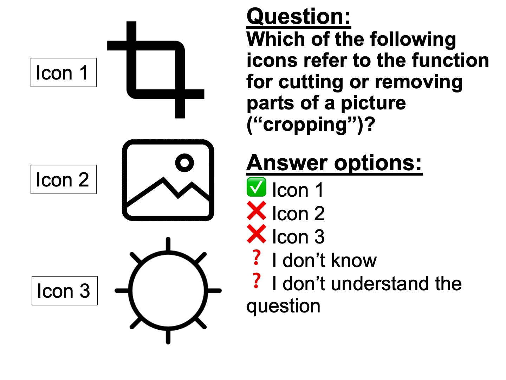

```{r, echo=FALSE, results='asis', message=FALSE, warning=FALSE}
dashboardr::.page_config(accessibility = TRUE, modals = TRUE, crosstab_prefix = "digital_content_creation")
```

```{=html}
<style>
  /* DigIQ Unified Theme & Color Palette Overrides */
  html { scroll-behavior: smooth; }
  section.level2 { scroll-margin-top: 85px; }

  /* Navbar hover readability */
  .navbar a:hover, .navbar .navbar-brand:hover, .navbar .navbar-nav .nav-link:hover {
    color: #3D7271 !important;
  }
  .navbar a:hover svg, .navbar .aa-DetachedSearchButton:hover svg, .navbar button:hover svg {
    fill: #3D7271 !important;
    stroke: #3D7271 !important;
  }

  /* Underline tabsets in DigIQ Teal & Terracotta instead of default royal blue */
  .panel-tabset .nav-item a::after {
    background-color: #E28D50 !important;
  }
  .panel-tabset .nav-tabs .nav-link.active {
    color: #0F6B5A !important;
    font-weight: 700 !important;
  }
  .panel-tabset .nav-tabs .nav-link.active::after {
    background-color: #3D7271 !important;
    height: 3px !important;
  }

  /* Question blockquotes in DigIQ Teal & Soft Mint */
  blockquote.blockquote {
    border-left: 5px solid #3D7271 !important;
    background: linear-gradient(90deg, #f2f8f6 0%, #f9fbfb 100%) !important;
    color: #243b3a !important;
    border-radius: 0 10px 10px 0 !important;
    padding: 14px 22px !important;
    box-shadow: 0 2px 6px rgba(61, 114, 113, 0.06) !important;
  }

  /* Clickable modal links inside question blockquotes */
  a.modal-link {
    display: inline-flex;
    align-items: center;
    gap: 4px;
    background-color: #e4f2ee;
    color: #0F6B5A !important;
    padding: 2px 9px;
    border-radius: 6px;
    border: 1px solid #b5ded2;
    font-weight: 600;
    text-decoration: none !important;
    transition: all 0.18s ease;
  }
  a.modal-link:hover {
    background-color: #3D7271;
    color: #ffffff !important;
    border-color: #3D7271;
    transform: translateY(-1px);
  }

  /* Wave 3 missing-data callout note on Performance sections */
  .dc-wave3-note {
    display: flex;
    align-items: flex-start;
    gap: 0.6rem;
    border-left: 4px solid #E28D50;
    background-color: #fdf6ef;
    color: #6e3b14;
    padding: 0.7rem 1.05rem;
    border-radius: 0 8px 8px 0;
    margin: 0.75rem 0 1rem 0;
    font-size: 0.93rem;
    line-height: 1.5;
  }
  .dc-wave3-note iconify-icon {
    color: #E28D50;
    font-size: 1.2rem;
    flex-shrink: 0;
    margin-top: 0.12rem;
  }

  /* Landing page hero & info banner */
  .dc-hero {
    max-width: 920px;
    margin: 0.5rem auto 1.75rem auto;
    padding: 1.5rem 2rem;
    background: linear-gradient(135deg, #f4f9f7 0%, #ebf4f1 100%);
    border: 1px solid #d5e5e1;
    border-top: 4px solid #3D7271;
    border-radius: 14px;
    text-align: center;
    color: #243b3a;
    box-shadow: 0 4px 16px rgba(31, 63, 62, 0.05);
  }
  .dc-hero p:first-child {
    font-size: 1.18rem;
    font-weight: 600;
    color: #0F6B5A;
    margin-bottom: 0.65rem;
  }
  .dc-hero p:last-child {
    font-size: 1.01rem;
    line-height: 1.65;
    color: #334e4d;
    margin-bottom: 0;
  }

  /* Landing page 11-tile grid */
  .dc-links {
    display: grid;
    grid-template-columns: repeat(auto-fit, minmax(280px, 1fr));
    gap: 1.15rem;
    margin: 1.5rem 0 2rem 0;
  }
  @media (min-width: 1100px) {
    .dc-links {
      grid-template-columns: repeat(6, minmax(0, 1fr));
    }
    .dc-links > .dc-link {
      grid-column: span 2;
    }
    /* Center the final 2 cards (10 & 11) on the bottom row */
    .dc-links > .dc-link:nth-child(10) {
      grid-column: 2 / span 2;
    }
    .dc-links > .dc-link:nth-child(11) {
      grid-column: 4 / span 2;
    }
  }
  .dc-link {
    display: flex;
    flex-direction: column;
    justify-content: space-between;
    padding: 1.25rem 1.35rem;
    border-radius: 13px;
    border: 1px solid #d5e3e0;
    border-left: 6px solid #3D7271;
    background: #ffffff;
    color: inherit !important;
    text-decoration: none !important;
    text-align: left;
    box-shadow: 0 2px 10px rgba(31, 63, 62, 0.05);
    transition: transform 0.2s ease, box-shadow 0.2s ease, border-color 0.2s ease, background-color 0.2s ease;
  }
  .dc-link:hover {
    transform: translateY(-4px);
    box-shadow: 0 12px 24px rgba(31, 63, 62, 0.12);
    border-color: #3D7271;
    border-left-color: #E28D50;
    background: #fbfdfc;
  }
  .dc-card-header {
    display: flex;
    align-items: center;
    gap: 0.75rem;
    margin-bottom: 0.6rem;
  }
  .dc-card-icon {
    width: 42px;
    height: 42px;
    border-radius: 11px;
    background: linear-gradient(135deg, #e6f4f0 0%, #c7e6d5 100%);
    color: #0F6B5A;
    display: inline-flex;
    align-items: center;
    justify-content: center;
    font-size: 1.35rem;
    flex-shrink: 0;
    transition: background 0.2s ease, color 0.2s ease, transform 0.2s ease;
  }
  .dc-link:hover .dc-card-icon {
    background: #3D7271;
    color: #ffffff;
    transform: scale(1.05);
  }
  .dc-link-title {
    font-weight: 700;
    color: #1f3f3e;
    font-size: 1.06rem;
    line-height: 1.25;
    flex-grow: 1;
    transition: color 0.2s ease;
  }
  .dc-link:hover .dc-link-title {
    color: #0F6B5A;
  }
  .dc-card-arrow {
    color: #9ab3b0;
    font-size: 1.05rem;
    transition: transform 0.2s ease, color 0.2s ease;
    flex-shrink: 0;
  }
  .dc-link:hover .dc-card-arrow {
    transform: translateX(4px);
    color: #E28D50;
  }
  .dc-link-text {
    font-size: 0.91rem;
    line-height: 1.5;
    color: #4a5b5a;
    margin-bottom: 0.9rem;
    flex-grow: 1;
  }
  .dc-card-tags {
    display: flex;
    flex-wrap: wrap;
    gap: 0.4rem;
    padding-top: 0.65rem;
    border-top: 1px solid #edf3f2;
  }
  .dc-tag {
    display: inline-flex;
    align-items: center;
    gap: 0.28rem;
    font-size: 0.74rem;
    font-weight: 600;
    padding: 0.2rem 0.55rem;
    border-radius: 999px;
    letter-spacing: 0.01em;
  }
  .dc-tag-skills {
    background-color: #e6f4f0;
    color: #0F6B5A;
    border: 1px solid #bfe3d7;
  }
  .dc-tag-knowledge {
    background-color: #fef6dc;
    color: #825600;
    border: 1px solid #f0d57d;
  }
  .dc-tag-perf {
    background-color: #fdede2;
    color: #9c4215;
    border: 1px solid #eeb998;
  }

  /* Dimension page intro card & clickable measurement jump-pills */
  .dc-dim-intro {
    background: linear-gradient(135deg, #f6faf9 0%, #ecf4f2 100%);
    border: 1px solid #d3e3e0;
    border-left: 6px solid #3D7271;
    border-radius: 13px;
    padding: 1.25rem 1.5rem;
    margin: 0.75rem 0 1.75rem 0;
    box-shadow: 0 3px 12px rgba(31, 63, 62, 0.05);
  }
  .dc-dim-intro > p {
    font-size: 1.03rem;
    line-height: 1.65;
    color: #243b3a;
    margin-bottom: 0.85rem;
  }
  .dc-jump-row {
    display: flex;
    flex-wrap: wrap;
    align-items: center;
    gap: 0.45rem;
    padding-top: 0.75rem;
    border-top: 1px solid rgba(61, 114, 113, 0.15);
    font-size: 0.96rem;
    color: #2f4b4a;
  }
  .dc-jump-label {
    font-weight: 600;
    color: #1f3f3e;
    margin-right: 0.15rem;
  }
  .dc-jump-sep {
    color: #546e6d;
    margin-right: 0.1rem;
  }
  a.dc-jump-pill {
    display: inline-flex;
    align-items: center;
    gap: 0.38rem;
    padding: 0.32rem 0.82rem;
    border-radius: 999px;
    font-size: 0.89rem;
    font-weight: 600;
    text-decoration: none !important;
    transition: transform 0.18s ease, box-shadow 0.18s ease, background-color 0.18s ease, color 0.18s ease, border-color 0.18s ease;
    box-shadow: 0 1px 4px rgba(0, 0, 0, 0.05);
  }
  a.dc-jump-pill:hover {
    transform: translateY(-2px);
    box-shadow: 0 5px 12px rgba(31, 63, 62, 0.15);
  }
  .dc-jump-arrow {
    font-size: 0.8rem;
    opacity: 0.8;
    transition: transform 0.18s ease;
  }
  a.dc-jump-pill:hover .dc-jump-arrow {
    transform: translateY(2px);
    opacity: 1;
  }
  a.dc-jump-skills {
    background-color: #e6f4f0;
    color: #0F6B5A !important;
    border: 1px solid #b3ddd0;
  }
  a.dc-jump-skills:hover {
    background-color: #3D7271;
    color: #ffffff !important;
    border-color: #3D7271;
  }
  a.dc-jump-knowledge {
    background-color: #fef6dc;
    color: #7d5200 !important;
    border: 1px solid #ebd076;
  }
  a.dc-jump-knowledge:hover {
    background-color: #c98f12;
    color: #ffffff !important;
    border-color: #c98f12;
  }
  a.dc-jump-perf {
    background-color: #fdede2;
    color: #9c4215 !important;
    border: 1px solid #ebb491;
  }
  a.dc-jump-perf:hover {
    background-color: #E28D50;
    color: #ffffff !important;
    border-color: #E28D50;
  }
</style>
```

::: {.dc-dim-intro}
**Digitale Contentcreatie competentie** omvat het vermogen om digitale content te maken en aan te passen: presentaties maken, verschillende media combineren, beelden/muziek/video bewerken, en auteursrechten begrijpen rond digitale content.

```{=html}
<div class='dc-jump-row'><span class='dc-jump-label'>Dit wordt op drie manieren gemeten:</span> <a class='dc-jump-pill dc-jump-skills' href='#inhoudscreatie-vaardigheden'><iconify-icon inline icon='ph:lightning-fill'></iconify-icon> <span>zelfingeschatte vaardigheden</span> <span class='dc-jump-arrow'>&#8595;</span></a><span class='dc-jump-sep'>,</span> <a class='dc-jump-pill dc-jump-knowledge' href='#inhoudscreatie-kennis'><iconify-icon inline icon='ph:book-open-fill'></iconify-icon> <span>items die kennis testen</span> <span class='dc-jump-arrow'>&#8595;</span></a><span class='dc-jump-sep'>, en</span> <a class='dc-jump-pill dc-jump-perf' href='#inhoudscreatie-prestatie'><iconify-icon inline icon='ph:clipboard-text'></iconify-icon> <span>prestaties/gedrag</span> <span class='dc-jump-arrow'>&#8595;</span></a><span class='dc-jump-sep'>.</span></div>
```
:::

```{r setup}
#| echo: false
#| warning: false
#| message: false
#| error: false
#| results: 'hide'

# Load dashboardr (includes dplyr, highcharter as dependencies)
library(dashboardr)

# Global chunk options
knitr::opts_chunk$set(
  echo = FALSE,
  warning = FALSE,
  message = FALSE,
  error = FALSE,
  fig.width = 12,
  fig.height = 8,
  dpi = 300
)

# Load data
data <- readRDS('dataset_large_5307obs.rds')

# Data summary
cat('Dataset loaded:', nrow(data), 'rows,', ncol(data), 'columns\n')

# Create filtered datasets
# Each filter is applied once and reused across visualizations

data_filtered_984a0efe <- dashboardr::.convert_haven(data) %>% dplyr::filter(wave == 1)
data_filtered_4af682fd <- dashboardr::.convert_haven(data) %>% dplyr::filter(wave == 2)
data_filtered_5311412c <- dashboardr::.convert_haven(data) %>% dplyr::filter(wave == 3)
data_filtered_f45d3309 <- dashboardr::.convert_haven(data) %>% dplyr::filter(wave %in% c(1, 2))

```

##  Inhoudscreatie Vaardigheden


**Vaardigheden** meet het *zelfgerapporteerde vermogen* van deelnemers om een breed scala aan digitale taken uit te voeren. Deze items leggen vast hoe zelfverzekerd mensen zich voelen bij het zoeken naar informatie.
```{r, echo=FALSE, message=FALSE, warning=FALSE}
create_blockquote("Bedenk in hoeverre elke zin klopt of waar is voor jou persoonlijk, als je de activiteit nu en in je eentje zou moeten doen. Wees vooral eerlijk, het is heel normaal dat je sommige dingen nooit doet. Dat willen we juist weten! Als je niet begrijpt wat de vraag inhoudt, kruis dan aan 'Ik begrijp de vraag niet'.", preset = "question")
```


::: {.panel-tabset}

###  Ronde 1


::: {.panel-tabset}

#####  Algemeen


```{r dccs-wave1-overall}
# Digitale Contentcreatievaardigheden
result <- viz_stackedbars(
  data = data_filtered_984a0efe,
  title = "Digitale Contentcreatievaardigheden",
  x_vars = c("SCrea2", "SCrea3", "SCrea4", "SCrea5"),
  x_var_labels = c("Ik kan op de computer een presentatie maken (bijvoorbeeld in Powerpoint)", "Ik kan iets maken dat verschillende digitale media combineert (bijvoorbeeld een filmpje met muziek eronder)", "Ik kan bestaande digitale plaatjes, muziek en video veranderen", "Ik kan een foto of video mooier maken (bijvoorbeeld met een filter of Photoshop)"),
  stacked_type = "percent",
  color_palette = c("#3D7271", "#E28D50", "#F5D76E", "#C7E6D5", "#0F6B5A", "#BABACD"),
  horizontal = TRUE,
  x_label = "",
  stack_breaks = c(0.5, 2.5, 3.5, 5.5),
  stack_bin_labels = c("Helemaal Onwaar (1-2)", "Niet onwaar en niet waar (3)", "Helemaal Waar (4-5)"),
  stack_order = c("Helemaal Waar (4-5)", "Niet onwaar en niet waar (3)", "Helemaal Onwaar (1-2)"),
  stack_label = NULL,
  weight_var = "weging_GAMO"
)

result
```


#####  Leeftijd


::: {.panel-tabset}

######  Vraag 1


```{r dccs-wave1-age-item1}
# Ik kan op de computer een presentatie maken (bijvoorbeeld in Powerpoint)
result <- viz_stackedbar(
  data = data_filtered_984a0efe,
  title = "Ik kan op de computer een presentatie maken (bijvoorbeeld in Powerpoint)",
  stacked_type = "percent",
  horizontal = TRUE,
  stack_breaks = c(0.5, 2.5, 3.5, 5.5),
  stack_bin_labels = c("Helemaal Onwaar (1-2)", "Niet onwaar en niet waar (3)", "Helemaal Waar (4-5)"),
  stack_order = c("Helemaal Waar (4-5)", "Niet onwaar en niet waar (3)", "Helemaal Onwaar (1-2)"),
  color_palette = c("#3D7271", "#E28D50", "#F5D76E", "#C7E6D5", "#0F6B5A", "#BABACD"),
  weight_var = "weging_GAMO",
  x_var = "AgeGroup",
  x_label = "Leeftijd",
  stack_var = "SCrea2"
)

result
```


######  Vraag 2


```{r dccs-wave1-age-item2}
# Ik kan iets maken dat verschillende digitale media combineert (bijvoorbeeld een filmpje met muziek eronder)
result <- viz_stackedbar(
  data = data_filtered_984a0efe,
  title = "Ik kan iets maken dat verschillende digitale media combineert (bijvoorbeeld een filmpje met muziek eronder)",
  stacked_type = "percent",
  horizontal = TRUE,
  stack_breaks = c(0.5, 2.5, 3.5, 5.5),
  stack_bin_labels = c("Helemaal Onwaar (1-2)", "Niet onwaar en niet waar (3)", "Helemaal Waar (4-5)"),
  stack_order = c("Helemaal Waar (4-5)", "Niet onwaar en niet waar (3)", "Helemaal Onwaar (1-2)"),
  color_palette = c("#3D7271", "#E28D50", "#F5D76E", "#C7E6D5", "#0F6B5A", "#BABACD"),
  weight_var = "weging_GAMO",
  x_var = "AgeGroup",
  x_label = "Leeftijd",
  stack_var = "SCrea3"
)

result
```


######  Vraag 3


```{r dccs-wave1-age-item3}
# Ik kan bestaande digitale plaatjes, muziek en video veranderen
result <- viz_stackedbar(
  data = data_filtered_984a0efe,
  title = "Ik kan bestaande digitale plaatjes, muziek en video veranderen",
  stacked_type = "percent",
  horizontal = TRUE,
  stack_breaks = c(0.5, 2.5, 3.5, 5.5),
  stack_bin_labels = c("Helemaal Onwaar (1-2)", "Niet onwaar en niet waar (3)", "Helemaal Waar (4-5)"),
  stack_order = c("Helemaal Waar (4-5)", "Niet onwaar en niet waar (3)", "Helemaal Onwaar (1-2)"),
  color_palette = c("#3D7271", "#E28D50", "#F5D76E", "#C7E6D5", "#0F6B5A", "#BABACD"),
  weight_var = "weging_GAMO",
  x_var = "AgeGroup",
  x_label = "Leeftijd",
  stack_var = "SCrea4"
)

result
```


######  Vraag 4


```{r dccs-wave1-age-item4}
# Ik kan een foto of video mooier maken (bijvoorbeeld met een filter of Photoshop)
result <- viz_stackedbar(
  data = data_filtered_984a0efe,
  title = "Ik kan een foto of video mooier maken (bijvoorbeeld met een filter of Photoshop)",
  stacked_type = "percent",
  horizontal = TRUE,
  stack_breaks = c(0.5, 2.5, 3.5, 5.5),
  stack_bin_labels = c("Helemaal Onwaar (1-2)", "Niet onwaar en niet waar (3)", "Helemaal Waar (4-5)"),
  stack_order = c("Helemaal Waar (4-5)", "Niet onwaar en niet waar (3)", "Helemaal Onwaar (1-2)"),
  color_palette = c("#3D7271", "#E28D50", "#F5D76E", "#C7E6D5", "#0F6B5A", "#BABACD"),
  weight_var = "weging_GAMO",
  x_var = "AgeGroup",
  x_label = "Leeftijd",
  stack_var = "SCrea5"
)

result
```


:::


#####  Geslacht


::: {.panel-tabset}

######  Vraag 1


```{r dccs-wave1-gender-item1}
# Ik kan op de computer een presentatie maken (bijvoorbeeld in Powerpoint)
result <- viz_stackedbar(
  data = data_filtered_984a0efe,
  title = "Ik kan op de computer een presentatie maken (bijvoorbeeld in Powerpoint)",
  stacked_type = "percent",
  horizontal = TRUE,
  stack_breaks = c(0.5, 2.5, 3.5, 5.5),
  stack_bin_labels = c("Helemaal Onwaar (1-2)", "Niet onwaar en niet waar (3)", "Helemaal Waar (4-5)"),
  stack_order = c("Helemaal Waar (4-5)", "Niet onwaar en niet waar (3)", "Helemaal Onwaar (1-2)"),
  color_palette = c("#3D7271", "#E28D50", "#F5D76E", "#C7E6D5", "#0F6B5A", "#BABACD"),
  weight_var = "weging_GAMO",
  x_var = "geslacht",
  x_label = "Geslacht",
  stack_var = "SCrea2"
)

result
```


######  Vraag 2


```{r dccs-wave1-gender-item2}
# Ik kan iets maken dat verschillende digitale media combineert (bijvoorbeeld een filmpje met muziek eronder)
result <- viz_stackedbar(
  data = data_filtered_984a0efe,
  title = "Ik kan iets maken dat verschillende digitale media combineert (bijvoorbeeld een filmpje met muziek eronder)",
  stacked_type = "percent",
  horizontal = TRUE,
  stack_breaks = c(0.5, 2.5, 3.5, 5.5),
  stack_bin_labels = c("Helemaal Onwaar (1-2)", "Niet onwaar en niet waar (3)", "Helemaal Waar (4-5)"),
  stack_order = c("Helemaal Waar (4-5)", "Niet onwaar en niet waar (3)", "Helemaal Onwaar (1-2)"),
  color_palette = c("#3D7271", "#E28D50", "#F5D76E", "#C7E6D5", "#0F6B5A", "#BABACD"),
  weight_var = "weging_GAMO",
  x_var = "geslacht",
  x_label = "Geslacht",
  stack_var = "SCrea3"
)

result
```


######  Vraag 3


```{r dccs-wave1-gender-item3}
# Ik kan bestaande digitale plaatjes, muziek en video veranderen
result <- viz_stackedbar(
  data = data_filtered_984a0efe,
  title = "Ik kan bestaande digitale plaatjes, muziek en video veranderen",
  stacked_type = "percent",
  horizontal = TRUE,
  stack_breaks = c(0.5, 2.5, 3.5, 5.5),
  stack_bin_labels = c("Helemaal Onwaar (1-2)", "Niet onwaar en niet waar (3)", "Helemaal Waar (4-5)"),
  stack_order = c("Helemaal Waar (4-5)", "Niet onwaar en niet waar (3)", "Helemaal Onwaar (1-2)"),
  color_palette = c("#3D7271", "#E28D50", "#F5D76E", "#C7E6D5", "#0F6B5A", "#BABACD"),
  weight_var = "weging_GAMO",
  x_var = "geslacht",
  x_label = "Geslacht",
  stack_var = "SCrea4"
)

result
```


######  Vraag 4


```{r dccs-wave1-gender-item4}
# Ik kan een foto of video mooier maken (bijvoorbeeld met een filter of Photoshop)
result <- viz_stackedbar(
  data = data_filtered_984a0efe,
  title = "Ik kan een foto of video mooier maken (bijvoorbeeld met een filter of Photoshop)",
  stacked_type = "percent",
  horizontal = TRUE,
  stack_breaks = c(0.5, 2.5, 3.5, 5.5),
  stack_bin_labels = c("Helemaal Onwaar (1-2)", "Niet onwaar en niet waar (3)", "Helemaal Waar (4-5)"),
  stack_order = c("Helemaal Waar (4-5)", "Niet onwaar en niet waar (3)", "Helemaal Onwaar (1-2)"),
  color_palette = c("#3D7271", "#E28D50", "#F5D76E", "#C7E6D5", "#0F6B5A", "#BABACD"),
  weight_var = "weging_GAMO",
  x_var = "geslacht",
  x_label = "Geslacht",
  stack_var = "SCrea5"
)

result
```


:::


#####  Opleidingsniveau


::: {.panel-tabset}

######  Vraag 1


```{r dccs-wave1-edu-item1}
# Ik kan op de computer een presentatie maken (bijvoorbeeld in Powerpoint)
result <- viz_stackedbar(
  data = data_filtered_984a0efe,
  title = "Ik kan op de computer een presentatie maken (bijvoorbeeld in Powerpoint)",
  stacked_type = "percent",
  horizontal = TRUE,
  stack_breaks = c(0.5, 2.5, 3.5, 5.5),
  stack_bin_labels = c("Helemaal Onwaar (1-2)", "Niet onwaar en niet waar (3)", "Helemaal Waar (4-5)"),
  stack_order = c("Helemaal Waar (4-5)", "Niet onwaar en niet waar (3)", "Helemaal Onwaar (1-2)"),
  color_palette = c("#3D7271", "#E28D50", "#F5D76E", "#C7E6D5", "#0F6B5A", "#BABACD"),
  weight_var = "weging_GAMO",
  x_var = "Education",
  x_label = "Opleidingsniveau",
  stack_var = "SCrea2"
)

result
```


######  Vraag 2


```{r dccs-wave1-edu-item2}
# Ik kan iets maken dat verschillende digitale media combineert (bijvoorbeeld een filmpje met muziek eronder)
result <- viz_stackedbar(
  data = data_filtered_984a0efe,
  title = "Ik kan iets maken dat verschillende digitale media combineert (bijvoorbeeld een filmpje met muziek eronder)",
  stacked_type = "percent",
  horizontal = TRUE,
  stack_breaks = c(0.5, 2.5, 3.5, 5.5),
  stack_bin_labels = c("Helemaal Onwaar (1-2)", "Niet onwaar en niet waar (3)", "Helemaal Waar (4-5)"),
  stack_order = c("Helemaal Waar (4-5)", "Niet onwaar en niet waar (3)", "Helemaal Onwaar (1-2)"),
  color_palette = c("#3D7271", "#E28D50", "#F5D76E", "#C7E6D5", "#0F6B5A", "#BABACD"),
  weight_var = "weging_GAMO",
  x_var = "Education",
  x_label = "Opleidingsniveau",
  stack_var = "SCrea3"
)

result
```


######  Vraag 3


```{r dccs-wave1-edu-item3}
# Ik kan bestaande digitale plaatjes, muziek en video veranderen
result <- viz_stackedbar(
  data = data_filtered_984a0efe,
  title = "Ik kan bestaande digitale plaatjes, muziek en video veranderen",
  stacked_type = "percent",
  horizontal = TRUE,
  stack_breaks = c(0.5, 2.5, 3.5, 5.5),
  stack_bin_labels = c("Helemaal Onwaar (1-2)", "Niet onwaar en niet waar (3)", "Helemaal Waar (4-5)"),
  stack_order = c("Helemaal Waar (4-5)", "Niet onwaar en niet waar (3)", "Helemaal Onwaar (1-2)"),
  color_palette = c("#3D7271", "#E28D50", "#F5D76E", "#C7E6D5", "#0F6B5A", "#BABACD"),
  weight_var = "weging_GAMO",
  x_var = "Education",
  x_label = "Opleidingsniveau",
  stack_var = "SCrea4"
)

result
```


######  Vraag 4


```{r dccs-wave1-edu-item4}
# Ik kan een foto of video mooier maken (bijvoorbeeld met een filter of Photoshop)
result <- viz_stackedbar(
  data = data_filtered_984a0efe,
  title = "Ik kan een foto of video mooier maken (bijvoorbeeld met een filter of Photoshop)",
  stacked_type = "percent",
  horizontal = TRUE,
  stack_breaks = c(0.5, 2.5, 3.5, 5.5),
  stack_bin_labels = c("Helemaal Onwaar (1-2)", "Niet onwaar en niet waar (3)", "Helemaal Waar (4-5)"),
  stack_order = c("Helemaal Waar (4-5)", "Niet onwaar en niet waar (3)", "Helemaal Onwaar (1-2)"),
  color_palette = c("#3D7271", "#E28D50", "#F5D76E", "#C7E6D5", "#0F6B5A", "#BABACD"),
  weight_var = "weging_GAMO",
  x_var = "Education",
  x_label = "Opleidingsniveau",
  stack_var = "SCrea5"
)

result
```


:::


#####  Migratieachtergrond


::: {.panel-tabset}

######  Vraag 1


```{r dccs-wave1-mig-item1}
# Ik kan op de computer een presentatie maken (bijvoorbeeld in Powerpoint)
result <- viz_stackedbar(
  data = data_filtered_984a0efe,
  title = "Ik kan op de computer een presentatie maken (bijvoorbeeld in Powerpoint)",
  stacked_type = "percent",
  horizontal = TRUE,
  stack_breaks = c(0.5, 2.5, 3.5, 5.5),
  stack_bin_labels = c("Helemaal Onwaar (1-2)", "Niet onwaar en niet waar (3)", "Helemaal Waar (4-5)"),
  stack_order = c("Helemaal Waar (4-5)", "Niet onwaar en niet waar (3)", "Helemaal Onwaar (1-2)"),
  color_palette = c("#3D7271", "#E28D50", "#F5D76E", "#C7E6D5", "#0F6B5A", "#BABACD"),
  weight_var = "weging_GAMO",
  x_var = "MigrationBackground",
  x_label = "Migratieachtergrond",
  stack_var = "SCrea2"
)

result
```


######  Vraag 2


```{r dccs-wave1-mig-item2}
# Ik kan iets maken dat verschillende digitale media combineert (bijvoorbeeld een filmpje met muziek eronder)
result <- viz_stackedbar(
  data = data_filtered_984a0efe,
  title = "Ik kan iets maken dat verschillende digitale media combineert (bijvoorbeeld een filmpje met muziek eronder)",
  stacked_type = "percent",
  horizontal = TRUE,
  stack_breaks = c(0.5, 2.5, 3.5, 5.5),
  stack_bin_labels = c("Helemaal Onwaar (1-2)", "Niet onwaar en niet waar (3)", "Helemaal Waar (4-5)"),
  stack_order = c("Helemaal Waar (4-5)", "Niet onwaar en niet waar (3)", "Helemaal Onwaar (1-2)"),
  color_palette = c("#3D7271", "#E28D50", "#F5D76E", "#C7E6D5", "#0F6B5A", "#BABACD"),
  weight_var = "weging_GAMO",
  x_var = "MigrationBackground",
  x_label = "Migratieachtergrond",
  stack_var = "SCrea3"
)

result
```


######  Vraag 3


```{r dccs-wave1-mig-item3}
# Ik kan bestaande digitale plaatjes, muziek en video veranderen
result <- viz_stackedbar(
  data = data_filtered_984a0efe,
  title = "Ik kan bestaande digitale plaatjes, muziek en video veranderen",
  stacked_type = "percent",
  horizontal = TRUE,
  stack_breaks = c(0.5, 2.5, 3.5, 5.5),
  stack_bin_labels = c("Helemaal Onwaar (1-2)", "Niet onwaar en niet waar (3)", "Helemaal Waar (4-5)"),
  stack_order = c("Helemaal Waar (4-5)", "Niet onwaar en niet waar (3)", "Helemaal Onwaar (1-2)"),
  color_palette = c("#3D7271", "#E28D50", "#F5D76E", "#C7E6D5", "#0F6B5A", "#BABACD"),
  weight_var = "weging_GAMO",
  x_var = "MigrationBackground",
  x_label = "Migratieachtergrond",
  stack_var = "SCrea4"
)

result
```


######  Vraag 4


```{r dccs-wave1-mig-item4}
# Ik kan een foto of video mooier maken (bijvoorbeeld met een filter of Photoshop)
result <- viz_stackedbar(
  data = data_filtered_984a0efe,
  title = "Ik kan een foto of video mooier maken (bijvoorbeeld met een filter of Photoshop)",
  stacked_type = "percent",
  horizontal = TRUE,
  stack_breaks = c(0.5, 2.5, 3.5, 5.5),
  stack_bin_labels = c("Helemaal Onwaar (1-2)", "Niet onwaar en niet waar (3)", "Helemaal Waar (4-5)"),
  stack_order = c("Helemaal Waar (4-5)", "Niet onwaar en niet waar (3)", "Helemaal Onwaar (1-2)"),
  color_palette = c("#3D7271", "#E28D50", "#F5D76E", "#C7E6D5", "#0F6B5A", "#BABACD"),
  weight_var = "weging_GAMO",
  x_var = "MigrationBackground",
  x_label = "Migratieachtergrond",
  stack_var = "SCrea5"
)

result
```


:::


:::


###  Ronde 2


::: {.panel-tabset}

#####  Algemeen


```{r dccs-wave2-overall}
# Digitale Contentcreatievaardigheden
result <- viz_stackedbars(
  data = data_filtered_4af682fd,
  title = "Digitale Contentcreatievaardigheden",
  x_vars = c("SCrea2", "SCrea3", "SCrea4", "SCrea5"),
  x_var_labels = c("Ik kan op de computer een presentatie maken (bijvoorbeeld in Powerpoint)", "Ik kan iets maken dat verschillende digitale media combineert (bijvoorbeeld een filmpje met muziek eronder)", "Ik kan bestaande digitale plaatjes, muziek en video veranderen", "Ik kan een foto of video mooier maken (bijvoorbeeld met een filter of Photoshop)"),
  stacked_type = "percent",
  color_palette = c("#3D7271", "#E28D50", "#F5D76E", "#C7E6D5", "#0F6B5A", "#BABACD"),
  horizontal = TRUE,
  x_label = "",
  stack_breaks = c(0.5, 2.5, 3.5, 5.5),
  stack_bin_labels = c("Helemaal Onwaar (1-2)", "Niet onwaar en niet waar (3)", "Helemaal Waar (4-5)"),
  stack_order = c("Helemaal Waar (4-5)", "Niet onwaar en niet waar (3)", "Helemaal Onwaar (1-2)"),
  stack_label = NULL,
  weight_var = "weging_GAMO"
)

result
```


#####  Leeftijd


::: {.panel-tabset}

######  Vraag 1


```{r dccs-wave2-age-item1}
# Ik kan op de computer een presentatie maken (bijvoorbeeld in Powerpoint)
result <- viz_stackedbar(
  data = data_filtered_4af682fd,
  title = "Ik kan op de computer een presentatie maken (bijvoorbeeld in Powerpoint)",
  stacked_type = "percent",
  horizontal = TRUE,
  stack_breaks = c(0.5, 2.5, 3.5, 5.5),
  stack_bin_labels = c("Helemaal Onwaar (1-2)", "Niet onwaar en niet waar (3)", "Helemaal Waar (4-5)"),
  stack_order = c("Helemaal Waar (4-5)", "Niet onwaar en niet waar (3)", "Helemaal Onwaar (1-2)"),
  color_palette = c("#3D7271", "#E28D50", "#F5D76E", "#C7E6D5", "#0F6B5A", "#BABACD"),
  weight_var = "weging_GAMO",
  x_var = "AgeGroup",
  x_label = "Leeftijd",
  stack_var = "SCrea2"
)

result
```


######  Vraag 2


```{r dccs-wave2-age-item2}
# Ik kan iets maken dat verschillende digitale media combineert (bijvoorbeeld een filmpje met muziek eronder)
result <- viz_stackedbar(
  data = data_filtered_4af682fd,
  title = "Ik kan iets maken dat verschillende digitale media combineert (bijvoorbeeld een filmpje met muziek eronder)",
  stacked_type = "percent",
  horizontal = TRUE,
  stack_breaks = c(0.5, 2.5, 3.5, 5.5),
  stack_bin_labels = c("Helemaal Onwaar (1-2)", "Niet onwaar en niet waar (3)", "Helemaal Waar (4-5)"),
  stack_order = c("Helemaal Waar (4-5)", "Niet onwaar en niet waar (3)", "Helemaal Onwaar (1-2)"),
  color_palette = c("#3D7271", "#E28D50", "#F5D76E", "#C7E6D5", "#0F6B5A", "#BABACD"),
  weight_var = "weging_GAMO",
  x_var = "AgeGroup",
  x_label = "Leeftijd",
  stack_var = "SCrea3"
)

result
```


######  Vraag 3


```{r dccs-wave2-age-item3}
# Ik kan bestaande digitale plaatjes, muziek en video veranderen
result <- viz_stackedbar(
  data = data_filtered_4af682fd,
  title = "Ik kan bestaande digitale plaatjes, muziek en video veranderen",
  stacked_type = "percent",
  horizontal = TRUE,
  stack_breaks = c(0.5, 2.5, 3.5, 5.5),
  stack_bin_labels = c("Helemaal Onwaar (1-2)", "Niet onwaar en niet waar (3)", "Helemaal Waar (4-5)"),
  stack_order = c("Helemaal Waar (4-5)", "Niet onwaar en niet waar (3)", "Helemaal Onwaar (1-2)"),
  color_palette = c("#3D7271", "#E28D50", "#F5D76E", "#C7E6D5", "#0F6B5A", "#BABACD"),
  weight_var = "weging_GAMO",
  x_var = "AgeGroup",
  x_label = "Leeftijd",
  stack_var = "SCrea4"
)

result
```


######  Vraag 4


```{r dccs-wave2-age-item4}
# Ik kan een foto of video mooier maken (bijvoorbeeld met een filter of Photoshop)
result <- viz_stackedbar(
  data = data_filtered_4af682fd,
  title = "Ik kan een foto of video mooier maken (bijvoorbeeld met een filter of Photoshop)",
  stacked_type = "percent",
  horizontal = TRUE,
  stack_breaks = c(0.5, 2.5, 3.5, 5.5),
  stack_bin_labels = c("Helemaal Onwaar (1-2)", "Niet onwaar en niet waar (3)", "Helemaal Waar (4-5)"),
  stack_order = c("Helemaal Waar (4-5)", "Niet onwaar en niet waar (3)", "Helemaal Onwaar (1-2)"),
  color_palette = c("#3D7271", "#E28D50", "#F5D76E", "#C7E6D5", "#0F6B5A", "#BABACD"),
  weight_var = "weging_GAMO",
  x_var = "AgeGroup",
  x_label = "Leeftijd",
  stack_var = "SCrea5"
)

result
```


:::


#####  Geslacht


::: {.panel-tabset}

######  Vraag 1


```{r dccs-wave2-gender-item1}
# Ik kan op de computer een presentatie maken (bijvoorbeeld in Powerpoint)
result <- viz_stackedbar(
  data = data_filtered_4af682fd,
  title = "Ik kan op de computer een presentatie maken (bijvoorbeeld in Powerpoint)",
  stacked_type = "percent",
  horizontal = TRUE,
  stack_breaks = c(0.5, 2.5, 3.5, 5.5),
  stack_bin_labels = c("Helemaal Onwaar (1-2)", "Niet onwaar en niet waar (3)", "Helemaal Waar (4-5)"),
  stack_order = c("Helemaal Waar (4-5)", "Niet onwaar en niet waar (3)", "Helemaal Onwaar (1-2)"),
  color_palette = c("#3D7271", "#E28D50", "#F5D76E", "#C7E6D5", "#0F6B5A", "#BABACD"),
  weight_var = "weging_GAMO",
  x_var = "geslacht",
  x_label = "Geslacht",
  stack_var = "SCrea2"
)

result
```


######  Vraag 2


```{r dccs-wave2-gender-item2}
# Ik kan iets maken dat verschillende digitale media combineert (bijvoorbeeld een filmpje met muziek eronder)
result <- viz_stackedbar(
  data = data_filtered_4af682fd,
  title = "Ik kan iets maken dat verschillende digitale media combineert (bijvoorbeeld een filmpje met muziek eronder)",
  stacked_type = "percent",
  horizontal = TRUE,
  stack_breaks = c(0.5, 2.5, 3.5, 5.5),
  stack_bin_labels = c("Helemaal Onwaar (1-2)", "Niet onwaar en niet waar (3)", "Helemaal Waar (4-5)"),
  stack_order = c("Helemaal Waar (4-5)", "Niet onwaar en niet waar (3)", "Helemaal Onwaar (1-2)"),
  color_palette = c("#3D7271", "#E28D50", "#F5D76E", "#C7E6D5", "#0F6B5A", "#BABACD"),
  weight_var = "weging_GAMO",
  x_var = "geslacht",
  x_label = "Geslacht",
  stack_var = "SCrea3"
)

result
```


######  Vraag 3


```{r dccs-wave2-gender-item3}
# Ik kan bestaande digitale plaatjes, muziek en video veranderen
result <- viz_stackedbar(
  data = data_filtered_4af682fd,
  title = "Ik kan bestaande digitale plaatjes, muziek en video veranderen",
  stacked_type = "percent",
  horizontal = TRUE,
  stack_breaks = c(0.5, 2.5, 3.5, 5.5),
  stack_bin_labels = c("Helemaal Onwaar (1-2)", "Niet onwaar en niet waar (3)", "Helemaal Waar (4-5)"),
  stack_order = c("Helemaal Waar (4-5)", "Niet onwaar en niet waar (3)", "Helemaal Onwaar (1-2)"),
  color_palette = c("#3D7271", "#E28D50", "#F5D76E", "#C7E6D5", "#0F6B5A", "#BABACD"),
  weight_var = "weging_GAMO",
  x_var = "geslacht",
  x_label = "Geslacht",
  stack_var = "SCrea4"
)

result
```


######  Vraag 4


```{r dccs-wave2-gender-item4}
# Ik kan een foto of video mooier maken (bijvoorbeeld met een filter of Photoshop)
result <- viz_stackedbar(
  data = data_filtered_4af682fd,
  title = "Ik kan een foto of video mooier maken (bijvoorbeeld met een filter of Photoshop)",
  stacked_type = "percent",
  horizontal = TRUE,
  stack_breaks = c(0.5, 2.5, 3.5, 5.5),
  stack_bin_labels = c("Helemaal Onwaar (1-2)", "Niet onwaar en niet waar (3)", "Helemaal Waar (4-5)"),
  stack_order = c("Helemaal Waar (4-5)", "Niet onwaar en niet waar (3)", "Helemaal Onwaar (1-2)"),
  color_palette = c("#3D7271", "#E28D50", "#F5D76E", "#C7E6D5", "#0F6B5A", "#BABACD"),
  weight_var = "weging_GAMO",
  x_var = "geslacht",
  x_label = "Geslacht",
  stack_var = "SCrea5"
)

result
```


:::


#####  Opleidingsniveau


::: {.panel-tabset}

######  Vraag 1


```{r dccs-wave2-edu-item1}
# Ik kan op de computer een presentatie maken (bijvoorbeeld in Powerpoint)
result <- viz_stackedbar(
  data = data_filtered_4af682fd,
  title = "Ik kan op de computer een presentatie maken (bijvoorbeeld in Powerpoint)",
  stacked_type = "percent",
  horizontal = TRUE,
  stack_breaks = c(0.5, 2.5, 3.5, 5.5),
  stack_bin_labels = c("Helemaal Onwaar (1-2)", "Niet onwaar en niet waar (3)", "Helemaal Waar (4-5)"),
  stack_order = c("Helemaal Waar (4-5)", "Niet onwaar en niet waar (3)", "Helemaal Onwaar (1-2)"),
  color_palette = c("#3D7271", "#E28D50", "#F5D76E", "#C7E6D5", "#0F6B5A", "#BABACD"),
  weight_var = "weging_GAMO",
  x_var = "Education",
  x_label = "Opleidingsniveau",
  stack_var = "SCrea2"
)

result
```


######  Vraag 2


```{r dccs-wave2-edu-item2}
# Ik kan iets maken dat verschillende digitale media combineert (bijvoorbeeld een filmpje met muziek eronder)
result <- viz_stackedbar(
  data = data_filtered_4af682fd,
  title = "Ik kan iets maken dat verschillende digitale media combineert (bijvoorbeeld een filmpje met muziek eronder)",
  stacked_type = "percent",
  horizontal = TRUE,
  stack_breaks = c(0.5, 2.5, 3.5, 5.5),
  stack_bin_labels = c("Helemaal Onwaar (1-2)", "Niet onwaar en niet waar (3)", "Helemaal Waar (4-5)"),
  stack_order = c("Helemaal Waar (4-5)", "Niet onwaar en niet waar (3)", "Helemaal Onwaar (1-2)"),
  color_palette = c("#3D7271", "#E28D50", "#F5D76E", "#C7E6D5", "#0F6B5A", "#BABACD"),
  weight_var = "weging_GAMO",
  x_var = "Education",
  x_label = "Opleidingsniveau",
  stack_var = "SCrea3"
)

result
```


######  Vraag 3


```{r dccs-wave2-edu-item3}
# Ik kan bestaande digitale plaatjes, muziek en video veranderen
result <- viz_stackedbar(
  data = data_filtered_4af682fd,
  title = "Ik kan bestaande digitale plaatjes, muziek en video veranderen",
  stacked_type = "percent",
  horizontal = TRUE,
  stack_breaks = c(0.5, 2.5, 3.5, 5.5),
  stack_bin_labels = c("Helemaal Onwaar (1-2)", "Niet onwaar en niet waar (3)", "Helemaal Waar (4-5)"),
  stack_order = c("Helemaal Waar (4-5)", "Niet onwaar en niet waar (3)", "Helemaal Onwaar (1-2)"),
  color_palette = c("#3D7271", "#E28D50", "#F5D76E", "#C7E6D5", "#0F6B5A", "#BABACD"),
  weight_var = "weging_GAMO",
  x_var = "Education",
  x_label = "Opleidingsniveau",
  stack_var = "SCrea4"
)

result
```


######  Vraag 4


```{r dccs-wave2-edu-item4}
# Ik kan een foto of video mooier maken (bijvoorbeeld met een filter of Photoshop)
result <- viz_stackedbar(
  data = data_filtered_4af682fd,
  title = "Ik kan een foto of video mooier maken (bijvoorbeeld met een filter of Photoshop)",
  stacked_type = "percent",
  horizontal = TRUE,
  stack_breaks = c(0.5, 2.5, 3.5, 5.5),
  stack_bin_labels = c("Helemaal Onwaar (1-2)", "Niet onwaar en niet waar (3)", "Helemaal Waar (4-5)"),
  stack_order = c("Helemaal Waar (4-5)", "Niet onwaar en niet waar (3)", "Helemaal Onwaar (1-2)"),
  color_palette = c("#3D7271", "#E28D50", "#F5D76E", "#C7E6D5", "#0F6B5A", "#BABACD"),
  weight_var = "weging_GAMO",
  x_var = "Education",
  x_label = "Opleidingsniveau",
  stack_var = "SCrea5"
)

result
```


:::


#####  Migratieachtergrond


::: {.panel-tabset}

######  Vraag 1


```{r dccs-wave2-mig-item1}
# Ik kan op de computer een presentatie maken (bijvoorbeeld in Powerpoint)
result <- viz_stackedbar(
  data = data_filtered_4af682fd,
  title = "Ik kan op de computer een presentatie maken (bijvoorbeeld in Powerpoint)",
  stacked_type = "percent",
  horizontal = TRUE,
  stack_breaks = c(0.5, 2.5, 3.5, 5.5),
  stack_bin_labels = c("Helemaal Onwaar (1-2)", "Niet onwaar en niet waar (3)", "Helemaal Waar (4-5)"),
  stack_order = c("Helemaal Waar (4-5)", "Niet onwaar en niet waar (3)", "Helemaal Onwaar (1-2)"),
  color_palette = c("#3D7271", "#E28D50", "#F5D76E", "#C7E6D5", "#0F6B5A", "#BABACD"),
  weight_var = "weging_GAMO",
  x_var = "MigrationBackground",
  x_label = "Migratieachtergrond",
  stack_var = "SCrea2"
)

result
```


######  Vraag 2


```{r dccs-wave2-mig-item2}
# Ik kan iets maken dat verschillende digitale media combineert (bijvoorbeeld een filmpje met muziek eronder)
result <- viz_stackedbar(
  data = data_filtered_4af682fd,
  title = "Ik kan iets maken dat verschillende digitale media combineert (bijvoorbeeld een filmpje met muziek eronder)",
  stacked_type = "percent",
  horizontal = TRUE,
  stack_breaks = c(0.5, 2.5, 3.5, 5.5),
  stack_bin_labels = c("Helemaal Onwaar (1-2)", "Niet onwaar en niet waar (3)", "Helemaal Waar (4-5)"),
  stack_order = c("Helemaal Waar (4-5)", "Niet onwaar en niet waar (3)", "Helemaal Onwaar (1-2)"),
  color_palette = c("#3D7271", "#E28D50", "#F5D76E", "#C7E6D5", "#0F6B5A", "#BABACD"),
  weight_var = "weging_GAMO",
  x_var = "MigrationBackground",
  x_label = "Migratieachtergrond",
  stack_var = "SCrea3"
)

result
```


######  Vraag 3


```{r dccs-wave2-mig-item3}
# Ik kan bestaande digitale plaatjes, muziek en video veranderen
result <- viz_stackedbar(
  data = data_filtered_4af682fd,
  title = "Ik kan bestaande digitale plaatjes, muziek en video veranderen",
  stacked_type = "percent",
  horizontal = TRUE,
  stack_breaks = c(0.5, 2.5, 3.5, 5.5),
  stack_bin_labels = c("Helemaal Onwaar (1-2)", "Niet onwaar en niet waar (3)", "Helemaal Waar (4-5)"),
  stack_order = c("Helemaal Waar (4-5)", "Niet onwaar en niet waar (3)", "Helemaal Onwaar (1-2)"),
  color_palette = c("#3D7271", "#E28D50", "#F5D76E", "#C7E6D5", "#0F6B5A", "#BABACD"),
  weight_var = "weging_GAMO",
  x_var = "MigrationBackground",
  x_label = "Migratieachtergrond",
  stack_var = "SCrea4"
)

result
```


######  Vraag 4


```{r dccs-wave2-mig-item4}
# Ik kan een foto of video mooier maken (bijvoorbeeld met een filter of Photoshop)
result <- viz_stackedbar(
  data = data_filtered_4af682fd,
  title = "Ik kan een foto of video mooier maken (bijvoorbeeld met een filter of Photoshop)",
  stacked_type = "percent",
  horizontal = TRUE,
  stack_breaks = c(0.5, 2.5, 3.5, 5.5),
  stack_bin_labels = c("Helemaal Onwaar (1-2)", "Niet onwaar en niet waar (3)", "Helemaal Waar (4-5)"),
  stack_order = c("Helemaal Waar (4-5)", "Niet onwaar en niet waar (3)", "Helemaal Onwaar (1-2)"),
  color_palette = c("#3D7271", "#E28D50", "#F5D76E", "#C7E6D5", "#0F6B5A", "#BABACD"),
  weight_var = "weging_GAMO",
  x_var = "MigrationBackground",
  x_label = "Migratieachtergrond",
  stack_var = "SCrea5"
)

result
```


:::


:::


###  Ronde 3


::: {.panel-tabset}

#####  Algemeen


```{r dccs-wave3-overall}
# Digitale Contentcreatievaardigheden
result <- viz_stackedbars(
  data = data_filtered_5311412c,
  title = "Digitale Contentcreatievaardigheden",
  x_vars = c("SCrea2", "SCrea3", "SCrea4", "SCrea5"),
  x_var_labels = c("Ik kan op de computer een presentatie maken (bijvoorbeeld in Powerpoint)", "Ik kan iets maken dat verschillende digitale media combineert (bijvoorbeeld een filmpje met muziek eronder)", "Ik kan bestaande digitale plaatjes, muziek en video veranderen", "Ik kan een foto of video mooier maken (bijvoorbeeld met een filter of Photoshop)"),
  stacked_type = "percent",
  color_palette = c("#3D7271", "#E28D50", "#F5D76E", "#C7E6D5", "#0F6B5A", "#BABACD"),
  horizontal = TRUE,
  x_label = "",
  stack_breaks = c(0.5, 2.5, 3.5, 5.5),
  stack_bin_labels = c("Helemaal Onwaar (1-2)", "Niet onwaar en niet waar (3)", "Helemaal Waar (4-5)"),
  stack_order = c("Helemaal Waar (4-5)", "Niet onwaar en niet waar (3)", "Helemaal Onwaar (1-2)"),
  stack_label = NULL,
  weight_var = "weging_GAMO"
)

result
```


#####  Leeftijd


::: {.panel-tabset}

######  Vraag 1


```{r dccs-wave3-age-item1}
# Ik kan op de computer een presentatie maken (bijvoorbeeld in Powerpoint)
result <- viz_stackedbar(
  data = data_filtered_5311412c,
  title = "Ik kan op de computer een presentatie maken (bijvoorbeeld in Powerpoint)",
  stacked_type = "percent",
  horizontal = TRUE,
  stack_breaks = c(0.5, 2.5, 3.5, 5.5),
  stack_bin_labels = c("Helemaal Onwaar (1-2)", "Niet onwaar en niet waar (3)", "Helemaal Waar (4-5)"),
  stack_order = c("Helemaal Waar (4-5)", "Niet onwaar en niet waar (3)", "Helemaal Onwaar (1-2)"),
  color_palette = c("#3D7271", "#E28D50", "#F5D76E", "#C7E6D5", "#0F6B5A", "#BABACD"),
  weight_var = "weging_GAMO",
  x_var = "AgeGroup",
  x_label = "Leeftijd",
  stack_var = "SCrea2"
)

result
```


######  Vraag 2


```{r dccs-wave3-age-item2}
# Ik kan iets maken dat verschillende digitale media combineert (bijvoorbeeld een filmpje met muziek eronder)
result <- viz_stackedbar(
  data = data_filtered_5311412c,
  title = "Ik kan iets maken dat verschillende digitale media combineert (bijvoorbeeld een filmpje met muziek eronder)",
  stacked_type = "percent",
  horizontal = TRUE,
  stack_breaks = c(0.5, 2.5, 3.5, 5.5),
  stack_bin_labels = c("Helemaal Onwaar (1-2)", "Niet onwaar en niet waar (3)", "Helemaal Waar (4-5)"),
  stack_order = c("Helemaal Waar (4-5)", "Niet onwaar en niet waar (3)", "Helemaal Onwaar (1-2)"),
  color_palette = c("#3D7271", "#E28D50", "#F5D76E", "#C7E6D5", "#0F6B5A", "#BABACD"),
  weight_var = "weging_GAMO",
  x_var = "AgeGroup",
  x_label = "Leeftijd",
  stack_var = "SCrea3"
)

result
```


######  Vraag 3


```{r dccs-wave3-age-item3}
# Ik kan bestaande digitale plaatjes, muziek en video veranderen
result <- viz_stackedbar(
  data = data_filtered_5311412c,
  title = "Ik kan bestaande digitale plaatjes, muziek en video veranderen",
  stacked_type = "percent",
  horizontal = TRUE,
  stack_breaks = c(0.5, 2.5, 3.5, 5.5),
  stack_bin_labels = c("Helemaal Onwaar (1-2)", "Niet onwaar en niet waar (3)", "Helemaal Waar (4-5)"),
  stack_order = c("Helemaal Waar (4-5)", "Niet onwaar en niet waar (3)", "Helemaal Onwaar (1-2)"),
  color_palette = c("#3D7271", "#E28D50", "#F5D76E", "#C7E6D5", "#0F6B5A", "#BABACD"),
  weight_var = "weging_GAMO",
  x_var = "AgeGroup",
  x_label = "Leeftijd",
  stack_var = "SCrea4"
)

result
```


######  Vraag 4


```{r dccs-wave3-age-item4}
# Ik kan een foto of video mooier maken (bijvoorbeeld met een filter of Photoshop)
result <- viz_stackedbar(
  data = data_filtered_5311412c,
  title = "Ik kan een foto of video mooier maken (bijvoorbeeld met een filter of Photoshop)",
  stacked_type = "percent",
  horizontal = TRUE,
  stack_breaks = c(0.5, 2.5, 3.5, 5.5),
  stack_bin_labels = c("Helemaal Onwaar (1-2)", "Niet onwaar en niet waar (3)", "Helemaal Waar (4-5)"),
  stack_order = c("Helemaal Waar (4-5)", "Niet onwaar en niet waar (3)", "Helemaal Onwaar (1-2)"),
  color_palette = c("#3D7271", "#E28D50", "#F5D76E", "#C7E6D5", "#0F6B5A", "#BABACD"),
  weight_var = "weging_GAMO",
  x_var = "AgeGroup",
  x_label = "Leeftijd",
  stack_var = "SCrea5"
)

result
```


:::


#####  Geslacht


::: {.panel-tabset}

######  Vraag 1


```{r dccs-wave3-gender-item1}
# Ik kan op de computer een presentatie maken (bijvoorbeeld in Powerpoint)
result <- viz_stackedbar(
  data = data_filtered_5311412c,
  title = "Ik kan op de computer een presentatie maken (bijvoorbeeld in Powerpoint)",
  stacked_type = "percent",
  horizontal = TRUE,
  stack_breaks = c(0.5, 2.5, 3.5, 5.5),
  stack_bin_labels = c("Helemaal Onwaar (1-2)", "Niet onwaar en niet waar (3)", "Helemaal Waar (4-5)"),
  stack_order = c("Helemaal Waar (4-5)", "Niet onwaar en niet waar (3)", "Helemaal Onwaar (1-2)"),
  color_palette = c("#3D7271", "#E28D50", "#F5D76E", "#C7E6D5", "#0F6B5A", "#BABACD"),
  weight_var = "weging_GAMO",
  x_var = "geslacht",
  x_label = "Geslacht",
  stack_var = "SCrea2"
)

result
```


######  Vraag 2


```{r dccs-wave3-gender-item2}
# Ik kan iets maken dat verschillende digitale media combineert (bijvoorbeeld een filmpje met muziek eronder)
result <- viz_stackedbar(
  data = data_filtered_5311412c,
  title = "Ik kan iets maken dat verschillende digitale media combineert (bijvoorbeeld een filmpje met muziek eronder)",
  stacked_type = "percent",
  horizontal = TRUE,
  stack_breaks = c(0.5, 2.5, 3.5, 5.5),
  stack_bin_labels = c("Helemaal Onwaar (1-2)", "Niet onwaar en niet waar (3)", "Helemaal Waar (4-5)"),
  stack_order = c("Helemaal Waar (4-5)", "Niet onwaar en niet waar (3)", "Helemaal Onwaar (1-2)"),
  color_palette = c("#3D7271", "#E28D50", "#F5D76E", "#C7E6D5", "#0F6B5A", "#BABACD"),
  weight_var = "weging_GAMO",
  x_var = "geslacht",
  x_label = "Geslacht",
  stack_var = "SCrea3"
)

result
```


######  Vraag 3


```{r dccs-wave3-gender-item3}
# Ik kan bestaande digitale plaatjes, muziek en video veranderen
result <- viz_stackedbar(
  data = data_filtered_5311412c,
  title = "Ik kan bestaande digitale plaatjes, muziek en video veranderen",
  stacked_type = "percent",
  horizontal = TRUE,
  stack_breaks = c(0.5, 2.5, 3.5, 5.5),
  stack_bin_labels = c("Helemaal Onwaar (1-2)", "Niet onwaar en niet waar (3)", "Helemaal Waar (4-5)"),
  stack_order = c("Helemaal Waar (4-5)", "Niet onwaar en niet waar (3)", "Helemaal Onwaar (1-2)"),
  color_palette = c("#3D7271", "#E28D50", "#F5D76E", "#C7E6D5", "#0F6B5A", "#BABACD"),
  weight_var = "weging_GAMO",
  x_var = "geslacht",
  x_label = "Geslacht",
  stack_var = "SCrea4"
)

result
```


######  Vraag 4


```{r dccs-wave3-gender-item4}
# Ik kan een foto of video mooier maken (bijvoorbeeld met een filter of Photoshop)
result <- viz_stackedbar(
  data = data_filtered_5311412c,
  title = "Ik kan een foto of video mooier maken (bijvoorbeeld met een filter of Photoshop)",
  stacked_type = "percent",
  horizontal = TRUE,
  stack_breaks = c(0.5, 2.5, 3.5, 5.5),
  stack_bin_labels = c("Helemaal Onwaar (1-2)", "Niet onwaar en niet waar (3)", "Helemaal Waar (4-5)"),
  stack_order = c("Helemaal Waar (4-5)", "Niet onwaar en niet waar (3)", "Helemaal Onwaar (1-2)"),
  color_palette = c("#3D7271", "#E28D50", "#F5D76E", "#C7E6D5", "#0F6B5A", "#BABACD"),
  weight_var = "weging_GAMO",
  x_var = "geslacht",
  x_label = "Geslacht",
  stack_var = "SCrea5"
)

result
```


:::


#####  Opleidingsniveau


::: {.panel-tabset}

######  Vraag 1


```{r dccs-wave3-edu-item1}
# Ik kan op de computer een presentatie maken (bijvoorbeeld in Powerpoint)
result <- viz_stackedbar(
  data = data_filtered_5311412c,
  title = "Ik kan op de computer een presentatie maken (bijvoorbeeld in Powerpoint)",
  stacked_type = "percent",
  horizontal = TRUE,
  stack_breaks = c(0.5, 2.5, 3.5, 5.5),
  stack_bin_labels = c("Helemaal Onwaar (1-2)", "Niet onwaar en niet waar (3)", "Helemaal Waar (4-5)"),
  stack_order = c("Helemaal Waar (4-5)", "Niet onwaar en niet waar (3)", "Helemaal Onwaar (1-2)"),
  color_palette = c("#3D7271", "#E28D50", "#F5D76E", "#C7E6D5", "#0F6B5A", "#BABACD"),
  weight_var = "weging_GAMO",
  x_var = "Education",
  x_label = "Opleidingsniveau",
  stack_var = "SCrea2"
)

result
```


######  Vraag 2


```{r dccs-wave3-edu-item2}
# Ik kan iets maken dat verschillende digitale media combineert (bijvoorbeeld een filmpje met muziek eronder)
result <- viz_stackedbar(
  data = data_filtered_5311412c,
  title = "Ik kan iets maken dat verschillende digitale media combineert (bijvoorbeeld een filmpje met muziek eronder)",
  stacked_type = "percent",
  horizontal = TRUE,
  stack_breaks = c(0.5, 2.5, 3.5, 5.5),
  stack_bin_labels = c("Helemaal Onwaar (1-2)", "Niet onwaar en niet waar (3)", "Helemaal Waar (4-5)"),
  stack_order = c("Helemaal Waar (4-5)", "Niet onwaar en niet waar (3)", "Helemaal Onwaar (1-2)"),
  color_palette = c("#3D7271", "#E28D50", "#F5D76E", "#C7E6D5", "#0F6B5A", "#BABACD"),
  weight_var = "weging_GAMO",
  x_var = "Education",
  x_label = "Opleidingsniveau",
  stack_var = "SCrea3"
)

result
```


######  Vraag 3


```{r dccs-wave3-edu-item3}
# Ik kan bestaande digitale plaatjes, muziek en video veranderen
result <- viz_stackedbar(
  data = data_filtered_5311412c,
  title = "Ik kan bestaande digitale plaatjes, muziek en video veranderen",
  stacked_type = "percent",
  horizontal = TRUE,
  stack_breaks = c(0.5, 2.5, 3.5, 5.5),
  stack_bin_labels = c("Helemaal Onwaar (1-2)", "Niet onwaar en niet waar (3)", "Helemaal Waar (4-5)"),
  stack_order = c("Helemaal Waar (4-5)", "Niet onwaar en niet waar (3)", "Helemaal Onwaar (1-2)"),
  color_palette = c("#3D7271", "#E28D50", "#F5D76E", "#C7E6D5", "#0F6B5A", "#BABACD"),
  weight_var = "weging_GAMO",
  x_var = "Education",
  x_label = "Opleidingsniveau",
  stack_var = "SCrea4"
)

result
```


######  Vraag 4


```{r dccs-wave3-edu-item4}
# Ik kan een foto of video mooier maken (bijvoorbeeld met een filter of Photoshop)
result <- viz_stackedbar(
  data = data_filtered_5311412c,
  title = "Ik kan een foto of video mooier maken (bijvoorbeeld met een filter of Photoshop)",
  stacked_type = "percent",
  horizontal = TRUE,
  stack_breaks = c(0.5, 2.5, 3.5, 5.5),
  stack_bin_labels = c("Helemaal Onwaar (1-2)", "Niet onwaar en niet waar (3)", "Helemaal Waar (4-5)"),
  stack_order = c("Helemaal Waar (4-5)", "Niet onwaar en niet waar (3)", "Helemaal Onwaar (1-2)"),
  color_palette = c("#3D7271", "#E28D50", "#F5D76E", "#C7E6D5", "#0F6B5A", "#BABACD"),
  weight_var = "weging_GAMO",
  x_var = "Education",
  x_label = "Opleidingsniveau",
  stack_var = "SCrea5"
)

result
```


:::


#####  Migratieachtergrond


::: {.panel-tabset}

######  Vraag 1


```{r dccs-wave3-mig-item1}
# Ik kan op de computer een presentatie maken (bijvoorbeeld in Powerpoint)
result <- viz_stackedbar(
  data = data_filtered_5311412c,
  title = "Ik kan op de computer een presentatie maken (bijvoorbeeld in Powerpoint)",
  stacked_type = "percent",
  horizontal = TRUE,
  stack_breaks = c(0.5, 2.5, 3.5, 5.5),
  stack_bin_labels = c("Helemaal Onwaar (1-2)", "Niet onwaar en niet waar (3)", "Helemaal Waar (4-5)"),
  stack_order = c("Helemaal Waar (4-5)", "Niet onwaar en niet waar (3)", "Helemaal Onwaar (1-2)"),
  color_palette = c("#3D7271", "#E28D50", "#F5D76E", "#C7E6D5", "#0F6B5A", "#BABACD"),
  weight_var = "weging_GAMO",
  x_var = "MigrationBackground",
  x_label = "Migratieachtergrond",
  stack_var = "SCrea2"
)

result
```


######  Vraag 2


```{r dccs-wave3-mig-item2}
# Ik kan iets maken dat verschillende digitale media combineert (bijvoorbeeld een filmpje met muziek eronder)
result <- viz_stackedbar(
  data = data_filtered_5311412c,
  title = "Ik kan iets maken dat verschillende digitale media combineert (bijvoorbeeld een filmpje met muziek eronder)",
  stacked_type = "percent",
  horizontal = TRUE,
  stack_breaks = c(0.5, 2.5, 3.5, 5.5),
  stack_bin_labels = c("Helemaal Onwaar (1-2)", "Niet onwaar en niet waar (3)", "Helemaal Waar (4-5)"),
  stack_order = c("Helemaal Waar (4-5)", "Niet onwaar en niet waar (3)", "Helemaal Onwaar (1-2)"),
  color_palette = c("#3D7271", "#E28D50", "#F5D76E", "#C7E6D5", "#0F6B5A", "#BABACD"),
  weight_var = "weging_GAMO",
  x_var = "MigrationBackground",
  x_label = "Migratieachtergrond",
  stack_var = "SCrea3"
)

result
```


######  Vraag 3


```{r dccs-wave3-mig-item3}
# Ik kan bestaande digitale plaatjes, muziek en video veranderen
result <- viz_stackedbar(
  data = data_filtered_5311412c,
  title = "Ik kan bestaande digitale plaatjes, muziek en video veranderen",
  stacked_type = "percent",
  horizontal = TRUE,
  stack_breaks = c(0.5, 2.5, 3.5, 5.5),
  stack_bin_labels = c("Helemaal Onwaar (1-2)", "Niet onwaar en niet waar (3)", "Helemaal Waar (4-5)"),
  stack_order = c("Helemaal Waar (4-5)", "Niet onwaar en niet waar (3)", "Helemaal Onwaar (1-2)"),
  color_palette = c("#3D7271", "#E28D50", "#F5D76E", "#C7E6D5", "#0F6B5A", "#BABACD"),
  weight_var = "weging_GAMO",
  x_var = "MigrationBackground",
  x_label = "Migratieachtergrond",
  stack_var = "SCrea4"
)

result
```


######  Vraag 4


```{r dccs-wave3-mig-item4}
# Ik kan een foto of video mooier maken (bijvoorbeeld met een filter of Photoshop)
result <- viz_stackedbar(
  data = data_filtered_5311412c,
  title = "Ik kan een foto of video mooier maken (bijvoorbeeld met een filter of Photoshop)",
  stacked_type = "percent",
  horizontal = TRUE,
  stack_breaks = c(0.5, 2.5, 3.5, 5.5),
  stack_bin_labels = c("Helemaal Onwaar (1-2)", "Niet onwaar en niet waar (3)", "Helemaal Waar (4-5)"),
  stack_order = c("Helemaal Waar (4-5)", "Niet onwaar en niet waar (3)", "Helemaal Onwaar (1-2)"),
  color_palette = c("#3D7271", "#E28D50", "#F5D76E", "#C7E6D5", "#0F6B5A", "#BABACD"),
  weight_var = "weging_GAMO",
  x_var = "MigrationBackground",
  x_label = "Migratieachtergrond",
  stack_var = "SCrea5"
)

result
```


:::


:::


###  Verloop over tijd


::: {.panel-tabset}

#####  Algemeen


::: {.panel-tabset}

######  Vraag 1


```{r dccs-overtime-overall-item1}
# Ik kan op de computer een presentatie maken (bijvoorbeeld in Powerpoint)
result <- viz_timeline(
  data = data,
  title = "Ik kan op de computer een presentatie maken (bijvoorbeeld in Powerpoint)",
  time_var = "wave_time_label",
  chart_type = "line",
  y_filter = c(4, 5),
  y_filter_label = "Percentage of Respondents",
  y_filter_combine = TRUE,
  x_label = "",
  y_label = "Percentage of Respondents",
  color_palette = c("#3D7271", "#E28D50", "#F5D76E", "#C7E6D5", "#0F6B5A", "#BABACD"),
  y_min = 0,
  y_max = 100,
  weight_var = "weging_GAMO",
  y_var = "SCrea2"
)

result
```


######  Vraag 2


```{r dccs-overtime-overall-item2}
# Ik kan iets maken dat verschillende digitale media combineert (bijvoorbeeld een filmpje met muziek eronder)
result <- viz_timeline(
  data = data,
  title = "Ik kan iets maken dat verschillende digitale media combineert (bijvoorbeeld een filmpje met muziek eronder)",
  time_var = "wave_time_label",
  chart_type = "line",
  y_filter = c(4, 5),
  y_filter_label = "Percentage of Respondents",
  y_filter_combine = TRUE,
  x_label = "",
  y_label = "Percentage of Respondents",
  color_palette = c("#3D7271", "#E28D50", "#F5D76E", "#C7E6D5", "#0F6B5A", "#BABACD"),
  y_min = 0,
  y_max = 100,
  weight_var = "weging_GAMO",
  y_var = "SCrea3"
)

result
```


######  Vraag 3


```{r dccs-overtime-overall-item3}
# Ik kan bestaande digitale plaatjes, muziek en video veranderen
result <- viz_timeline(
  data = data,
  title = "Ik kan bestaande digitale plaatjes, muziek en video veranderen",
  time_var = "wave_time_label",
  chart_type = "line",
  y_filter = c(4, 5),
  y_filter_label = "Percentage of Respondents",
  y_filter_combine = TRUE,
  x_label = "",
  y_label = "Percentage of Respondents",
  color_palette = c("#3D7271", "#E28D50", "#F5D76E", "#C7E6D5", "#0F6B5A", "#BABACD"),
  y_min = 0,
  y_max = 100,
  weight_var = "weging_GAMO",
  y_var = "SCrea4"
)

result
```


######  Vraag 4


```{r dccs-overtime-overall-item4}
# Ik kan een foto of video mooier maken (bijvoorbeeld met een filter of Photoshop)
result <- viz_timeline(
  data = data,
  title = "Ik kan een foto of video mooier maken (bijvoorbeeld met een filter of Photoshop)",
  time_var = "wave_time_label",
  chart_type = "line",
  y_filter = c(4, 5),
  y_filter_label = "Percentage of Respondents",
  y_filter_combine = TRUE,
  x_label = "",
  y_label = "Percentage of Respondents",
  color_palette = c("#3D7271", "#E28D50", "#F5D76E", "#C7E6D5", "#0F6B5A", "#BABACD"),
  y_min = 0,
  y_max = 100,
  weight_var = "weging_GAMO",
  y_var = "SCrea5"
)

result
```


:::


#####  Leeftijd


::: {.panel-tabset}

######  Vraag 1


```{r dccs-overtime-age-item1}
# Ik kan op de computer een presentatie maken (bijvoorbeeld in Powerpoint)
result <- viz_timeline(
  data = data,
  title = "Ik kan op de computer een presentatie maken (bijvoorbeeld in Powerpoint)",
  time_var = "wave_time_label",
  chart_type = "line",
  y_filter = c(4, 5),
  x_label = "",
  y_label = "Percentage of Respondents",
  color_palette = c("#3D7271", "#E28D50", "#F5D76E", "#C7E6D5", "#0F6B5A", "#BABACD"),
  y_min = 0,
  y_max = 100,
  weight_var = "weging_GAMO",
  y_var = "SCrea2",
  group_var = "AgeGroup"
)

result
```


######  Vraag 2


```{r dccs-overtime-age-item2}
# Ik kan iets maken dat verschillende digitale media combineert (bijvoorbeeld een filmpje met muziek eronder)
result <- viz_timeline(
  data = data,
  title = "Ik kan iets maken dat verschillende digitale media combineert (bijvoorbeeld een filmpje met muziek eronder)",
  time_var = "wave_time_label",
  chart_type = "line",
  y_filter = c(4, 5),
  x_label = "",
  y_label = "Percentage of Respondents",
  color_palette = c("#3D7271", "#E28D50", "#F5D76E", "#C7E6D5", "#0F6B5A", "#BABACD"),
  y_min = 0,
  y_max = 100,
  weight_var = "weging_GAMO",
  y_var = "SCrea3",
  group_var = "AgeGroup"
)

result
```


######  Vraag 3


```{r dccs-overtime-age-item3}
# Ik kan bestaande digitale plaatjes, muziek en video veranderen
result <- viz_timeline(
  data = data,
  title = "Ik kan bestaande digitale plaatjes, muziek en video veranderen",
  time_var = "wave_time_label",
  chart_type = "line",
  y_filter = c(4, 5),
  x_label = "",
  y_label = "Percentage of Respondents",
  color_palette = c("#3D7271", "#E28D50", "#F5D76E", "#C7E6D5", "#0F6B5A", "#BABACD"),
  y_min = 0,
  y_max = 100,
  weight_var = "weging_GAMO",
  y_var = "SCrea4",
  group_var = "AgeGroup"
)

result
```


######  Vraag 4


```{r dccs-overtime-age-item4}
# Ik kan een foto of video mooier maken (bijvoorbeeld met een filter of Photoshop)
result <- viz_timeline(
  data = data,
  title = "Ik kan een foto of video mooier maken (bijvoorbeeld met een filter of Photoshop)",
  time_var = "wave_time_label",
  chart_type = "line",
  y_filter = c(4, 5),
  x_label = "",
  y_label = "Percentage of Respondents",
  color_palette = c("#3D7271", "#E28D50", "#F5D76E", "#C7E6D5", "#0F6B5A", "#BABACD"),
  y_min = 0,
  y_max = 100,
  weight_var = "weging_GAMO",
  y_var = "SCrea5",
  group_var = "AgeGroup"
)

result
```


:::


#####  Geslacht


::: {.panel-tabset}

######  Vraag 1


```{r dccs-overtime-gender-item1}
# Ik kan op de computer een presentatie maken (bijvoorbeeld in Powerpoint)
result <- viz_timeline(
  data = data,
  title = "Ik kan op de computer een presentatie maken (bijvoorbeeld in Powerpoint)",
  time_var = "wave_time_label",
  chart_type = "line",
  y_filter = c(4, 5),
  x_label = "",
  y_label = "Percentage of Respondents",
  color_palette = c("#3D7271", "#E28D50", "#F5D76E", "#C7E6D5", "#0F6B5A", "#BABACD"),
  y_min = 0,
  y_max = 100,
  weight_var = "weging_GAMO",
  y_var = "SCrea2",
  group_var = "geslacht"
)

result
```


######  Vraag 2


```{r dccs-overtime-gender-item2}
# Ik kan iets maken dat verschillende digitale media combineert (bijvoorbeeld een filmpje met muziek eronder)
result <- viz_timeline(
  data = data,
  title = "Ik kan iets maken dat verschillende digitale media combineert (bijvoorbeeld een filmpje met muziek eronder)",
  time_var = "wave_time_label",
  chart_type = "line",
  y_filter = c(4, 5),
  x_label = "",
  y_label = "Percentage of Respondents",
  color_palette = c("#3D7271", "#E28D50", "#F5D76E", "#C7E6D5", "#0F6B5A", "#BABACD"),
  y_min = 0,
  y_max = 100,
  weight_var = "weging_GAMO",
  y_var = "SCrea3",
  group_var = "geslacht"
)

result
```


######  Vraag 3


```{r dccs-overtime-gender-item3}
# Ik kan bestaande digitale plaatjes, muziek en video veranderen
result <- viz_timeline(
  data = data,
  title = "Ik kan bestaande digitale plaatjes, muziek en video veranderen",
  time_var = "wave_time_label",
  chart_type = "line",
  y_filter = c(4, 5),
  x_label = "",
  y_label = "Percentage of Respondents",
  color_palette = c("#3D7271", "#E28D50", "#F5D76E", "#C7E6D5", "#0F6B5A", "#BABACD"),
  y_min = 0,
  y_max = 100,
  weight_var = "weging_GAMO",
  y_var = "SCrea4",
  group_var = "geslacht"
)

result
```


######  Vraag 4


```{r dccs-overtime-gender-item4}
# Ik kan een foto of video mooier maken (bijvoorbeeld met een filter of Photoshop)
result <- viz_timeline(
  data = data,
  title = "Ik kan een foto of video mooier maken (bijvoorbeeld met een filter of Photoshop)",
  time_var = "wave_time_label",
  chart_type = "line",
  y_filter = c(4, 5),
  x_label = "",
  y_label = "Percentage of Respondents",
  color_palette = c("#3D7271", "#E28D50", "#F5D76E", "#C7E6D5", "#0F6B5A", "#BABACD"),
  y_min = 0,
  y_max = 100,
  weight_var = "weging_GAMO",
  y_var = "SCrea5",
  group_var = "geslacht"
)

result
```


:::


#####  Opleidingsniveau


::: {.panel-tabset}

######  Vraag 1


```{r dccs-overtime-edu-item1}
# Ik kan op de computer een presentatie maken (bijvoorbeeld in Powerpoint)
result <- viz_timeline(
  data = data,
  title = "Ik kan op de computer een presentatie maken (bijvoorbeeld in Powerpoint)",
  time_var = "wave_time_label",
  chart_type = "line",
  y_filter = c(4, 5),
  x_label = "",
  y_label = "Percentage of Respondents",
  color_palette = c("#3D7271", "#E28D50", "#F5D76E", "#C7E6D5", "#0F6B5A", "#BABACD"),
  y_min = 0,
  y_max = 100,
  weight_var = "weging_GAMO",
  y_var = "SCrea2",
  group_var = "Education"
)

result
```


######  Vraag 2


```{r dccs-overtime-edu-item2}
# Ik kan iets maken dat verschillende digitale media combineert (bijvoorbeeld een filmpje met muziek eronder)
result <- viz_timeline(
  data = data,
  title = "Ik kan iets maken dat verschillende digitale media combineert (bijvoorbeeld een filmpje met muziek eronder)",
  time_var = "wave_time_label",
  chart_type = "line",
  y_filter = c(4, 5),
  x_label = "",
  y_label = "Percentage of Respondents",
  color_palette = c("#3D7271", "#E28D50", "#F5D76E", "#C7E6D5", "#0F6B5A", "#BABACD"),
  y_min = 0,
  y_max = 100,
  weight_var = "weging_GAMO",
  y_var = "SCrea3",
  group_var = "Education"
)

result
```


######  Vraag 3


```{r dccs-overtime-edu-item3}
# Ik kan bestaande digitale plaatjes, muziek en video veranderen
result <- viz_timeline(
  data = data,
  title = "Ik kan bestaande digitale plaatjes, muziek en video veranderen",
  time_var = "wave_time_label",
  chart_type = "line",
  y_filter = c(4, 5),
  x_label = "",
  y_label = "Percentage of Respondents",
  color_palette = c("#3D7271", "#E28D50", "#F5D76E", "#C7E6D5", "#0F6B5A", "#BABACD"),
  y_min = 0,
  y_max = 100,
  weight_var = "weging_GAMO",
  y_var = "SCrea4",
  group_var = "Education"
)

result
```


######  Vraag 4


```{r dccs-overtime-edu-item4}
# Ik kan een foto of video mooier maken (bijvoorbeeld met een filter of Photoshop)
result <- viz_timeline(
  data = data,
  title = "Ik kan een foto of video mooier maken (bijvoorbeeld met een filter of Photoshop)",
  time_var = "wave_time_label",
  chart_type = "line",
  y_filter = c(4, 5),
  x_label = "",
  y_label = "Percentage of Respondents",
  color_palette = c("#3D7271", "#E28D50", "#F5D76E", "#C7E6D5", "#0F6B5A", "#BABACD"),
  y_min = 0,
  y_max = 100,
  weight_var = "weging_GAMO",
  y_var = "SCrea5",
  group_var = "Education"
)

result
```


:::


#####  Migratieachtergrond


::: {.panel-tabset}

######  Vraag 1


```{r dccs-overtime-mig-item1}
# Ik kan op de computer een presentatie maken (bijvoorbeeld in Powerpoint)
result <- viz_timeline(
  data = data,
  title = "Ik kan op de computer een presentatie maken (bijvoorbeeld in Powerpoint)",
  time_var = "wave_time_label",
  chart_type = "line",
  y_filter = c(4, 5),
  x_label = "",
  y_label = "Percentage of Respondents",
  color_palette = c("#3D7271", "#E28D50", "#F5D76E", "#C7E6D5", "#0F6B5A", "#BABACD"),
  y_min = 0,
  y_max = 100,
  weight_var = "weging_GAMO",
  y_var = "SCrea2",
  group_var = "MigrationBackground"
)

result
```


######  Vraag 2


```{r dccs-overtime-mig-item2}
# Ik kan iets maken dat verschillende digitale media combineert (bijvoorbeeld een filmpje met muziek eronder)
result <- viz_timeline(
  data = data,
  title = "Ik kan iets maken dat verschillende digitale media combineert (bijvoorbeeld een filmpje met muziek eronder)",
  time_var = "wave_time_label",
  chart_type = "line",
  y_filter = c(4, 5),
  x_label = "",
  y_label = "Percentage of Respondents",
  color_palette = c("#3D7271", "#E28D50", "#F5D76E", "#C7E6D5", "#0F6B5A", "#BABACD"),
  y_min = 0,
  y_max = 100,
  weight_var = "weging_GAMO",
  y_var = "SCrea3",
  group_var = "MigrationBackground"
)

result
```


######  Vraag 3


```{r dccs-overtime-mig-item3}
# Ik kan bestaande digitale plaatjes, muziek en video veranderen
result <- viz_timeline(
  data = data,
  title = "Ik kan bestaande digitale plaatjes, muziek en video veranderen",
  time_var = "wave_time_label",
  chart_type = "line",
  y_filter = c(4, 5),
  x_label = "",
  y_label = "Percentage of Respondents",
  color_palette = c("#3D7271", "#E28D50", "#F5D76E", "#C7E6D5", "#0F6B5A", "#BABACD"),
  y_min = 0,
  y_max = 100,
  weight_var = "weging_GAMO",
  y_var = "SCrea4",
  group_var = "MigrationBackground"
)

result
```


######  Vraag 4


```{r dccs-overtime-mig-item4}
# Ik kan een foto of video mooier maken (bijvoorbeeld met een filter of Photoshop)
result <- viz_timeline(
  data = data,
  title = "Ik kan een foto of video mooier maken (bijvoorbeeld met een filter of Photoshop)",
  time_var = "wave_time_label",
  chart_type = "line",
  y_filter = c(4, 5),
  x_label = "",
  y_label = "Percentage of Respondents",
  color_palette = c("#3D7271", "#E28D50", "#F5D76E", "#C7E6D5", "#0F6B5A", "#BABACD"),
  y_min = 0,
  y_max = 100,
  weight_var = "weging_GAMO",
  y_var = "SCrea5",
  group_var = "MigrationBackground"
)

result
```


:::


:::


:::

##  Inhoudscreatie Kennis


**Kennis** meet wat deelnemers *weten* over de digitale wereld. Deze items testen het feitelijke begrip door respondenten te laten aangeven of beweringen waar of onwaar zijn.
```{r, echo=FALSE, message=FALSE, warning=FALSE}
create_blockquote("Nu volgen een aantal uitspraken die gaan over het online media en digitale technologie. Geef aan of de zin volgens jou feitelijk wel waar of juist niet waar is (dus in het algemeen, niet voor jou persoonlijk). Als je het niet weet, kruis dan aan 'ik weet het niet'. Je hoeft dus niet te gokken.", preset = "question")
```


::: {.panel-tabset}

###  Ronde 1


::: {.panel-tabset}

#####  Algemeen


```{r kcrea-wave1-overall}
# 
result <- viz_stackedbars(
  data = data_filtered_984a0efe,
  title = "",
  x_vars = c("KCrea2RC", "KCrea3RC"),
  x_var_labels = c("Sommige mensen worden betaald om producten te gebruiken in de video's die ze maken", "Je mag bestaande video's en muziek aanpassen en delen, zolang je er geen geld mee verdient"),
  stacked_type = "percent",
  color_palette = c("#3D7271", "#E28D50", "#F5D76E", "#C7E6D5", "#0F6B5A", "#BABACD"),
  horizontal = TRUE,
  x_label = "",
  stack_breaks = c(0, 10, 20, 30),
  stack_bin_labels = c("Correct beantwoord", "Incorrect beantwoord", "Weet/begrijp niet"),
  stack_map_values = list("1" = "Correct beantwoord", "0" = "Incorrect beantwoord"),
  stack_order = c("Correct beantwoord", "Incorrect beantwoord", "Weet/begrijp niet"),
  stack_label = NULL,
  weight_var = "weging_GAMO"
)

result
```


#####  Leeftijd


::: {.panel-tabset}

######  Vraag 1


```{r kcrea-wave1-age-item1}
# Sommige mensen worden betaald om producten te gebruiken in de video's die ze maken
result <- viz_stackedbar(
  data = data_filtered_984a0efe,
  title = "Sommige mensen worden betaald om producten te gebruiken in de video's die ze maken",
  stacked_type = "percent",
  horizontal = TRUE,
  stack_breaks = c(0, 10, 20, 30),
  stack_bin_labels = c("Correct beantwoord", "Incorrect beantwoord", "Weet/begrijp niet"),
  stack_map_values = list("1" = "Correct beantwoord", "0" = "Incorrect beantwoord"),
  stack_order = c("Correct beantwoord", "Incorrect beantwoord", "Weet/begrijp niet"),
  color_palette = c("#3D7271", "#E28D50", "#F5D76E", "#C7E6D5", "#0F6B5A", "#BABACD"),
  weight_var = "weging_GAMO",
  x_var = "AgeGroup",
  x_label = "Leeftijd",
  stack_var = "KCrea2RC"
)

result
```


######  Vraag 2


```{r kcrea-wave1-age-item2}
# Je mag bestaande video's en muziek aanpassen en delen, zolang je er geen geld mee verdient
result <- viz_stackedbar(
  data = data_filtered_984a0efe,
  title = "Je mag bestaande video's en muziek aanpassen en delen, zolang je er geen geld mee verdient",
  stacked_type = "percent",
  horizontal = TRUE,
  stack_breaks = c(0, 10, 20, 30),
  stack_bin_labels = c("Correct beantwoord", "Incorrect beantwoord", "Weet/begrijp niet"),
  stack_map_values = list("1" = "Correct beantwoord", "0" = "Incorrect beantwoord"),
  stack_order = c("Correct beantwoord", "Incorrect beantwoord", "Weet/begrijp niet"),
  color_palette = c("#3D7271", "#E28D50", "#F5D76E", "#C7E6D5", "#0F6B5A", "#BABACD"),
  weight_var = "weging_GAMO",
  x_var = "AgeGroup",
  x_label = "Leeftijd",
  stack_var = "KCrea3RC"
)

result
```


:::


#####  Geslacht


::: {.panel-tabset}

######  Vraag 1


```{r kcrea-wave1-gender-item1}
# Sommige mensen worden betaald om producten te gebruiken in de video's die ze maken
result <- viz_stackedbar(
  data = data_filtered_984a0efe,
  title = "Sommige mensen worden betaald om producten te gebruiken in de video's die ze maken",
  stacked_type = "percent",
  horizontal = TRUE,
  stack_breaks = c(0, 10, 20, 30),
  stack_bin_labels = c("Correct beantwoord", "Incorrect beantwoord", "Weet/begrijp niet"),
  stack_map_values = list("1" = "Correct beantwoord", "0" = "Incorrect beantwoord"),
  stack_order = c("Correct beantwoord", "Incorrect beantwoord", "Weet/begrijp niet"),
  color_palette = c("#3D7271", "#E28D50", "#F5D76E", "#C7E6D5", "#0F6B5A", "#BABACD"),
  weight_var = "weging_GAMO",
  x_var = "geslacht",
  x_label = "Geslacht",
  stack_var = "KCrea2RC"
)

result
```


######  Vraag 2


```{r kcrea-wave1-gender-item2}
# Je mag bestaande video's en muziek aanpassen en delen, zolang je er geen geld mee verdient
result <- viz_stackedbar(
  data = data_filtered_984a0efe,
  title = "Je mag bestaande video's en muziek aanpassen en delen, zolang je er geen geld mee verdient",
  stacked_type = "percent",
  horizontal = TRUE,
  stack_breaks = c(0, 10, 20, 30),
  stack_bin_labels = c("Correct beantwoord", "Incorrect beantwoord", "Weet/begrijp niet"),
  stack_map_values = list("1" = "Correct beantwoord", "0" = "Incorrect beantwoord"),
  stack_order = c("Correct beantwoord", "Incorrect beantwoord", "Weet/begrijp niet"),
  color_palette = c("#3D7271", "#E28D50", "#F5D76E", "#C7E6D5", "#0F6B5A", "#BABACD"),
  weight_var = "weging_GAMO",
  x_var = "geslacht",
  x_label = "Geslacht",
  stack_var = "KCrea3RC"
)

result
```


:::


#####  Opleidingsniveau


::: {.panel-tabset}

######  Vraag 1


```{r kcrea-wave1-edu-item1}
# Sommige mensen worden betaald om producten te gebruiken in de video's die ze maken
result <- viz_stackedbar(
  data = data_filtered_984a0efe,
  title = "Sommige mensen worden betaald om producten te gebruiken in de video's die ze maken",
  stacked_type = "percent",
  horizontal = TRUE,
  stack_breaks = c(0, 10, 20, 30),
  stack_bin_labels = c("Correct beantwoord", "Incorrect beantwoord", "Weet/begrijp niet"),
  stack_map_values = list("1" = "Correct beantwoord", "0" = "Incorrect beantwoord"),
  stack_order = c("Correct beantwoord", "Incorrect beantwoord", "Weet/begrijp niet"),
  color_palette = c("#3D7271", "#E28D50", "#F5D76E", "#C7E6D5", "#0F6B5A", "#BABACD"),
  weight_var = "weging_GAMO",
  x_var = "Education",
  x_label = "Opleidingsniveau",
  stack_var = "KCrea2RC"
)

result
```


######  Vraag 2


```{r kcrea-wave1-edu-item2}
# Je mag bestaande video's en muziek aanpassen en delen, zolang je er geen geld mee verdient
result <- viz_stackedbar(
  data = data_filtered_984a0efe,
  title = "Je mag bestaande video's en muziek aanpassen en delen, zolang je er geen geld mee verdient",
  stacked_type = "percent",
  horizontal = TRUE,
  stack_breaks = c(0, 10, 20, 30),
  stack_bin_labels = c("Correct beantwoord", "Incorrect beantwoord", "Weet/begrijp niet"),
  stack_map_values = list("1" = "Correct beantwoord", "0" = "Incorrect beantwoord"),
  stack_order = c("Correct beantwoord", "Incorrect beantwoord", "Weet/begrijp niet"),
  color_palette = c("#3D7271", "#E28D50", "#F5D76E", "#C7E6D5", "#0F6B5A", "#BABACD"),
  weight_var = "weging_GAMO",
  x_var = "Education",
  x_label = "Opleidingsniveau",
  stack_var = "KCrea3RC"
)

result
```


:::


#####  Migratieachtergrond


::: {.panel-tabset}

######  Vraag 1


```{r kcrea-wave1-mig-item1}
# Sommige mensen worden betaald om producten te gebruiken in de video's die ze maken
result <- viz_stackedbar(
  data = data_filtered_984a0efe,
  title = "Sommige mensen worden betaald om producten te gebruiken in de video's die ze maken",
  stacked_type = "percent",
  horizontal = TRUE,
  stack_breaks = c(0, 10, 20, 30),
  stack_bin_labels = c("Correct beantwoord", "Incorrect beantwoord", "Weet/begrijp niet"),
  stack_map_values = list("1" = "Correct beantwoord", "0" = "Incorrect beantwoord"),
  stack_order = c("Correct beantwoord", "Incorrect beantwoord", "Weet/begrijp niet"),
  color_palette = c("#3D7271", "#E28D50", "#F5D76E", "#C7E6D5", "#0F6B5A", "#BABACD"),
  weight_var = "weging_GAMO",
  x_var = "MigrationBackground",
  x_label = "Migratieachtergrond",
  stack_var = "KCrea2RC"
)

result
```


######  Vraag 2


```{r kcrea-wave1-mig-item2}
# Je mag bestaande video's en muziek aanpassen en delen, zolang je er geen geld mee verdient
result <- viz_stackedbar(
  data = data_filtered_984a0efe,
  title = "Je mag bestaande video's en muziek aanpassen en delen, zolang je er geen geld mee verdient",
  stacked_type = "percent",
  horizontal = TRUE,
  stack_breaks = c(0, 10, 20, 30),
  stack_bin_labels = c("Correct beantwoord", "Incorrect beantwoord", "Weet/begrijp niet"),
  stack_map_values = list("1" = "Correct beantwoord", "0" = "Incorrect beantwoord"),
  stack_order = c("Correct beantwoord", "Incorrect beantwoord", "Weet/begrijp niet"),
  color_palette = c("#3D7271", "#E28D50", "#F5D76E", "#C7E6D5", "#0F6B5A", "#BABACD"),
  weight_var = "weging_GAMO",
  x_var = "MigrationBackground",
  x_label = "Migratieachtergrond",
  stack_var = "KCrea3RC"
)

result
```


:::


:::


###  Ronde 2


::: {.panel-tabset}

#####  Algemeen


```{r kcrea-wave2-overall}
# 
result <- viz_stackedbars(
  data = data_filtered_4af682fd,
  title = "",
  x_vars = c("KCrea2RC", "KCrea3RC"),
  x_var_labels = c("Sommige mensen worden betaald om producten te gebruiken in de video's die ze maken", "Je mag bestaande video's en muziek aanpassen en delen, zolang je er geen geld mee verdient"),
  stacked_type = "percent",
  color_palette = c("#3D7271", "#E28D50", "#F5D76E", "#C7E6D5", "#0F6B5A", "#BABACD"),
  horizontal = TRUE,
  x_label = "",
  stack_breaks = c(0, 10, 20, 30),
  stack_bin_labels = c("Correct beantwoord", "Incorrect beantwoord", "Weet/begrijp niet"),
  stack_map_values = list("1" = "Correct beantwoord", "0" = "Incorrect beantwoord"),
  stack_order = c("Correct beantwoord", "Incorrect beantwoord", "Weet/begrijp niet"),
  stack_label = NULL,
  weight_var = "weging_GAMO"
)

result
```


#####  Leeftijd


::: {.panel-tabset}

######  Vraag 1


```{r kcrea-wave2-age-item1}
# Sommige mensen worden betaald om producten te gebruiken in de video's die ze maken
result <- viz_stackedbar(
  data = data_filtered_4af682fd,
  title = "Sommige mensen worden betaald om producten te gebruiken in de video's die ze maken",
  stacked_type = "percent",
  horizontal = TRUE,
  stack_breaks = c(0, 10, 20, 30),
  stack_bin_labels = c("Correct beantwoord", "Incorrect beantwoord", "Weet/begrijp niet"),
  stack_map_values = list("1" = "Correct beantwoord", "0" = "Incorrect beantwoord"),
  stack_order = c("Correct beantwoord", "Incorrect beantwoord", "Weet/begrijp niet"),
  color_palette = c("#3D7271", "#E28D50", "#F5D76E", "#C7E6D5", "#0F6B5A", "#BABACD"),
  weight_var = "weging_GAMO",
  x_var = "AgeGroup",
  x_label = "Leeftijd",
  stack_var = "KCrea2RC"
)

result
```


######  Vraag 2


```{r kcrea-wave2-age-item2}
# Je mag bestaande video's en muziek aanpassen en delen, zolang je er geen geld mee verdient
result <- viz_stackedbar(
  data = data_filtered_4af682fd,
  title = "Je mag bestaande video's en muziek aanpassen en delen, zolang je er geen geld mee verdient",
  stacked_type = "percent",
  horizontal = TRUE,
  stack_breaks = c(0, 10, 20, 30),
  stack_bin_labels = c("Correct beantwoord", "Incorrect beantwoord", "Weet/begrijp niet"),
  stack_map_values = list("1" = "Correct beantwoord", "0" = "Incorrect beantwoord"),
  stack_order = c("Correct beantwoord", "Incorrect beantwoord", "Weet/begrijp niet"),
  color_palette = c("#3D7271", "#E28D50", "#F5D76E", "#C7E6D5", "#0F6B5A", "#BABACD"),
  weight_var = "weging_GAMO",
  x_var = "AgeGroup",
  x_label = "Leeftijd",
  stack_var = "KCrea3RC"
)

result
```


:::


#####  Geslacht


::: {.panel-tabset}

######  Vraag 1


```{r kcrea-wave2-gender-item1}
# Sommige mensen worden betaald om producten te gebruiken in de video's die ze maken
result <- viz_stackedbar(
  data = data_filtered_4af682fd,
  title = "Sommige mensen worden betaald om producten te gebruiken in de video's die ze maken",
  stacked_type = "percent",
  horizontal = TRUE,
  stack_breaks = c(0, 10, 20, 30),
  stack_bin_labels = c("Correct beantwoord", "Incorrect beantwoord", "Weet/begrijp niet"),
  stack_map_values = list("1" = "Correct beantwoord", "0" = "Incorrect beantwoord"),
  stack_order = c("Correct beantwoord", "Incorrect beantwoord", "Weet/begrijp niet"),
  color_palette = c("#3D7271", "#E28D50", "#F5D76E", "#C7E6D5", "#0F6B5A", "#BABACD"),
  weight_var = "weging_GAMO",
  x_var = "geslacht",
  x_label = "Geslacht",
  stack_var = "KCrea2RC"
)

result
```


######  Vraag 2


```{r kcrea-wave2-gender-item2}
# Je mag bestaande video's en muziek aanpassen en delen, zolang je er geen geld mee verdient
result <- viz_stackedbar(
  data = data_filtered_4af682fd,
  title = "Je mag bestaande video's en muziek aanpassen en delen, zolang je er geen geld mee verdient",
  stacked_type = "percent",
  horizontal = TRUE,
  stack_breaks = c(0, 10, 20, 30),
  stack_bin_labels = c("Correct beantwoord", "Incorrect beantwoord", "Weet/begrijp niet"),
  stack_map_values = list("1" = "Correct beantwoord", "0" = "Incorrect beantwoord"),
  stack_order = c("Correct beantwoord", "Incorrect beantwoord", "Weet/begrijp niet"),
  color_palette = c("#3D7271", "#E28D50", "#F5D76E", "#C7E6D5", "#0F6B5A", "#BABACD"),
  weight_var = "weging_GAMO",
  x_var = "geslacht",
  x_label = "Geslacht",
  stack_var = "KCrea3RC"
)

result
```


:::


#####  Opleidingsniveau


::: {.panel-tabset}

######  Vraag 1


```{r kcrea-wave2-edu-item1}
# Sommige mensen worden betaald om producten te gebruiken in de video's die ze maken
result <- viz_stackedbar(
  data = data_filtered_4af682fd,
  title = "Sommige mensen worden betaald om producten te gebruiken in de video's die ze maken",
  stacked_type = "percent",
  horizontal = TRUE,
  stack_breaks = c(0, 10, 20, 30),
  stack_bin_labels = c("Correct beantwoord", "Incorrect beantwoord", "Weet/begrijp niet"),
  stack_map_values = list("1" = "Correct beantwoord", "0" = "Incorrect beantwoord"),
  stack_order = c("Correct beantwoord", "Incorrect beantwoord", "Weet/begrijp niet"),
  color_palette = c("#3D7271", "#E28D50", "#F5D76E", "#C7E6D5", "#0F6B5A", "#BABACD"),
  weight_var = "weging_GAMO",
  x_var = "Education",
  x_label = "Opleidingsniveau",
  stack_var = "KCrea2RC"
)

result
```


######  Vraag 2


```{r kcrea-wave2-edu-item2}
# Je mag bestaande video's en muziek aanpassen en delen, zolang je er geen geld mee verdient
result <- viz_stackedbar(
  data = data_filtered_4af682fd,
  title = "Je mag bestaande video's en muziek aanpassen en delen, zolang je er geen geld mee verdient",
  stacked_type = "percent",
  horizontal = TRUE,
  stack_breaks = c(0, 10, 20, 30),
  stack_bin_labels = c("Correct beantwoord", "Incorrect beantwoord", "Weet/begrijp niet"),
  stack_map_values = list("1" = "Correct beantwoord", "0" = "Incorrect beantwoord"),
  stack_order = c("Correct beantwoord", "Incorrect beantwoord", "Weet/begrijp niet"),
  color_palette = c("#3D7271", "#E28D50", "#F5D76E", "#C7E6D5", "#0F6B5A", "#BABACD"),
  weight_var = "weging_GAMO",
  x_var = "Education",
  x_label = "Opleidingsniveau",
  stack_var = "KCrea3RC"
)

result
```


:::


#####  Migratieachtergrond


::: {.panel-tabset}

######  Vraag 1


```{r kcrea-wave2-mig-item1}
# Sommige mensen worden betaald om producten te gebruiken in de video's die ze maken
result <- viz_stackedbar(
  data = data_filtered_4af682fd,
  title = "Sommige mensen worden betaald om producten te gebruiken in de video's die ze maken",
  stacked_type = "percent",
  horizontal = TRUE,
  stack_breaks = c(0, 10, 20, 30),
  stack_bin_labels = c("Correct beantwoord", "Incorrect beantwoord", "Weet/begrijp niet"),
  stack_map_values = list("1" = "Correct beantwoord", "0" = "Incorrect beantwoord"),
  stack_order = c("Correct beantwoord", "Incorrect beantwoord", "Weet/begrijp niet"),
  color_palette = c("#3D7271", "#E28D50", "#F5D76E", "#C7E6D5", "#0F6B5A", "#BABACD"),
  weight_var = "weging_GAMO",
  x_var = "MigrationBackground",
  x_label = "Migratieachtergrond",
  stack_var = "KCrea2RC"
)

result
```


######  Vraag 2


```{r kcrea-wave2-mig-item2}
# Je mag bestaande video's en muziek aanpassen en delen, zolang je er geen geld mee verdient
result <- viz_stackedbar(
  data = data_filtered_4af682fd,
  title = "Je mag bestaande video's en muziek aanpassen en delen, zolang je er geen geld mee verdient",
  stacked_type = "percent",
  horizontal = TRUE,
  stack_breaks = c(0, 10, 20, 30),
  stack_bin_labels = c("Correct beantwoord", "Incorrect beantwoord", "Weet/begrijp niet"),
  stack_map_values = list("1" = "Correct beantwoord", "0" = "Incorrect beantwoord"),
  stack_order = c("Correct beantwoord", "Incorrect beantwoord", "Weet/begrijp niet"),
  color_palette = c("#3D7271", "#E28D50", "#F5D76E", "#C7E6D5", "#0F6B5A", "#BABACD"),
  weight_var = "weging_GAMO",
  x_var = "MigrationBackground",
  x_label = "Migratieachtergrond",
  stack_var = "KCrea3RC"
)

result
```


:::


:::


###  Ronde 3


::: {.panel-tabset}

#####  Algemeen


```{r kcrea-wave3-overall}
# 
result <- viz_stackedbars(
  data = data_filtered_5311412c,
  title = "",
  x_vars = c("KCrea2RC", "KCrea3RC"),
  x_var_labels = c("Sommige mensen worden betaald om producten te gebruiken in de video's die ze maken", "Je mag bestaande video's en muziek aanpassen en delen, zolang je er geen geld mee verdient"),
  stacked_type = "percent",
  color_palette = c("#3D7271", "#E28D50", "#F5D76E", "#C7E6D5", "#0F6B5A", "#BABACD"),
  horizontal = TRUE,
  x_label = "",
  stack_breaks = c(0, 10, 20, 30),
  stack_bin_labels = c("Correct beantwoord", "Incorrect beantwoord", "Weet/begrijp niet"),
  stack_map_values = list("1" = "Correct beantwoord", "0" = "Incorrect beantwoord"),
  stack_order = c("Correct beantwoord", "Incorrect beantwoord", "Weet/begrijp niet"),
  stack_label = NULL,
  weight_var = "weging_GAMO"
)

result
```


#####  Leeftijd


::: {.panel-tabset}

######  Vraag 1


```{r kcrea-wave3-age-item1}
# Sommige mensen worden betaald om producten te gebruiken in de video's die ze maken
result <- viz_stackedbar(
  data = data_filtered_5311412c,
  title = "Sommige mensen worden betaald om producten te gebruiken in de video's die ze maken",
  stacked_type = "percent",
  horizontal = TRUE,
  stack_breaks = c(0, 10, 20, 30),
  stack_bin_labels = c("Correct beantwoord", "Incorrect beantwoord", "Weet/begrijp niet"),
  stack_map_values = list("1" = "Correct beantwoord", "0" = "Incorrect beantwoord"),
  stack_order = c("Correct beantwoord", "Incorrect beantwoord", "Weet/begrijp niet"),
  color_palette = c("#3D7271", "#E28D50", "#F5D76E", "#C7E6D5", "#0F6B5A", "#BABACD"),
  weight_var = "weging_GAMO",
  x_var = "AgeGroup",
  x_label = "Leeftijd",
  stack_var = "KCrea2RC"
)

result
```


######  Vraag 2


```{r kcrea-wave3-age-item2}
# Je mag bestaande video's en muziek aanpassen en delen, zolang je er geen geld mee verdient
result <- viz_stackedbar(
  data = data_filtered_5311412c,
  title = "Je mag bestaande video's en muziek aanpassen en delen, zolang je er geen geld mee verdient",
  stacked_type = "percent",
  horizontal = TRUE,
  stack_breaks = c(0, 10, 20, 30),
  stack_bin_labels = c("Correct beantwoord", "Incorrect beantwoord", "Weet/begrijp niet"),
  stack_map_values = list("1" = "Correct beantwoord", "0" = "Incorrect beantwoord"),
  stack_order = c("Correct beantwoord", "Incorrect beantwoord", "Weet/begrijp niet"),
  color_palette = c("#3D7271", "#E28D50", "#F5D76E", "#C7E6D5", "#0F6B5A", "#BABACD"),
  weight_var = "weging_GAMO",
  x_var = "AgeGroup",
  x_label = "Leeftijd",
  stack_var = "KCrea3RC"
)

result
```


:::


#####  Geslacht


::: {.panel-tabset}

######  Vraag 1


```{r kcrea-wave3-gender-item1}
# Sommige mensen worden betaald om producten te gebruiken in de video's die ze maken
result <- viz_stackedbar(
  data = data_filtered_5311412c,
  title = "Sommige mensen worden betaald om producten te gebruiken in de video's die ze maken",
  stacked_type = "percent",
  horizontal = TRUE,
  stack_breaks = c(0, 10, 20, 30),
  stack_bin_labels = c("Correct beantwoord", "Incorrect beantwoord", "Weet/begrijp niet"),
  stack_map_values = list("1" = "Correct beantwoord", "0" = "Incorrect beantwoord"),
  stack_order = c("Correct beantwoord", "Incorrect beantwoord", "Weet/begrijp niet"),
  color_palette = c("#3D7271", "#E28D50", "#F5D76E", "#C7E6D5", "#0F6B5A", "#BABACD"),
  weight_var = "weging_GAMO",
  x_var = "geslacht",
  x_label = "Geslacht",
  stack_var = "KCrea2RC"
)

result
```


######  Vraag 2


```{r kcrea-wave3-gender-item2}
# Je mag bestaande video's en muziek aanpassen en delen, zolang je er geen geld mee verdient
result <- viz_stackedbar(
  data = data_filtered_5311412c,
  title = "Je mag bestaande video's en muziek aanpassen en delen, zolang je er geen geld mee verdient",
  stacked_type = "percent",
  horizontal = TRUE,
  stack_breaks = c(0, 10, 20, 30),
  stack_bin_labels = c("Correct beantwoord", "Incorrect beantwoord", "Weet/begrijp niet"),
  stack_map_values = list("1" = "Correct beantwoord", "0" = "Incorrect beantwoord"),
  stack_order = c("Correct beantwoord", "Incorrect beantwoord", "Weet/begrijp niet"),
  color_palette = c("#3D7271", "#E28D50", "#F5D76E", "#C7E6D5", "#0F6B5A", "#BABACD"),
  weight_var = "weging_GAMO",
  x_var = "geslacht",
  x_label = "Geslacht",
  stack_var = "KCrea3RC"
)

result
```


:::


#####  Opleidingsniveau


::: {.panel-tabset}

######  Vraag 1


```{r kcrea-wave3-edu-item1}
# Sommige mensen worden betaald om producten te gebruiken in de video's die ze maken
result <- viz_stackedbar(
  data = data_filtered_5311412c,
  title = "Sommige mensen worden betaald om producten te gebruiken in de video's die ze maken",
  stacked_type = "percent",
  horizontal = TRUE,
  stack_breaks = c(0, 10, 20, 30),
  stack_bin_labels = c("Correct beantwoord", "Incorrect beantwoord", "Weet/begrijp niet"),
  stack_map_values = list("1" = "Correct beantwoord", "0" = "Incorrect beantwoord"),
  stack_order = c("Correct beantwoord", "Incorrect beantwoord", "Weet/begrijp niet"),
  color_palette = c("#3D7271", "#E28D50", "#F5D76E", "#C7E6D5", "#0F6B5A", "#BABACD"),
  weight_var = "weging_GAMO",
  x_var = "Education",
  x_label = "Opleidingsniveau",
  stack_var = "KCrea2RC"
)

result
```


######  Vraag 2


```{r kcrea-wave3-edu-item2}
# Je mag bestaande video's en muziek aanpassen en delen, zolang je er geen geld mee verdient
result <- viz_stackedbar(
  data = data_filtered_5311412c,
  title = "Je mag bestaande video's en muziek aanpassen en delen, zolang je er geen geld mee verdient",
  stacked_type = "percent",
  horizontal = TRUE,
  stack_breaks = c(0, 10, 20, 30),
  stack_bin_labels = c("Correct beantwoord", "Incorrect beantwoord", "Weet/begrijp niet"),
  stack_map_values = list("1" = "Correct beantwoord", "0" = "Incorrect beantwoord"),
  stack_order = c("Correct beantwoord", "Incorrect beantwoord", "Weet/begrijp niet"),
  color_palette = c("#3D7271", "#E28D50", "#F5D76E", "#C7E6D5", "#0F6B5A", "#BABACD"),
  weight_var = "weging_GAMO",
  x_var = "Education",
  x_label = "Opleidingsniveau",
  stack_var = "KCrea3RC"
)

result
```


:::


#####  Migratieachtergrond


::: {.panel-tabset}

######  Vraag 1


```{r kcrea-wave3-mig-item1}
# Sommige mensen worden betaald om producten te gebruiken in de video's die ze maken
result <- viz_stackedbar(
  data = data_filtered_5311412c,
  title = "Sommige mensen worden betaald om producten te gebruiken in de video's die ze maken",
  stacked_type = "percent",
  horizontal = TRUE,
  stack_breaks = c(0, 10, 20, 30),
  stack_bin_labels = c("Correct beantwoord", "Incorrect beantwoord", "Weet/begrijp niet"),
  stack_map_values = list("1" = "Correct beantwoord", "0" = "Incorrect beantwoord"),
  stack_order = c("Correct beantwoord", "Incorrect beantwoord", "Weet/begrijp niet"),
  color_palette = c("#3D7271", "#E28D50", "#F5D76E", "#C7E6D5", "#0F6B5A", "#BABACD"),
  weight_var = "weging_GAMO",
  x_var = "MigrationBackground",
  x_label = "Migratieachtergrond",
  stack_var = "KCrea2RC"
)

result
```


######  Vraag 2


```{r kcrea-wave3-mig-item2}
# Je mag bestaande video's en muziek aanpassen en delen, zolang je er geen geld mee verdient
result <- viz_stackedbar(
  data = data_filtered_5311412c,
  title = "Je mag bestaande video's en muziek aanpassen en delen, zolang je er geen geld mee verdient",
  stacked_type = "percent",
  horizontal = TRUE,
  stack_breaks = c(0, 10, 20, 30),
  stack_bin_labels = c("Correct beantwoord", "Incorrect beantwoord", "Weet/begrijp niet"),
  stack_map_values = list("1" = "Correct beantwoord", "0" = "Incorrect beantwoord"),
  stack_order = c("Correct beantwoord", "Incorrect beantwoord", "Weet/begrijp niet"),
  color_palette = c("#3D7271", "#E28D50", "#F5D76E", "#C7E6D5", "#0F6B5A", "#BABACD"),
  weight_var = "weging_GAMO",
  x_var = "MigrationBackground",
  x_label = "Migratieachtergrond",
  stack_var = "KCrea3RC"
)

result
```


:::


:::


###  Verloop over tijd


::: {.panel-tabset}

#####  Algemeen


::: {.panel-tabset}

######  Vraag 1


```{r kcrea-overtime-overall-item1}
# Sommige mensen worden betaald om producten te gebruiken in de video's die ze maken
result <- viz_timeline(
  data = data,
  title = "Sommige mensen worden betaald om producten te gebruiken in de video's die ze maken",
  time_var = "wave_time_label",
  chart_type = "line",
  y_filter = 1,
  y_min = 0,
  y_max = 100,
  y_filter_label = "Percentage dat correct heeft geantwoord",
  y_filter_combine = TRUE,
  x_label = "",
  y_label = "Percentage dat correct heeft geantwoord",
  color_palette = c("#3D7271", "#E28D50", "#F5D76E", "#C7E6D5", "#0F6B5A", "#BABACD"),
  weight_var = "weging_GAMO",
  y_var = "KCrea2RC"
)

result
```


######  Vraag 2


```{r kcrea-overtime-overall-item2}
# Je mag bestaande video's en muziek aanpassen en delen, zolang je er geen geld mee verdient
result <- viz_timeline(
  data = data,
  title = "Je mag bestaande video's en muziek aanpassen en delen, zolang je er geen geld mee verdient",
  time_var = "wave_time_label",
  chart_type = "line",
  y_filter = 1,
  y_min = 0,
  y_max = 100,
  y_filter_label = "Percentage dat correct heeft geantwoord",
  y_filter_combine = TRUE,
  x_label = "",
  y_label = "Percentage dat correct heeft geantwoord",
  color_palette = c("#3D7271", "#E28D50", "#F5D76E", "#C7E6D5", "#0F6B5A", "#BABACD"),
  weight_var = "weging_GAMO",
  y_var = "KCrea3RC"
)

result
```


:::


#####  Leeftijd


::: {.panel-tabset}

######  Vraag 1


```{r kcrea-overtime-age-item1}
# Sommige mensen worden betaald om producten te gebruiken in de video's die ze maken
result <- viz_timeline(
  data = data,
  title = "Sommige mensen worden betaald om producten te gebruiken in de video's die ze maken",
  time_var = "wave_time_label",
  chart_type = "line",
  y_filter = 1,
  y_min = 0,
  y_max = 100,
  x_label = "",
  y_label = "Percentage dat correct heeft geantwoord",
  color_palette = c("#3D7271", "#E28D50", "#F5D76E", "#C7E6D5", "#0F6B5A", "#BABACD"),
  y_filter_label = NULL,
  weight_var = "weging_GAMO",
  y_var = "KCrea2RC",
  group_var = "AgeGroup"
)

result
```


######  Vraag 2


```{r kcrea-overtime-age-item2}
# Je mag bestaande video's en muziek aanpassen en delen, zolang je er geen geld mee verdient
result <- viz_timeline(
  data = data,
  title = "Je mag bestaande video's en muziek aanpassen en delen, zolang je er geen geld mee verdient",
  time_var = "wave_time_label",
  chart_type = "line",
  y_filter = 1,
  y_min = 0,
  y_max = 100,
  x_label = "",
  y_label = "Percentage dat correct heeft geantwoord",
  color_palette = c("#3D7271", "#E28D50", "#F5D76E", "#C7E6D5", "#0F6B5A", "#BABACD"),
  y_filter_label = NULL,
  weight_var = "weging_GAMO",
  y_var = "KCrea3RC",
  group_var = "AgeGroup"
)

result
```


:::


#####  Geslacht


::: {.panel-tabset}

######  Vraag 1


```{r kcrea-overtime-gender-item1}
# Sommige mensen worden betaald om producten te gebruiken in de video's die ze maken
result <- viz_timeline(
  data = data,
  title = "Sommige mensen worden betaald om producten te gebruiken in de video's die ze maken",
  time_var = "wave_time_label",
  chart_type = "line",
  y_filter = 1,
  y_min = 0,
  y_max = 100,
  x_label = "",
  y_label = "Percentage dat correct heeft geantwoord",
  color_palette = c("#3D7271", "#E28D50", "#F5D76E", "#C7E6D5", "#0F6B5A", "#BABACD"),
  y_filter_label = NULL,
  weight_var = "weging_GAMO",
  y_var = "KCrea2RC",
  group_var = "geslacht"
)

result
```


######  Vraag 2


```{r kcrea-overtime-gender-item2}
# Je mag bestaande video's en muziek aanpassen en delen, zolang je er geen geld mee verdient
result <- viz_timeline(
  data = data,
  title = "Je mag bestaande video's en muziek aanpassen en delen, zolang je er geen geld mee verdient",
  time_var = "wave_time_label",
  chart_type = "line",
  y_filter = 1,
  y_min = 0,
  y_max = 100,
  x_label = "",
  y_label = "Percentage dat correct heeft geantwoord",
  color_palette = c("#3D7271", "#E28D50", "#F5D76E", "#C7E6D5", "#0F6B5A", "#BABACD"),
  y_filter_label = NULL,
  weight_var = "weging_GAMO",
  y_var = "KCrea3RC",
  group_var = "geslacht"
)

result
```


:::


#####  Opleidingsniveau


::: {.panel-tabset}

######  Vraag 1


```{r kcrea-overtime-edu-item1}
# Sommige mensen worden betaald om producten te gebruiken in de video's die ze maken
result <- viz_timeline(
  data = data,
  title = "Sommige mensen worden betaald om producten te gebruiken in de video's die ze maken",
  time_var = "wave_time_label",
  chart_type = "line",
  y_filter = 1,
  y_min = 0,
  y_max = 100,
  x_label = "",
  y_label = "Percentage dat correct heeft geantwoord",
  color_palette = c("#3D7271", "#E28D50", "#F5D76E", "#C7E6D5", "#0F6B5A", "#BABACD"),
  y_filter_label = NULL,
  weight_var = "weging_GAMO",
  y_var = "KCrea2RC",
  group_var = "Education"
)

result
```


######  Vraag 2


```{r kcrea-overtime-edu-item2}
# Je mag bestaande video's en muziek aanpassen en delen, zolang je er geen geld mee verdient
result <- viz_timeline(
  data = data,
  title = "Je mag bestaande video's en muziek aanpassen en delen, zolang je er geen geld mee verdient",
  time_var = "wave_time_label",
  chart_type = "line",
  y_filter = 1,
  y_min = 0,
  y_max = 100,
  x_label = "",
  y_label = "Percentage dat correct heeft geantwoord",
  color_palette = c("#3D7271", "#E28D50", "#F5D76E", "#C7E6D5", "#0F6B5A", "#BABACD"),
  y_filter_label = NULL,
  weight_var = "weging_GAMO",
  y_var = "KCrea3RC",
  group_var = "Education"
)

result
```


:::


#####  Migratieachtergrond


::: {.panel-tabset}

######  Vraag 1


```{r kcrea-overtime-mig-item1}
# Sommige mensen worden betaald om producten te gebruiken in de video's die ze maken
result <- viz_timeline(
  data = data,
  title = "Sommige mensen worden betaald om producten te gebruiken in de video's die ze maken",
  time_var = "wave_time_label",
  chart_type = "line",
  y_filter = 1,
  y_min = 0,
  y_max = 100,
  x_label = "",
  y_label = "Percentage dat correct heeft geantwoord",
  color_palette = c("#3D7271", "#E28D50", "#F5D76E", "#C7E6D5", "#0F6B5A", "#BABACD"),
  y_filter_label = NULL,
  weight_var = "weging_GAMO",
  y_var = "KCrea2RC",
  group_var = "MigrationBackground"
)

result
```


######  Vraag 2


```{r kcrea-overtime-mig-item2}
# Je mag bestaande video's en muziek aanpassen en delen, zolang je er geen geld mee verdient
result <- viz_timeline(
  data = data,
  title = "Je mag bestaande video's en muziek aanpassen en delen, zolang je er geen geld mee verdient",
  time_var = "wave_time_label",
  chart_type = "line",
  y_filter = 1,
  y_min = 0,
  y_max = 100,
  x_label = "",
  y_label = "Percentage dat correct heeft geantwoord",
  color_palette = c("#3D7271", "#E28D50", "#F5D76E", "#C7E6D5", "#0F6B5A", "#BABACD"),
  y_filter_label = NULL,
  weight_var = "weging_GAMO",
  y_var = "KCrea3RC",
  group_var = "MigrationBackground"
)

result
```


:::


:::


:::

##  Inhoudscreatie Prestatie


**Prestaties** meten de praktische digitale vaardigheden van deelnemers in een reeks taken uit het echte leven. In plaats van zelfrapportage testen deze items wat mensen *werkelijk kunnen*: bijvoorbeeld het zoeken naar betrouwbare informatie.

<div class="dc-wave3-note"><iconify-icon inline icon="ph:info-fill"></iconify-icon> <span><strong>Let op:</strong> Deze prestatie-items zijn alleen voor Ronde 1 en Ronde 2 op een vergelijkbare manier gemeten en daarom ontbreken de gegevens van Ronde 3.</span></div>
```{r, echo=FALSE, message=FALSE, warning=FALSE}
create_blockquote('Welk van de <a href=\"#PDCCS1R\" class=\"modal-link\">onderstaande icoontjes</a> is voor het bijsnijden of stukken weghalen van een foto?', preset = 'question')
```


::: {.panel-tabset}

###  Ronde 1


::: {.panel-tabset}

#####  Algemeen


```{r perf-dccs-wave1-overall}
# Welk van onderstaande icoontjes is voor het bijsnijden of stukken weghalen van een foto?

result <- viz_stackedbars(
  data = data_filtered_984a0efe,
  title = "Welk van onderstaande icoontjes is voor het bijsnijden of stukken weghalen van een foto?
",
  x_vars = "PDCCS1R",
  x_var_labels = "Welk van onderstaande icoontjes is voor het bijsnijden of stukken weghalen van een foto?
",
  stacked_type = "percent",
  color_palette = c("#3D7271", "#E28D50", "#F5D76E", "#C7E6D5", "#0F6B5A", "#BABACD"),
  horizontal = TRUE,
  x_label = "",
  stack_breaks = c(0, 10, 20, 30),
  stack_bin_labels = c("Incorrect", "Correct"),
  stack_map_values = list("1" = "Correct", "0" = "Incorrect"),
  stack_order = c("Correct", "Incorrect"),
  stack_label = NULL,
  weight_var = "weging_GAMO"
)

result
```


#####  Leeftijd


```{r perf-dccs-wave1-age}
# Welk van onderstaande icoontjes is voor het bijsnijden of stukken weghalen van een foto?

result <- viz_stackedbar(
  data = data_filtered_984a0efe,
  title = "Welk van onderstaande icoontjes is voor het bijsnijden of stukken weghalen van een foto?
",
  stacked_type = "percent",
  horizontal = TRUE,
  stack_breaks = c(0, 10, 20, 30),
  stack_bin_labels = c("Incorrect", "Correct"),
  stack_map_values = list("1" = "Correct", "0" = "Incorrect"),
  stack_order = c("Correct", "Incorrect"),
  color_palette = c("#3D7271", "#E28D50", "#F5D76E", "#C7E6D5", "#0F6B5A", "#BABACD"),
  weight_var = "weging_GAMO",
  x_var = "AgeGroup",
  x_label = "Leeftijd",
  stack_var = "PDCCS1R"
)

result
```


#####  Geslacht


```{r perf-dccs-wave1-gender}
# Welk van onderstaande icoontjes is voor het bijsnijden of stukken weghalen van een foto?

result <- viz_stackedbar(
  data = data_filtered_984a0efe,
  title = "Welk van onderstaande icoontjes is voor het bijsnijden of stukken weghalen van een foto?
",
  stacked_type = "percent",
  horizontal = TRUE,
  stack_breaks = c(0, 10, 20, 30),
  stack_bin_labels = c("Incorrect", "Correct"),
  stack_map_values = list("1" = "Correct", "0" = "Incorrect"),
  stack_order = c("Correct", "Incorrect"),
  color_palette = c("#3D7271", "#E28D50", "#F5D76E", "#C7E6D5", "#0F6B5A", "#BABACD"),
  weight_var = "weging_GAMO",
  x_var = "geslacht",
  x_label = "Geslacht",
  stack_var = "PDCCS1R"
)

result
```


#####  Opleidingsniveau


```{r perf-dccs-wave1-edu}
# Welk van onderstaande icoontjes is voor het bijsnijden of stukken weghalen van een foto?

result <- viz_stackedbar(
  data = data_filtered_984a0efe,
  title = "Welk van onderstaande icoontjes is voor het bijsnijden of stukken weghalen van een foto?
",
  stacked_type = "percent",
  horizontal = TRUE,
  stack_breaks = c(0, 10, 20, 30),
  stack_bin_labels = c("Incorrect", "Correct"),
  stack_map_values = list("1" = "Correct", "0" = "Incorrect"),
  stack_order = c("Correct", "Incorrect"),
  color_palette = c("#3D7271", "#E28D50", "#F5D76E", "#C7E6D5", "#0F6B5A", "#BABACD"),
  weight_var = "weging_GAMO",
  x_var = "Education",
  x_label = "Opleidingsniveau",
  stack_var = "PDCCS1R"
)

result
```


#####  Migratieachtergrond


```{r perf-dccs-wave1-mig}
# Welk van onderstaande icoontjes is voor het bijsnijden of stukken weghalen van een foto?

result <- viz_stackedbar(
  data = data_filtered_984a0efe,
  title = "Welk van onderstaande icoontjes is voor het bijsnijden of stukken weghalen van een foto?
",
  stacked_type = "percent",
  horizontal = TRUE,
  stack_breaks = c(0, 10, 20, 30),
  stack_bin_labels = c("Incorrect", "Correct"),
  stack_map_values = list("1" = "Correct", "0" = "Incorrect"),
  stack_order = c("Correct", "Incorrect"),
  color_palette = c("#3D7271", "#E28D50", "#F5D76E", "#C7E6D5", "#0F6B5A", "#BABACD"),
  weight_var = "weging_GAMO",
  x_var = "MigrationBackground",
  x_label = "Migratieachtergrond",
  stack_var = "PDCCS1R"
)

result
```


:::


###  Ronde 2


::: {.panel-tabset}

#####  Algemeen


```{r perf-dccs-wave2-overall}
# Welk van onderstaande icoontjes is voor het bijsnijden of stukken weghalen van een foto?

result <- viz_stackedbars(
  data = data_filtered_4af682fd,
  title = "Welk van onderstaande icoontjes is voor het bijsnijden of stukken weghalen van een foto?
",
  x_vars = "PDCCS1R",
  x_var_labels = "Welk van onderstaande icoontjes is voor het bijsnijden of stukken weghalen van een foto?
",
  stacked_type = "percent",
  color_palette = c("#3D7271", "#E28D50", "#F5D76E", "#C7E6D5", "#0F6B5A", "#BABACD"),
  horizontal = TRUE,
  x_label = "",
  stack_breaks = c(0, 10, 20, 30),
  stack_bin_labels = c("Incorrect", "Correct"),
  stack_map_values = list("1" = "Correct", "0" = "Incorrect"),
  stack_order = c("Correct", "Incorrect"),
  stack_label = NULL,
  weight_var = "weging_GAMO"
)

result
```


#####  Leeftijd


```{r perf-dccs-wave2-age}
# Welk van onderstaande icoontjes is voor het bijsnijden of stukken weghalen van een foto?

result <- viz_stackedbar(
  data = data_filtered_4af682fd,
  title = "Welk van onderstaande icoontjes is voor het bijsnijden of stukken weghalen van een foto?
",
  stacked_type = "percent",
  horizontal = TRUE,
  stack_breaks = c(0, 10, 20, 30),
  stack_bin_labels = c("Incorrect", "Correct"),
  stack_map_values = list("1" = "Correct", "0" = "Incorrect"),
  stack_order = c("Correct", "Incorrect"),
  color_palette = c("#3D7271", "#E28D50", "#F5D76E", "#C7E6D5", "#0F6B5A", "#BABACD"),
  weight_var = "weging_GAMO",
  x_var = "AgeGroup",
  x_label = "Leeftijd",
  stack_var = "PDCCS1R"
)

result
```


#####  Geslacht


```{r perf-dccs-wave2-gender}
# Welk van onderstaande icoontjes is voor het bijsnijden of stukken weghalen van een foto?

result <- viz_stackedbar(
  data = data_filtered_4af682fd,
  title = "Welk van onderstaande icoontjes is voor het bijsnijden of stukken weghalen van een foto?
",
  stacked_type = "percent",
  horizontal = TRUE,
  stack_breaks = c(0, 10, 20, 30),
  stack_bin_labels = c("Incorrect", "Correct"),
  stack_map_values = list("1" = "Correct", "0" = "Incorrect"),
  stack_order = c("Correct", "Incorrect"),
  color_palette = c("#3D7271", "#E28D50", "#F5D76E", "#C7E6D5", "#0F6B5A", "#BABACD"),
  weight_var = "weging_GAMO",
  x_var = "geslacht",
  x_label = "Geslacht",
  stack_var = "PDCCS1R"
)

result
```


#####  Opleidingsniveau


```{r perf-dccs-wave2-edu}
# Welk van onderstaande icoontjes is voor het bijsnijden of stukken weghalen van een foto?

result <- viz_stackedbar(
  data = data_filtered_4af682fd,
  title = "Welk van onderstaande icoontjes is voor het bijsnijden of stukken weghalen van een foto?
",
  stacked_type = "percent",
  horizontal = TRUE,
  stack_breaks = c(0, 10, 20, 30),
  stack_bin_labels = c("Incorrect", "Correct"),
  stack_map_values = list("1" = "Correct", "0" = "Incorrect"),
  stack_order = c("Correct", "Incorrect"),
  color_palette = c("#3D7271", "#E28D50", "#F5D76E", "#C7E6D5", "#0F6B5A", "#BABACD"),
  weight_var = "weging_GAMO",
  x_var = "Education",
  x_label = "Opleidingsniveau",
  stack_var = "PDCCS1R"
)

result
```


#####  Migratieachtergrond


```{r perf-dccs-wave2-mig}
# Welk van onderstaande icoontjes is voor het bijsnijden of stukken weghalen van een foto?

result <- viz_stackedbar(
  data = data_filtered_4af682fd,
  title = "Welk van onderstaande icoontjes is voor het bijsnijden of stukken weghalen van een foto?
",
  stacked_type = "percent",
  horizontal = TRUE,
  stack_breaks = c(0, 10, 20, 30),
  stack_bin_labels = c("Incorrect", "Correct"),
  stack_map_values = list("1" = "Correct", "0" = "Incorrect"),
  stack_order = c("Correct", "Incorrect"),
  color_palette = c("#3D7271", "#E28D50", "#F5D76E", "#C7E6D5", "#0F6B5A", "#BABACD"),
  weight_var = "weging_GAMO",
  x_var = "MigrationBackground",
  x_label = "Migratieachtergrond",
  stack_var = "PDCCS1R"
)

result
```


:::


###  Verloop over tijd


::: {.panel-tabset}

#####  Algemeen


```{r perf-dccs-overtime-overall}
# Welk van onderstaande icoontjes is voor het bijsnijden of stukken weghalen van een foto?

result <- viz_timeline(
  data = data_filtered_f45d3309,
  title = "Welk van onderstaande icoontjes is voor het bijsnijden of stukken weghalen van een foto?
",
  time_var = "wave_time_label",
  chart_type = "line",
  y_filter = 1,
  y_min = 0,
  y_max = 100,
  y_filter_label = "Percentage dat correct heeft geantwoord",
  y_filter_combine = TRUE,
  x_label = "",
  y_label = "Percentage dat correct heeft geantwoord",
  color_palette = c("#3D7271", "#E28D50", "#F5D76E", "#C7E6D5", "#0F6B5A", "#BABACD"),
  weight_var = "weging_GAMO",
  y_var = "PDCCS1R"
)

result
```


#####  Leeftijd


```{r perf-dccs-overtime-age}
# Welk van onderstaande icoontjes is voor het bijsnijden of stukken weghalen van een foto?

result <- viz_timeline(
  data = data_filtered_f45d3309,
  title = "Welk van onderstaande icoontjes is voor het bijsnijden of stukken weghalen van een foto?
",
  time_var = "wave_time_label",
  chart_type = "line",
  y_filter = 1,
  y_min = 0,
  y_max = 100,
  x_label = "",
  y_label = "Percentage dat correct heeft geantwoord",
  color_palette = c("#3D7271", "#E28D50", "#F5D76E", "#C7E6D5", "#0F6B5A", "#BABACD"),
  y_filter_label = NULL,
  weight_var = "weging_GAMO",
  y_var = "PDCCS1R",
  group_var = "AgeGroup"
)

result
```


#####  Geslacht


```{r perf-dccs-overtime-gender}
# Welk van onderstaande icoontjes is voor het bijsnijden of stukken weghalen van een foto?

result <- viz_timeline(
  data = data_filtered_f45d3309,
  title = "Welk van onderstaande icoontjes is voor het bijsnijden of stukken weghalen van een foto?
",
  time_var = "wave_time_label",
  chart_type = "line",
  y_filter = 1,
  y_min = 0,
  y_max = 100,
  x_label = "",
  y_label = "Percentage dat correct heeft geantwoord",
  color_palette = c("#3D7271", "#E28D50", "#F5D76E", "#C7E6D5", "#0F6B5A", "#BABACD"),
  y_filter_label = NULL,
  weight_var = "weging_GAMO",
  y_var = "PDCCS1R",
  group_var = "geslacht"
)

result
```


#####  Opleidingsniveau


```{r perf-dccs-overtime-edu}
# Welk van onderstaande icoontjes is voor het bijsnijden of stukken weghalen van een foto?

result <- viz_timeline(
  data = data_filtered_f45d3309,
  title = "Welk van onderstaande icoontjes is voor het bijsnijden of stukken weghalen van een foto?
",
  time_var = "wave_time_label",
  chart_type = "line",
  y_filter = 1,
  y_min = 0,
  y_max = 100,
  x_label = "",
  y_label = "Percentage dat correct heeft geantwoord",
  color_palette = c("#3D7271", "#E28D50", "#F5D76E", "#C7E6D5", "#0F6B5A", "#BABACD"),
  y_filter_label = NULL,
  weight_var = "weging_GAMO",
  y_var = "PDCCS1R",
  group_var = "Education"
)

result
```


#####  Migratieachtergrond


```{r perf-dccs-overtime-mig}
# Welk van onderstaande icoontjes is voor het bijsnijden of stukken weghalen van een foto?

result <- viz_timeline(
  data = data_filtered_f45d3309,
  title = "Welk van onderstaande icoontjes is voor het bijsnijden of stukken weghalen van een foto?
",
  time_var = "wave_time_label",
  chart_type = "line",
  y_filter = 1,
  y_min = 0,
  y_max = 100,
  x_label = "",
  y_label = "Percentage dat correct heeft geantwoord",
  color_palette = c("#3D7271", "#E28D50", "#F5D76E", "#C7E6D5", "#0F6B5A", "#BABACD"),
  y_filter_label = NULL,
  weight_var = "weging_GAMO",
  y_var = "PDCCS1R",
  group_var = "MigrationBackground"
)

result
```


:::


:::


```{r, echo=FALSE, results='asis'}
dashboardr::modal_content(
  modal_id = 'PDCCS1R',
  text = '<h2>Meer info</h2>
'
)
```

