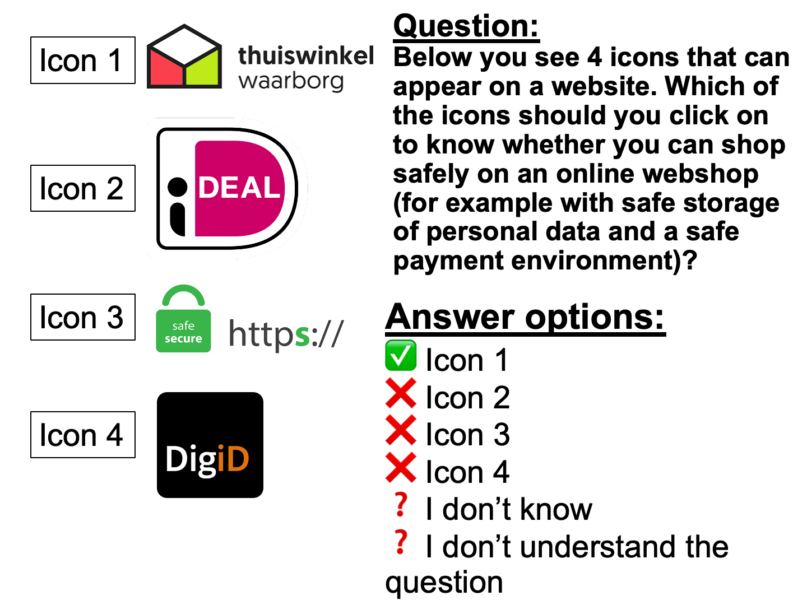

```{r, echo=FALSE, results='asis', message=FALSE, warning=FALSE}
dashboardr::.page_config(accessibility = TRUE, modals = TRUE, crosstab_prefix = "transactional")
```

```{=html}
<style>
  /* DigIQ Unified Theme & Editorial Observatory Styling */
  html { scroll-behavior: smooth; }
  section.level2 { scroll-margin-top: 85px; }

  /* Navbar hover readability */
  .navbar a:hover, .navbar .navbar-brand:hover, .navbar .navbar-nav .nav-link:hover {
    color: #3D7271 !important;
  }
  .navbar a:hover svg, .navbar .aa-DetachedSearchButton:hover svg, .navbar button:hover svg {
    fill: #3D7271 !important;
    stroke: #3D7271 !important;
  }

  /* Underline tabsets in DigIQ Teal & Terracotta instead of default royal blue */
  .panel-tabset .nav-item a::after {
    background-color: #E28D50 !important;
  }
  .panel-tabset .nav-tabs .nav-link.active {
    color: #0F6B5A !important;
    font-weight: 700 !important;
  }
  .panel-tabset .nav-tabs .nav-link.active::after {
    background-color: #3D7271 !important;
    height: 3px !important;
  }

  /* Question blockquotes in clean DigIQ Teal */
  blockquote.blockquote {
    border-left: 4px solid #3D7271 !important;
    background: linear-gradient(90deg, #f4f9f8 0%, #fafcfc 100%) !important;
    color: #1e3332 !important;
    border-radius: 0 8px 8px 0 !important;
    padding: 13px 20px !important;
    box-shadow: 0 1px 4px rgba(15, 45, 43, 0.04) !important;
  }

  /* Clickable modal links inside question blockquotes */
  a.modal-link {
    color: #0F6B5A !important;
    font-weight: 600;
    text-decoration: underline !important;
    text-decoration-color: rgba(15, 107, 90, 0.45) !important;
    text-underline-offset: 3px;
    transition: color 0.15s ease, text-decoration-color 0.15s ease;
  }
  a.modal-link:hover {
    color: #E28D50 !important;
    text-decoration-color: #E28D50 !important;
  }

  /* Wave 3 missing-data callout note on Performance sections */
  .dc-wave3-note {
    display: flex;
    align-items: flex-start;
    gap: 0.65rem;
    border: 1px solid #ebd5c3;
    border-left: 4px solid #E28D50;
    background: linear-gradient(90deg, #fdf8f3 0%, #fffcfa 100%);
    color: #5c3314;
    padding: 0.7rem 1.05rem;
    border-radius: 0 8px 8px 0;
    margin: 0.75rem 0 1.1rem 0;
    font-size: 0.92rem;
    line-height: 1.5;
  }
  .dc-wave3-note iconify-icon {
    color: #E28D50;
    font-size: 1.15rem;
    flex-shrink: 0;
    margin-top: 0.14rem;
  }

  /* Landing page: hide redundant Quarto title header & style Editorial Observatory Hero */
  body:has(.dc-observatory-hero) #title-block-header {
    display: none;
  }
  .dc-observatory-hero {
    position: relative;
    overflow: hidden;
    margin: 0.5rem 0 2rem 0;
    padding: 2.2rem 2.5rem 1.75rem 2.5rem;
    border-radius: 16px;
    background:
      radial-gradient(circle at 96% 8%, rgba(61, 114, 113, 0.11) 0%, transparent 45%),
      radial-gradient(circle at 4% 95%, rgba(226, 141, 80, 0.08) 0%, transparent 40%),
      linear-gradient(180deg, #ffffff 0%, #f7fbfa 100%);
    border: 1px solid #d5e3e0;
    box-shadow: 0 1px 3px rgba(15, 45, 43, 0.03), 0 10px 30px -8px rgba(15, 45, 43, 0.07);
  }
  .dc-observatory-hero::before {
    content: '';
    position: absolute;
    top: 0; left: 0; right: 0;
    height: 4px;
    background: linear-gradient(90deg, #0F6B5A 0%, #3D7271 62%, #E28D50 100%);
  }
  .dc-hero-eyebrow {
    display: inline-flex;
    align-items: center;
    gap: 0.5rem;
    font-size: 0.75rem;
    font-weight: 700;
    letter-spacing: 0.09em;
    text-transform: uppercase;
    color: #0F6B5A;
    background: #eaf4f1;
    border: 1px solid #cbe2dc;
    padding: 0.28rem 0.75rem;
    border-radius: 999px;
    margin-bottom: 0.95rem;
  }
  .dc-hero-dot {
    width: 7px;
    height: 7px;
    border-radius: 50%;
    background-color: #E28D50;
    box-shadow: 0 0 0 3px rgba(226, 141, 80, 0.22);
  }
  .dc-hero-title {
    font-size: 2rem;
    font-weight: 800;
    letter-spacing: -0.025em;
    color: #122928;
    margin: 0 0 0.75rem 0;
    line-height: 1.2;
  }
  .dc-hero-lead p {
    font-size: 1.03rem;
    line-height: 1.65;
    color: #364f4d;
    max-width: 880px;
    margin: 0 0 0.55rem 0;
  }
  .dc-hero-lead p:first-child {
    font-weight: 600;
    color: #1c3b39;
  }
  .dc-hero-metrics {
    display: grid;
    grid-template-columns: repeat(auto-fit, minmax(195px, 1fr));
    gap: 0.9rem;
    margin-top: 1.45rem;
    padding-top: 1.25rem;
    border-top: 1px solid #e1ecea;
  }
  .dc-metric-item {
    display: flex;
    align-items: center;
    gap: 0.75rem;
    padding: 0.65rem 0.9rem;
    background: rgba(255, 255, 255, 0.85);
    border: 1px solid #e2ecea;
    border-radius: 10px;
  }
  .dc-metric-icon {
    width: 36px;
    height: 36px;
    border-radius: 8px;
    background: #eef6f4;
    color: #3D7271;
    display: inline-flex;
    align-items: center;
    justify-content: center;
    font-size: 1.2rem;
    flex-shrink: 0;
  }
  .dc-metric-val {
    font-size: 0.98rem;
    font-weight: 700;
    color: #142d2c;
    line-height: 1.2;
  }
  .dc-metric-sub {
    font-size: 0.78rem;
    color: #5b7472;
    margin-top: 0.1rem;
  }

  /* Landing page 11-tile Bento Grid */
  .dc-links {
    display: grid;
    grid-template-columns: repeat(auto-fit, minmax(285px, 1fr));
    gap: 1.15rem;
    margin: 1.25rem 0 2.25rem 0;
  }
  @media (min-width: 1100px) {
    .dc-links {
      grid-template-columns: repeat(6, minmax(0, 1fr));
    }
    .dc-links > .dc-link {
      grid-column: span 2;
    }
    /* Center the final 2 AI cards (10 & 11) on the bottom row */
    .dc-links > .dc-link:nth-child(10) {
      grid-column: 2 / span 2;
    }
    .dc-links > .dc-link:nth-child(11) {
      grid-column: 4 / span 2;
    }
  }
  .dc-link {
    position: relative;
    overflow: hidden;
    display: flex;
    flex-direction: column;
    justify-content: space-between;
    padding: 1.35rem 1.4rem 1.15rem 1.4rem;
    border-radius: 13px;
    border: 1px solid #dce7e5;
    border-left: 4px solid #3D7271;
    background: #ffffff;
    color: inherit !important;
    text-decoration: none !important;
    text-align: left;
    box-shadow: 0 1px 2px rgba(15, 40, 38, 0.03), 0 6px 18px -4px rgba(15, 40, 38, 0.05);
    transition: transform 0.22s cubic-bezier(0.16, 1, 0.3, 1), box-shadow 0.22s cubic-bezier(0.16, 1, 0.3, 1), border-color 0.2s ease;
  }
  .dc-link::after {
    content: '';
    position: absolute;
    top: 0; left: 0; right: 0;
    height: 2px;
    background: linear-gradient(90deg, #3D7271, #E28D50);
    opacity: 0;
    transition: opacity 0.22s ease;
  }
  .dc-link:hover {
    transform: translateY(-4px);
    box-shadow: 0 4px 8px rgba(15, 40, 38, 0.04), 0 16px 32px -6px rgba(15, 40, 38, 0.11);
    border-color: #b8cfcc;
    border-left-color: #E28D50;
  }
  .dc-link:hover::after {
    opacity: 1;
  }
  .dc-card-watermark {
    position: absolute;
    right: -10px;
    bottom: -14px;
    font-size: 5.4rem;
    color: #3D7271;
    opacity: 0.04;
    pointer-events: none;
    transition: transform 0.3s ease, opacity 0.3s ease, color 0.3s ease;
  }
  .dc-link:hover .dc-card-watermark {
    transform: scale(1.08) rotate(-5deg);
    opacity: 0.075;
    color: #0F6B5A;
  }
  .dc-card-top {
    display: flex;
    align-items: center;
    justify-content: space-between;
    gap: 0.75rem;
    margin-bottom: 0.75rem;
  }
  .dc-card-title-group {
    display: flex;
    align-items: center;
    gap: 0.7rem;
    min-width: 0;
  }
  .dc-card-emblem {
    width: 38px;
    height: 38px;
    border-radius: 9px;
    background: #eef5f3;
    border: 1px solid #d5e6e2;
    color: #0F6B5A;
    display: inline-flex;
    align-items: center;
    justify-content: center;
    font-size: 1.22rem;
    flex-shrink: 0;
    transition: background-color 0.2s ease, color 0.2s ease, border-color 0.2s ease, transform 0.2s ease;
  }
  .dc-link:hover .dc-card-emblem {
    background: #3D7271;
    border-color: #3D7271;
    color: #ffffff;
    transform: scale(1.04);
  }
  .dc-link-title {
    font-weight: 700;
    color: #142c2b;
    font-size: 1.05rem;
    letter-spacing: -0.01em;
    line-height: 1.25;
    transition: color 0.2s ease;
  }
  .dc-link:hover .dc-link-title {
    color: #0F6B5A;
  }
  .dc-card-num {
    font-family: 'Fira Code', monospace;
    font-size: 0.73rem;
    font-weight: 600;
    color: #7c9694;
    background: #f3f7f6;
    border: 1px solid #e3ecea;
    padding: 0.14rem 0.48rem;
    border-radius: 6px;
    flex-shrink: 0;
    transition: color 0.2s ease, border-color 0.2s ease, background-color 0.2s ease;
  }
  .dc-link:hover .dc-card-num {
    color: #9c4215;
    background: #fdf3eb;
    border-color: #f0cdb4;
  }
  .dc-link-text {
    position: relative;
    z-index: 1;
    font-size: 0.91rem;
    line-height: 1.54;
    color: #495e5d;
    margin-bottom: 1rem;
    flex-grow: 1;
  }
  .dc-card-footer {
    position: relative;
    z-index: 1;
    display: flex;
    align-items: center;
    justify-content: space-between;
    padding-top: 0.65rem;
    border-top: 1px solid #eff4f3;
    font-size: 0.8rem;
    font-weight: 600;
    color: #3D7271;
    letter-spacing: 0.01em;
    transition: color 0.2s ease;
  }
  .dc-card-cta-arrow {
    display: inline-flex;
    align-items: center;
    font-size: 0.95rem;
    color: #88a3a0;
    transition: transform 0.2s ease, color 0.2s ease;
  }
  .dc-link:hover .dc-card-footer {
    color: #0F6B5A;
  }
  .dc-link:hover .dc-card-cta-arrow {
    transform: translateX(4px);
    color: #E28D50;
  }

  /* Dimension page intro panel & unified architectural jump-chips */
  .dc-dim-intro {
    background: #ffffff;
    border: 1px solid #d8e4e2;
    border-left: 5px solid #3D7271;
    border-radius: 12px;
    padding: 1.2rem 1.45rem;
    margin: 0.65rem 0 1.65rem 0;
    box-shadow: 0 2px 12px rgba(15, 45, 43, 0.04);
  }
  .dc-dim-intro > p {
    font-size: 1.01rem;
    line-height: 1.65;
    color: #213736;
    margin-bottom: 0.8rem;
  }
  .dc-jump-row {
    display: flex;
    flex-wrap: wrap;
    align-items: center;
    gap: 0.45rem;
    padding-top: 0.7rem;
    border-top: 1px solid #e7f0ee;
    font-size: 0.92rem;
    color: #425958;
    margin: 0;
  }
  .dc-jump-label {
    font-weight: 600;
    color: #1b3332;
    margin-right: 0.15rem;
  }
  a.dc-jump-link {
    display: inline-flex;
    align-items: center;
    gap: 0.35rem;
    padding: 0.24rem 0.7rem;
    border-radius: 7px;
    background: #f3f8f7;
    border: 1px solid #cde0dd;
    color: #0F6B5A !important;
    font-size: 0.86rem;
    font-weight: 600;
    text-decoration: none !important;
    transition: all 0.16s ease;
  }
  a.dc-jump-link:hover {
    background: #3D7271;
    border-color: #3D7271;
    color: #ffffff !important;
    transform: translateY(-1px);
    box-shadow: 0 3px 8px rgba(61, 114, 113, 0.18);
  }
</style>
```

::: {.dc-dim-intro}
**Transactionele competentie** omvat het vermogen om officiële online zaken af te handelen: overheidsdiensten beheren, digitale betalingen, gezondheidszorgafspraken, en documenten uploaden.

```{=html}
<div class='dc-jump-row'><span class='dc-jump-label'>Dit wordt op drie manieren gemeten:</span> <a class='dc-jump-link' href='#transactionele-vaardigheden'><iconify-icon inline icon='ph:lightning-fill'></iconify-icon> <span>zelfingeschatte vaardigheden</span> &#8595;</a> <a class='dc-jump-link' href='#transactionele-kennis'><iconify-icon inline icon='ph:book-open-fill'></iconify-icon> <span>items die kennis testen</span> &#8595;</a> <span>en</span> <a class='dc-jump-link' href='#transactionele-prestatie'><iconify-icon inline icon='ph:clipboard-text'></iconify-icon> <span>prestaties/gedrag</span> &#8595;</a></div>
```
:::

```{r setup}
#| echo: false
#| warning: false
#| message: false
#| error: false
#| results: 'hide'

# Load dashboardr (includes dplyr, highcharter as dependencies)
library(dashboardr)

# Global chunk options
knitr::opts_chunk$set(
  echo = FALSE,
  warning = FALSE,
  message = FALSE,
  error = FALSE,
  fig.width = 12,
  fig.height = 8,
  dpi = 300
)

# Load data
data <- readRDS('dataset_large_5307obs.rds')

# Data summary
cat('Dataset loaded:', nrow(data), 'rows,', ncol(data), 'columns\n')

# Create filtered datasets
# Each filter is applied once and reused across visualizations

data_filtered_984a0efe <- dashboardr::.convert_haven(data) %>% dplyr::filter(wave == 1)
data_filtered_4af682fd <- dashboardr::.convert_haven(data) %>% dplyr::filter(wave == 2)
data_filtered_5311412c <- dashboardr::.convert_haven(data) %>% dplyr::filter(wave == 3)
data_filtered_f45d3309 <- dashboardr::.convert_haven(data) %>% dplyr::filter(wave %in% c(1, 2))

```

##  Transactionele Vaardigheden


**Vaardigheden** meet het *zelfgerapporteerde vermogen* van deelnemers om een breed scala aan digitale taken uit te voeren. Deze items leggen vast hoe zelfverzekerd mensen zich voelen bij het zoeken naar informatie.
```{r, echo=FALSE, message=FALSE, warning=FALSE}
create_blockquote("Bedenk in hoeverre elke zin klopt of waar is voor jou persoonlijk, als je de activiteit nu en in je eentje zou moeten doen. Wees vooral eerlijk, het is heel normaal dat je sommige dingen nooit doet. Dat willen we juist weten! Als je niet begrijpt wat de vraag inhoudt, kruis dan aan 'Ik begrijp de vraag niet'.", preset = "question")
```


::: {.panel-tabset}

###  Ronde 1


::: {.panel-tabset}

#####  Algemeen


```{r trans-wave1-overall}
# Transactionele Vaardigheden
result <- viz_stackedbars(
  data = data_filtered_984a0efe,
  title = "Transactionele Vaardigheden",
  x_vars = c("Strans1", "Strans2", "Strans3", "Strans4", "Strans5"),
  x_var_labels = c("Ik weet hoe ik online dingen kan regelen bij de belastingdienst (bijv. belasting aangifte doen of loonheffing voor bijbaan aanvragen)", "Ik kan digitaal mijn betalingen doen met de computer of met mijn mobiel (bijvoorbeeld online bankieren, online winkelen, iDeal gebruiken)", "Ik weet hoe ik op de computer of mobiele telefoon online zorg moet regelen (bijv. zorgverzekering afsluiten of een online afspraak maken met de huisarts)", "Ik weet hoe ik mijn DigID kan aanvragen en gebruiken", "Ik weet hoe ik documenten en foto's kan uploaden wanneer dit nodig is om online zaken te regelen (bijv. bij het aanvragen van een OV chipkaart)"),
  stacked_type = "percent",
  color_palette = c("#3D7271", "#E28D50", "#F5D76E", "#C7E6D5", "#0F6B5A", "#BABACD"),
  horizontal = TRUE,
  x_label = "",
  stack_breaks = c(0.5, 2.5, 3.5, 5.5),
  stack_bin_labels = c("Helemaal Onwaar (1-2)", "Niet onwaar en niet waar (3)", "Helemaal Waar (4-5)"),
  stack_order = c("Helemaal Waar (4-5)", "Niet onwaar en niet waar (3)", "Helemaal Onwaar (1-2)"),
  stack_label = NULL,
  weight_var = "weging_GAMO"
)

result
```


#####  Leeftijd


::: {.panel-tabset}

######  Vraag 1


```{r trans-wave1-age-item1}
# Ik weet hoe ik online dingen kan regelen bij de belastingdienst (bijv. belasting aangifte doen of loonheffing voor bijbaan aanvragen)
result <- viz_stackedbar(
  data = data_filtered_984a0efe,
  title = "Ik weet hoe ik online dingen kan regelen bij de belastingdienst (bijv. belasting aangifte doen of loonheffing voor bijbaan aanvragen)",
  stacked_type = "percent",
  horizontal = TRUE,
  stack_breaks = c(0.5, 2.5, 3.5, 5.5),
  stack_bin_labels = c("Helemaal Onwaar (1-2)", "Niet onwaar en niet waar (3)", "Helemaal Waar (4-5)"),
  stack_order = c("Helemaal Waar (4-5)", "Niet onwaar en niet waar (3)", "Helemaal Onwaar (1-2)"),
  color_palette = c("#3D7271", "#E28D50", "#F5D76E", "#C7E6D5", "#0F6B5A", "#BABACD"),
  weight_var = "weging_GAMO",
  x_var = "AgeGroup",
  x_label = "Leeftijd",
  stack_var = "Strans1"
)

result
```


######  Vraag 2


```{r trans-wave1-age-item2}
# Ik kan digitaal mijn betalingen doen met de computer of met mijn mobiel (bijvoorbeeld online bankieren, online winkelen, iDeal gebruiken)
result <- viz_stackedbar(
  data = data_filtered_984a0efe,
  title = "Ik kan digitaal mijn betalingen doen met de computer of met mijn mobiel (bijvoorbeeld online bankieren, online winkelen, iDeal gebruiken)",
  stacked_type = "percent",
  horizontal = TRUE,
  stack_breaks = c(0.5, 2.5, 3.5, 5.5),
  stack_bin_labels = c("Helemaal Onwaar (1-2)", "Niet onwaar en niet waar (3)", "Helemaal Waar (4-5)"),
  stack_order = c("Helemaal Waar (4-5)", "Niet onwaar en niet waar (3)", "Helemaal Onwaar (1-2)"),
  color_palette = c("#3D7271", "#E28D50", "#F5D76E", "#C7E6D5", "#0F6B5A", "#BABACD"),
  weight_var = "weging_GAMO",
  x_var = "AgeGroup",
  x_label = "Leeftijd",
  stack_var = "Strans2"
)

result
```


######  Vraag 3


```{r trans-wave1-age-item3}
# Ik weet hoe ik op de computer of mobiele telefoon online zorg moet regelen (bijv. zorgverzekering afsluiten of een online afspraak maken met de huisarts)
result <- viz_stackedbar(
  data = data_filtered_984a0efe,
  title = "Ik weet hoe ik op de computer of mobiele telefoon online zorg moet regelen (bijv. zorgverzekering afsluiten of een online afspraak maken met de huisarts)",
  stacked_type = "percent",
  horizontal = TRUE,
  stack_breaks = c(0.5, 2.5, 3.5, 5.5),
  stack_bin_labels = c("Helemaal Onwaar (1-2)", "Niet onwaar en niet waar (3)", "Helemaal Waar (4-5)"),
  stack_order = c("Helemaal Waar (4-5)", "Niet onwaar en niet waar (3)", "Helemaal Onwaar (1-2)"),
  color_palette = c("#3D7271", "#E28D50", "#F5D76E", "#C7E6D5", "#0F6B5A", "#BABACD"),
  weight_var = "weging_GAMO",
  x_var = "AgeGroup",
  x_label = "Leeftijd",
  stack_var = "Strans3"
)

result
```


######  Vraag 4


```{r trans-wave1-age-item4}
# Ik weet hoe ik mijn DigID kan aanvragen en gebruiken
result <- viz_stackedbar(
  data = data_filtered_984a0efe,
  title = "Ik weet hoe ik mijn DigID kan aanvragen en gebruiken",
  stacked_type = "percent",
  horizontal = TRUE,
  stack_breaks = c(0.5, 2.5, 3.5, 5.5),
  stack_bin_labels = c("Helemaal Onwaar (1-2)", "Niet onwaar en niet waar (3)", "Helemaal Waar (4-5)"),
  stack_order = c("Helemaal Waar (4-5)", "Niet onwaar en niet waar (3)", "Helemaal Onwaar (1-2)"),
  color_palette = c("#3D7271", "#E28D50", "#F5D76E", "#C7E6D5", "#0F6B5A", "#BABACD"),
  weight_var = "weging_GAMO",
  x_var = "AgeGroup",
  x_label = "Leeftijd",
  stack_var = "Strans4"
)

result
```


######  Vraag 5


```{r trans-wave1-age-item5}
# Ik weet hoe ik documenten en foto's kan uploaden wanneer dit nodig is om online zaken te regelen (bijv. bij het aanvragen van een OV chipkaart)
result <- viz_stackedbar(
  data = data_filtered_984a0efe,
  title = "Ik weet hoe ik documenten en foto's kan uploaden wanneer dit nodig is om online zaken te regelen (bijv. bij het aanvragen van een OV chipkaart)",
  stacked_type = "percent",
  horizontal = TRUE,
  stack_breaks = c(0.5, 2.5, 3.5, 5.5),
  stack_bin_labels = c("Helemaal Onwaar (1-2)", "Niet onwaar en niet waar (3)", "Helemaal Waar (4-5)"),
  stack_order = c("Helemaal Waar (4-5)", "Niet onwaar en niet waar (3)", "Helemaal Onwaar (1-2)"),
  color_palette = c("#3D7271", "#E28D50", "#F5D76E", "#C7E6D5", "#0F6B5A", "#BABACD"),
  weight_var = "weging_GAMO",
  x_var = "AgeGroup",
  x_label = "Leeftijd",
  stack_var = "Strans5"
)

result
```


:::


#####  Geslacht


::: {.panel-tabset}

######  Vraag 1


```{r trans-wave1-gender-item1}
# Ik weet hoe ik online dingen kan regelen bij de belastingdienst (bijv. belasting aangifte doen of loonheffing voor bijbaan aanvragen)
result <- viz_stackedbar(
  data = data_filtered_984a0efe,
  title = "Ik weet hoe ik online dingen kan regelen bij de belastingdienst (bijv. belasting aangifte doen of loonheffing voor bijbaan aanvragen)",
  stacked_type = "percent",
  horizontal = TRUE,
  stack_breaks = c(0.5, 2.5, 3.5, 5.5),
  stack_bin_labels = c("Helemaal Onwaar (1-2)", "Niet onwaar en niet waar (3)", "Helemaal Waar (4-5)"),
  stack_order = c("Helemaal Waar (4-5)", "Niet onwaar en niet waar (3)", "Helemaal Onwaar (1-2)"),
  color_palette = c("#3D7271", "#E28D50", "#F5D76E", "#C7E6D5", "#0F6B5A", "#BABACD"),
  weight_var = "weging_GAMO",
  x_var = "geslacht",
  x_label = "Geslacht",
  stack_var = "Strans1"
)

result
```


######  Vraag 2


```{r trans-wave1-gender-item2}
# Ik kan digitaal mijn betalingen doen met de computer of met mijn mobiel (bijvoorbeeld online bankieren, online winkelen, iDeal gebruiken)
result <- viz_stackedbar(
  data = data_filtered_984a0efe,
  title = "Ik kan digitaal mijn betalingen doen met de computer of met mijn mobiel (bijvoorbeeld online bankieren, online winkelen, iDeal gebruiken)",
  stacked_type = "percent",
  horizontal = TRUE,
  stack_breaks = c(0.5, 2.5, 3.5, 5.5),
  stack_bin_labels = c("Helemaal Onwaar (1-2)", "Niet onwaar en niet waar (3)", "Helemaal Waar (4-5)"),
  stack_order = c("Helemaal Waar (4-5)", "Niet onwaar en niet waar (3)", "Helemaal Onwaar (1-2)"),
  color_palette = c("#3D7271", "#E28D50", "#F5D76E", "#C7E6D5", "#0F6B5A", "#BABACD"),
  weight_var = "weging_GAMO",
  x_var = "geslacht",
  x_label = "Geslacht",
  stack_var = "Strans2"
)

result
```


######  Vraag 3


```{r trans-wave1-gender-item3}
# Ik weet hoe ik op de computer of mobiele telefoon online zorg moet regelen (bijv. zorgverzekering afsluiten of een online afspraak maken met de huisarts)
result <- viz_stackedbar(
  data = data_filtered_984a0efe,
  title = "Ik weet hoe ik op de computer of mobiele telefoon online zorg moet regelen (bijv. zorgverzekering afsluiten of een online afspraak maken met de huisarts)",
  stacked_type = "percent",
  horizontal = TRUE,
  stack_breaks = c(0.5, 2.5, 3.5, 5.5),
  stack_bin_labels = c("Helemaal Onwaar (1-2)", "Niet onwaar en niet waar (3)", "Helemaal Waar (4-5)"),
  stack_order = c("Helemaal Waar (4-5)", "Niet onwaar en niet waar (3)", "Helemaal Onwaar (1-2)"),
  color_palette = c("#3D7271", "#E28D50", "#F5D76E", "#C7E6D5", "#0F6B5A", "#BABACD"),
  weight_var = "weging_GAMO",
  x_var = "geslacht",
  x_label = "Geslacht",
  stack_var = "Strans3"
)

result
```


######  Vraag 4


```{r trans-wave1-gender-item4}
# Ik weet hoe ik mijn DigID kan aanvragen en gebruiken
result <- viz_stackedbar(
  data = data_filtered_984a0efe,
  title = "Ik weet hoe ik mijn DigID kan aanvragen en gebruiken",
  stacked_type = "percent",
  horizontal = TRUE,
  stack_breaks = c(0.5, 2.5, 3.5, 5.5),
  stack_bin_labels = c("Helemaal Onwaar (1-2)", "Niet onwaar en niet waar (3)", "Helemaal Waar (4-5)"),
  stack_order = c("Helemaal Waar (4-5)", "Niet onwaar en niet waar (3)", "Helemaal Onwaar (1-2)"),
  color_palette = c("#3D7271", "#E28D50", "#F5D76E", "#C7E6D5", "#0F6B5A", "#BABACD"),
  weight_var = "weging_GAMO",
  x_var = "geslacht",
  x_label = "Geslacht",
  stack_var = "Strans4"
)

result
```


######  Vraag 5


```{r trans-wave1-gender-item5}
# Ik weet hoe ik documenten en foto's kan uploaden wanneer dit nodig is om online zaken te regelen (bijv. bij het aanvragen van een OV chipkaart)
result <- viz_stackedbar(
  data = data_filtered_984a0efe,
  title = "Ik weet hoe ik documenten en foto's kan uploaden wanneer dit nodig is om online zaken te regelen (bijv. bij het aanvragen van een OV chipkaart)",
  stacked_type = "percent",
  horizontal = TRUE,
  stack_breaks = c(0.5, 2.5, 3.5, 5.5),
  stack_bin_labels = c("Helemaal Onwaar (1-2)", "Niet onwaar en niet waar (3)", "Helemaal Waar (4-5)"),
  stack_order = c("Helemaal Waar (4-5)", "Niet onwaar en niet waar (3)", "Helemaal Onwaar (1-2)"),
  color_palette = c("#3D7271", "#E28D50", "#F5D76E", "#C7E6D5", "#0F6B5A", "#BABACD"),
  weight_var = "weging_GAMO",
  x_var = "geslacht",
  x_label = "Geslacht",
  stack_var = "Strans5"
)

result
```


:::


#####  Opleidingsniveau


::: {.panel-tabset}

######  Vraag 1


```{r trans-wave1-edu-item1}
# Ik weet hoe ik online dingen kan regelen bij de belastingdienst (bijv. belasting aangifte doen of loonheffing voor bijbaan aanvragen)
result <- viz_stackedbar(
  data = data_filtered_984a0efe,
  title = "Ik weet hoe ik online dingen kan regelen bij de belastingdienst (bijv. belasting aangifte doen of loonheffing voor bijbaan aanvragen)",
  stacked_type = "percent",
  horizontal = TRUE,
  stack_breaks = c(0.5, 2.5, 3.5, 5.5),
  stack_bin_labels = c("Helemaal Onwaar (1-2)", "Niet onwaar en niet waar (3)", "Helemaal Waar (4-5)"),
  stack_order = c("Helemaal Waar (4-5)", "Niet onwaar en niet waar (3)", "Helemaal Onwaar (1-2)"),
  color_palette = c("#3D7271", "#E28D50", "#F5D76E", "#C7E6D5", "#0F6B5A", "#BABACD"),
  weight_var = "weging_GAMO",
  x_var = "Education",
  x_label = "Opleidingsniveau",
  stack_var = "Strans1"
)

result
```


######  Vraag 2


```{r trans-wave1-edu-item2}
# Ik kan digitaal mijn betalingen doen met de computer of met mijn mobiel (bijvoorbeeld online bankieren, online winkelen, iDeal gebruiken)
result <- viz_stackedbar(
  data = data_filtered_984a0efe,
  title = "Ik kan digitaal mijn betalingen doen met de computer of met mijn mobiel (bijvoorbeeld online bankieren, online winkelen, iDeal gebruiken)",
  stacked_type = "percent",
  horizontal = TRUE,
  stack_breaks = c(0.5, 2.5, 3.5, 5.5),
  stack_bin_labels = c("Helemaal Onwaar (1-2)", "Niet onwaar en niet waar (3)", "Helemaal Waar (4-5)"),
  stack_order = c("Helemaal Waar (4-5)", "Niet onwaar en niet waar (3)", "Helemaal Onwaar (1-2)"),
  color_palette = c("#3D7271", "#E28D50", "#F5D76E", "#C7E6D5", "#0F6B5A", "#BABACD"),
  weight_var = "weging_GAMO",
  x_var = "Education",
  x_label = "Opleidingsniveau",
  stack_var = "Strans2"
)

result
```


######  Vraag 3


```{r trans-wave1-edu-item3}
# Ik weet hoe ik op de computer of mobiele telefoon online zorg moet regelen (bijv. zorgverzekering afsluiten of een online afspraak maken met de huisarts)
result <- viz_stackedbar(
  data = data_filtered_984a0efe,
  title = "Ik weet hoe ik op de computer of mobiele telefoon online zorg moet regelen (bijv. zorgverzekering afsluiten of een online afspraak maken met de huisarts)",
  stacked_type = "percent",
  horizontal = TRUE,
  stack_breaks = c(0.5, 2.5, 3.5, 5.5),
  stack_bin_labels = c("Helemaal Onwaar (1-2)", "Niet onwaar en niet waar (3)", "Helemaal Waar (4-5)"),
  stack_order = c("Helemaal Waar (4-5)", "Niet onwaar en niet waar (3)", "Helemaal Onwaar (1-2)"),
  color_palette = c("#3D7271", "#E28D50", "#F5D76E", "#C7E6D5", "#0F6B5A", "#BABACD"),
  weight_var = "weging_GAMO",
  x_var = "Education",
  x_label = "Opleidingsniveau",
  stack_var = "Strans3"
)

result
```


######  Vraag 4


```{r trans-wave1-edu-item4}
# Ik weet hoe ik mijn DigID kan aanvragen en gebruiken
result <- viz_stackedbar(
  data = data_filtered_984a0efe,
  title = "Ik weet hoe ik mijn DigID kan aanvragen en gebruiken",
  stacked_type = "percent",
  horizontal = TRUE,
  stack_breaks = c(0.5, 2.5, 3.5, 5.5),
  stack_bin_labels = c("Helemaal Onwaar (1-2)", "Niet onwaar en niet waar (3)", "Helemaal Waar (4-5)"),
  stack_order = c("Helemaal Waar (4-5)", "Niet onwaar en niet waar (3)", "Helemaal Onwaar (1-2)"),
  color_palette = c("#3D7271", "#E28D50", "#F5D76E", "#C7E6D5", "#0F6B5A", "#BABACD"),
  weight_var = "weging_GAMO",
  x_var = "Education",
  x_label = "Opleidingsniveau",
  stack_var = "Strans4"
)

result
```


######  Vraag 5


```{r trans-wave1-edu-item5}
# Ik weet hoe ik documenten en foto's kan uploaden wanneer dit nodig is om online zaken te regelen (bijv. bij het aanvragen van een OV chipkaart)
result <- viz_stackedbar(
  data = data_filtered_984a0efe,
  title = "Ik weet hoe ik documenten en foto's kan uploaden wanneer dit nodig is om online zaken te regelen (bijv. bij het aanvragen van een OV chipkaart)",
  stacked_type = "percent",
  horizontal = TRUE,
  stack_breaks = c(0.5, 2.5, 3.5, 5.5),
  stack_bin_labels = c("Helemaal Onwaar (1-2)", "Niet onwaar en niet waar (3)", "Helemaal Waar (4-5)"),
  stack_order = c("Helemaal Waar (4-5)", "Niet onwaar en niet waar (3)", "Helemaal Onwaar (1-2)"),
  color_palette = c("#3D7271", "#E28D50", "#F5D76E", "#C7E6D5", "#0F6B5A", "#BABACD"),
  weight_var = "weging_GAMO",
  x_var = "Education",
  x_label = "Opleidingsniveau",
  stack_var = "Strans5"
)

result
```


:::


#####  Migratieachtergrond


::: {.panel-tabset}

######  Vraag 1


```{r trans-wave1-mig-item1}
# Ik weet hoe ik online dingen kan regelen bij de belastingdienst (bijv. belasting aangifte doen of loonheffing voor bijbaan aanvragen)
result <- viz_stackedbar(
  data = data_filtered_984a0efe,
  title = "Ik weet hoe ik online dingen kan regelen bij de belastingdienst (bijv. belasting aangifte doen of loonheffing voor bijbaan aanvragen)",
  stacked_type = "percent",
  horizontal = TRUE,
  stack_breaks = c(0.5, 2.5, 3.5, 5.5),
  stack_bin_labels = c("Helemaal Onwaar (1-2)", "Niet onwaar en niet waar (3)", "Helemaal Waar (4-5)"),
  stack_order = c("Helemaal Waar (4-5)", "Niet onwaar en niet waar (3)", "Helemaal Onwaar (1-2)"),
  color_palette = c("#3D7271", "#E28D50", "#F5D76E", "#C7E6D5", "#0F6B5A", "#BABACD"),
  weight_var = "weging_GAMO",
  x_var = "MigrationBackground",
  x_label = "Migratieachtergrond",
  stack_var = "Strans1"
)

result
```


######  Vraag 2


```{r trans-wave1-mig-item2}
# Ik kan digitaal mijn betalingen doen met de computer of met mijn mobiel (bijvoorbeeld online bankieren, online winkelen, iDeal gebruiken)
result <- viz_stackedbar(
  data = data_filtered_984a0efe,
  title = "Ik kan digitaal mijn betalingen doen met de computer of met mijn mobiel (bijvoorbeeld online bankieren, online winkelen, iDeal gebruiken)",
  stacked_type = "percent",
  horizontal = TRUE,
  stack_breaks = c(0.5, 2.5, 3.5, 5.5),
  stack_bin_labels = c("Helemaal Onwaar (1-2)", "Niet onwaar en niet waar (3)", "Helemaal Waar (4-5)"),
  stack_order = c("Helemaal Waar (4-5)", "Niet onwaar en niet waar (3)", "Helemaal Onwaar (1-2)"),
  color_palette = c("#3D7271", "#E28D50", "#F5D76E", "#C7E6D5", "#0F6B5A", "#BABACD"),
  weight_var = "weging_GAMO",
  x_var = "MigrationBackground",
  x_label = "Migratieachtergrond",
  stack_var = "Strans2"
)

result
```


######  Vraag 3


```{r trans-wave1-mig-item3}
# Ik weet hoe ik op de computer of mobiele telefoon online zorg moet regelen (bijv. zorgverzekering afsluiten of een online afspraak maken met de huisarts)
result <- viz_stackedbar(
  data = data_filtered_984a0efe,
  title = "Ik weet hoe ik op de computer of mobiele telefoon online zorg moet regelen (bijv. zorgverzekering afsluiten of een online afspraak maken met de huisarts)",
  stacked_type = "percent",
  horizontal = TRUE,
  stack_breaks = c(0.5, 2.5, 3.5, 5.5),
  stack_bin_labels = c("Helemaal Onwaar (1-2)", "Niet onwaar en niet waar (3)", "Helemaal Waar (4-5)"),
  stack_order = c("Helemaal Waar (4-5)", "Niet onwaar en niet waar (3)", "Helemaal Onwaar (1-2)"),
  color_palette = c("#3D7271", "#E28D50", "#F5D76E", "#C7E6D5", "#0F6B5A", "#BABACD"),
  weight_var = "weging_GAMO",
  x_var = "MigrationBackground",
  x_label = "Migratieachtergrond",
  stack_var = "Strans3"
)

result
```


######  Vraag 4


```{r trans-wave1-mig-item4}
# Ik weet hoe ik mijn DigID kan aanvragen en gebruiken
result <- viz_stackedbar(
  data = data_filtered_984a0efe,
  title = "Ik weet hoe ik mijn DigID kan aanvragen en gebruiken",
  stacked_type = "percent",
  horizontal = TRUE,
  stack_breaks = c(0.5, 2.5, 3.5, 5.5),
  stack_bin_labels = c("Helemaal Onwaar (1-2)", "Niet onwaar en niet waar (3)", "Helemaal Waar (4-5)"),
  stack_order = c("Helemaal Waar (4-5)", "Niet onwaar en niet waar (3)", "Helemaal Onwaar (1-2)"),
  color_palette = c("#3D7271", "#E28D50", "#F5D76E", "#C7E6D5", "#0F6B5A", "#BABACD"),
  weight_var = "weging_GAMO",
  x_var = "MigrationBackground",
  x_label = "Migratieachtergrond",
  stack_var = "Strans4"
)

result
```


######  Vraag 5


```{r trans-wave1-mig-item5}
# Ik weet hoe ik documenten en foto's kan uploaden wanneer dit nodig is om online zaken te regelen (bijv. bij het aanvragen van een OV chipkaart)
result <- viz_stackedbar(
  data = data_filtered_984a0efe,
  title = "Ik weet hoe ik documenten en foto's kan uploaden wanneer dit nodig is om online zaken te regelen (bijv. bij het aanvragen van een OV chipkaart)",
  stacked_type = "percent",
  horizontal = TRUE,
  stack_breaks = c(0.5, 2.5, 3.5, 5.5),
  stack_bin_labels = c("Helemaal Onwaar (1-2)", "Niet onwaar en niet waar (3)", "Helemaal Waar (4-5)"),
  stack_order = c("Helemaal Waar (4-5)", "Niet onwaar en niet waar (3)", "Helemaal Onwaar (1-2)"),
  color_palette = c("#3D7271", "#E28D50", "#F5D76E", "#C7E6D5", "#0F6B5A", "#BABACD"),
  weight_var = "weging_GAMO",
  x_var = "MigrationBackground",
  x_label = "Migratieachtergrond",
  stack_var = "Strans5"
)

result
```


:::


:::


###  Ronde 2


::: {.panel-tabset}

#####  Algemeen


```{r trans-wave2-overall}
# Transactionele Vaardigheden
result <- viz_stackedbars(
  data = data_filtered_4af682fd,
  title = "Transactionele Vaardigheden",
  x_vars = c("Strans1", "Strans2", "Strans3", "Strans4", "Strans5"),
  x_var_labels = c("Ik weet hoe ik online dingen kan regelen bij de belastingdienst (bijv. belasting aangifte doen of loonheffing voor bijbaan aanvragen)", "Ik kan digitaal mijn betalingen doen met de computer of met mijn mobiel (bijvoorbeeld online bankieren, online winkelen, iDeal gebruiken)", "Ik weet hoe ik op de computer of mobiele telefoon online zorg moet regelen (bijv. zorgverzekering afsluiten of een online afspraak maken met de huisarts)", "Ik weet hoe ik mijn DigID kan aanvragen en gebruiken", "Ik weet hoe ik documenten en foto's kan uploaden wanneer dit nodig is om online zaken te regelen (bijv. bij het aanvragen van een OV chipkaart)"),
  stacked_type = "percent",
  color_palette = c("#3D7271", "#E28D50", "#F5D76E", "#C7E6D5", "#0F6B5A", "#BABACD"),
  horizontal = TRUE,
  x_label = "",
  stack_breaks = c(0.5, 2.5, 3.5, 5.5),
  stack_bin_labels = c("Helemaal Onwaar (1-2)", "Niet onwaar en niet waar (3)", "Helemaal Waar (4-5)"),
  stack_order = c("Helemaal Waar (4-5)", "Niet onwaar en niet waar (3)", "Helemaal Onwaar (1-2)"),
  stack_label = NULL,
  weight_var = "weging_GAMO"
)

result
```


#####  Leeftijd


::: {.panel-tabset}

######  Vraag 1


```{r trans-wave2-age-item1}
# Ik weet hoe ik online dingen kan regelen bij de belastingdienst (bijv. belasting aangifte doen of loonheffing voor bijbaan aanvragen)
result <- viz_stackedbar(
  data = data_filtered_4af682fd,
  title = "Ik weet hoe ik online dingen kan regelen bij de belastingdienst (bijv. belasting aangifte doen of loonheffing voor bijbaan aanvragen)",
  stacked_type = "percent",
  horizontal = TRUE,
  stack_breaks = c(0.5, 2.5, 3.5, 5.5),
  stack_bin_labels = c("Helemaal Onwaar (1-2)", "Niet onwaar en niet waar (3)", "Helemaal Waar (4-5)"),
  stack_order = c("Helemaal Waar (4-5)", "Niet onwaar en niet waar (3)", "Helemaal Onwaar (1-2)"),
  color_palette = c("#3D7271", "#E28D50", "#F5D76E", "#C7E6D5", "#0F6B5A", "#BABACD"),
  weight_var = "weging_GAMO",
  x_var = "AgeGroup",
  x_label = "Leeftijd",
  stack_var = "Strans1"
)

result
```


######  Vraag 2


```{r trans-wave2-age-item2}
# Ik kan digitaal mijn betalingen doen met de computer of met mijn mobiel (bijvoorbeeld online bankieren, online winkelen, iDeal gebruiken)
result <- viz_stackedbar(
  data = data_filtered_4af682fd,
  title = "Ik kan digitaal mijn betalingen doen met de computer of met mijn mobiel (bijvoorbeeld online bankieren, online winkelen, iDeal gebruiken)",
  stacked_type = "percent",
  horizontal = TRUE,
  stack_breaks = c(0.5, 2.5, 3.5, 5.5),
  stack_bin_labels = c("Helemaal Onwaar (1-2)", "Niet onwaar en niet waar (3)", "Helemaal Waar (4-5)"),
  stack_order = c("Helemaal Waar (4-5)", "Niet onwaar en niet waar (3)", "Helemaal Onwaar (1-2)"),
  color_palette = c("#3D7271", "#E28D50", "#F5D76E", "#C7E6D5", "#0F6B5A", "#BABACD"),
  weight_var = "weging_GAMO",
  x_var = "AgeGroup",
  x_label = "Leeftijd",
  stack_var = "Strans2"
)

result
```


######  Vraag 3


```{r trans-wave2-age-item3}
# Ik weet hoe ik op de computer of mobiele telefoon online zorg moet regelen (bijv. zorgverzekering afsluiten of een online afspraak maken met de huisarts)
result <- viz_stackedbar(
  data = data_filtered_4af682fd,
  title = "Ik weet hoe ik op de computer of mobiele telefoon online zorg moet regelen (bijv. zorgverzekering afsluiten of een online afspraak maken met de huisarts)",
  stacked_type = "percent",
  horizontal = TRUE,
  stack_breaks = c(0.5, 2.5, 3.5, 5.5),
  stack_bin_labels = c("Helemaal Onwaar (1-2)", "Niet onwaar en niet waar (3)", "Helemaal Waar (4-5)"),
  stack_order = c("Helemaal Waar (4-5)", "Niet onwaar en niet waar (3)", "Helemaal Onwaar (1-2)"),
  color_palette = c("#3D7271", "#E28D50", "#F5D76E", "#C7E6D5", "#0F6B5A", "#BABACD"),
  weight_var = "weging_GAMO",
  x_var = "AgeGroup",
  x_label = "Leeftijd",
  stack_var = "Strans3"
)

result
```


######  Vraag 4


```{r trans-wave2-age-item4}
# Ik weet hoe ik mijn DigID kan aanvragen en gebruiken
result <- viz_stackedbar(
  data = data_filtered_4af682fd,
  title = "Ik weet hoe ik mijn DigID kan aanvragen en gebruiken",
  stacked_type = "percent",
  horizontal = TRUE,
  stack_breaks = c(0.5, 2.5, 3.5, 5.5),
  stack_bin_labels = c("Helemaal Onwaar (1-2)", "Niet onwaar en niet waar (3)", "Helemaal Waar (4-5)"),
  stack_order = c("Helemaal Waar (4-5)", "Niet onwaar en niet waar (3)", "Helemaal Onwaar (1-2)"),
  color_palette = c("#3D7271", "#E28D50", "#F5D76E", "#C7E6D5", "#0F6B5A", "#BABACD"),
  weight_var = "weging_GAMO",
  x_var = "AgeGroup",
  x_label = "Leeftijd",
  stack_var = "Strans4"
)

result
```


######  Vraag 5


```{r trans-wave2-age-item5}
# Ik weet hoe ik documenten en foto's kan uploaden wanneer dit nodig is om online zaken te regelen (bijv. bij het aanvragen van een OV chipkaart)
result <- viz_stackedbar(
  data = data_filtered_4af682fd,
  title = "Ik weet hoe ik documenten en foto's kan uploaden wanneer dit nodig is om online zaken te regelen (bijv. bij het aanvragen van een OV chipkaart)",
  stacked_type = "percent",
  horizontal = TRUE,
  stack_breaks = c(0.5, 2.5, 3.5, 5.5),
  stack_bin_labels = c("Helemaal Onwaar (1-2)", "Niet onwaar en niet waar (3)", "Helemaal Waar (4-5)"),
  stack_order = c("Helemaal Waar (4-5)", "Niet onwaar en niet waar (3)", "Helemaal Onwaar (1-2)"),
  color_palette = c("#3D7271", "#E28D50", "#F5D76E", "#C7E6D5", "#0F6B5A", "#BABACD"),
  weight_var = "weging_GAMO",
  x_var = "AgeGroup",
  x_label = "Leeftijd",
  stack_var = "Strans5"
)

result
```


:::


#####  Geslacht


::: {.panel-tabset}

######  Vraag 1


```{r trans-wave2-gender-item1}
# Ik weet hoe ik online dingen kan regelen bij de belastingdienst (bijv. belasting aangifte doen of loonheffing voor bijbaan aanvragen)
result <- viz_stackedbar(
  data = data_filtered_4af682fd,
  title = "Ik weet hoe ik online dingen kan regelen bij de belastingdienst (bijv. belasting aangifte doen of loonheffing voor bijbaan aanvragen)",
  stacked_type = "percent",
  horizontal = TRUE,
  stack_breaks = c(0.5, 2.5, 3.5, 5.5),
  stack_bin_labels = c("Helemaal Onwaar (1-2)", "Niet onwaar en niet waar (3)", "Helemaal Waar (4-5)"),
  stack_order = c("Helemaal Waar (4-5)", "Niet onwaar en niet waar (3)", "Helemaal Onwaar (1-2)"),
  color_palette = c("#3D7271", "#E28D50", "#F5D76E", "#C7E6D5", "#0F6B5A", "#BABACD"),
  weight_var = "weging_GAMO",
  x_var = "geslacht",
  x_label = "Geslacht",
  stack_var = "Strans1"
)

result
```


######  Vraag 2


```{r trans-wave2-gender-item2}
# Ik kan digitaal mijn betalingen doen met de computer of met mijn mobiel (bijvoorbeeld online bankieren, online winkelen, iDeal gebruiken)
result <- viz_stackedbar(
  data = data_filtered_4af682fd,
  title = "Ik kan digitaal mijn betalingen doen met de computer of met mijn mobiel (bijvoorbeeld online bankieren, online winkelen, iDeal gebruiken)",
  stacked_type = "percent",
  horizontal = TRUE,
  stack_breaks = c(0.5, 2.5, 3.5, 5.5),
  stack_bin_labels = c("Helemaal Onwaar (1-2)", "Niet onwaar en niet waar (3)", "Helemaal Waar (4-5)"),
  stack_order = c("Helemaal Waar (4-5)", "Niet onwaar en niet waar (3)", "Helemaal Onwaar (1-2)"),
  color_palette = c("#3D7271", "#E28D50", "#F5D76E", "#C7E6D5", "#0F6B5A", "#BABACD"),
  weight_var = "weging_GAMO",
  x_var = "geslacht",
  x_label = "Geslacht",
  stack_var = "Strans2"
)

result
```


######  Vraag 3


```{r trans-wave2-gender-item3}
# Ik weet hoe ik op de computer of mobiele telefoon online zorg moet regelen (bijv. zorgverzekering afsluiten of een online afspraak maken met de huisarts)
result <- viz_stackedbar(
  data = data_filtered_4af682fd,
  title = "Ik weet hoe ik op de computer of mobiele telefoon online zorg moet regelen (bijv. zorgverzekering afsluiten of een online afspraak maken met de huisarts)",
  stacked_type = "percent",
  horizontal = TRUE,
  stack_breaks = c(0.5, 2.5, 3.5, 5.5),
  stack_bin_labels = c("Helemaal Onwaar (1-2)", "Niet onwaar en niet waar (3)", "Helemaal Waar (4-5)"),
  stack_order = c("Helemaal Waar (4-5)", "Niet onwaar en niet waar (3)", "Helemaal Onwaar (1-2)"),
  color_palette = c("#3D7271", "#E28D50", "#F5D76E", "#C7E6D5", "#0F6B5A", "#BABACD"),
  weight_var = "weging_GAMO",
  x_var = "geslacht",
  x_label = "Geslacht",
  stack_var = "Strans3"
)

result
```


######  Vraag 4


```{r trans-wave2-gender-item4}
# Ik weet hoe ik mijn DigID kan aanvragen en gebruiken
result <- viz_stackedbar(
  data = data_filtered_4af682fd,
  title = "Ik weet hoe ik mijn DigID kan aanvragen en gebruiken",
  stacked_type = "percent",
  horizontal = TRUE,
  stack_breaks = c(0.5, 2.5, 3.5, 5.5),
  stack_bin_labels = c("Helemaal Onwaar (1-2)", "Niet onwaar en niet waar (3)", "Helemaal Waar (4-5)"),
  stack_order = c("Helemaal Waar (4-5)", "Niet onwaar en niet waar (3)", "Helemaal Onwaar (1-2)"),
  color_palette = c("#3D7271", "#E28D50", "#F5D76E", "#C7E6D5", "#0F6B5A", "#BABACD"),
  weight_var = "weging_GAMO",
  x_var = "geslacht",
  x_label = "Geslacht",
  stack_var = "Strans4"
)

result
```


######  Vraag 5


```{r trans-wave2-gender-item5}
# Ik weet hoe ik documenten en foto's kan uploaden wanneer dit nodig is om online zaken te regelen (bijv. bij het aanvragen van een OV chipkaart)
result <- viz_stackedbar(
  data = data_filtered_4af682fd,
  title = "Ik weet hoe ik documenten en foto's kan uploaden wanneer dit nodig is om online zaken te regelen (bijv. bij het aanvragen van een OV chipkaart)",
  stacked_type = "percent",
  horizontal = TRUE,
  stack_breaks = c(0.5, 2.5, 3.5, 5.5),
  stack_bin_labels = c("Helemaal Onwaar (1-2)", "Niet onwaar en niet waar (3)", "Helemaal Waar (4-5)"),
  stack_order = c("Helemaal Waar (4-5)", "Niet onwaar en niet waar (3)", "Helemaal Onwaar (1-2)"),
  color_palette = c("#3D7271", "#E28D50", "#F5D76E", "#C7E6D5", "#0F6B5A", "#BABACD"),
  weight_var = "weging_GAMO",
  x_var = "geslacht",
  x_label = "Geslacht",
  stack_var = "Strans5"
)

result
```


:::


#####  Opleidingsniveau


::: {.panel-tabset}

######  Vraag 1


```{r trans-wave2-edu-item1}
# Ik weet hoe ik online dingen kan regelen bij de belastingdienst (bijv. belasting aangifte doen of loonheffing voor bijbaan aanvragen)
result <- viz_stackedbar(
  data = data_filtered_4af682fd,
  title = "Ik weet hoe ik online dingen kan regelen bij de belastingdienst (bijv. belasting aangifte doen of loonheffing voor bijbaan aanvragen)",
  stacked_type = "percent",
  horizontal = TRUE,
  stack_breaks = c(0.5, 2.5, 3.5, 5.5),
  stack_bin_labels = c("Helemaal Onwaar (1-2)", "Niet onwaar en niet waar (3)", "Helemaal Waar (4-5)"),
  stack_order = c("Helemaal Waar (4-5)", "Niet onwaar en niet waar (3)", "Helemaal Onwaar (1-2)"),
  color_palette = c("#3D7271", "#E28D50", "#F5D76E", "#C7E6D5", "#0F6B5A", "#BABACD"),
  weight_var = "weging_GAMO",
  x_var = "Education",
  x_label = "Opleidingsniveau",
  stack_var = "Strans1"
)

result
```


######  Vraag 2


```{r trans-wave2-edu-item2}
# Ik kan digitaal mijn betalingen doen met de computer of met mijn mobiel (bijvoorbeeld online bankieren, online winkelen, iDeal gebruiken)
result <- viz_stackedbar(
  data = data_filtered_4af682fd,
  title = "Ik kan digitaal mijn betalingen doen met de computer of met mijn mobiel (bijvoorbeeld online bankieren, online winkelen, iDeal gebruiken)",
  stacked_type = "percent",
  horizontal = TRUE,
  stack_breaks = c(0.5, 2.5, 3.5, 5.5),
  stack_bin_labels = c("Helemaal Onwaar (1-2)", "Niet onwaar en niet waar (3)", "Helemaal Waar (4-5)"),
  stack_order = c("Helemaal Waar (4-5)", "Niet onwaar en niet waar (3)", "Helemaal Onwaar (1-2)"),
  color_palette = c("#3D7271", "#E28D50", "#F5D76E", "#C7E6D5", "#0F6B5A", "#BABACD"),
  weight_var = "weging_GAMO",
  x_var = "Education",
  x_label = "Opleidingsniveau",
  stack_var = "Strans2"
)

result
```


######  Vraag 3


```{r trans-wave2-edu-item3}
# Ik weet hoe ik op de computer of mobiele telefoon online zorg moet regelen (bijv. zorgverzekering afsluiten of een online afspraak maken met de huisarts)
result <- viz_stackedbar(
  data = data_filtered_4af682fd,
  title = "Ik weet hoe ik op de computer of mobiele telefoon online zorg moet regelen (bijv. zorgverzekering afsluiten of een online afspraak maken met de huisarts)",
  stacked_type = "percent",
  horizontal = TRUE,
  stack_breaks = c(0.5, 2.5, 3.5, 5.5),
  stack_bin_labels = c("Helemaal Onwaar (1-2)", "Niet onwaar en niet waar (3)", "Helemaal Waar (4-5)"),
  stack_order = c("Helemaal Waar (4-5)", "Niet onwaar en niet waar (3)", "Helemaal Onwaar (1-2)"),
  color_palette = c("#3D7271", "#E28D50", "#F5D76E", "#C7E6D5", "#0F6B5A", "#BABACD"),
  weight_var = "weging_GAMO",
  x_var = "Education",
  x_label = "Opleidingsniveau",
  stack_var = "Strans3"
)

result
```


######  Vraag 4


```{r trans-wave2-edu-item4}
# Ik weet hoe ik mijn DigID kan aanvragen en gebruiken
result <- viz_stackedbar(
  data = data_filtered_4af682fd,
  title = "Ik weet hoe ik mijn DigID kan aanvragen en gebruiken",
  stacked_type = "percent",
  horizontal = TRUE,
  stack_breaks = c(0.5, 2.5, 3.5, 5.5),
  stack_bin_labels = c("Helemaal Onwaar (1-2)", "Niet onwaar en niet waar (3)", "Helemaal Waar (4-5)"),
  stack_order = c("Helemaal Waar (4-5)", "Niet onwaar en niet waar (3)", "Helemaal Onwaar (1-2)"),
  color_palette = c("#3D7271", "#E28D50", "#F5D76E", "#C7E6D5", "#0F6B5A", "#BABACD"),
  weight_var = "weging_GAMO",
  x_var = "Education",
  x_label = "Opleidingsniveau",
  stack_var = "Strans4"
)

result
```


######  Vraag 5


```{r trans-wave2-edu-item5}
# Ik weet hoe ik documenten en foto's kan uploaden wanneer dit nodig is om online zaken te regelen (bijv. bij het aanvragen van een OV chipkaart)
result <- viz_stackedbar(
  data = data_filtered_4af682fd,
  title = "Ik weet hoe ik documenten en foto's kan uploaden wanneer dit nodig is om online zaken te regelen (bijv. bij het aanvragen van een OV chipkaart)",
  stacked_type = "percent",
  horizontal = TRUE,
  stack_breaks = c(0.5, 2.5, 3.5, 5.5),
  stack_bin_labels = c("Helemaal Onwaar (1-2)", "Niet onwaar en niet waar (3)", "Helemaal Waar (4-5)"),
  stack_order = c("Helemaal Waar (4-5)", "Niet onwaar en niet waar (3)", "Helemaal Onwaar (1-2)"),
  color_palette = c("#3D7271", "#E28D50", "#F5D76E", "#C7E6D5", "#0F6B5A", "#BABACD"),
  weight_var = "weging_GAMO",
  x_var = "Education",
  x_label = "Opleidingsniveau",
  stack_var = "Strans5"
)

result
```


:::


#####  Migratieachtergrond


::: {.panel-tabset}

######  Vraag 1


```{r trans-wave2-mig-item1}
# Ik weet hoe ik online dingen kan regelen bij de belastingdienst (bijv. belasting aangifte doen of loonheffing voor bijbaan aanvragen)
result <- viz_stackedbar(
  data = data_filtered_4af682fd,
  title = "Ik weet hoe ik online dingen kan regelen bij de belastingdienst (bijv. belasting aangifte doen of loonheffing voor bijbaan aanvragen)",
  stacked_type = "percent",
  horizontal = TRUE,
  stack_breaks = c(0.5, 2.5, 3.5, 5.5),
  stack_bin_labels = c("Helemaal Onwaar (1-2)", "Niet onwaar en niet waar (3)", "Helemaal Waar (4-5)"),
  stack_order = c("Helemaal Waar (4-5)", "Niet onwaar en niet waar (3)", "Helemaal Onwaar (1-2)"),
  color_palette = c("#3D7271", "#E28D50", "#F5D76E", "#C7E6D5", "#0F6B5A", "#BABACD"),
  weight_var = "weging_GAMO",
  x_var = "MigrationBackground",
  x_label = "Migratieachtergrond",
  stack_var = "Strans1"
)

result
```


######  Vraag 2


```{r trans-wave2-mig-item2}
# Ik kan digitaal mijn betalingen doen met de computer of met mijn mobiel (bijvoorbeeld online bankieren, online winkelen, iDeal gebruiken)
result <- viz_stackedbar(
  data = data_filtered_4af682fd,
  title = "Ik kan digitaal mijn betalingen doen met de computer of met mijn mobiel (bijvoorbeeld online bankieren, online winkelen, iDeal gebruiken)",
  stacked_type = "percent",
  horizontal = TRUE,
  stack_breaks = c(0.5, 2.5, 3.5, 5.5),
  stack_bin_labels = c("Helemaal Onwaar (1-2)", "Niet onwaar en niet waar (3)", "Helemaal Waar (4-5)"),
  stack_order = c("Helemaal Waar (4-5)", "Niet onwaar en niet waar (3)", "Helemaal Onwaar (1-2)"),
  color_palette = c("#3D7271", "#E28D50", "#F5D76E", "#C7E6D5", "#0F6B5A", "#BABACD"),
  weight_var = "weging_GAMO",
  x_var = "MigrationBackground",
  x_label = "Migratieachtergrond",
  stack_var = "Strans2"
)

result
```


######  Vraag 3


```{r trans-wave2-mig-item3}
# Ik weet hoe ik op de computer of mobiele telefoon online zorg moet regelen (bijv. zorgverzekering afsluiten of een online afspraak maken met de huisarts)
result <- viz_stackedbar(
  data = data_filtered_4af682fd,
  title = "Ik weet hoe ik op de computer of mobiele telefoon online zorg moet regelen (bijv. zorgverzekering afsluiten of een online afspraak maken met de huisarts)",
  stacked_type = "percent",
  horizontal = TRUE,
  stack_breaks = c(0.5, 2.5, 3.5, 5.5),
  stack_bin_labels = c("Helemaal Onwaar (1-2)", "Niet onwaar en niet waar (3)", "Helemaal Waar (4-5)"),
  stack_order = c("Helemaal Waar (4-5)", "Niet onwaar en niet waar (3)", "Helemaal Onwaar (1-2)"),
  color_palette = c("#3D7271", "#E28D50", "#F5D76E", "#C7E6D5", "#0F6B5A", "#BABACD"),
  weight_var = "weging_GAMO",
  x_var = "MigrationBackground",
  x_label = "Migratieachtergrond",
  stack_var = "Strans3"
)

result
```


######  Vraag 4


```{r trans-wave2-mig-item4}
# Ik weet hoe ik mijn DigID kan aanvragen en gebruiken
result <- viz_stackedbar(
  data = data_filtered_4af682fd,
  title = "Ik weet hoe ik mijn DigID kan aanvragen en gebruiken",
  stacked_type = "percent",
  horizontal = TRUE,
  stack_breaks = c(0.5, 2.5, 3.5, 5.5),
  stack_bin_labels = c("Helemaal Onwaar (1-2)", "Niet onwaar en niet waar (3)", "Helemaal Waar (4-5)"),
  stack_order = c("Helemaal Waar (4-5)", "Niet onwaar en niet waar (3)", "Helemaal Onwaar (1-2)"),
  color_palette = c("#3D7271", "#E28D50", "#F5D76E", "#C7E6D5", "#0F6B5A", "#BABACD"),
  weight_var = "weging_GAMO",
  x_var = "MigrationBackground",
  x_label = "Migratieachtergrond",
  stack_var = "Strans4"
)

result
```


######  Vraag 5


```{r trans-wave2-mig-item5}
# Ik weet hoe ik documenten en foto's kan uploaden wanneer dit nodig is om online zaken te regelen (bijv. bij het aanvragen van een OV chipkaart)
result <- viz_stackedbar(
  data = data_filtered_4af682fd,
  title = "Ik weet hoe ik documenten en foto's kan uploaden wanneer dit nodig is om online zaken te regelen (bijv. bij het aanvragen van een OV chipkaart)",
  stacked_type = "percent",
  horizontal = TRUE,
  stack_breaks = c(0.5, 2.5, 3.5, 5.5),
  stack_bin_labels = c("Helemaal Onwaar (1-2)", "Niet onwaar en niet waar (3)", "Helemaal Waar (4-5)"),
  stack_order = c("Helemaal Waar (4-5)", "Niet onwaar en niet waar (3)", "Helemaal Onwaar (1-2)"),
  color_palette = c("#3D7271", "#E28D50", "#F5D76E", "#C7E6D5", "#0F6B5A", "#BABACD"),
  weight_var = "weging_GAMO",
  x_var = "MigrationBackground",
  x_label = "Migratieachtergrond",
  stack_var = "Strans5"
)

result
```


:::


:::


###  Ronde 3


::: {.panel-tabset}

#####  Algemeen


```{r trans-wave3-overall}
# Transactionele Vaardigheden
result <- viz_stackedbars(
  data = data_filtered_5311412c,
  title = "Transactionele Vaardigheden",
  x_vars = c("Strans1", "Strans2", "Strans3", "Strans4", "Strans5"),
  x_var_labels = c("Ik weet hoe ik online dingen kan regelen bij de belastingdienst (bijv. belasting aangifte doen of loonheffing voor bijbaan aanvragen)", "Ik kan digitaal mijn betalingen doen met de computer of met mijn mobiel (bijvoorbeeld online bankieren, online winkelen, iDeal gebruiken)", "Ik weet hoe ik op de computer of mobiele telefoon online zorg moet regelen (bijv. zorgverzekering afsluiten of een online afspraak maken met de huisarts)", "Ik weet hoe ik mijn DigID kan aanvragen en gebruiken", "Ik weet hoe ik documenten en foto's kan uploaden wanneer dit nodig is om online zaken te regelen (bijv. bij het aanvragen van een OV chipkaart)"),
  stacked_type = "percent",
  color_palette = c("#3D7271", "#E28D50", "#F5D76E", "#C7E6D5", "#0F6B5A", "#BABACD"),
  horizontal = TRUE,
  x_label = "",
  stack_breaks = c(0.5, 2.5, 3.5, 5.5),
  stack_bin_labels = c("Helemaal Onwaar (1-2)", "Niet onwaar en niet waar (3)", "Helemaal Waar (4-5)"),
  stack_order = c("Helemaal Waar (4-5)", "Niet onwaar en niet waar (3)", "Helemaal Onwaar (1-2)"),
  stack_label = NULL,
  weight_var = "weging_GAMO"
)

result
```


#####  Leeftijd


::: {.panel-tabset}

######  Vraag 1


```{r trans-wave3-age-item1}
# Ik weet hoe ik online dingen kan regelen bij de belastingdienst (bijv. belasting aangifte doen of loonheffing voor bijbaan aanvragen)
result <- viz_stackedbar(
  data = data_filtered_5311412c,
  title = "Ik weet hoe ik online dingen kan regelen bij de belastingdienst (bijv. belasting aangifte doen of loonheffing voor bijbaan aanvragen)",
  stacked_type = "percent",
  horizontal = TRUE,
  stack_breaks = c(0.5, 2.5, 3.5, 5.5),
  stack_bin_labels = c("Helemaal Onwaar (1-2)", "Niet onwaar en niet waar (3)", "Helemaal Waar (4-5)"),
  stack_order = c("Helemaal Waar (4-5)", "Niet onwaar en niet waar (3)", "Helemaal Onwaar (1-2)"),
  color_palette = c("#3D7271", "#E28D50", "#F5D76E", "#C7E6D5", "#0F6B5A", "#BABACD"),
  weight_var = "weging_GAMO",
  x_var = "AgeGroup",
  x_label = "Leeftijd",
  stack_var = "Strans1"
)

result
```


######  Vraag 2


```{r trans-wave3-age-item2}
# Ik kan digitaal mijn betalingen doen met de computer of met mijn mobiel (bijvoorbeeld online bankieren, online winkelen, iDeal gebruiken)
result <- viz_stackedbar(
  data = data_filtered_5311412c,
  title = "Ik kan digitaal mijn betalingen doen met de computer of met mijn mobiel (bijvoorbeeld online bankieren, online winkelen, iDeal gebruiken)",
  stacked_type = "percent",
  horizontal = TRUE,
  stack_breaks = c(0.5, 2.5, 3.5, 5.5),
  stack_bin_labels = c("Helemaal Onwaar (1-2)", "Niet onwaar en niet waar (3)", "Helemaal Waar (4-5)"),
  stack_order = c("Helemaal Waar (4-5)", "Niet onwaar en niet waar (3)", "Helemaal Onwaar (1-2)"),
  color_palette = c("#3D7271", "#E28D50", "#F5D76E", "#C7E6D5", "#0F6B5A", "#BABACD"),
  weight_var = "weging_GAMO",
  x_var = "AgeGroup",
  x_label = "Leeftijd",
  stack_var = "Strans2"
)

result
```


######  Vraag 3


```{r trans-wave3-age-item3}
# Ik weet hoe ik op de computer of mobiele telefoon online zorg moet regelen (bijv. zorgverzekering afsluiten of een online afspraak maken met de huisarts)
result <- viz_stackedbar(
  data = data_filtered_5311412c,
  title = "Ik weet hoe ik op de computer of mobiele telefoon online zorg moet regelen (bijv. zorgverzekering afsluiten of een online afspraak maken met de huisarts)",
  stacked_type = "percent",
  horizontal = TRUE,
  stack_breaks = c(0.5, 2.5, 3.5, 5.5),
  stack_bin_labels = c("Helemaal Onwaar (1-2)", "Niet onwaar en niet waar (3)", "Helemaal Waar (4-5)"),
  stack_order = c("Helemaal Waar (4-5)", "Niet onwaar en niet waar (3)", "Helemaal Onwaar (1-2)"),
  color_palette = c("#3D7271", "#E28D50", "#F5D76E", "#C7E6D5", "#0F6B5A", "#BABACD"),
  weight_var = "weging_GAMO",
  x_var = "AgeGroup",
  x_label = "Leeftijd",
  stack_var = "Strans3"
)

result
```


######  Vraag 4


```{r trans-wave3-age-item4}
# Ik weet hoe ik mijn DigID kan aanvragen en gebruiken
result <- viz_stackedbar(
  data = data_filtered_5311412c,
  title = "Ik weet hoe ik mijn DigID kan aanvragen en gebruiken",
  stacked_type = "percent",
  horizontal = TRUE,
  stack_breaks = c(0.5, 2.5, 3.5, 5.5),
  stack_bin_labels = c("Helemaal Onwaar (1-2)", "Niet onwaar en niet waar (3)", "Helemaal Waar (4-5)"),
  stack_order = c("Helemaal Waar (4-5)", "Niet onwaar en niet waar (3)", "Helemaal Onwaar (1-2)"),
  color_palette = c("#3D7271", "#E28D50", "#F5D76E", "#C7E6D5", "#0F6B5A", "#BABACD"),
  weight_var = "weging_GAMO",
  x_var = "AgeGroup",
  x_label = "Leeftijd",
  stack_var = "Strans4"
)

result
```


######  Vraag 5


```{r trans-wave3-age-item5}
# Ik weet hoe ik documenten en foto's kan uploaden wanneer dit nodig is om online zaken te regelen (bijv. bij het aanvragen van een OV chipkaart)
result <- viz_stackedbar(
  data = data_filtered_5311412c,
  title = "Ik weet hoe ik documenten en foto's kan uploaden wanneer dit nodig is om online zaken te regelen (bijv. bij het aanvragen van een OV chipkaart)",
  stacked_type = "percent",
  horizontal = TRUE,
  stack_breaks = c(0.5, 2.5, 3.5, 5.5),
  stack_bin_labels = c("Helemaal Onwaar (1-2)", "Niet onwaar en niet waar (3)", "Helemaal Waar (4-5)"),
  stack_order = c("Helemaal Waar (4-5)", "Niet onwaar en niet waar (3)", "Helemaal Onwaar (1-2)"),
  color_palette = c("#3D7271", "#E28D50", "#F5D76E", "#C7E6D5", "#0F6B5A", "#BABACD"),
  weight_var = "weging_GAMO",
  x_var = "AgeGroup",
  x_label = "Leeftijd",
  stack_var = "Strans5"
)

result
```


:::


#####  Geslacht


::: {.panel-tabset}

######  Vraag 1


```{r trans-wave3-gender-item1}
# Ik weet hoe ik online dingen kan regelen bij de belastingdienst (bijv. belasting aangifte doen of loonheffing voor bijbaan aanvragen)
result <- viz_stackedbar(
  data = data_filtered_5311412c,
  title = "Ik weet hoe ik online dingen kan regelen bij de belastingdienst (bijv. belasting aangifte doen of loonheffing voor bijbaan aanvragen)",
  stacked_type = "percent",
  horizontal = TRUE,
  stack_breaks = c(0.5, 2.5, 3.5, 5.5),
  stack_bin_labels = c("Helemaal Onwaar (1-2)", "Niet onwaar en niet waar (3)", "Helemaal Waar (4-5)"),
  stack_order = c("Helemaal Waar (4-5)", "Niet onwaar en niet waar (3)", "Helemaal Onwaar (1-2)"),
  color_palette = c("#3D7271", "#E28D50", "#F5D76E", "#C7E6D5", "#0F6B5A", "#BABACD"),
  weight_var = "weging_GAMO",
  x_var = "geslacht",
  x_label = "Geslacht",
  stack_var = "Strans1"
)

result
```


######  Vraag 2


```{r trans-wave3-gender-item2}
# Ik kan digitaal mijn betalingen doen met de computer of met mijn mobiel (bijvoorbeeld online bankieren, online winkelen, iDeal gebruiken)
result <- viz_stackedbar(
  data = data_filtered_5311412c,
  title = "Ik kan digitaal mijn betalingen doen met de computer of met mijn mobiel (bijvoorbeeld online bankieren, online winkelen, iDeal gebruiken)",
  stacked_type = "percent",
  horizontal = TRUE,
  stack_breaks = c(0.5, 2.5, 3.5, 5.5),
  stack_bin_labels = c("Helemaal Onwaar (1-2)", "Niet onwaar en niet waar (3)", "Helemaal Waar (4-5)"),
  stack_order = c("Helemaal Waar (4-5)", "Niet onwaar en niet waar (3)", "Helemaal Onwaar (1-2)"),
  color_palette = c("#3D7271", "#E28D50", "#F5D76E", "#C7E6D5", "#0F6B5A", "#BABACD"),
  weight_var = "weging_GAMO",
  x_var = "geslacht",
  x_label = "Geslacht",
  stack_var = "Strans2"
)

result
```


######  Vraag 3


```{r trans-wave3-gender-item3}
# Ik weet hoe ik op de computer of mobiele telefoon online zorg moet regelen (bijv. zorgverzekering afsluiten of een online afspraak maken met de huisarts)
result <- viz_stackedbar(
  data = data_filtered_5311412c,
  title = "Ik weet hoe ik op de computer of mobiele telefoon online zorg moet regelen (bijv. zorgverzekering afsluiten of een online afspraak maken met de huisarts)",
  stacked_type = "percent",
  horizontal = TRUE,
  stack_breaks = c(0.5, 2.5, 3.5, 5.5),
  stack_bin_labels = c("Helemaal Onwaar (1-2)", "Niet onwaar en niet waar (3)", "Helemaal Waar (4-5)"),
  stack_order = c("Helemaal Waar (4-5)", "Niet onwaar en niet waar (3)", "Helemaal Onwaar (1-2)"),
  color_palette = c("#3D7271", "#E28D50", "#F5D76E", "#C7E6D5", "#0F6B5A", "#BABACD"),
  weight_var = "weging_GAMO",
  x_var = "geslacht",
  x_label = "Geslacht",
  stack_var = "Strans3"
)

result
```


######  Vraag 4


```{r trans-wave3-gender-item4}
# Ik weet hoe ik mijn DigID kan aanvragen en gebruiken
result <- viz_stackedbar(
  data = data_filtered_5311412c,
  title = "Ik weet hoe ik mijn DigID kan aanvragen en gebruiken",
  stacked_type = "percent",
  horizontal = TRUE,
  stack_breaks = c(0.5, 2.5, 3.5, 5.5),
  stack_bin_labels = c("Helemaal Onwaar (1-2)", "Niet onwaar en niet waar (3)", "Helemaal Waar (4-5)"),
  stack_order = c("Helemaal Waar (4-5)", "Niet onwaar en niet waar (3)", "Helemaal Onwaar (1-2)"),
  color_palette = c("#3D7271", "#E28D50", "#F5D76E", "#C7E6D5", "#0F6B5A", "#BABACD"),
  weight_var = "weging_GAMO",
  x_var = "geslacht",
  x_label = "Geslacht",
  stack_var = "Strans4"
)

result
```


######  Vraag 5


```{r trans-wave3-gender-item5}
# Ik weet hoe ik documenten en foto's kan uploaden wanneer dit nodig is om online zaken te regelen (bijv. bij het aanvragen van een OV chipkaart)
result <- viz_stackedbar(
  data = data_filtered_5311412c,
  title = "Ik weet hoe ik documenten en foto's kan uploaden wanneer dit nodig is om online zaken te regelen (bijv. bij het aanvragen van een OV chipkaart)",
  stacked_type = "percent",
  horizontal = TRUE,
  stack_breaks = c(0.5, 2.5, 3.5, 5.5),
  stack_bin_labels = c("Helemaal Onwaar (1-2)", "Niet onwaar en niet waar (3)", "Helemaal Waar (4-5)"),
  stack_order = c("Helemaal Waar (4-5)", "Niet onwaar en niet waar (3)", "Helemaal Onwaar (1-2)"),
  color_palette = c("#3D7271", "#E28D50", "#F5D76E", "#C7E6D5", "#0F6B5A", "#BABACD"),
  weight_var = "weging_GAMO",
  x_var = "geslacht",
  x_label = "Geslacht",
  stack_var = "Strans5"
)

result
```


:::


#####  Opleidingsniveau


::: {.panel-tabset}

######  Vraag 1


```{r trans-wave3-edu-item1}
# Ik weet hoe ik online dingen kan regelen bij de belastingdienst (bijv. belasting aangifte doen of loonheffing voor bijbaan aanvragen)
result <- viz_stackedbar(
  data = data_filtered_5311412c,
  title = "Ik weet hoe ik online dingen kan regelen bij de belastingdienst (bijv. belasting aangifte doen of loonheffing voor bijbaan aanvragen)",
  stacked_type = "percent",
  horizontal = TRUE,
  stack_breaks = c(0.5, 2.5, 3.5, 5.5),
  stack_bin_labels = c("Helemaal Onwaar (1-2)", "Niet onwaar en niet waar (3)", "Helemaal Waar (4-5)"),
  stack_order = c("Helemaal Waar (4-5)", "Niet onwaar en niet waar (3)", "Helemaal Onwaar (1-2)"),
  color_palette = c("#3D7271", "#E28D50", "#F5D76E", "#C7E6D5", "#0F6B5A", "#BABACD"),
  weight_var = "weging_GAMO",
  x_var = "Education",
  x_label = "Opleidingsniveau",
  stack_var = "Strans1"
)

result
```


######  Vraag 2


```{r trans-wave3-edu-item2}
# Ik kan digitaal mijn betalingen doen met de computer of met mijn mobiel (bijvoorbeeld online bankieren, online winkelen, iDeal gebruiken)
result <- viz_stackedbar(
  data = data_filtered_5311412c,
  title = "Ik kan digitaal mijn betalingen doen met de computer of met mijn mobiel (bijvoorbeeld online bankieren, online winkelen, iDeal gebruiken)",
  stacked_type = "percent",
  horizontal = TRUE,
  stack_breaks = c(0.5, 2.5, 3.5, 5.5),
  stack_bin_labels = c("Helemaal Onwaar (1-2)", "Niet onwaar en niet waar (3)", "Helemaal Waar (4-5)"),
  stack_order = c("Helemaal Waar (4-5)", "Niet onwaar en niet waar (3)", "Helemaal Onwaar (1-2)"),
  color_palette = c("#3D7271", "#E28D50", "#F5D76E", "#C7E6D5", "#0F6B5A", "#BABACD"),
  weight_var = "weging_GAMO",
  x_var = "Education",
  x_label = "Opleidingsniveau",
  stack_var = "Strans2"
)

result
```


######  Vraag 3


```{r trans-wave3-edu-item3}
# Ik weet hoe ik op de computer of mobiele telefoon online zorg moet regelen (bijv. zorgverzekering afsluiten of een online afspraak maken met de huisarts)
result <- viz_stackedbar(
  data = data_filtered_5311412c,
  title = "Ik weet hoe ik op de computer of mobiele telefoon online zorg moet regelen (bijv. zorgverzekering afsluiten of een online afspraak maken met de huisarts)",
  stacked_type = "percent",
  horizontal = TRUE,
  stack_breaks = c(0.5, 2.5, 3.5, 5.5),
  stack_bin_labels = c("Helemaal Onwaar (1-2)", "Niet onwaar en niet waar (3)", "Helemaal Waar (4-5)"),
  stack_order = c("Helemaal Waar (4-5)", "Niet onwaar en niet waar (3)", "Helemaal Onwaar (1-2)"),
  color_palette = c("#3D7271", "#E28D50", "#F5D76E", "#C7E6D5", "#0F6B5A", "#BABACD"),
  weight_var = "weging_GAMO",
  x_var = "Education",
  x_label = "Opleidingsniveau",
  stack_var = "Strans3"
)

result
```


######  Vraag 4


```{r trans-wave3-edu-item4}
# Ik weet hoe ik mijn DigID kan aanvragen en gebruiken
result <- viz_stackedbar(
  data = data_filtered_5311412c,
  title = "Ik weet hoe ik mijn DigID kan aanvragen en gebruiken",
  stacked_type = "percent",
  horizontal = TRUE,
  stack_breaks = c(0.5, 2.5, 3.5, 5.5),
  stack_bin_labels = c("Helemaal Onwaar (1-2)", "Niet onwaar en niet waar (3)", "Helemaal Waar (4-5)"),
  stack_order = c("Helemaal Waar (4-5)", "Niet onwaar en niet waar (3)", "Helemaal Onwaar (1-2)"),
  color_palette = c("#3D7271", "#E28D50", "#F5D76E", "#C7E6D5", "#0F6B5A", "#BABACD"),
  weight_var = "weging_GAMO",
  x_var = "Education",
  x_label = "Opleidingsniveau",
  stack_var = "Strans4"
)

result
```


######  Vraag 5


```{r trans-wave3-edu-item5}
# Ik weet hoe ik documenten en foto's kan uploaden wanneer dit nodig is om online zaken te regelen (bijv. bij het aanvragen van een OV chipkaart)
result <- viz_stackedbar(
  data = data_filtered_5311412c,
  title = "Ik weet hoe ik documenten en foto's kan uploaden wanneer dit nodig is om online zaken te regelen (bijv. bij het aanvragen van een OV chipkaart)",
  stacked_type = "percent",
  horizontal = TRUE,
  stack_breaks = c(0.5, 2.5, 3.5, 5.5),
  stack_bin_labels = c("Helemaal Onwaar (1-2)", "Niet onwaar en niet waar (3)", "Helemaal Waar (4-5)"),
  stack_order = c("Helemaal Waar (4-5)", "Niet onwaar en niet waar (3)", "Helemaal Onwaar (1-2)"),
  color_palette = c("#3D7271", "#E28D50", "#F5D76E", "#C7E6D5", "#0F6B5A", "#BABACD"),
  weight_var = "weging_GAMO",
  x_var = "Education",
  x_label = "Opleidingsniveau",
  stack_var = "Strans5"
)

result
```


:::


#####  Migratieachtergrond


::: {.panel-tabset}

######  Vraag 1


```{r trans-wave3-mig-item1}
# Ik weet hoe ik online dingen kan regelen bij de belastingdienst (bijv. belasting aangifte doen of loonheffing voor bijbaan aanvragen)
result <- viz_stackedbar(
  data = data_filtered_5311412c,
  title = "Ik weet hoe ik online dingen kan regelen bij de belastingdienst (bijv. belasting aangifte doen of loonheffing voor bijbaan aanvragen)",
  stacked_type = "percent",
  horizontal = TRUE,
  stack_breaks = c(0.5, 2.5, 3.5, 5.5),
  stack_bin_labels = c("Helemaal Onwaar (1-2)", "Niet onwaar en niet waar (3)", "Helemaal Waar (4-5)"),
  stack_order = c("Helemaal Waar (4-5)", "Niet onwaar en niet waar (3)", "Helemaal Onwaar (1-2)"),
  color_palette = c("#3D7271", "#E28D50", "#F5D76E", "#C7E6D5", "#0F6B5A", "#BABACD"),
  weight_var = "weging_GAMO",
  x_var = "MigrationBackground",
  x_label = "Migratieachtergrond",
  stack_var = "Strans1"
)

result
```


######  Vraag 2


```{r trans-wave3-mig-item2}
# Ik kan digitaal mijn betalingen doen met de computer of met mijn mobiel (bijvoorbeeld online bankieren, online winkelen, iDeal gebruiken)
result <- viz_stackedbar(
  data = data_filtered_5311412c,
  title = "Ik kan digitaal mijn betalingen doen met de computer of met mijn mobiel (bijvoorbeeld online bankieren, online winkelen, iDeal gebruiken)",
  stacked_type = "percent",
  horizontal = TRUE,
  stack_breaks = c(0.5, 2.5, 3.5, 5.5),
  stack_bin_labels = c("Helemaal Onwaar (1-2)", "Niet onwaar en niet waar (3)", "Helemaal Waar (4-5)"),
  stack_order = c("Helemaal Waar (4-5)", "Niet onwaar en niet waar (3)", "Helemaal Onwaar (1-2)"),
  color_palette = c("#3D7271", "#E28D50", "#F5D76E", "#C7E6D5", "#0F6B5A", "#BABACD"),
  weight_var = "weging_GAMO",
  x_var = "MigrationBackground",
  x_label = "Migratieachtergrond",
  stack_var = "Strans2"
)

result
```


######  Vraag 3


```{r trans-wave3-mig-item3}
# Ik weet hoe ik op de computer of mobiele telefoon online zorg moet regelen (bijv. zorgverzekering afsluiten of een online afspraak maken met de huisarts)
result <- viz_stackedbar(
  data = data_filtered_5311412c,
  title = "Ik weet hoe ik op de computer of mobiele telefoon online zorg moet regelen (bijv. zorgverzekering afsluiten of een online afspraak maken met de huisarts)",
  stacked_type = "percent",
  horizontal = TRUE,
  stack_breaks = c(0.5, 2.5, 3.5, 5.5),
  stack_bin_labels = c("Helemaal Onwaar (1-2)", "Niet onwaar en niet waar (3)", "Helemaal Waar (4-5)"),
  stack_order = c("Helemaal Waar (4-5)", "Niet onwaar en niet waar (3)", "Helemaal Onwaar (1-2)"),
  color_palette = c("#3D7271", "#E28D50", "#F5D76E", "#C7E6D5", "#0F6B5A", "#BABACD"),
  weight_var = "weging_GAMO",
  x_var = "MigrationBackground",
  x_label = "Migratieachtergrond",
  stack_var = "Strans3"
)

result
```


######  Vraag 4


```{r trans-wave3-mig-item4}
# Ik weet hoe ik mijn DigID kan aanvragen en gebruiken
result <- viz_stackedbar(
  data = data_filtered_5311412c,
  title = "Ik weet hoe ik mijn DigID kan aanvragen en gebruiken",
  stacked_type = "percent",
  horizontal = TRUE,
  stack_breaks = c(0.5, 2.5, 3.5, 5.5),
  stack_bin_labels = c("Helemaal Onwaar (1-2)", "Niet onwaar en niet waar (3)", "Helemaal Waar (4-5)"),
  stack_order = c("Helemaal Waar (4-5)", "Niet onwaar en niet waar (3)", "Helemaal Onwaar (1-2)"),
  color_palette = c("#3D7271", "#E28D50", "#F5D76E", "#C7E6D5", "#0F6B5A", "#BABACD"),
  weight_var = "weging_GAMO",
  x_var = "MigrationBackground",
  x_label = "Migratieachtergrond",
  stack_var = "Strans4"
)

result
```


######  Vraag 5


```{r trans-wave3-mig-item5}
# Ik weet hoe ik documenten en foto's kan uploaden wanneer dit nodig is om online zaken te regelen (bijv. bij het aanvragen van een OV chipkaart)
result <- viz_stackedbar(
  data = data_filtered_5311412c,
  title = "Ik weet hoe ik documenten en foto's kan uploaden wanneer dit nodig is om online zaken te regelen (bijv. bij het aanvragen van een OV chipkaart)",
  stacked_type = "percent",
  horizontal = TRUE,
  stack_breaks = c(0.5, 2.5, 3.5, 5.5),
  stack_bin_labels = c("Helemaal Onwaar (1-2)", "Niet onwaar en niet waar (3)", "Helemaal Waar (4-5)"),
  stack_order = c("Helemaal Waar (4-5)", "Niet onwaar en niet waar (3)", "Helemaal Onwaar (1-2)"),
  color_palette = c("#3D7271", "#E28D50", "#F5D76E", "#C7E6D5", "#0F6B5A", "#BABACD"),
  weight_var = "weging_GAMO",
  x_var = "MigrationBackground",
  x_label = "Migratieachtergrond",
  stack_var = "Strans5"
)

result
```


:::


:::


###  Verloop over tijd


::: {.panel-tabset}

#####  Algemeen


::: {.panel-tabset}

######  Vraag 1


```{r trans-overtime-overall-item1}
# Ik weet hoe ik online dingen kan regelen bij de belastingdienst (bijv. belasting aangifte doen of loonheffing voor bijbaan aanvragen)
result <- viz_timeline(
  data = data,
  title = "Ik weet hoe ik online dingen kan regelen bij de belastingdienst (bijv. belasting aangifte doen of loonheffing voor bijbaan aanvragen)",
  time_var = "wave_time_label",
  chart_type = "line",
  y_filter = c(4, 5),
  y_filter_label = "Percentage of Respondents",
  y_filter_combine = TRUE,
  x_label = "",
  y_label = "Percentage of Respondents",
  color_palette = c("#3D7271", "#E28D50", "#F5D76E", "#C7E6D5", "#0F6B5A", "#BABACD"),
  y_min = 0,
  y_max = 100,
  weight_var = "weging_GAMO",
  y_var = "Strans1"
)

result
```


######  Vraag 2


```{r trans-overtime-overall-item2}
# Ik kan digitaal mijn betalingen doen met de computer of met mijn mobiel (bijvoorbeeld online bankieren, online winkelen, iDeal gebruiken)
result <- viz_timeline(
  data = data,
  title = "Ik kan digitaal mijn betalingen doen met de computer of met mijn mobiel (bijvoorbeeld online bankieren, online winkelen, iDeal gebruiken)",
  time_var = "wave_time_label",
  chart_type = "line",
  y_filter = c(4, 5),
  y_filter_label = "Percentage of Respondents",
  y_filter_combine = TRUE,
  x_label = "",
  y_label = "Percentage of Respondents",
  color_palette = c("#3D7271", "#E28D50", "#F5D76E", "#C7E6D5", "#0F6B5A", "#BABACD"),
  y_min = 0,
  y_max = 100,
  weight_var = "weging_GAMO",
  y_var = "Strans2"
)

result
```


######  Vraag 3


```{r trans-overtime-overall-item3}
# Ik weet hoe ik op de computer of mobiele telefoon online zorg moet regelen (bijv. zorgverzekering afsluiten of een online afspraak maken met de huisarts)
result <- viz_timeline(
  data = data,
  title = "Ik weet hoe ik op de computer of mobiele telefoon online zorg moet regelen (bijv. zorgverzekering afsluiten of een online afspraak maken met de huisarts)",
  time_var = "wave_time_label",
  chart_type = "line",
  y_filter = c(4, 5),
  y_filter_label = "Percentage of Respondents",
  y_filter_combine = TRUE,
  x_label = "",
  y_label = "Percentage of Respondents",
  color_palette = c("#3D7271", "#E28D50", "#F5D76E", "#C7E6D5", "#0F6B5A", "#BABACD"),
  y_min = 0,
  y_max = 100,
  weight_var = "weging_GAMO",
  y_var = "Strans3"
)

result
```


######  Vraag 4


```{r trans-overtime-overall-item4}
# Ik weet hoe ik mijn DigID kan aanvragen en gebruiken
result <- viz_timeline(
  data = data,
  title = "Ik weet hoe ik mijn DigID kan aanvragen en gebruiken",
  time_var = "wave_time_label",
  chart_type = "line",
  y_filter = c(4, 5),
  y_filter_label = "Percentage of Respondents",
  y_filter_combine = TRUE,
  x_label = "",
  y_label = "Percentage of Respondents",
  color_palette = c("#3D7271", "#E28D50", "#F5D76E", "#C7E6D5", "#0F6B5A", "#BABACD"),
  y_min = 0,
  y_max = 100,
  weight_var = "weging_GAMO",
  y_var = "Strans4"
)

result
```


######  Vraag 5


```{r trans-overtime-overall-item5}
# Ik weet hoe ik documenten en foto's kan uploaden wanneer dit nodig is om online zaken te regelen (bijv. bij het aanvragen van een OV chipkaart)
result <- viz_timeline(
  data = data,
  title = "Ik weet hoe ik documenten en foto's kan uploaden wanneer dit nodig is om online zaken te regelen (bijv. bij het aanvragen van een OV chipkaart)",
  time_var = "wave_time_label",
  chart_type = "line",
  y_filter = c(4, 5),
  y_filter_label = "Percentage of Respondents",
  y_filter_combine = TRUE,
  x_label = "",
  y_label = "Percentage of Respondents",
  color_palette = c("#3D7271", "#E28D50", "#F5D76E", "#C7E6D5", "#0F6B5A", "#BABACD"),
  y_min = 0,
  y_max = 100,
  weight_var = "weging_GAMO",
  y_var = "Strans5"
)

result
```


:::


#####  Leeftijd


::: {.panel-tabset}

######  Vraag 1


```{r trans-overtime-age-item1}
# Ik weet hoe ik online dingen kan regelen bij de belastingdienst (bijv. belasting aangifte doen of loonheffing voor bijbaan aanvragen)
result <- viz_timeline(
  data = data,
  title = "Ik weet hoe ik online dingen kan regelen bij de belastingdienst (bijv. belasting aangifte doen of loonheffing voor bijbaan aanvragen)",
  time_var = "wave_time_label",
  chart_type = "line",
  y_filter = c(4, 5),
  x_label = "",
  y_label = "Percentage of Respondents",
  color_palette = c("#3D7271", "#E28D50", "#F5D76E", "#C7E6D5", "#0F6B5A", "#BABACD"),
  y_min = 0,
  y_max = 100,
  weight_var = "weging_GAMO",
  y_var = "Strans1",
  group_var = "AgeGroup"
)

result
```


######  Vraag 2


```{r trans-overtime-age-item2}
# Ik kan digitaal mijn betalingen doen met de computer of met mijn mobiel (bijvoorbeeld online bankieren, online winkelen, iDeal gebruiken)
result <- viz_timeline(
  data = data,
  title = "Ik kan digitaal mijn betalingen doen met de computer of met mijn mobiel (bijvoorbeeld online bankieren, online winkelen, iDeal gebruiken)",
  time_var = "wave_time_label",
  chart_type = "line",
  y_filter = c(4, 5),
  x_label = "",
  y_label = "Percentage of Respondents",
  color_palette = c("#3D7271", "#E28D50", "#F5D76E", "#C7E6D5", "#0F6B5A", "#BABACD"),
  y_min = 0,
  y_max = 100,
  weight_var = "weging_GAMO",
  y_var = "Strans2",
  group_var = "AgeGroup"
)

result
```


######  Vraag 3


```{r trans-overtime-age-item3}
# Ik weet hoe ik op de computer of mobiele telefoon online zorg moet regelen (bijv. zorgverzekering afsluiten of een online afspraak maken met de huisarts)
result <- viz_timeline(
  data = data,
  title = "Ik weet hoe ik op de computer of mobiele telefoon online zorg moet regelen (bijv. zorgverzekering afsluiten of een online afspraak maken met de huisarts)",
  time_var = "wave_time_label",
  chart_type = "line",
  y_filter = c(4, 5),
  x_label = "",
  y_label = "Percentage of Respondents",
  color_palette = c("#3D7271", "#E28D50", "#F5D76E", "#C7E6D5", "#0F6B5A", "#BABACD"),
  y_min = 0,
  y_max = 100,
  weight_var = "weging_GAMO",
  y_var = "Strans3",
  group_var = "AgeGroup"
)

result
```


######  Vraag 4


```{r trans-overtime-age-item4}
# Ik weet hoe ik mijn DigID kan aanvragen en gebruiken
result <- viz_timeline(
  data = data,
  title = "Ik weet hoe ik mijn DigID kan aanvragen en gebruiken",
  time_var = "wave_time_label",
  chart_type = "line",
  y_filter = c(4, 5),
  x_label = "",
  y_label = "Percentage of Respondents",
  color_palette = c("#3D7271", "#E28D50", "#F5D76E", "#C7E6D5", "#0F6B5A", "#BABACD"),
  y_min = 0,
  y_max = 100,
  weight_var = "weging_GAMO",
  y_var = "Strans4",
  group_var = "AgeGroup"
)

result
```


######  Vraag 5


```{r trans-overtime-age-item5}
# Ik weet hoe ik documenten en foto's kan uploaden wanneer dit nodig is om online zaken te regelen (bijv. bij het aanvragen van een OV chipkaart)
result <- viz_timeline(
  data = data,
  title = "Ik weet hoe ik documenten en foto's kan uploaden wanneer dit nodig is om online zaken te regelen (bijv. bij het aanvragen van een OV chipkaart)",
  time_var = "wave_time_label",
  chart_type = "line",
  y_filter = c(4, 5),
  x_label = "",
  y_label = "Percentage of Respondents",
  color_palette = c("#3D7271", "#E28D50", "#F5D76E", "#C7E6D5", "#0F6B5A", "#BABACD"),
  y_min = 0,
  y_max = 100,
  weight_var = "weging_GAMO",
  y_var = "Strans5",
  group_var = "AgeGroup"
)

result
```


:::


#####  Geslacht


::: {.panel-tabset}

######  Vraag 1


```{r trans-overtime-gender-item1}
# Ik weet hoe ik online dingen kan regelen bij de belastingdienst (bijv. belasting aangifte doen of loonheffing voor bijbaan aanvragen)
result <- viz_timeline(
  data = data,
  title = "Ik weet hoe ik online dingen kan regelen bij de belastingdienst (bijv. belasting aangifte doen of loonheffing voor bijbaan aanvragen)",
  time_var = "wave_time_label",
  chart_type = "line",
  y_filter = c(4, 5),
  x_label = "",
  y_label = "Percentage of Respondents",
  color_palette = c("#3D7271", "#E28D50", "#F5D76E", "#C7E6D5", "#0F6B5A", "#BABACD"),
  y_min = 0,
  y_max = 100,
  weight_var = "weging_GAMO",
  y_var = "Strans1",
  group_var = "geslacht"
)

result
```


######  Vraag 2


```{r trans-overtime-gender-item2}
# Ik kan digitaal mijn betalingen doen met de computer of met mijn mobiel (bijvoorbeeld online bankieren, online winkelen, iDeal gebruiken)
result <- viz_timeline(
  data = data,
  title = "Ik kan digitaal mijn betalingen doen met de computer of met mijn mobiel (bijvoorbeeld online bankieren, online winkelen, iDeal gebruiken)",
  time_var = "wave_time_label",
  chart_type = "line",
  y_filter = c(4, 5),
  x_label = "",
  y_label = "Percentage of Respondents",
  color_palette = c("#3D7271", "#E28D50", "#F5D76E", "#C7E6D5", "#0F6B5A", "#BABACD"),
  y_min = 0,
  y_max = 100,
  weight_var = "weging_GAMO",
  y_var = "Strans2",
  group_var = "geslacht"
)

result
```


######  Vraag 3


```{r trans-overtime-gender-item3}
# Ik weet hoe ik op de computer of mobiele telefoon online zorg moet regelen (bijv. zorgverzekering afsluiten of een online afspraak maken met de huisarts)
result <- viz_timeline(
  data = data,
  title = "Ik weet hoe ik op de computer of mobiele telefoon online zorg moet regelen (bijv. zorgverzekering afsluiten of een online afspraak maken met de huisarts)",
  time_var = "wave_time_label",
  chart_type = "line",
  y_filter = c(4, 5),
  x_label = "",
  y_label = "Percentage of Respondents",
  color_palette = c("#3D7271", "#E28D50", "#F5D76E", "#C7E6D5", "#0F6B5A", "#BABACD"),
  y_min = 0,
  y_max = 100,
  weight_var = "weging_GAMO",
  y_var = "Strans3",
  group_var = "geslacht"
)

result
```


######  Vraag 4


```{r trans-overtime-gender-item4}
# Ik weet hoe ik mijn DigID kan aanvragen en gebruiken
result <- viz_timeline(
  data = data,
  title = "Ik weet hoe ik mijn DigID kan aanvragen en gebruiken",
  time_var = "wave_time_label",
  chart_type = "line",
  y_filter = c(4, 5),
  x_label = "",
  y_label = "Percentage of Respondents",
  color_palette = c("#3D7271", "#E28D50", "#F5D76E", "#C7E6D5", "#0F6B5A", "#BABACD"),
  y_min = 0,
  y_max = 100,
  weight_var = "weging_GAMO",
  y_var = "Strans4",
  group_var = "geslacht"
)

result
```


######  Vraag 5


```{r trans-overtime-gender-item5}
# Ik weet hoe ik documenten en foto's kan uploaden wanneer dit nodig is om online zaken te regelen (bijv. bij het aanvragen van een OV chipkaart)
result <- viz_timeline(
  data = data,
  title = "Ik weet hoe ik documenten en foto's kan uploaden wanneer dit nodig is om online zaken te regelen (bijv. bij het aanvragen van een OV chipkaart)",
  time_var = "wave_time_label",
  chart_type = "line",
  y_filter = c(4, 5),
  x_label = "",
  y_label = "Percentage of Respondents",
  color_palette = c("#3D7271", "#E28D50", "#F5D76E", "#C7E6D5", "#0F6B5A", "#BABACD"),
  y_min = 0,
  y_max = 100,
  weight_var = "weging_GAMO",
  y_var = "Strans5",
  group_var = "geslacht"
)

result
```


:::


#####  Opleidingsniveau


::: {.panel-tabset}

######  Vraag 1


```{r trans-overtime-edu-item1}
# Ik weet hoe ik online dingen kan regelen bij de belastingdienst (bijv. belasting aangifte doen of loonheffing voor bijbaan aanvragen)
result <- viz_timeline(
  data = data,
  title = "Ik weet hoe ik online dingen kan regelen bij de belastingdienst (bijv. belasting aangifte doen of loonheffing voor bijbaan aanvragen)",
  time_var = "wave_time_label",
  chart_type = "line",
  y_filter = c(4, 5),
  x_label = "",
  y_label = "Percentage of Respondents",
  color_palette = c("#3D7271", "#E28D50", "#F5D76E", "#C7E6D5", "#0F6B5A", "#BABACD"),
  y_min = 0,
  y_max = 100,
  weight_var = "weging_GAMO",
  y_var = "Strans1",
  group_var = "Education"
)

result
```


######  Vraag 2


```{r trans-overtime-edu-item2}
# Ik kan digitaal mijn betalingen doen met de computer of met mijn mobiel (bijvoorbeeld online bankieren, online winkelen, iDeal gebruiken)
result <- viz_timeline(
  data = data,
  title = "Ik kan digitaal mijn betalingen doen met de computer of met mijn mobiel (bijvoorbeeld online bankieren, online winkelen, iDeal gebruiken)",
  time_var = "wave_time_label",
  chart_type = "line",
  y_filter = c(4, 5),
  x_label = "",
  y_label = "Percentage of Respondents",
  color_palette = c("#3D7271", "#E28D50", "#F5D76E", "#C7E6D5", "#0F6B5A", "#BABACD"),
  y_min = 0,
  y_max = 100,
  weight_var = "weging_GAMO",
  y_var = "Strans2",
  group_var = "Education"
)

result
```


######  Vraag 3


```{r trans-overtime-edu-item3}
# Ik weet hoe ik op de computer of mobiele telefoon online zorg moet regelen (bijv. zorgverzekering afsluiten of een online afspraak maken met de huisarts)
result <- viz_timeline(
  data = data,
  title = "Ik weet hoe ik op de computer of mobiele telefoon online zorg moet regelen (bijv. zorgverzekering afsluiten of een online afspraak maken met de huisarts)",
  time_var = "wave_time_label",
  chart_type = "line",
  y_filter = c(4, 5),
  x_label = "",
  y_label = "Percentage of Respondents",
  color_palette = c("#3D7271", "#E28D50", "#F5D76E", "#C7E6D5", "#0F6B5A", "#BABACD"),
  y_min = 0,
  y_max = 100,
  weight_var = "weging_GAMO",
  y_var = "Strans3",
  group_var = "Education"
)

result
```


######  Vraag 4


```{r trans-overtime-edu-item4}
# Ik weet hoe ik mijn DigID kan aanvragen en gebruiken
result <- viz_timeline(
  data = data,
  title = "Ik weet hoe ik mijn DigID kan aanvragen en gebruiken",
  time_var = "wave_time_label",
  chart_type = "line",
  y_filter = c(4, 5),
  x_label = "",
  y_label = "Percentage of Respondents",
  color_palette = c("#3D7271", "#E28D50", "#F5D76E", "#C7E6D5", "#0F6B5A", "#BABACD"),
  y_min = 0,
  y_max = 100,
  weight_var = "weging_GAMO",
  y_var = "Strans4",
  group_var = "Education"
)

result
```


######  Vraag 5


```{r trans-overtime-edu-item5}
# Ik weet hoe ik documenten en foto's kan uploaden wanneer dit nodig is om online zaken te regelen (bijv. bij het aanvragen van een OV chipkaart)
result <- viz_timeline(
  data = data,
  title = "Ik weet hoe ik documenten en foto's kan uploaden wanneer dit nodig is om online zaken te regelen (bijv. bij het aanvragen van een OV chipkaart)",
  time_var = "wave_time_label",
  chart_type = "line",
  y_filter = c(4, 5),
  x_label = "",
  y_label = "Percentage of Respondents",
  color_palette = c("#3D7271", "#E28D50", "#F5D76E", "#C7E6D5", "#0F6B5A", "#BABACD"),
  y_min = 0,
  y_max = 100,
  weight_var = "weging_GAMO",
  y_var = "Strans5",
  group_var = "Education"
)

result
```


:::


#####  Migratieachtergrond


::: {.panel-tabset}

######  Vraag 1


```{r trans-overtime-mig-item1}
# Ik weet hoe ik online dingen kan regelen bij de belastingdienst (bijv. belasting aangifte doen of loonheffing voor bijbaan aanvragen)
result <- viz_timeline(
  data = data,
  title = "Ik weet hoe ik online dingen kan regelen bij de belastingdienst (bijv. belasting aangifte doen of loonheffing voor bijbaan aanvragen)",
  time_var = "wave_time_label",
  chart_type = "line",
  y_filter = c(4, 5),
  x_label = "",
  y_label = "Percentage of Respondents",
  color_palette = c("#3D7271", "#E28D50", "#F5D76E", "#C7E6D5", "#0F6B5A", "#BABACD"),
  y_min = 0,
  y_max = 100,
  weight_var = "weging_GAMO",
  y_var = "Strans1",
  group_var = "MigrationBackground"
)

result
```


######  Vraag 2


```{r trans-overtime-mig-item2}
# Ik kan digitaal mijn betalingen doen met de computer of met mijn mobiel (bijvoorbeeld online bankieren, online winkelen, iDeal gebruiken)
result <- viz_timeline(
  data = data,
  title = "Ik kan digitaal mijn betalingen doen met de computer of met mijn mobiel (bijvoorbeeld online bankieren, online winkelen, iDeal gebruiken)",
  time_var = "wave_time_label",
  chart_type = "line",
  y_filter = c(4, 5),
  x_label = "",
  y_label = "Percentage of Respondents",
  color_palette = c("#3D7271", "#E28D50", "#F5D76E", "#C7E6D5", "#0F6B5A", "#BABACD"),
  y_min = 0,
  y_max = 100,
  weight_var = "weging_GAMO",
  y_var = "Strans2",
  group_var = "MigrationBackground"
)

result
```


######  Vraag 3


```{r trans-overtime-mig-item3}
# Ik weet hoe ik op de computer of mobiele telefoon online zorg moet regelen (bijv. zorgverzekering afsluiten of een online afspraak maken met de huisarts)
result <- viz_timeline(
  data = data,
  title = "Ik weet hoe ik op de computer of mobiele telefoon online zorg moet regelen (bijv. zorgverzekering afsluiten of een online afspraak maken met de huisarts)",
  time_var = "wave_time_label",
  chart_type = "line",
  y_filter = c(4, 5),
  x_label = "",
  y_label = "Percentage of Respondents",
  color_palette = c("#3D7271", "#E28D50", "#F5D76E", "#C7E6D5", "#0F6B5A", "#BABACD"),
  y_min = 0,
  y_max = 100,
  weight_var = "weging_GAMO",
  y_var = "Strans3",
  group_var = "MigrationBackground"
)

result
```


######  Vraag 4


```{r trans-overtime-mig-item4}
# Ik weet hoe ik mijn DigID kan aanvragen en gebruiken
result <- viz_timeline(
  data = data,
  title = "Ik weet hoe ik mijn DigID kan aanvragen en gebruiken",
  time_var = "wave_time_label",
  chart_type = "line",
  y_filter = c(4, 5),
  x_label = "",
  y_label = "Percentage of Respondents",
  color_palette = c("#3D7271", "#E28D50", "#F5D76E", "#C7E6D5", "#0F6B5A", "#BABACD"),
  y_min = 0,
  y_max = 100,
  weight_var = "weging_GAMO",
  y_var = "Strans4",
  group_var = "MigrationBackground"
)

result
```


######  Vraag 5


```{r trans-overtime-mig-item5}
# Ik weet hoe ik documenten en foto's kan uploaden wanneer dit nodig is om online zaken te regelen (bijv. bij het aanvragen van een OV chipkaart)
result <- viz_timeline(
  data = data,
  title = "Ik weet hoe ik documenten en foto's kan uploaden wanneer dit nodig is om online zaken te regelen (bijv. bij het aanvragen van een OV chipkaart)",
  time_var = "wave_time_label",
  chart_type = "line",
  y_filter = c(4, 5),
  x_label = "",
  y_label = "Percentage of Respondents",
  color_palette = c("#3D7271", "#E28D50", "#F5D76E", "#C7E6D5", "#0F6B5A", "#BABACD"),
  y_min = 0,
  y_max = 100,
  weight_var = "weging_GAMO",
  y_var = "Strans5",
  group_var = "MigrationBackground"
)

result
```


:::


:::


:::

##  Transactionele Kennis


**Kennis** meet wat deelnemers *weten* over de digitale wereld. Deze items testen het feitelijke begrip door respondenten te laten aangeven of beweringen waar of onwaar zijn.
```{r, echo=FALSE, message=FALSE, warning=FALSE}
create_blockquote("Nu volgen een aantal uitspraken die gaan over het online media en digitale technologie. Geef aan of de zin volgens jou feitelijk wel waar of juist niet waar is (dus in het algemeen, niet voor jou persoonlijk). Als je het niet weet, kruis dan aan 'ik weet het niet'. Je hoeft dus niet te gokken.", preset = "question")
```


::: {.panel-tabset}

###  Ronde 1


::: {.panel-tabset}

#####  Algemeen


```{r ktrans-wave1-overall}
# 
result <- viz_stackedbars(
  data = data_filtered_984a0efe,
  title = "",
  x_vars = c("Ktrans2RC", "Ktrans3RC"),
  x_var_labels = c("Bij medische spoed maak je online een afspraak met je zorgverlener", "Een webshop is betrouwbaar als je er kunt betalen met iDeal"),
  stacked_type = "percent",
  color_palette = c("#3D7271", "#E28D50", "#F5D76E", "#C7E6D5", "#0F6B5A", "#BABACD"),
  horizontal = TRUE,
  x_label = "",
  stack_breaks = c(0, 10, 20, 30),
  stack_bin_labels = c("Correct beantwoord", "Incorrect beantwoord", "Weet/begrijp niet"),
  stack_map_values = list("1" = "Correct beantwoord", "0" = "Incorrect beantwoord"),
  stack_order = c("Correct beantwoord", "Incorrect beantwoord", "Weet/begrijp niet"),
  stack_label = NULL,
  weight_var = "weging_GAMO"
)

result
```


#####  Leeftijd


::: {.panel-tabset}

######  Vraag 1


```{r ktrans-wave1-age-item1}
# Bij medische spoed maak je online een afspraak met je zorgverlener
result <- viz_stackedbar(
  data = data_filtered_984a0efe,
  title = "Bij medische spoed maak je online een afspraak met je zorgverlener",
  stacked_type = "percent",
  horizontal = TRUE,
  stack_breaks = c(0, 10, 20, 30),
  stack_bin_labels = c("Correct beantwoord", "Incorrect beantwoord", "Weet/begrijp niet"),
  stack_map_values = list("1" = "Correct beantwoord", "0" = "Incorrect beantwoord"),
  stack_order = c("Correct beantwoord", "Incorrect beantwoord", "Weet/begrijp niet"),
  color_palette = c("#3D7271", "#E28D50", "#F5D76E", "#C7E6D5", "#0F6B5A", "#BABACD"),
  weight_var = "weging_GAMO",
  x_var = "AgeGroup",
  x_label = "Leeftijd",
  stack_var = "Ktrans2RC"
)

result
```


######  Vraag 2


```{r ktrans-wave1-age-item2}
# Een webshop is betrouwbaar als je er kunt betalen met iDeal
result <- viz_stackedbar(
  data = data_filtered_984a0efe,
  title = "Een webshop is betrouwbaar als je er kunt betalen met iDeal",
  stacked_type = "percent",
  horizontal = TRUE,
  stack_breaks = c(0, 10, 20, 30),
  stack_bin_labels = c("Correct beantwoord", "Incorrect beantwoord", "Weet/begrijp niet"),
  stack_map_values = list("1" = "Correct beantwoord", "0" = "Incorrect beantwoord"),
  stack_order = c("Correct beantwoord", "Incorrect beantwoord", "Weet/begrijp niet"),
  color_palette = c("#3D7271", "#E28D50", "#F5D76E", "#C7E6D5", "#0F6B5A", "#BABACD"),
  weight_var = "weging_GAMO",
  x_var = "AgeGroup",
  x_label = "Leeftijd",
  stack_var = "Ktrans3RC"
)

result
```


:::


#####  Geslacht


::: {.panel-tabset}

######  Vraag 1


```{r ktrans-wave1-gender-item1}
# Bij medische spoed maak je online een afspraak met je zorgverlener
result <- viz_stackedbar(
  data = data_filtered_984a0efe,
  title = "Bij medische spoed maak je online een afspraak met je zorgverlener",
  stacked_type = "percent",
  horizontal = TRUE,
  stack_breaks = c(0, 10, 20, 30),
  stack_bin_labels = c("Correct beantwoord", "Incorrect beantwoord", "Weet/begrijp niet"),
  stack_map_values = list("1" = "Correct beantwoord", "0" = "Incorrect beantwoord"),
  stack_order = c("Correct beantwoord", "Incorrect beantwoord", "Weet/begrijp niet"),
  color_palette = c("#3D7271", "#E28D50", "#F5D76E", "#C7E6D5", "#0F6B5A", "#BABACD"),
  weight_var = "weging_GAMO",
  x_var = "geslacht",
  x_label = "Geslacht",
  stack_var = "Ktrans2RC"
)

result
```


######  Vraag 2


```{r ktrans-wave1-gender-item2}
# Een webshop is betrouwbaar als je er kunt betalen met iDeal
result <- viz_stackedbar(
  data = data_filtered_984a0efe,
  title = "Een webshop is betrouwbaar als je er kunt betalen met iDeal",
  stacked_type = "percent",
  horizontal = TRUE,
  stack_breaks = c(0, 10, 20, 30),
  stack_bin_labels = c("Correct beantwoord", "Incorrect beantwoord", "Weet/begrijp niet"),
  stack_map_values = list("1" = "Correct beantwoord", "0" = "Incorrect beantwoord"),
  stack_order = c("Correct beantwoord", "Incorrect beantwoord", "Weet/begrijp niet"),
  color_palette = c("#3D7271", "#E28D50", "#F5D76E", "#C7E6D5", "#0F6B5A", "#BABACD"),
  weight_var = "weging_GAMO",
  x_var = "geslacht",
  x_label = "Geslacht",
  stack_var = "Ktrans3RC"
)

result
```


:::


#####  Opleidingsniveau


::: {.panel-tabset}

######  Vraag 1


```{r ktrans-wave1-edu-item1}
# Bij medische spoed maak je online een afspraak met je zorgverlener
result <- viz_stackedbar(
  data = data_filtered_984a0efe,
  title = "Bij medische spoed maak je online een afspraak met je zorgverlener",
  stacked_type = "percent",
  horizontal = TRUE,
  stack_breaks = c(0, 10, 20, 30),
  stack_bin_labels = c("Correct beantwoord", "Incorrect beantwoord", "Weet/begrijp niet"),
  stack_map_values = list("1" = "Correct beantwoord", "0" = "Incorrect beantwoord"),
  stack_order = c("Correct beantwoord", "Incorrect beantwoord", "Weet/begrijp niet"),
  color_palette = c("#3D7271", "#E28D50", "#F5D76E", "#C7E6D5", "#0F6B5A", "#BABACD"),
  weight_var = "weging_GAMO",
  x_var = "Education",
  x_label = "Opleidingsniveau",
  stack_var = "Ktrans2RC"
)

result
```


######  Vraag 2


```{r ktrans-wave1-edu-item2}
# Een webshop is betrouwbaar als je er kunt betalen met iDeal
result <- viz_stackedbar(
  data = data_filtered_984a0efe,
  title = "Een webshop is betrouwbaar als je er kunt betalen met iDeal",
  stacked_type = "percent",
  horizontal = TRUE,
  stack_breaks = c(0, 10, 20, 30),
  stack_bin_labels = c("Correct beantwoord", "Incorrect beantwoord", "Weet/begrijp niet"),
  stack_map_values = list("1" = "Correct beantwoord", "0" = "Incorrect beantwoord"),
  stack_order = c("Correct beantwoord", "Incorrect beantwoord", "Weet/begrijp niet"),
  color_palette = c("#3D7271", "#E28D50", "#F5D76E", "#C7E6D5", "#0F6B5A", "#BABACD"),
  weight_var = "weging_GAMO",
  x_var = "Education",
  x_label = "Opleidingsniveau",
  stack_var = "Ktrans3RC"
)

result
```


:::


#####  Migratieachtergrond


::: {.panel-tabset}

######  Vraag 1


```{r ktrans-wave1-mig-item1}
# Bij medische spoed maak je online een afspraak met je zorgverlener
result <- viz_stackedbar(
  data = data_filtered_984a0efe,
  title = "Bij medische spoed maak je online een afspraak met je zorgverlener",
  stacked_type = "percent",
  horizontal = TRUE,
  stack_breaks = c(0, 10, 20, 30),
  stack_bin_labels = c("Correct beantwoord", "Incorrect beantwoord", "Weet/begrijp niet"),
  stack_map_values = list("1" = "Correct beantwoord", "0" = "Incorrect beantwoord"),
  stack_order = c("Correct beantwoord", "Incorrect beantwoord", "Weet/begrijp niet"),
  color_palette = c("#3D7271", "#E28D50", "#F5D76E", "#C7E6D5", "#0F6B5A", "#BABACD"),
  weight_var = "weging_GAMO",
  x_var = "MigrationBackground",
  x_label = "Migratieachtergrond",
  stack_var = "Ktrans2RC"
)

result
```


######  Vraag 2


```{r ktrans-wave1-mig-item2}
# Een webshop is betrouwbaar als je er kunt betalen met iDeal
result <- viz_stackedbar(
  data = data_filtered_984a0efe,
  title = "Een webshop is betrouwbaar als je er kunt betalen met iDeal",
  stacked_type = "percent",
  horizontal = TRUE,
  stack_breaks = c(0, 10, 20, 30),
  stack_bin_labels = c("Correct beantwoord", "Incorrect beantwoord", "Weet/begrijp niet"),
  stack_map_values = list("1" = "Correct beantwoord", "0" = "Incorrect beantwoord"),
  stack_order = c("Correct beantwoord", "Incorrect beantwoord", "Weet/begrijp niet"),
  color_palette = c("#3D7271", "#E28D50", "#F5D76E", "#C7E6D5", "#0F6B5A", "#BABACD"),
  weight_var = "weging_GAMO",
  x_var = "MigrationBackground",
  x_label = "Migratieachtergrond",
  stack_var = "Ktrans3RC"
)

result
```


:::


:::


###  Ronde 2


::: {.panel-tabset}

#####  Algemeen


```{r ktrans-wave2-overall}
# 
result <- viz_stackedbars(
  data = data_filtered_4af682fd,
  title = "",
  x_vars = c("Ktrans2RC", "Ktrans3RC"),
  x_var_labels = c("Bij medische spoed maak je online een afspraak met je zorgverlener", "Een webshop is betrouwbaar als je er kunt betalen met iDeal"),
  stacked_type = "percent",
  color_palette = c("#3D7271", "#E28D50", "#F5D76E", "#C7E6D5", "#0F6B5A", "#BABACD"),
  horizontal = TRUE,
  x_label = "",
  stack_breaks = c(0, 10, 20, 30),
  stack_bin_labels = c("Correct beantwoord", "Incorrect beantwoord", "Weet/begrijp niet"),
  stack_map_values = list("1" = "Correct beantwoord", "0" = "Incorrect beantwoord"),
  stack_order = c("Correct beantwoord", "Incorrect beantwoord", "Weet/begrijp niet"),
  stack_label = NULL,
  weight_var = "weging_GAMO"
)

result
```


#####  Leeftijd


::: {.panel-tabset}

######  Vraag 1


```{r ktrans-wave2-age-item1}
# Bij medische spoed maak je online een afspraak met je zorgverlener
result <- viz_stackedbar(
  data = data_filtered_4af682fd,
  title = "Bij medische spoed maak je online een afspraak met je zorgverlener",
  stacked_type = "percent",
  horizontal = TRUE,
  stack_breaks = c(0, 10, 20, 30),
  stack_bin_labels = c("Correct beantwoord", "Incorrect beantwoord", "Weet/begrijp niet"),
  stack_map_values = list("1" = "Correct beantwoord", "0" = "Incorrect beantwoord"),
  stack_order = c("Correct beantwoord", "Incorrect beantwoord", "Weet/begrijp niet"),
  color_palette = c("#3D7271", "#E28D50", "#F5D76E", "#C7E6D5", "#0F6B5A", "#BABACD"),
  weight_var = "weging_GAMO",
  x_var = "AgeGroup",
  x_label = "Leeftijd",
  stack_var = "Ktrans2RC"
)

result
```


######  Vraag 2


```{r ktrans-wave2-age-item2}
# Een webshop is betrouwbaar als je er kunt betalen met iDeal
result <- viz_stackedbar(
  data = data_filtered_4af682fd,
  title = "Een webshop is betrouwbaar als je er kunt betalen met iDeal",
  stacked_type = "percent",
  horizontal = TRUE,
  stack_breaks = c(0, 10, 20, 30),
  stack_bin_labels = c("Correct beantwoord", "Incorrect beantwoord", "Weet/begrijp niet"),
  stack_map_values = list("1" = "Correct beantwoord", "0" = "Incorrect beantwoord"),
  stack_order = c("Correct beantwoord", "Incorrect beantwoord", "Weet/begrijp niet"),
  color_palette = c("#3D7271", "#E28D50", "#F5D76E", "#C7E6D5", "#0F6B5A", "#BABACD"),
  weight_var = "weging_GAMO",
  x_var = "AgeGroup",
  x_label = "Leeftijd",
  stack_var = "Ktrans3RC"
)

result
```


:::


#####  Geslacht


::: {.panel-tabset}

######  Vraag 1


```{r ktrans-wave2-gender-item1}
# Bij medische spoed maak je online een afspraak met je zorgverlener
result <- viz_stackedbar(
  data = data_filtered_4af682fd,
  title = "Bij medische spoed maak je online een afspraak met je zorgverlener",
  stacked_type = "percent",
  horizontal = TRUE,
  stack_breaks = c(0, 10, 20, 30),
  stack_bin_labels = c("Correct beantwoord", "Incorrect beantwoord", "Weet/begrijp niet"),
  stack_map_values = list("1" = "Correct beantwoord", "0" = "Incorrect beantwoord"),
  stack_order = c("Correct beantwoord", "Incorrect beantwoord", "Weet/begrijp niet"),
  color_palette = c("#3D7271", "#E28D50", "#F5D76E", "#C7E6D5", "#0F6B5A", "#BABACD"),
  weight_var = "weging_GAMO",
  x_var = "geslacht",
  x_label = "Geslacht",
  stack_var = "Ktrans2RC"
)

result
```


######  Vraag 2


```{r ktrans-wave2-gender-item2}
# Een webshop is betrouwbaar als je er kunt betalen met iDeal
result <- viz_stackedbar(
  data = data_filtered_4af682fd,
  title = "Een webshop is betrouwbaar als je er kunt betalen met iDeal",
  stacked_type = "percent",
  horizontal = TRUE,
  stack_breaks = c(0, 10, 20, 30),
  stack_bin_labels = c("Correct beantwoord", "Incorrect beantwoord", "Weet/begrijp niet"),
  stack_map_values = list("1" = "Correct beantwoord", "0" = "Incorrect beantwoord"),
  stack_order = c("Correct beantwoord", "Incorrect beantwoord", "Weet/begrijp niet"),
  color_palette = c("#3D7271", "#E28D50", "#F5D76E", "#C7E6D5", "#0F6B5A", "#BABACD"),
  weight_var = "weging_GAMO",
  x_var = "geslacht",
  x_label = "Geslacht",
  stack_var = "Ktrans3RC"
)

result
```


:::


#####  Opleidingsniveau


::: {.panel-tabset}

######  Vraag 1


```{r ktrans-wave2-edu-item1}
# Bij medische spoed maak je online een afspraak met je zorgverlener
result <- viz_stackedbar(
  data = data_filtered_4af682fd,
  title = "Bij medische spoed maak je online een afspraak met je zorgverlener",
  stacked_type = "percent",
  horizontal = TRUE,
  stack_breaks = c(0, 10, 20, 30),
  stack_bin_labels = c("Correct beantwoord", "Incorrect beantwoord", "Weet/begrijp niet"),
  stack_map_values = list("1" = "Correct beantwoord", "0" = "Incorrect beantwoord"),
  stack_order = c("Correct beantwoord", "Incorrect beantwoord", "Weet/begrijp niet"),
  color_palette = c("#3D7271", "#E28D50", "#F5D76E", "#C7E6D5", "#0F6B5A", "#BABACD"),
  weight_var = "weging_GAMO",
  x_var = "Education",
  x_label = "Opleidingsniveau",
  stack_var = "Ktrans2RC"
)

result
```


######  Vraag 2


```{r ktrans-wave2-edu-item2}
# Een webshop is betrouwbaar als je er kunt betalen met iDeal
result <- viz_stackedbar(
  data = data_filtered_4af682fd,
  title = "Een webshop is betrouwbaar als je er kunt betalen met iDeal",
  stacked_type = "percent",
  horizontal = TRUE,
  stack_breaks = c(0, 10, 20, 30),
  stack_bin_labels = c("Correct beantwoord", "Incorrect beantwoord", "Weet/begrijp niet"),
  stack_map_values = list("1" = "Correct beantwoord", "0" = "Incorrect beantwoord"),
  stack_order = c("Correct beantwoord", "Incorrect beantwoord", "Weet/begrijp niet"),
  color_palette = c("#3D7271", "#E28D50", "#F5D76E", "#C7E6D5", "#0F6B5A", "#BABACD"),
  weight_var = "weging_GAMO",
  x_var = "Education",
  x_label = "Opleidingsniveau",
  stack_var = "Ktrans3RC"
)

result
```


:::


#####  Migratieachtergrond


::: {.panel-tabset}

######  Vraag 1


```{r ktrans-wave2-mig-item1}
# Bij medische spoed maak je online een afspraak met je zorgverlener
result <- viz_stackedbar(
  data = data_filtered_4af682fd,
  title = "Bij medische spoed maak je online een afspraak met je zorgverlener",
  stacked_type = "percent",
  horizontal = TRUE,
  stack_breaks = c(0, 10, 20, 30),
  stack_bin_labels = c("Correct beantwoord", "Incorrect beantwoord", "Weet/begrijp niet"),
  stack_map_values = list("1" = "Correct beantwoord", "0" = "Incorrect beantwoord"),
  stack_order = c("Correct beantwoord", "Incorrect beantwoord", "Weet/begrijp niet"),
  color_palette = c("#3D7271", "#E28D50", "#F5D76E", "#C7E6D5", "#0F6B5A", "#BABACD"),
  weight_var = "weging_GAMO",
  x_var = "MigrationBackground",
  x_label = "Migratieachtergrond",
  stack_var = "Ktrans2RC"
)

result
```


######  Vraag 2


```{r ktrans-wave2-mig-item2}
# Een webshop is betrouwbaar als je er kunt betalen met iDeal
result <- viz_stackedbar(
  data = data_filtered_4af682fd,
  title = "Een webshop is betrouwbaar als je er kunt betalen met iDeal",
  stacked_type = "percent",
  horizontal = TRUE,
  stack_breaks = c(0, 10, 20, 30),
  stack_bin_labels = c("Correct beantwoord", "Incorrect beantwoord", "Weet/begrijp niet"),
  stack_map_values = list("1" = "Correct beantwoord", "0" = "Incorrect beantwoord"),
  stack_order = c("Correct beantwoord", "Incorrect beantwoord", "Weet/begrijp niet"),
  color_palette = c("#3D7271", "#E28D50", "#F5D76E", "#C7E6D5", "#0F6B5A", "#BABACD"),
  weight_var = "weging_GAMO",
  x_var = "MigrationBackground",
  x_label = "Migratieachtergrond",
  stack_var = "Ktrans3RC"
)

result
```


:::


:::


###  Ronde 3


::: {.panel-tabset}

#####  Algemeen


```{r ktrans-wave3-overall}
# 
result <- viz_stackedbars(
  data = data_filtered_5311412c,
  title = "",
  x_vars = c("Ktrans2RC", "Ktrans3RC"),
  x_var_labels = c("Bij medische spoed maak je online een afspraak met je zorgverlener", "Een webshop is betrouwbaar als je er kunt betalen met iDeal"),
  stacked_type = "percent",
  color_palette = c("#3D7271", "#E28D50", "#F5D76E", "#C7E6D5", "#0F6B5A", "#BABACD"),
  horizontal = TRUE,
  x_label = "",
  stack_breaks = c(0, 10, 20, 30),
  stack_bin_labels = c("Correct beantwoord", "Incorrect beantwoord", "Weet/begrijp niet"),
  stack_map_values = list("1" = "Correct beantwoord", "0" = "Incorrect beantwoord"),
  stack_order = c("Correct beantwoord", "Incorrect beantwoord", "Weet/begrijp niet"),
  stack_label = NULL,
  weight_var = "weging_GAMO"
)

result
```


#####  Leeftijd


::: {.panel-tabset}

######  Vraag 1


```{r ktrans-wave3-age-item1}
# Bij medische spoed maak je online een afspraak met je zorgverlener
result <- viz_stackedbar(
  data = data_filtered_5311412c,
  title = "Bij medische spoed maak je online een afspraak met je zorgverlener",
  stacked_type = "percent",
  horizontal = TRUE,
  stack_breaks = c(0, 10, 20, 30),
  stack_bin_labels = c("Correct beantwoord", "Incorrect beantwoord", "Weet/begrijp niet"),
  stack_map_values = list("1" = "Correct beantwoord", "0" = "Incorrect beantwoord"),
  stack_order = c("Correct beantwoord", "Incorrect beantwoord", "Weet/begrijp niet"),
  color_palette = c("#3D7271", "#E28D50", "#F5D76E", "#C7E6D5", "#0F6B5A", "#BABACD"),
  weight_var = "weging_GAMO",
  x_var = "AgeGroup",
  x_label = "Leeftijd",
  stack_var = "Ktrans2RC"
)

result
```


######  Vraag 2


```{r ktrans-wave3-age-item2}
# Een webshop is betrouwbaar als je er kunt betalen met iDeal
result <- viz_stackedbar(
  data = data_filtered_5311412c,
  title = "Een webshop is betrouwbaar als je er kunt betalen met iDeal",
  stacked_type = "percent",
  horizontal = TRUE,
  stack_breaks = c(0, 10, 20, 30),
  stack_bin_labels = c("Correct beantwoord", "Incorrect beantwoord", "Weet/begrijp niet"),
  stack_map_values = list("1" = "Correct beantwoord", "0" = "Incorrect beantwoord"),
  stack_order = c("Correct beantwoord", "Incorrect beantwoord", "Weet/begrijp niet"),
  color_palette = c("#3D7271", "#E28D50", "#F5D76E", "#C7E6D5", "#0F6B5A", "#BABACD"),
  weight_var = "weging_GAMO",
  x_var = "AgeGroup",
  x_label = "Leeftijd",
  stack_var = "Ktrans3RC"
)

result
```


:::


#####  Geslacht


::: {.panel-tabset}

######  Vraag 1


```{r ktrans-wave3-gender-item1}
# Bij medische spoed maak je online een afspraak met je zorgverlener
result <- viz_stackedbar(
  data = data_filtered_5311412c,
  title = "Bij medische spoed maak je online een afspraak met je zorgverlener",
  stacked_type = "percent",
  horizontal = TRUE,
  stack_breaks = c(0, 10, 20, 30),
  stack_bin_labels = c("Correct beantwoord", "Incorrect beantwoord", "Weet/begrijp niet"),
  stack_map_values = list("1" = "Correct beantwoord", "0" = "Incorrect beantwoord"),
  stack_order = c("Correct beantwoord", "Incorrect beantwoord", "Weet/begrijp niet"),
  color_palette = c("#3D7271", "#E28D50", "#F5D76E", "#C7E6D5", "#0F6B5A", "#BABACD"),
  weight_var = "weging_GAMO",
  x_var = "geslacht",
  x_label = "Geslacht",
  stack_var = "Ktrans2RC"
)

result
```


######  Vraag 2


```{r ktrans-wave3-gender-item2}
# Een webshop is betrouwbaar als je er kunt betalen met iDeal
result <- viz_stackedbar(
  data = data_filtered_5311412c,
  title = "Een webshop is betrouwbaar als je er kunt betalen met iDeal",
  stacked_type = "percent",
  horizontal = TRUE,
  stack_breaks = c(0, 10, 20, 30),
  stack_bin_labels = c("Correct beantwoord", "Incorrect beantwoord", "Weet/begrijp niet"),
  stack_map_values = list("1" = "Correct beantwoord", "0" = "Incorrect beantwoord"),
  stack_order = c("Correct beantwoord", "Incorrect beantwoord", "Weet/begrijp niet"),
  color_palette = c("#3D7271", "#E28D50", "#F5D76E", "#C7E6D5", "#0F6B5A", "#BABACD"),
  weight_var = "weging_GAMO",
  x_var = "geslacht",
  x_label = "Geslacht",
  stack_var = "Ktrans3RC"
)

result
```


:::


#####  Opleidingsniveau


::: {.panel-tabset}

######  Vraag 1


```{r ktrans-wave3-edu-item1}
# Bij medische spoed maak je online een afspraak met je zorgverlener
result <- viz_stackedbar(
  data = data_filtered_5311412c,
  title = "Bij medische spoed maak je online een afspraak met je zorgverlener",
  stacked_type = "percent",
  horizontal = TRUE,
  stack_breaks = c(0, 10, 20, 30),
  stack_bin_labels = c("Correct beantwoord", "Incorrect beantwoord", "Weet/begrijp niet"),
  stack_map_values = list("1" = "Correct beantwoord", "0" = "Incorrect beantwoord"),
  stack_order = c("Correct beantwoord", "Incorrect beantwoord", "Weet/begrijp niet"),
  color_palette = c("#3D7271", "#E28D50", "#F5D76E", "#C7E6D5", "#0F6B5A", "#BABACD"),
  weight_var = "weging_GAMO",
  x_var = "Education",
  x_label = "Opleidingsniveau",
  stack_var = "Ktrans2RC"
)

result
```


######  Vraag 2


```{r ktrans-wave3-edu-item2}
# Een webshop is betrouwbaar als je er kunt betalen met iDeal
result <- viz_stackedbar(
  data = data_filtered_5311412c,
  title = "Een webshop is betrouwbaar als je er kunt betalen met iDeal",
  stacked_type = "percent",
  horizontal = TRUE,
  stack_breaks = c(0, 10, 20, 30),
  stack_bin_labels = c("Correct beantwoord", "Incorrect beantwoord", "Weet/begrijp niet"),
  stack_map_values = list("1" = "Correct beantwoord", "0" = "Incorrect beantwoord"),
  stack_order = c("Correct beantwoord", "Incorrect beantwoord", "Weet/begrijp niet"),
  color_palette = c("#3D7271", "#E28D50", "#F5D76E", "#C7E6D5", "#0F6B5A", "#BABACD"),
  weight_var = "weging_GAMO",
  x_var = "Education",
  x_label = "Opleidingsniveau",
  stack_var = "Ktrans3RC"
)

result
```


:::


#####  Migratieachtergrond


::: {.panel-tabset}

######  Vraag 1


```{r ktrans-wave3-mig-item1}
# Bij medische spoed maak je online een afspraak met je zorgverlener
result <- viz_stackedbar(
  data = data_filtered_5311412c,
  title = "Bij medische spoed maak je online een afspraak met je zorgverlener",
  stacked_type = "percent",
  horizontal = TRUE,
  stack_breaks = c(0, 10, 20, 30),
  stack_bin_labels = c("Correct beantwoord", "Incorrect beantwoord", "Weet/begrijp niet"),
  stack_map_values = list("1" = "Correct beantwoord", "0" = "Incorrect beantwoord"),
  stack_order = c("Correct beantwoord", "Incorrect beantwoord", "Weet/begrijp niet"),
  color_palette = c("#3D7271", "#E28D50", "#F5D76E", "#C7E6D5", "#0F6B5A", "#BABACD"),
  weight_var = "weging_GAMO",
  x_var = "MigrationBackground",
  x_label = "Migratieachtergrond",
  stack_var = "Ktrans2RC"
)

result
```


######  Vraag 2


```{r ktrans-wave3-mig-item2}
# Een webshop is betrouwbaar als je er kunt betalen met iDeal
result <- viz_stackedbar(
  data = data_filtered_5311412c,
  title = "Een webshop is betrouwbaar als je er kunt betalen met iDeal",
  stacked_type = "percent",
  horizontal = TRUE,
  stack_breaks = c(0, 10, 20, 30),
  stack_bin_labels = c("Correct beantwoord", "Incorrect beantwoord", "Weet/begrijp niet"),
  stack_map_values = list("1" = "Correct beantwoord", "0" = "Incorrect beantwoord"),
  stack_order = c("Correct beantwoord", "Incorrect beantwoord", "Weet/begrijp niet"),
  color_palette = c("#3D7271", "#E28D50", "#F5D76E", "#C7E6D5", "#0F6B5A", "#BABACD"),
  weight_var = "weging_GAMO",
  x_var = "MigrationBackground",
  x_label = "Migratieachtergrond",
  stack_var = "Ktrans3RC"
)

result
```


:::


:::


###  Verloop over tijd


::: {.panel-tabset}

#####  Algemeen


::: {.panel-tabset}

######  Vraag 1


```{r ktrans-overtime-overall-item1}
# Bij medische spoed maak je online een afspraak met je zorgverlener
result <- viz_timeline(
  data = data,
  title = "Bij medische spoed maak je online een afspraak met je zorgverlener",
  time_var = "wave_time_label",
  chart_type = "line",
  y_filter = 1,
  y_min = 0,
  y_max = 100,
  y_filter_label = "Percentage dat correct heeft geantwoord",
  y_filter_combine = TRUE,
  x_label = "",
  y_label = "Percentage dat correct heeft geantwoord",
  color_palette = c("#3D7271", "#E28D50", "#F5D76E", "#C7E6D5", "#0F6B5A", "#BABACD"),
  weight_var = "weging_GAMO",
  y_var = "Ktrans2RC"
)

result
```


######  Vraag 2


```{r ktrans-overtime-overall-item2}
# Een webshop is betrouwbaar als je er kunt betalen met iDeal
result <- viz_timeline(
  data = data,
  title = "Een webshop is betrouwbaar als je er kunt betalen met iDeal",
  time_var = "wave_time_label",
  chart_type = "line",
  y_filter = 1,
  y_min = 0,
  y_max = 100,
  y_filter_label = "Percentage dat correct heeft geantwoord",
  y_filter_combine = TRUE,
  x_label = "",
  y_label = "Percentage dat correct heeft geantwoord",
  color_palette = c("#3D7271", "#E28D50", "#F5D76E", "#C7E6D5", "#0F6B5A", "#BABACD"),
  weight_var = "weging_GAMO",
  y_var = "Ktrans3RC"
)

result
```


:::


#####  Leeftijd


::: {.panel-tabset}

######  Vraag 1


```{r ktrans-overtime-age-item1}
# Bij medische spoed maak je online een afspraak met je zorgverlener
result <- viz_timeline(
  data = data,
  title = "Bij medische spoed maak je online een afspraak met je zorgverlener",
  time_var = "wave_time_label",
  chart_type = "line",
  y_filter = 1,
  y_min = 0,
  y_max = 100,
  x_label = "",
  y_label = "Percentage dat correct heeft geantwoord",
  color_palette = c("#3D7271", "#E28D50", "#F5D76E", "#C7E6D5", "#0F6B5A", "#BABACD"),
  y_filter_label = NULL,
  weight_var = "weging_GAMO",
  y_var = "Ktrans2RC",
  group_var = "AgeGroup"
)

result
```


######  Vraag 2


```{r ktrans-overtime-age-item2}
# Een webshop is betrouwbaar als je er kunt betalen met iDeal
result <- viz_timeline(
  data = data,
  title = "Een webshop is betrouwbaar als je er kunt betalen met iDeal",
  time_var = "wave_time_label",
  chart_type = "line",
  y_filter = 1,
  y_min = 0,
  y_max = 100,
  x_label = "",
  y_label = "Percentage dat correct heeft geantwoord",
  color_palette = c("#3D7271", "#E28D50", "#F5D76E", "#C7E6D5", "#0F6B5A", "#BABACD"),
  y_filter_label = NULL,
  weight_var = "weging_GAMO",
  y_var = "Ktrans3RC",
  group_var = "AgeGroup"
)

result
```


:::


#####  Geslacht


::: {.panel-tabset}

######  Vraag 1


```{r ktrans-overtime-gender-item1}
# Bij medische spoed maak je online een afspraak met je zorgverlener
result <- viz_timeline(
  data = data,
  title = "Bij medische spoed maak je online een afspraak met je zorgverlener",
  time_var = "wave_time_label",
  chart_type = "line",
  y_filter = 1,
  y_min = 0,
  y_max = 100,
  x_label = "",
  y_label = "Percentage dat correct heeft geantwoord",
  color_palette = c("#3D7271", "#E28D50", "#F5D76E", "#C7E6D5", "#0F6B5A", "#BABACD"),
  y_filter_label = NULL,
  weight_var = "weging_GAMO",
  y_var = "Ktrans2RC",
  group_var = "geslacht"
)

result
```


######  Vraag 2


```{r ktrans-overtime-gender-item2}
# Een webshop is betrouwbaar als je er kunt betalen met iDeal
result <- viz_timeline(
  data = data,
  title = "Een webshop is betrouwbaar als je er kunt betalen met iDeal",
  time_var = "wave_time_label",
  chart_type = "line",
  y_filter = 1,
  y_min = 0,
  y_max = 100,
  x_label = "",
  y_label = "Percentage dat correct heeft geantwoord",
  color_palette = c("#3D7271", "#E28D50", "#F5D76E", "#C7E6D5", "#0F6B5A", "#BABACD"),
  y_filter_label = NULL,
  weight_var = "weging_GAMO",
  y_var = "Ktrans3RC",
  group_var = "geslacht"
)

result
```


:::


#####  Opleidingsniveau


::: {.panel-tabset}

######  Vraag 1


```{r ktrans-overtime-edu-item1}
# Bij medische spoed maak je online een afspraak met je zorgverlener
result <- viz_timeline(
  data = data,
  title = "Bij medische spoed maak je online een afspraak met je zorgverlener",
  time_var = "wave_time_label",
  chart_type = "line",
  y_filter = 1,
  y_min = 0,
  y_max = 100,
  x_label = "",
  y_label = "Percentage dat correct heeft geantwoord",
  color_palette = c("#3D7271", "#E28D50", "#F5D76E", "#C7E6D5", "#0F6B5A", "#BABACD"),
  y_filter_label = NULL,
  weight_var = "weging_GAMO",
  y_var = "Ktrans2RC",
  group_var = "Education"
)

result
```


######  Vraag 2


```{r ktrans-overtime-edu-item2}
# Een webshop is betrouwbaar als je er kunt betalen met iDeal
result <- viz_timeline(
  data = data,
  title = "Een webshop is betrouwbaar als je er kunt betalen met iDeal",
  time_var = "wave_time_label",
  chart_type = "line",
  y_filter = 1,
  y_min = 0,
  y_max = 100,
  x_label = "",
  y_label = "Percentage dat correct heeft geantwoord",
  color_palette = c("#3D7271", "#E28D50", "#F5D76E", "#C7E6D5", "#0F6B5A", "#BABACD"),
  y_filter_label = NULL,
  weight_var = "weging_GAMO",
  y_var = "Ktrans3RC",
  group_var = "Education"
)

result
```


:::


#####  Migratieachtergrond


::: {.panel-tabset}

######  Vraag 1


```{r ktrans-overtime-mig-item1}
# Bij medische spoed maak je online een afspraak met je zorgverlener
result <- viz_timeline(
  data = data,
  title = "Bij medische spoed maak je online een afspraak met je zorgverlener",
  time_var = "wave_time_label",
  chart_type = "line",
  y_filter = 1,
  y_min = 0,
  y_max = 100,
  x_label = "",
  y_label = "Percentage dat correct heeft geantwoord",
  color_palette = c("#3D7271", "#E28D50", "#F5D76E", "#C7E6D5", "#0F6B5A", "#BABACD"),
  y_filter_label = NULL,
  weight_var = "weging_GAMO",
  y_var = "Ktrans2RC",
  group_var = "MigrationBackground"
)

result
```


######  Vraag 2


```{r ktrans-overtime-mig-item2}
# Een webshop is betrouwbaar als je er kunt betalen met iDeal
result <- viz_timeline(
  data = data,
  title = "Een webshop is betrouwbaar als je er kunt betalen met iDeal",
  time_var = "wave_time_label",
  chart_type = "line",
  y_filter = 1,
  y_min = 0,
  y_max = 100,
  x_label = "",
  y_label = "Percentage dat correct heeft geantwoord",
  color_palette = c("#3D7271", "#E28D50", "#F5D76E", "#C7E6D5", "#0F6B5A", "#BABACD"),
  y_filter_label = NULL,
  weight_var = "weging_GAMO",
  y_var = "Ktrans3RC",
  group_var = "MigrationBackground"
)

result
```


:::


:::


:::

##  Transactionele Prestatie


**Prestaties** meten de praktische digitale vaardigheden van deelnemers in een reeks taken uit het echte leven. In plaats van zelfrapportage testen deze items wat mensen *werkelijk kunnen*: bijvoorbeeld het zoeken naar betrouwbare informatie.

<div class="dc-wave3-note"><iconify-icon inline icon="ph:info-fill"></iconify-icon> <span><strong>Let op:</strong> Deze prestatie-items zijn alleen voor Ronde 1 en Ronde 2 op een vergelijkbare manier gemeten en daarom ontbreken de gegevens van Ronde 3.</span></div>
```{r, echo=FALSE, message=FALSE, warning=FALSE}
create_blockquote('Hieronder zie je 4 icoontjes die je op een website tegen kan komen. Op welk van de <a href=\"#PTS1R\" class=\"modal-link\">icoontjes</a> moet je klikken om te weten of je veilig kunt winkelen op een online webshop (bijvoorbeeld met veilige opslag van persoonsgegevens en een veilige betaalomgeving)?', preset = 'question')
```


::: {.panel-tabset}

###  Ronde 1


::: {.panel-tabset}

#####  Algemeen


```{r perf-trans-wave1-overall}
# Hieronder zie je 4 icoontjes die je op een website tegen kan komen. Op welk van de icoontjes moet je klikken om te weten of je veilig kunt winkelen op een online webshop (bijvoorbeeld met veilige opslag van persoonsgegevens en een veilige betaalomgeving)?
result <- viz_stackedbars(
  data = data_filtered_984a0efe,
  title = "Hieronder zie je 4 icoontjes die je op een website tegen kan komen. Op welk van de icoontjes moet je klikken om te weten of je veilig kunt winkelen op een online webshop (bijvoorbeeld met veilige opslag van persoonsgegevens en een veilige betaalomgeving)?",
  x_vars = "PTS1R",
  x_var_labels = "Hieronder zie je 4 icoontjes die je op een website tegen kan komen. Op welk van de icoontjes moet je klikken om te weten of je veilig kunt winkelen op een online webshop (bijvoorbeeld met veilige opslag van persoonsgegevens en een veilige betaalomgeving)?",
  stacked_type = "percent",
  color_palette = c("#3D7271", "#E28D50", "#F5D76E", "#C7E6D5", "#0F6B5A", "#BABACD"),
  horizontal = TRUE,
  x_label = "",
  stack_breaks = c(0, 10, 20, 30),
  stack_bin_labels = c("Incorrect", "Correct"),
  stack_map_values = list("1" = "Correct", "0" = "Incorrect"),
  stack_order = c("Correct", "Incorrect"),
  stack_label = NULL,
  weight_var = "weging_GAMO"
)

result
```


#####  Leeftijd


```{r perf-trans-wave1-age}
# Hieronder zie je 4 icoontjes die je op een website tegen kan komen. Op welk van de icoontjes moet je klikken om te weten of je veilig kunt winkelen op een online webshop (bijvoorbeeld met veilige opslag van persoonsgegevens en een veilige betaalomgeving)?
result <- viz_stackedbar(
  data = data_filtered_984a0efe,
  title = "Hieronder zie je 4 icoontjes die je op een website tegen kan komen. Op welk van de icoontjes moet je klikken om te weten of je veilig kunt winkelen op een online webshop (bijvoorbeeld met veilige opslag van persoonsgegevens en een veilige betaalomgeving)?",
  stacked_type = "percent",
  horizontal = TRUE,
  stack_breaks = c(0, 10, 20, 30),
  stack_bin_labels = c("Incorrect", "Correct"),
  stack_map_values = list("1" = "Correct", "0" = "Incorrect"),
  stack_order = c("Correct", "Incorrect"),
  color_palette = c("#3D7271", "#E28D50", "#F5D76E", "#C7E6D5", "#0F6B5A", "#BABACD"),
  weight_var = "weging_GAMO",
  x_var = "AgeGroup",
  x_label = "Leeftijd",
  stack_var = "PTS1R"
)

result
```


#####  Geslacht


```{r perf-trans-wave1-gender}
# Hieronder zie je 4 icoontjes die je op een website tegen kan komen. Op welk van de icoontjes moet je klikken om te weten of je veilig kunt winkelen op een online webshop (bijvoorbeeld met veilige opslag van persoonsgegevens en een veilige betaalomgeving)?
result <- viz_stackedbar(
  data = data_filtered_984a0efe,
  title = "Hieronder zie je 4 icoontjes die je op een website tegen kan komen. Op welk van de icoontjes moet je klikken om te weten of je veilig kunt winkelen op een online webshop (bijvoorbeeld met veilige opslag van persoonsgegevens en een veilige betaalomgeving)?",
  stacked_type = "percent",
  horizontal = TRUE,
  stack_breaks = c(0, 10, 20, 30),
  stack_bin_labels = c("Incorrect", "Correct"),
  stack_map_values = list("1" = "Correct", "0" = "Incorrect"),
  stack_order = c("Correct", "Incorrect"),
  color_palette = c("#3D7271", "#E28D50", "#F5D76E", "#C7E6D5", "#0F6B5A", "#BABACD"),
  weight_var = "weging_GAMO",
  x_var = "geslacht",
  x_label = "Geslacht",
  stack_var = "PTS1R"
)

result
```


#####  Opleidingsniveau


```{r perf-trans-wave1-edu}
# Hieronder zie je 4 icoontjes die je op een website tegen kan komen. Op welk van de icoontjes moet je klikken om te weten of je veilig kunt winkelen op een online webshop (bijvoorbeeld met veilige opslag van persoonsgegevens en een veilige betaalomgeving)?
result <- viz_stackedbar(
  data = data_filtered_984a0efe,
  title = "Hieronder zie je 4 icoontjes die je op een website tegen kan komen. Op welk van de icoontjes moet je klikken om te weten of je veilig kunt winkelen op een online webshop (bijvoorbeeld met veilige opslag van persoonsgegevens en een veilige betaalomgeving)?",
  stacked_type = "percent",
  horizontal = TRUE,
  stack_breaks = c(0, 10, 20, 30),
  stack_bin_labels = c("Incorrect", "Correct"),
  stack_map_values = list("1" = "Correct", "0" = "Incorrect"),
  stack_order = c("Correct", "Incorrect"),
  color_palette = c("#3D7271", "#E28D50", "#F5D76E", "#C7E6D5", "#0F6B5A", "#BABACD"),
  weight_var = "weging_GAMO",
  x_var = "Education",
  x_label = "Opleidingsniveau",
  stack_var = "PTS1R"
)

result
```


#####  Migratieachtergrond


```{r perf-trans-wave1-mig}
# Hieronder zie je 4 icoontjes die je op een website tegen kan komen. Op welk van de icoontjes moet je klikken om te weten of je veilig kunt winkelen op een online webshop (bijvoorbeeld met veilige opslag van persoonsgegevens en een veilige betaalomgeving)?
result <- viz_stackedbar(
  data = data_filtered_984a0efe,
  title = "Hieronder zie je 4 icoontjes die je op een website tegen kan komen. Op welk van de icoontjes moet je klikken om te weten of je veilig kunt winkelen op een online webshop (bijvoorbeeld met veilige opslag van persoonsgegevens en een veilige betaalomgeving)?",
  stacked_type = "percent",
  horizontal = TRUE,
  stack_breaks = c(0, 10, 20, 30),
  stack_bin_labels = c("Incorrect", "Correct"),
  stack_map_values = list("1" = "Correct", "0" = "Incorrect"),
  stack_order = c("Correct", "Incorrect"),
  color_palette = c("#3D7271", "#E28D50", "#F5D76E", "#C7E6D5", "#0F6B5A", "#BABACD"),
  weight_var = "weging_GAMO",
  x_var = "MigrationBackground",
  x_label = "Migratieachtergrond",
  stack_var = "PTS1R"
)

result
```


:::


###  Ronde 2


::: {.panel-tabset}

#####  Algemeen


```{r perf-trans-wave2-overall}
# Hieronder zie je 4 icoontjes die je op een website tegen kan komen. Op welk van de icoontjes moet je klikken om te weten of je veilig kunt winkelen op een online webshop (bijvoorbeeld met veilige opslag van persoonsgegevens en een veilige betaalomgeving)?
result <- viz_stackedbars(
  data = data_filtered_4af682fd,
  title = "Hieronder zie je 4 icoontjes die je op een website tegen kan komen. Op welk van de icoontjes moet je klikken om te weten of je veilig kunt winkelen op een online webshop (bijvoorbeeld met veilige opslag van persoonsgegevens en een veilige betaalomgeving)?",
  x_vars = "PTS1R",
  x_var_labels = "Hieronder zie je 4 icoontjes die je op een website tegen kan komen. Op welk van de icoontjes moet je klikken om te weten of je veilig kunt winkelen op een online webshop (bijvoorbeeld met veilige opslag van persoonsgegevens en een veilige betaalomgeving)?",
  stacked_type = "percent",
  color_palette = c("#3D7271", "#E28D50", "#F5D76E", "#C7E6D5", "#0F6B5A", "#BABACD"),
  horizontal = TRUE,
  x_label = "",
  stack_breaks = c(0, 10, 20, 30),
  stack_bin_labels = c("Incorrect", "Correct"),
  stack_map_values = list("1" = "Correct", "0" = "Incorrect"),
  stack_order = c("Correct", "Incorrect"),
  stack_label = NULL,
  weight_var = "weging_GAMO"
)

result
```


#####  Leeftijd


```{r perf-trans-wave2-age}
# Hieronder zie je 4 icoontjes die je op een website tegen kan komen. Op welk van de icoontjes moet je klikken om te weten of je veilig kunt winkelen op een online webshop (bijvoorbeeld met veilige opslag van persoonsgegevens en een veilige betaalomgeving)?
result <- viz_stackedbar(
  data = data_filtered_4af682fd,
  title = "Hieronder zie je 4 icoontjes die je op een website tegen kan komen. Op welk van de icoontjes moet je klikken om te weten of je veilig kunt winkelen op een online webshop (bijvoorbeeld met veilige opslag van persoonsgegevens en een veilige betaalomgeving)?",
  stacked_type = "percent",
  horizontal = TRUE,
  stack_breaks = c(0, 10, 20, 30),
  stack_bin_labels = c("Incorrect", "Correct"),
  stack_map_values = list("1" = "Correct", "0" = "Incorrect"),
  stack_order = c("Correct", "Incorrect"),
  color_palette = c("#3D7271", "#E28D50", "#F5D76E", "#C7E6D5", "#0F6B5A", "#BABACD"),
  weight_var = "weging_GAMO",
  x_var = "AgeGroup",
  x_label = "Leeftijd",
  stack_var = "PTS1R"
)

result
```


#####  Geslacht


```{r perf-trans-wave2-gender}
# Hieronder zie je 4 icoontjes die je op een website tegen kan komen. Op welk van de icoontjes moet je klikken om te weten of je veilig kunt winkelen op een online webshop (bijvoorbeeld met veilige opslag van persoonsgegevens en een veilige betaalomgeving)?
result <- viz_stackedbar(
  data = data_filtered_4af682fd,
  title = "Hieronder zie je 4 icoontjes die je op een website tegen kan komen. Op welk van de icoontjes moet je klikken om te weten of je veilig kunt winkelen op een online webshop (bijvoorbeeld met veilige opslag van persoonsgegevens en een veilige betaalomgeving)?",
  stacked_type = "percent",
  horizontal = TRUE,
  stack_breaks = c(0, 10, 20, 30),
  stack_bin_labels = c("Incorrect", "Correct"),
  stack_map_values = list("1" = "Correct", "0" = "Incorrect"),
  stack_order = c("Correct", "Incorrect"),
  color_palette = c("#3D7271", "#E28D50", "#F5D76E", "#C7E6D5", "#0F6B5A", "#BABACD"),
  weight_var = "weging_GAMO",
  x_var = "geslacht",
  x_label = "Geslacht",
  stack_var = "PTS1R"
)

result
```


#####  Opleidingsniveau


```{r perf-trans-wave2-edu}
# Hieronder zie je 4 icoontjes die je op een website tegen kan komen. Op welk van de icoontjes moet je klikken om te weten of je veilig kunt winkelen op een online webshop (bijvoorbeeld met veilige opslag van persoonsgegevens en een veilige betaalomgeving)?
result <- viz_stackedbar(
  data = data_filtered_4af682fd,
  title = "Hieronder zie je 4 icoontjes die je op een website tegen kan komen. Op welk van de icoontjes moet je klikken om te weten of je veilig kunt winkelen op een online webshop (bijvoorbeeld met veilige opslag van persoonsgegevens en een veilige betaalomgeving)?",
  stacked_type = "percent",
  horizontal = TRUE,
  stack_breaks = c(0, 10, 20, 30),
  stack_bin_labels = c("Incorrect", "Correct"),
  stack_map_values = list("1" = "Correct", "0" = "Incorrect"),
  stack_order = c("Correct", "Incorrect"),
  color_palette = c("#3D7271", "#E28D50", "#F5D76E", "#C7E6D5", "#0F6B5A", "#BABACD"),
  weight_var = "weging_GAMO",
  x_var = "Education",
  x_label = "Opleidingsniveau",
  stack_var = "PTS1R"
)

result
```


#####  Migratieachtergrond


```{r perf-trans-wave2-mig}
# Hieronder zie je 4 icoontjes die je op een website tegen kan komen. Op welk van de icoontjes moet je klikken om te weten of je veilig kunt winkelen op een online webshop (bijvoorbeeld met veilige opslag van persoonsgegevens en een veilige betaalomgeving)?
result <- viz_stackedbar(
  data = data_filtered_4af682fd,
  title = "Hieronder zie je 4 icoontjes die je op een website tegen kan komen. Op welk van de icoontjes moet je klikken om te weten of je veilig kunt winkelen op een online webshop (bijvoorbeeld met veilige opslag van persoonsgegevens en een veilige betaalomgeving)?",
  stacked_type = "percent",
  horizontal = TRUE,
  stack_breaks = c(0, 10, 20, 30),
  stack_bin_labels = c("Incorrect", "Correct"),
  stack_map_values = list("1" = "Correct", "0" = "Incorrect"),
  stack_order = c("Correct", "Incorrect"),
  color_palette = c("#3D7271", "#E28D50", "#F5D76E", "#C7E6D5", "#0F6B5A", "#BABACD"),
  weight_var = "weging_GAMO",
  x_var = "MigrationBackground",
  x_label = "Migratieachtergrond",
  stack_var = "PTS1R"
)

result
```


:::


###  Verloop over tijd


::: {.panel-tabset}

#####  Algemeen


```{r perf-trans-overtime-overall}
# Hieronder zie je 4 icoontjes die je op een website tegen kan komen. Op welk van de icoontjes moet je klikken om te weten of je veilig kunt winkelen op een online webshop (bijvoorbeeld met veilige opslag van persoonsgegevens en een veilige betaalomgeving)?
result <- viz_timeline(
  data = data_filtered_f45d3309,
  title = "Hieronder zie je 4 icoontjes die je op een website tegen kan komen. Op welk van de icoontjes moet je klikken om te weten of je veilig kunt winkelen op een online webshop (bijvoorbeeld met veilige opslag van persoonsgegevens en een veilige betaalomgeving)?",
  time_var = "wave_time_label",
  chart_type = "line",
  y_filter = 1,
  y_min = 0,
  y_max = 100,
  y_filter_label = "Percentage dat correct heeft geantwoord",
  y_filter_combine = TRUE,
  x_label = "",
  y_label = "Percentage dat correct heeft geantwoord",
  color_palette = c("#3D7271", "#E28D50", "#F5D76E", "#C7E6D5", "#0F6B5A", "#BABACD"),
  weight_var = "weging_GAMO",
  y_var = "PTS1R"
)

result
```


#####  Leeftijd


```{r perf-trans-overtime-age}
# Hieronder zie je 4 icoontjes die je op een website tegen kan komen. Op welk van de icoontjes moet je klikken om te weten of je veilig kunt winkelen op een online webshop (bijvoorbeeld met veilige opslag van persoonsgegevens en een veilige betaalomgeving)?
result <- viz_timeline(
  data = data_filtered_f45d3309,
  title = "Hieronder zie je 4 icoontjes die je op een website tegen kan komen. Op welk van de icoontjes moet je klikken om te weten of je veilig kunt winkelen op een online webshop (bijvoorbeeld met veilige opslag van persoonsgegevens en een veilige betaalomgeving)?",
  time_var = "wave_time_label",
  chart_type = "line",
  y_filter = 1,
  y_min = 0,
  y_max = 100,
  x_label = "",
  y_label = "Percentage dat correct heeft geantwoord",
  color_palette = c("#3D7271", "#E28D50", "#F5D76E", "#C7E6D5", "#0F6B5A", "#BABACD"),
  y_filter_label = NULL,
  weight_var = "weging_GAMO",
  y_var = "PTS1R",
  group_var = "AgeGroup"
)

result
```


#####  Geslacht


```{r perf-trans-overtime-gender}
# Hieronder zie je 4 icoontjes die je op een website tegen kan komen. Op welk van de icoontjes moet je klikken om te weten of je veilig kunt winkelen op een online webshop (bijvoorbeeld met veilige opslag van persoonsgegevens en een veilige betaalomgeving)?
result <- viz_timeline(
  data = data_filtered_f45d3309,
  title = "Hieronder zie je 4 icoontjes die je op een website tegen kan komen. Op welk van de icoontjes moet je klikken om te weten of je veilig kunt winkelen op een online webshop (bijvoorbeeld met veilige opslag van persoonsgegevens en een veilige betaalomgeving)?",
  time_var = "wave_time_label",
  chart_type = "line",
  y_filter = 1,
  y_min = 0,
  y_max = 100,
  x_label = "",
  y_label = "Percentage dat correct heeft geantwoord",
  color_palette = c("#3D7271", "#E28D50", "#F5D76E", "#C7E6D5", "#0F6B5A", "#BABACD"),
  y_filter_label = NULL,
  weight_var = "weging_GAMO",
  y_var = "PTS1R",
  group_var = "geslacht"
)

result
```


#####  Opleidingsniveau


```{r perf-trans-overtime-edu}
# Hieronder zie je 4 icoontjes die je op een website tegen kan komen. Op welk van de icoontjes moet je klikken om te weten of je veilig kunt winkelen op een online webshop (bijvoorbeeld met veilige opslag van persoonsgegevens en een veilige betaalomgeving)?
result <- viz_timeline(
  data = data_filtered_f45d3309,
  title = "Hieronder zie je 4 icoontjes die je op een website tegen kan komen. Op welk van de icoontjes moet je klikken om te weten of je veilig kunt winkelen op een online webshop (bijvoorbeeld met veilige opslag van persoonsgegevens en een veilige betaalomgeving)?",
  time_var = "wave_time_label",
  chart_type = "line",
  y_filter = 1,
  y_min = 0,
  y_max = 100,
  x_label = "",
  y_label = "Percentage dat correct heeft geantwoord",
  color_palette = c("#3D7271", "#E28D50", "#F5D76E", "#C7E6D5", "#0F6B5A", "#BABACD"),
  y_filter_label = NULL,
  weight_var = "weging_GAMO",
  y_var = "PTS1R",
  group_var = "Education"
)

result
```


#####  Migratieachtergrond


```{r perf-trans-overtime-mig}
# Hieronder zie je 4 icoontjes die je op een website tegen kan komen. Op welk van de icoontjes moet je klikken om te weten of je veilig kunt winkelen op een online webshop (bijvoorbeeld met veilige opslag van persoonsgegevens en een veilige betaalomgeving)?
result <- viz_timeline(
  data = data_filtered_f45d3309,
  title = "Hieronder zie je 4 icoontjes die je op een website tegen kan komen. Op welk van de icoontjes moet je klikken om te weten of je veilig kunt winkelen op een online webshop (bijvoorbeeld met veilige opslag van persoonsgegevens en een veilige betaalomgeving)?",
  time_var = "wave_time_label",
  chart_type = "line",
  y_filter = 1,
  y_min = 0,
  y_max = 100,
  x_label = "",
  y_label = "Percentage dat correct heeft geantwoord",
  color_palette = c("#3D7271", "#E28D50", "#F5D76E", "#C7E6D5", "#0F6B5A", "#BABACD"),
  y_filter_label = NULL,
  weight_var = "weging_GAMO",
  y_var = "PTS1R",
  group_var = "MigrationBackground"
)

result
```


:::


:::


```{r, echo=FALSE, results='asis'}
dashboardr::modal_content(
  modal_id = 'PTS1R',
  text = '<h2>Meer info</h2>
'
)
```

