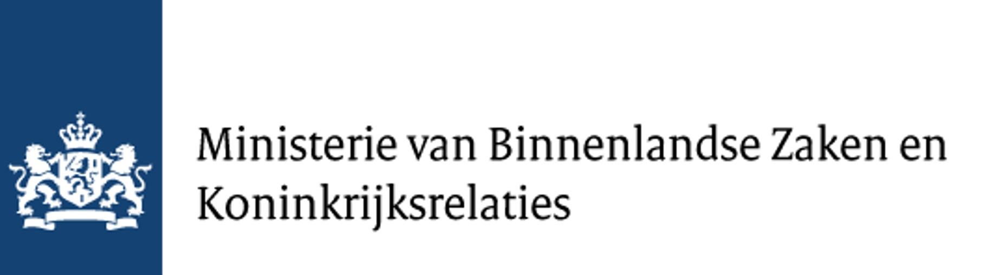

```{r, echo=FALSE, results='asis', message=FALSE, warning=FALSE}
dashboardr::.page_config(accessibility = TRUE, crosstab_prefix = "about")
```

<div style='text-align: justify;'>
### Doel van het onderzoek

De doelstellingen van WP2 waren (1) een overzicht geven van de huidige interventies met betrekking tot digitaal burgerschap in het Koninkrijk der Nederlanden, (2) te verduidelijken hoe deze interventies zich verhouden tot de expertperspectieven in WP1, en (3) onbenut potentieel voor de versterking van digitaal burgerschap te identificeren.

### Selectie van interventies

Interventies moesten zich richten op burgers en digitale competenties of randvoorwaarden voor deelname aan de digitale samenleving bieden, en worden uitgevoerd in (of duidelijk gericht zijn op burgers van) het Koninkrijk der Nederlanden. We raadpleegden overheidswebsites (www.digitaleoverheid.nl), het Ministerie van Binnenlandse Zaken en Koninkrijksrelaties, websites van relevante organisaties en netwerken (bijv. Netwerk Mediawijsheid) en experts op het gebied van digitaal burgerschap.

Deze zoektocht leverde een eerste steekproef van 177 interventies op. Interventies werden uitgesloten als ze zich buiten Nederland bevonden, de website ontoegankelijk was, of als ze niet over digitale participatie gingen, gericht waren op organisaties zonder directe focus op individuen, of een netwerk, onderzoeksproject, database, infrastructuur of subsidie betroffen. (Bijna) identieke interventies die onder een andere naam in meerdere gemeenten zijn uitgerold, zoals inloopspreekuren in buurthuizen of bibliotheken, zijn samengenomen.

### Codering

De uiteindelijke steekproef van 151 interventies werd geanalyseerd door drie getrainde codeerders volgens een deductief-inductieve aanpak. Het codeboek was gebaseerd op de definitie van digitaal burgerschap (kennis, vaardigheden, gedrag, actieve en verantwoorde participatie), beschrijvende informatie (type interventie, initiatiefnemer, looptijd) en beleidsrelevante informatie (sociaal probleem, inclusiviteit, verwachte uitkomst), vastgesteld in overleg met het Ministerie van Binnenlandse Zaken. Na een test op een sub-steekproef werd het codeboek verfijnd en uitgebreid. Doelgroepen werden gecodeerd op basis van wie expliciet als doelgroep werd genoemd; zonder expliciete doelgroep werd een interventie gecodeerd als gericht op de algemene bevolking.

### Over de cijfers

De grafieken in dit dashboard zijn rechtstreeks berekend uit het coderingsbestand. Percentages zijn berekend over de gecodeerde interventies. In de doelgroepcodering zijn *kinderen* en *jongeren* samengevoegd tot één categorie, en *alle burgers* en *niet gespecificeerd* tot *algemene bevolking*. De categorieën voor aangepakte problemen, verwachte uitkomsten (inductief) en looptijd komen uit het eindrapport *Grip op Digitaal Burgerschap*.

### Onderzoeksteam

**Marina Tulin**, **Olga Eisele**, **Alain Starke**, **Ernesto de León**, **Christian Burgers** en **Jessica Piotrowski**, Amsterdam School of Communication Research (ASCoR), Universiteit van Amsterdam.
</div>

<br><center></center>

