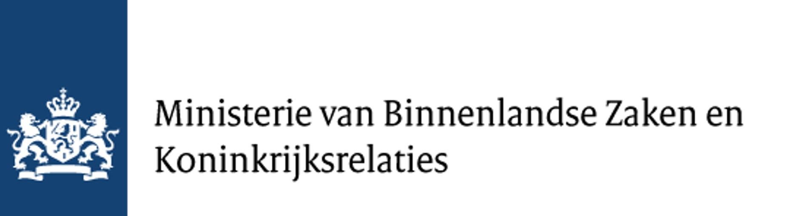

```{r, echo=FALSE, results='asis', message=FALSE, warning=FALSE}
dashboardr::.page_config(accessibility = TRUE, crosstab_prefix = "welkom_bij_het_digitaal_burgerschap_dashboard")
```

<div style='text-align: center;'>
Welkom bij het Digitaal Burgerschap Dashboard, met een overzicht van **151 interventies** die burgers in het Koninkrijk der Nederlanden helpen om actief en verantwoord deel te nemen aan de digitale samenleving.

Dit dashboard presenteert de resultaten van **WP2: Inventarisatie van interventies op het gebied van digitaal burgerschap**. We brachten in kaart op wie deze interventies zich richten, welke problemen ze aanpakken, welke vorm ze hebben en in hoeverre ze kennis, vaardigheden en gedrag bevorderen.

Digitaal burgerschap definiëren we als *een aangeleerde set competenties (vaardigheden, kennis en gedrag) die burgers in staat stellen actief en verantwoord deel te nemen aan de digitale samenleving*.
</div>

```{r setup}
#| echo: false
#| warning: false
#| message: false
#| error: false
#| results: 'hide'

# Load dashboardr (includes dplyr, highcharter as dependencies)
library(dashboardr)

# Global chunk options
knitr::opts_chunk$set(
  echo = FALSE,
  warning = FALSE,
  message = FALSE,
  error = FALSE,
  fig.width = 12,
  fig.height = 8,
  dpi = 300
)

```


<div style='text-align: center;'>

Klik hieronder op een thema (of gebruik het menu bovenaan) om de resultaten te bekijken. Voor achtergrondinformatie over de methode, zie **Meer info** rechtsboven.

</div>


```{=html}
<style>
  .dc-links { display: grid; grid-template-columns: repeat(auto-fit, minmax(240px, 1fr)); gap: 1rem; margin: 1.5rem 0; }
  .dc-link { display: block; padding: 1.1rem 1.2rem; border-radius: 10px; border: 1px solid #d9e3e2;
             border-left: 6px solid #3D7271; background: #f7faf9; color: inherit !important;
             text-decoration: none !important; transition: transform .15s ease, box-shadow .15s ease; }
  .dc-link:hover { transform: translateY(-2px); box-shadow: 0 4px 14px rgba(0,0,0,.08); }
  .dc-link-title { font-weight: 700; color: #3D7271; font-size: 1.05rem; margin-bottom: .3rem; }
  .dc-link-text { font-size: .92rem; color: #444; }
  </style>
<div class='dc-links'>
<a class='dc-link' href='target_groups.html'><div class='dc-link-title'><iconify-icon inline icon='ph:users-three-fill'></iconify-icon> Doelgroepen</div><div class='dc-link-text'>Op wie richten de interventies zich, en hoe inclusief zijn ze?</div></a>
<a class='dc-link' href='problems_outcomes.html'><div class='dc-link-title'><iconify-icon inline icon='ph:warning-circle-fill'></iconify-icon> Problemen & Uitkomsten</div><div class='dc-link-text'>Welke problemen pakken ze aan en wat willen ze bereiken?</div></a>
<a class='dc-link' href='intervention_types.html'><div class='dc-link-title'><iconify-icon inline icon='ph:shapes-fill'></iconify-icon> Vormen & Levensdomeinen</div><div class='dc-link-text'>Welke vorm hebben de interventies en welke levensdomeinen raken ze?</div></a>
<a class='dc-link' href='competencies.html'><div class='dc-link-title'><iconify-icon inline icon='ph:lightning-fill'></iconify-icon> Competenties & Participatie</div><div class='dc-link-text'>Kennis, vaardigheden, gedrag en actieve en verantwoorde participatie</div></a>
<a class='dc-link' href='initiators_scope.html'><div class='dc-link-title'><iconify-icon inline icon='ph:buildings-fill'></iconify-icon> Initiatiefnemers & Reikwijdte</div><div class='dc-link-text'>Wie neemt het initiatief, op welk niveau en hoe lang?</div></a>
<a class='dc-link' href='recommendations.html'><div class='dc-link-title'><iconify-icon inline icon='ph:lightbulb-fill'></iconify-icon> Aanbevelingen</div><div class='dc-link-text'>Conclusies en aanbevelingen uit het onderzoek</div></a>
<a class='dc-link' href='interventions.html'><div class='dc-link-title'><iconify-icon inline icon='ph:list-magnifying-glass'></iconify-icon> Alle Interventies</div><div class='dc-link-text'>Doorzoek en filter de volledige inventarisatie</div></a>
</div>
```


<br><center></center>

