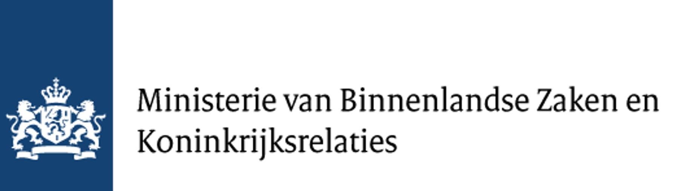

```{r, echo=FALSE, results='asis', message=FALSE, warning=FALSE}
dashboardr::.page_config(accessibility = TRUE, crosstab_prefix = "about")
```

<div style='text-align: justify;'>
### Aim of the study

The aims of WP2 were to (1) provide an overview of current interventions regarding digital citizenship in the Kingdom of the Netherlands, (2) clarify how these interventions relate to expert perspectives in WP1, and (3) identify unused potential in strengthening digital citizenship.

### Selecting interventions

Interventions had to focus on citizens and target digital competencies or basic prerequisites for participation in the digital society, and be implemented in (or clearly target citizens of) the Kingdom of the Netherlands. We scouted government websites (www.digitaleoverheid.nl), the Ministry of the Interior and Kingdom Relations, websites of relevant organisations and networks (e.g., Netwerk Mediawijsheid), and consulted experts on digital citizenship.

This search led to an initial sample of 177 interventions. Interventions were excluded if they were located outside the Netherlands, if their website was inaccessible, or if they were not about digital participation, targeted organisations without an immediate focus on individuals, or were a network, research project, database, infrastructure or subsidy. (Nearly) identical interventions rolled out under different names in several municipalities, such as walk-in help sessions in community centres or libraries, were merged.

### Coding

The final sample of 151 interventions was analysed by three trained coders following a deductive-inductive approach. The codebook was based on the definition of digital citizenship (knowledge, skills, behaviours, active and responsible participation), descriptive information (type of intervention, initiator, runtime) and policy-relevant information (social problem, inclusiveness, expected outcome), defined after discussion with the Ministry of the Interior. After testing on a subsample, the codebook was refined and expanded. Target groups were coded based on who was explicitly named as the target group; interventions without an explicit target group were coded as aimed at the general population.

### About the figures

The charts in this dashboard are computed directly from the coding sheet. Percentages are based on the coded interventions. In the target group coding, *children* and *youth* were merged into one category, and *all citizens* and *unspecified* into *general population*. The categories for problems addressed, expected outcomes (inductive) and runtime are taken from the final report *Grip op Digitaal Burgerschap*.

### Research team

**Marina Tulin**, **Olga Eisele**, **Alain Starke**, **Ernesto de León**, **Christian Burgers** and **Jessica Piotrowski**, Amsterdam School of Communication Research (ASCoR), University of Amsterdam.
</div>

<br><center></center>

