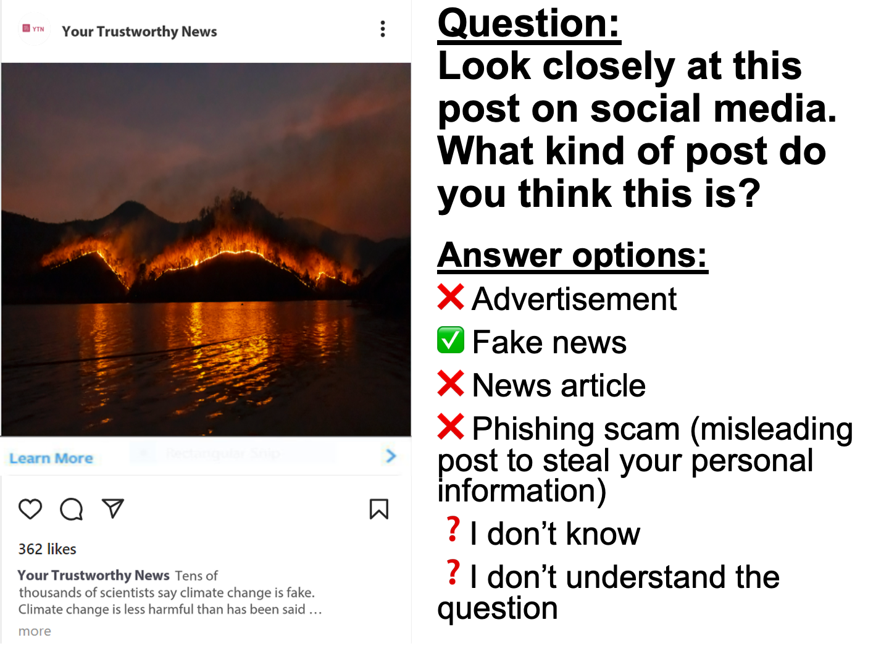
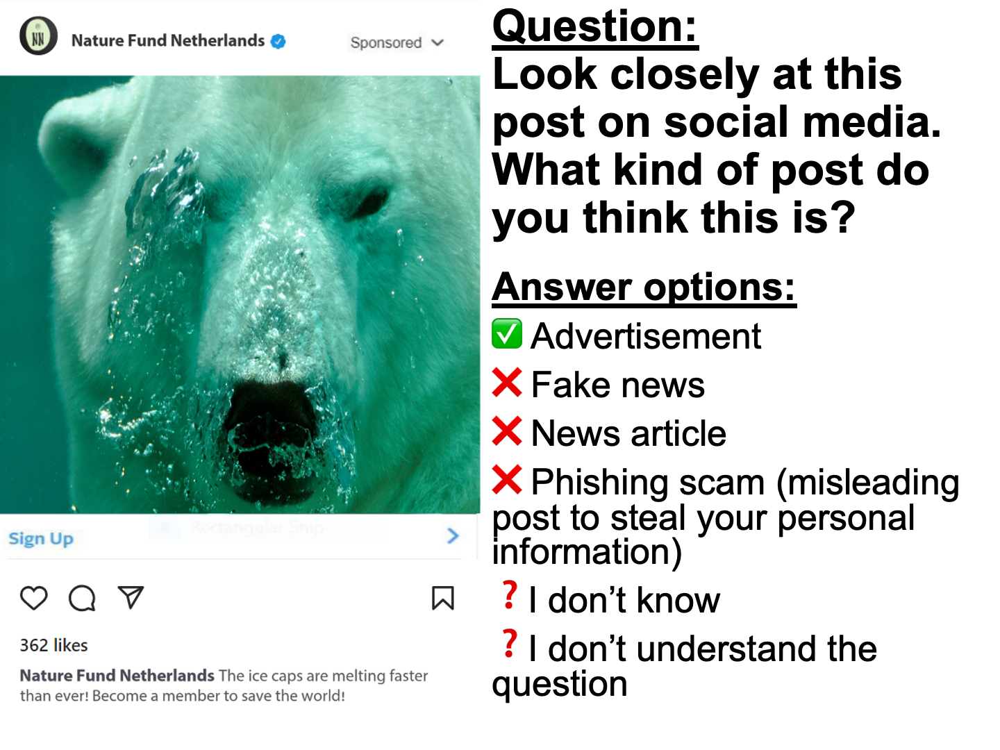
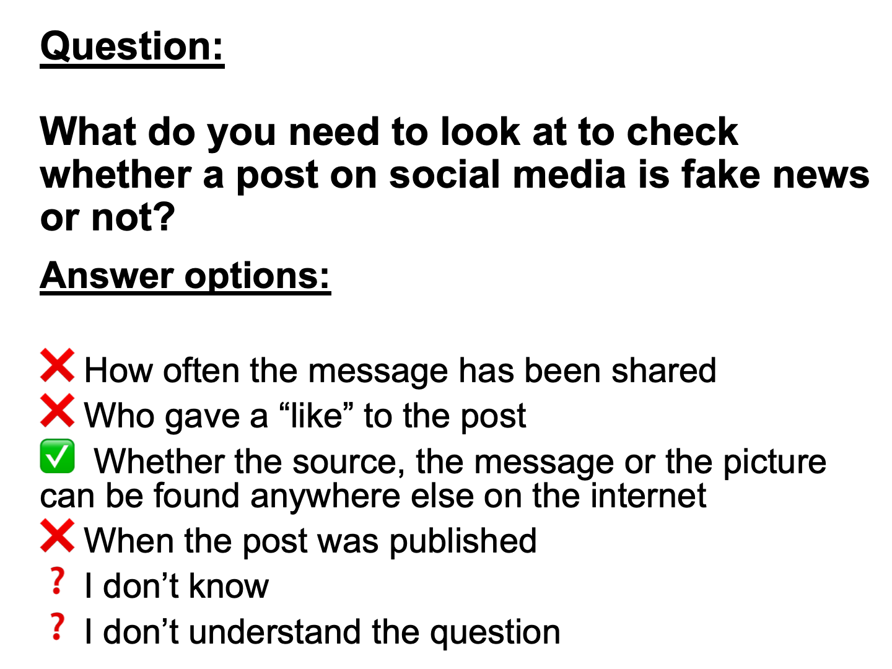

```{r, echo=FALSE, results='asis', message=FALSE, warning=FALSE}
dashboardr::.page_config(accessibility = TRUE, modals = TRUE, crosstab_prefix = "critical_information")
```

```{=html}
<style>
  /* DigIQ Unified Theme & Color Palette Overrides */
  html { scroll-behavior: smooth; }
  section.level2 { scroll-margin-top: 85px; }

  /* Navbar hover readability */
  .navbar a:hover, .navbar .navbar-brand:hover, .navbar .navbar-nav .nav-link:hover {
    color: #3D7271 !important;
  }
  .navbar a:hover svg, .navbar .aa-DetachedSearchButton:hover svg, .navbar button:hover svg {
    fill: #3D7271 !important;
    stroke: #3D7271 !important;
  }

  /* Underline tabsets in DigIQ Teal & Terracotta instead of default royal blue */
  .panel-tabset .nav-item a::after {
    background-color: #E28D50 !important;
  }
  .panel-tabset .nav-tabs .nav-link.active {
    color: #0F6B5A !important;
    font-weight: 700 !important;
  }
  .panel-tabset .nav-tabs .nav-link.active::after {
    background-color: #3D7271 !important;
    height: 3px !important;
  }

  /* Question blockquotes in DigIQ Teal & Soft Mint */
  blockquote.blockquote {
    border-left: 5px solid #3D7271 !important;
    background: linear-gradient(90deg, #f2f8f6 0%, #f9fbfb 100%) !important;
    color: #243b3a !important;
    border-radius: 0 10px 10px 0 !important;
    padding: 14px 22px !important;
    box-shadow: 0 2px 6px rgba(61, 114, 113, 0.06) !important;
  }

  /* Clickable modal links inside question blockquotes */
  a.modal-link {
    display: inline-flex;
    align-items: center;
    gap: 4px;
    background-color: #e4f2ee;
    color: #0F6B5A !important;
    padding: 2px 9px;
    border-radius: 6px;
    border: 1px solid #b5ded2;
    font-weight: 600;
    text-decoration: none !important;
    transition: all 0.18s ease;
  }
  a.modal-link:hover {
    background-color: #3D7271;
    color: #ffffff !important;
    border-color: #3D7271;
    transform: translateY(-1px);
  }

  /* Wave 3 missing-data callout note on Performance sections */
  .dc-wave3-note {
    display: flex;
    align-items: flex-start;
    gap: 0.6rem;
    border-left: 4px solid #E28D50;
    background-color: #fdf6ef;
    color: #6e3b14;
    padding: 0.7rem 1.05rem;
    border-radius: 0 8px 8px 0;
    margin: 0.75rem 0 1rem 0;
    font-size: 0.93rem;
    line-height: 1.5;
  }
  .dc-wave3-note iconify-icon {
    color: #E28D50;
    font-size: 1.2rem;
    flex-shrink: 0;
    margin-top: 0.12rem;
  }

  /* Landing page hero & info banner */
  .dc-hero {
    max-width: 920px;
    margin: 0.5rem auto 1.75rem auto;
    padding: 1.5rem 2rem;
    background: linear-gradient(135deg, #f4f9f7 0%, #ebf4f1 100%);
    border: 1px solid #d5e5e1;
    border-top: 4px solid #3D7271;
    border-radius: 14px;
    text-align: center;
    color: #243b3a;
    box-shadow: 0 4px 16px rgba(31, 63, 62, 0.05);
  }
  .dc-hero p:first-child {
    font-size: 1.18rem;
    font-weight: 600;
    color: #0F6B5A;
    margin-bottom: 0.65rem;
  }
  .dc-hero p:last-child {
    font-size: 1.01rem;
    line-height: 1.65;
    color: #334e4d;
    margin-bottom: 0;
  }

  /* Landing page 11-tile grid */
  .dc-links {
    display: grid;
    grid-template-columns: repeat(auto-fit, minmax(280px, 1fr));
    gap: 1.15rem;
    margin: 1.5rem 0 2rem 0;
  }
  @media (min-width: 1100px) {
    .dc-links {
      grid-template-columns: repeat(6, minmax(0, 1fr));
    }
    .dc-links > .dc-link {
      grid-column: span 2;
    }
    /* Center the final 2 cards (10 & 11) on the bottom row */
    .dc-links > .dc-link:nth-child(10) {
      grid-column: 2 / span 2;
    }
    .dc-links > .dc-link:nth-child(11) {
      grid-column: 4 / span 2;
    }
  }
  .dc-link {
    display: flex;
    flex-direction: column;
    justify-content: space-between;
    padding: 1.25rem 1.35rem;
    border-radius: 13px;
    border: 1px solid #d5e3e0;
    border-left: 6px solid #3D7271;
    background: #ffffff;
    color: inherit !important;
    text-decoration: none !important;
    text-align: left;
    box-shadow: 0 2px 10px rgba(31, 63, 62, 0.05);
    transition: transform 0.2s ease, box-shadow 0.2s ease, border-color 0.2s ease, background-color 0.2s ease;
  }
  .dc-link:hover {
    transform: translateY(-4px);
    box-shadow: 0 12px 24px rgba(31, 63, 62, 0.12);
    border-color: #3D7271;
    border-left-color: #E28D50;
    background: #fbfdfc;
  }
  .dc-card-header {
    display: flex;
    align-items: center;
    gap: 0.75rem;
    margin-bottom: 0.6rem;
  }
  .dc-card-icon {
    width: 42px;
    height: 42px;
    border-radius: 11px;
    background: linear-gradient(135deg, #e6f4f0 0%, #c7e6d5 100%);
    color: #0F6B5A;
    display: inline-flex;
    align-items: center;
    justify-content: center;
    font-size: 1.35rem;
    flex-shrink: 0;
    transition: background 0.2s ease, color 0.2s ease, transform 0.2s ease;
  }
  .dc-link:hover .dc-card-icon {
    background: #3D7271;
    color: #ffffff;
    transform: scale(1.05);
  }
  .dc-link-title {
    font-weight: 700;
    color: #1f3f3e;
    font-size: 1.06rem;
    line-height: 1.25;
    flex-grow: 1;
    transition: color 0.2s ease;
  }
  .dc-link:hover .dc-link-title {
    color: #0F6B5A;
  }
  .dc-card-arrow {
    color: #9ab3b0;
    font-size: 1.05rem;
    transition: transform 0.2s ease, color 0.2s ease;
    flex-shrink: 0;
  }
  .dc-link:hover .dc-card-arrow {
    transform: translateX(4px);
    color: #E28D50;
  }
  .dc-link-text {
    font-size: 0.91rem;
    line-height: 1.5;
    color: #4a5b5a;
    margin-bottom: 0.9rem;
    flex-grow: 1;
  }
  .dc-card-tags {
    display: flex;
    flex-wrap: wrap;
    gap: 0.4rem;
    padding-top: 0.65rem;
    border-top: 1px solid #edf3f2;
  }
  .dc-tag {
    display: inline-flex;
    align-items: center;
    gap: 0.28rem;
    font-size: 0.74rem;
    font-weight: 600;
    padding: 0.2rem 0.55rem;
    border-radius: 999px;
    letter-spacing: 0.01em;
  }
  .dc-tag-skills {
    background-color: #e6f4f0;
    color: #0F6B5A;
    border: 1px solid #bfe3d7;
  }
  .dc-tag-knowledge {
    background-color: #fef6dc;
    color: #825600;
    border: 1px solid #f0d57d;
  }
  .dc-tag-perf {
    background-color: #fdede2;
    color: #9c4215;
    border: 1px solid #eeb998;
  }

  /* Dimension page intro card & clickable measurement jump-pills */
  .dc-dim-intro {
    background: linear-gradient(135deg, #f6faf9 0%, #ecf4f2 100%);
    border: 1px solid #d3e3e0;
    border-left: 6px solid #3D7271;
    border-radius: 13px;
    padding: 1.25rem 1.5rem;
    margin: 0.75rem 0 1.75rem 0;
    box-shadow: 0 3px 12px rgba(31, 63, 62, 0.05);
  }
  .dc-dim-intro > p {
    font-size: 1.03rem;
    line-height: 1.65;
    color: #243b3a;
    margin-bottom: 0.85rem;
  }
  .dc-jump-row {
    display: flex;
    flex-wrap: wrap;
    align-items: center;
    gap: 0.45rem;
    padding-top: 0.75rem;
    border-top: 1px solid rgba(61, 114, 113, 0.15);
    font-size: 0.96rem;
    color: #2f4b4a;
  }
  .dc-jump-label {
    font-weight: 600;
    color: #1f3f3e;
    margin-right: 0.15rem;
  }
  .dc-jump-sep {
    color: #546e6d;
    margin-right: 0.1rem;
  }
  a.dc-jump-pill {
    display: inline-flex;
    align-items: center;
    gap: 0.38rem;
    padding: 0.32rem 0.82rem;
    border-radius: 999px;
    font-size: 0.89rem;
    font-weight: 600;
    text-decoration: none !important;
    transition: transform 0.18s ease, box-shadow 0.18s ease, background-color 0.18s ease, color 0.18s ease, border-color 0.18s ease;
    box-shadow: 0 1px 4px rgba(0, 0, 0, 0.05);
  }
  a.dc-jump-pill:hover {
    transform: translateY(-2px);
    box-shadow: 0 5px 12px rgba(31, 63, 62, 0.15);
  }
  .dc-jump-arrow {
    font-size: 0.8rem;
    opacity: 0.8;
    transition: transform 0.18s ease;
  }
  a.dc-jump-pill:hover .dc-jump-arrow {
    transform: translateY(2px);
    opacity: 1;
  }
  a.dc-jump-skills {
    background-color: #e6f4f0;
    color: #0F6B5A !important;
    border: 1px solid #b3ddd0;
  }
  a.dc-jump-skills:hover {
    background-color: #3D7271;
    color: #ffffff !important;
    border-color: #3D7271;
  }
  a.dc-jump-knowledge {
    background-color: #fef6dc;
    color: #7d5200 !important;
    border: 1px solid #ebd076;
  }
  a.dc-jump-knowledge:hover {
    background-color: #c98f12;
    color: #ffffff !important;
    border-color: #c98f12;
  }
  a.dc-jump-perf {
    background-color: #fdede2;
    color: #9c4215 !important;
    border: 1px solid #ebb491;
  }
  a.dc-jump-perf:hover {
    background-color: #E28D50;
    color: #ffffff !important;
    border-color: #E28D50;
  }
</style>
```

::: {.dc-dim-intro}
**Critical Information Competence** is the ability to evaluate online information: checking whether information is true, assessing website reliability, and understanding the purpose of online content (to inform, influence, entertain, or sell).

```{=html}
<div class='dc-jump-row'><span class='dc-jump-label'>It is measured in three ways:</span> <a class='dc-jump-pill dc-jump-skills' href='#critical-info-skills'><iconify-icon inline icon='ph:lightning-fill'></iconify-icon> <span>self-assessed skills</span> <span class='dc-jump-arrow'>&#8595;</span></a><span class='dc-jump-sep'>,</span> <a class='dc-jump-pill dc-jump-knowledge' href='#critical-info-knowledge'><iconify-icon inline icon='ph:book-open-fill'></iconify-icon> <span>items testing knowledge</span> <span class='dc-jump-arrow'>&#8595;</span></a><span class='dc-jump-sep'>, and</span> <a class='dc-jump-pill dc-jump-perf' href='#critical-info-performance'><iconify-icon inline icon='ph:clipboard-text'></iconify-icon> <span>performance/behavior</span> <span class='dc-jump-arrow'>&#8595;</span></a><span class='dc-jump-sep'>.</span></div>
```
:::

```{r setup}
#| echo: false
#| warning: false
#| message: false
#| error: false
#| results: 'hide'

# Load dashboardr (includes dplyr, highcharter as dependencies)
library(dashboardr)

# Global chunk options
knitr::opts_chunk$set(
  echo = FALSE,
  warning = FALSE,
  message = FALSE,
  error = FALSE,
  fig.width = 12,
  fig.height = 8,
  dpi = 300
)

# Load data
data <- readRDS('dataset_large_5307obs.rds')

# Data summary
cat('Dataset loaded:', nrow(data), 'rows,', ncol(data), 'columns\n')

# Create filtered datasets
# Each filter is applied once and reused across visualizations

data_filtered_984a0efe <- dashboardr::.convert_haven(data) %>% dplyr::filter(wave == 1)
data_filtered_4af682fd <- dashboardr::.convert_haven(data) %>% dplyr::filter(wave == 2)
data_filtered_5311412c <- dashboardr::.convert_haven(data) %>% dplyr::filter(wave == 3)
data_filtered_f45d3309 <- dashboardr::.convert_haven(data) %>% dplyr::filter(wave %in% c(1, 2))

```

##  Critical Info Skills


**Skills** measures participants’ *self-assessed ability* to perform a wide range of digital tasks. These items capture how confident people feel doing things like searching for information.
```{r, echo=FALSE, message=FALSE, warning=FALSE}
create_blockquote("Think about the extent to which each sentence applies to you, if you would have to do this activity now and without help. Please be honest. It is very normal that you never do some things. We'd like to know this. If you don't understand what the question means, please choose 'I don't understand the question.' Do you recognize yourself in the following statements?", preset = "question")
```


::: {.panel-tabset}

###  Wave 1


::: {.panel-tabset}

#####  Overall


```{r cis-wave1-overall}
# Critical Information Skills
result <- viz_stackedbars(
  data = data_filtered_984a0efe,
  title = "Critical Information Skills",
  x_vars = c("SInfo5", "SInfo6", "SInfo7"),
  x_var_labels = c("I know how I can check if the information I find on the internet is true", "I know how I can check if a website is reliable", "I can assess what the goal of online information is (e.g., to inform, influence, entertain or sell)"),
  stacked_type = "percent",
  color_palette = c("#3D7271", "#E28D50", "#F5D76E", "#C7E6D5", "#0F6B5A", "#BABACD"),
  horizontal = TRUE,
  x_label = "",
  stack_breaks = c(0.5, 2.5, 3.5, 5.5),
  stack_bin_labels = c("(Completely) Untrue (1-2)", "Not true and not untrue (3)", "(Completely) True (4-5)"),
  stack_order = c("(Completely) True (4-5)", "Not true and not untrue (3)", "(Completely) Untrue (1-2)"),
  stack_label = NULL,
  weight_var = "weging_GAMO"
)

result
```


#####  Age


::: {.panel-tabset}

######  Question 1


```{r cis-wave1-age-item1}
# I know how I can check if the information I find on the internet is true
result <- viz_stackedbar(
  data = data_filtered_984a0efe,
  title = "I know how I can check if the information I find on the internet is true",
  stacked_type = "percent",
  horizontal = TRUE,
  stack_breaks = c(0.5, 2.5, 3.5, 5.5),
  stack_bin_labels = c("(Completely) Untrue (1-2)", "Not true and not untrue (3)", "(Completely) True (4-5)"),
  stack_order = c("(Completely) True (4-5)", "Not true and not untrue (3)", "(Completely) Untrue (1-2)"),
  color_palette = c("#3D7271", "#E28D50", "#F5D76E", "#C7E6D5", "#0F6B5A", "#BABACD"),
  weight_var = "weging_GAMO",
  x_var = "AgeGroup",
  x_label = "Age",
  stack_var = "SInfo5"
)

result
```


######  Question 2


```{r cis-wave1-age-item2}
# I know how I can check if a website is reliable
result <- viz_stackedbar(
  data = data_filtered_984a0efe,
  title = "I know how I can check if a website is reliable",
  stacked_type = "percent",
  horizontal = TRUE,
  stack_breaks = c(0.5, 2.5, 3.5, 5.5),
  stack_bin_labels = c("(Completely) Untrue (1-2)", "Not true and not untrue (3)", "(Completely) True (4-5)"),
  stack_order = c("(Completely) True (4-5)", "Not true and not untrue (3)", "(Completely) Untrue (1-2)"),
  color_palette = c("#3D7271", "#E28D50", "#F5D76E", "#C7E6D5", "#0F6B5A", "#BABACD"),
  weight_var = "weging_GAMO",
  x_var = "AgeGroup",
  x_label = "Age",
  stack_var = "SInfo6"
)

result
```


######  Question 3


```{r cis-wave1-age-item3}
# I can assess what the goal of online information is (e.g., to inform, influence, entertain or sell)
result <- viz_stackedbar(
  data = data_filtered_984a0efe,
  title = "I can assess what the goal of online information is (e.g., to inform, influence, entertain or sell)",
  stacked_type = "percent",
  horizontal = TRUE,
  stack_breaks = c(0.5, 2.5, 3.5, 5.5),
  stack_bin_labels = c("(Completely) Untrue (1-2)", "Not true and not untrue (3)", "(Completely) True (4-5)"),
  stack_order = c("(Completely) True (4-5)", "Not true and not untrue (3)", "(Completely) Untrue (1-2)"),
  color_palette = c("#3D7271", "#E28D50", "#F5D76E", "#C7E6D5", "#0F6B5A", "#BABACD"),
  weight_var = "weging_GAMO",
  x_var = "AgeGroup",
  x_label = "Age",
  stack_var = "SInfo7"
)

result
```


:::


#####  Gender


::: {.panel-tabset}

######  Question 1


```{r cis-wave1-gender-item1}
# I know how I can check if the information I find on the internet is true
result <- viz_stackedbar(
  data = data_filtered_984a0efe,
  title = "I know how I can check if the information I find on the internet is true",
  stacked_type = "percent",
  horizontal = TRUE,
  stack_breaks = c(0.5, 2.5, 3.5, 5.5),
  stack_bin_labels = c("(Completely) Untrue (1-2)", "Not true and not untrue (3)", "(Completely) True (4-5)"),
  stack_order = c("(Completely) True (4-5)", "Not true and not untrue (3)", "(Completely) Untrue (1-2)"),
  color_palette = c("#3D7271", "#E28D50", "#F5D76E", "#C7E6D5", "#0F6B5A", "#BABACD"),
  weight_var = "weging_GAMO",
  x_var = "geslacht",
  x_label = "Gender",
  stack_var = "SInfo5"
)

result
```


######  Question 2


```{r cis-wave1-gender-item2}
# I know how I can check if a website is reliable
result <- viz_stackedbar(
  data = data_filtered_984a0efe,
  title = "I know how I can check if a website is reliable",
  stacked_type = "percent",
  horizontal = TRUE,
  stack_breaks = c(0.5, 2.5, 3.5, 5.5),
  stack_bin_labels = c("(Completely) Untrue (1-2)", "Not true and not untrue (3)", "(Completely) True (4-5)"),
  stack_order = c("(Completely) True (4-5)", "Not true and not untrue (3)", "(Completely) Untrue (1-2)"),
  color_palette = c("#3D7271", "#E28D50", "#F5D76E", "#C7E6D5", "#0F6B5A", "#BABACD"),
  weight_var = "weging_GAMO",
  x_var = "geslacht",
  x_label = "Gender",
  stack_var = "SInfo6"
)

result
```


######  Question 3


```{r cis-wave1-gender-item3}
# I can assess what the goal of online information is (e.g., to inform, influence, entertain or sell)
result <- viz_stackedbar(
  data = data_filtered_984a0efe,
  title = "I can assess what the goal of online information is (e.g., to inform, influence, entertain or sell)",
  stacked_type = "percent",
  horizontal = TRUE,
  stack_breaks = c(0.5, 2.5, 3.5, 5.5),
  stack_bin_labels = c("(Completely) Untrue (1-2)", "Not true and not untrue (3)", "(Completely) True (4-5)"),
  stack_order = c("(Completely) True (4-5)", "Not true and not untrue (3)", "(Completely) Untrue (1-2)"),
  color_palette = c("#3D7271", "#E28D50", "#F5D76E", "#C7E6D5", "#0F6B5A", "#BABACD"),
  weight_var = "weging_GAMO",
  x_var = "geslacht",
  x_label = "Gender",
  stack_var = "SInfo7"
)

result
```


:::


#####  Education


::: {.panel-tabset}

######  Question 1


```{r cis-wave1-edu-item1}
# I know how I can check if the information I find on the internet is true
result <- viz_stackedbar(
  data = data_filtered_984a0efe,
  title = "I know how I can check if the information I find on the internet is true",
  stacked_type = "percent",
  horizontal = TRUE,
  stack_breaks = c(0.5, 2.5, 3.5, 5.5),
  stack_bin_labels = c("(Completely) Untrue (1-2)", "Not true and not untrue (3)", "(Completely) True (4-5)"),
  stack_order = c("(Completely) True (4-5)", "Not true and not untrue (3)", "(Completely) Untrue (1-2)"),
  color_palette = c("#3D7271", "#E28D50", "#F5D76E", "#C7E6D5", "#0F6B5A", "#BABACD"),
  weight_var = "weging_GAMO",
  x_var = "Education",
  x_label = "Education",
  stack_var = "SInfo5"
)

result
```


######  Question 2


```{r cis-wave1-edu-item2}
# I know how I can check if a website is reliable
result <- viz_stackedbar(
  data = data_filtered_984a0efe,
  title = "I know how I can check if a website is reliable",
  stacked_type = "percent",
  horizontal = TRUE,
  stack_breaks = c(0.5, 2.5, 3.5, 5.5),
  stack_bin_labels = c("(Completely) Untrue (1-2)", "Not true and not untrue (3)", "(Completely) True (4-5)"),
  stack_order = c("(Completely) True (4-5)", "Not true and not untrue (3)", "(Completely) Untrue (1-2)"),
  color_palette = c("#3D7271", "#E28D50", "#F5D76E", "#C7E6D5", "#0F6B5A", "#BABACD"),
  weight_var = "weging_GAMO",
  x_var = "Education",
  x_label = "Education",
  stack_var = "SInfo6"
)

result
```


######  Question 3


```{r cis-wave1-edu-item3}
# I can assess what the goal of online information is (e.g., to inform, influence, entertain or sell)
result <- viz_stackedbar(
  data = data_filtered_984a0efe,
  title = "I can assess what the goal of online information is (e.g., to inform, influence, entertain or sell)",
  stacked_type = "percent",
  horizontal = TRUE,
  stack_breaks = c(0.5, 2.5, 3.5, 5.5),
  stack_bin_labels = c("(Completely) Untrue (1-2)", "Not true and not untrue (3)", "(Completely) True (4-5)"),
  stack_order = c("(Completely) True (4-5)", "Not true and not untrue (3)", "(Completely) Untrue (1-2)"),
  color_palette = c("#3D7271", "#E28D50", "#F5D76E", "#C7E6D5", "#0F6B5A", "#BABACD"),
  weight_var = "weging_GAMO",
  x_var = "Education",
  x_label = "Education",
  stack_var = "SInfo7"
)

result
```


:::


#####  Migration Background


::: {.panel-tabset}

######  Question 1


```{r cis-wave1-mig-item1}
# I know how I can check if the information I find on the internet is true
result <- viz_stackedbar(
  data = data_filtered_984a0efe,
  title = "I know how I can check if the information I find on the internet is true",
  stacked_type = "percent",
  horizontal = TRUE,
  stack_breaks = c(0.5, 2.5, 3.5, 5.5),
  stack_bin_labels = c("(Completely) Untrue (1-2)", "Not true and not untrue (3)", "(Completely) True (4-5)"),
  stack_order = c("(Completely) True (4-5)", "Not true and not untrue (3)", "(Completely) Untrue (1-2)"),
  color_palette = c("#3D7271", "#E28D50", "#F5D76E", "#C7E6D5", "#0F6B5A", "#BABACD"),
  weight_var = "weging_GAMO",
  x_var = "MigrationBackground",
  x_label = "Migration Background",
  stack_var = "SInfo5"
)

result
```


######  Question 2


```{r cis-wave1-mig-item2}
# I know how I can check if a website is reliable
result <- viz_stackedbar(
  data = data_filtered_984a0efe,
  title = "I know how I can check if a website is reliable",
  stacked_type = "percent",
  horizontal = TRUE,
  stack_breaks = c(0.5, 2.5, 3.5, 5.5),
  stack_bin_labels = c("(Completely) Untrue (1-2)", "Not true and not untrue (3)", "(Completely) True (4-5)"),
  stack_order = c("(Completely) True (4-5)", "Not true and not untrue (3)", "(Completely) Untrue (1-2)"),
  color_palette = c("#3D7271", "#E28D50", "#F5D76E", "#C7E6D5", "#0F6B5A", "#BABACD"),
  weight_var = "weging_GAMO",
  x_var = "MigrationBackground",
  x_label = "Migration Background",
  stack_var = "SInfo6"
)

result
```


######  Question 3


```{r cis-wave1-mig-item3}
# I can assess what the goal of online information is (e.g., to inform, influence, entertain or sell)
result <- viz_stackedbar(
  data = data_filtered_984a0efe,
  title = "I can assess what the goal of online information is (e.g., to inform, influence, entertain or sell)",
  stacked_type = "percent",
  horizontal = TRUE,
  stack_breaks = c(0.5, 2.5, 3.5, 5.5),
  stack_bin_labels = c("(Completely) Untrue (1-2)", "Not true and not untrue (3)", "(Completely) True (4-5)"),
  stack_order = c("(Completely) True (4-5)", "Not true and not untrue (3)", "(Completely) Untrue (1-2)"),
  color_palette = c("#3D7271", "#E28D50", "#F5D76E", "#C7E6D5", "#0F6B5A", "#BABACD"),
  weight_var = "weging_GAMO",
  x_var = "MigrationBackground",
  x_label = "Migration Background",
  stack_var = "SInfo7"
)

result
```


:::


:::


###  Wave 2


::: {.panel-tabset}

#####  Overall


```{r cis-wave2-overall}
# Critical Information Skills
result <- viz_stackedbars(
  data = data_filtered_4af682fd,
  title = "Critical Information Skills",
  x_vars = c("SInfo5", "SInfo6", "SInfo7"),
  x_var_labels = c("I know how I can check if the information I find on the internet is true", "I know how I can check if a website is reliable", "I can assess what the goal of online information is (e.g., to inform, influence, entertain or sell)"),
  stacked_type = "percent",
  color_palette = c("#3D7271", "#E28D50", "#F5D76E", "#C7E6D5", "#0F6B5A", "#BABACD"),
  horizontal = TRUE,
  x_label = "",
  stack_breaks = c(0.5, 2.5, 3.5, 5.5),
  stack_bin_labels = c("(Completely) Untrue (1-2)", "Not true and not untrue (3)", "(Completely) True (4-5)"),
  stack_order = c("(Completely) True (4-5)", "Not true and not untrue (3)", "(Completely) Untrue (1-2)"),
  stack_label = NULL,
  weight_var = "weging_GAMO"
)

result
```


#####  Age


::: {.panel-tabset}

######  Question 1


```{r cis-wave2-age-item1}
# I know how I can check if the information I find on the internet is true
result <- viz_stackedbar(
  data = data_filtered_4af682fd,
  title = "I know how I can check if the information I find on the internet is true",
  stacked_type = "percent",
  horizontal = TRUE,
  stack_breaks = c(0.5, 2.5, 3.5, 5.5),
  stack_bin_labels = c("(Completely) Untrue (1-2)", "Not true and not untrue (3)", "(Completely) True (4-5)"),
  stack_order = c("(Completely) True (4-5)", "Not true and not untrue (3)", "(Completely) Untrue (1-2)"),
  color_palette = c("#3D7271", "#E28D50", "#F5D76E", "#C7E6D5", "#0F6B5A", "#BABACD"),
  weight_var = "weging_GAMO",
  x_var = "AgeGroup",
  x_label = "Age",
  stack_var = "SInfo5"
)

result
```


######  Question 2


```{r cis-wave2-age-item2}
# I know how I can check if a website is reliable
result <- viz_stackedbar(
  data = data_filtered_4af682fd,
  title = "I know how I can check if a website is reliable",
  stacked_type = "percent",
  horizontal = TRUE,
  stack_breaks = c(0.5, 2.5, 3.5, 5.5),
  stack_bin_labels = c("(Completely) Untrue (1-2)", "Not true and not untrue (3)", "(Completely) True (4-5)"),
  stack_order = c("(Completely) True (4-5)", "Not true and not untrue (3)", "(Completely) Untrue (1-2)"),
  color_palette = c("#3D7271", "#E28D50", "#F5D76E", "#C7E6D5", "#0F6B5A", "#BABACD"),
  weight_var = "weging_GAMO",
  x_var = "AgeGroup",
  x_label = "Age",
  stack_var = "SInfo6"
)

result
```


######  Question 3


```{r cis-wave2-age-item3}
# I can assess what the goal of online information is (e.g., to inform, influence, entertain or sell)
result <- viz_stackedbar(
  data = data_filtered_4af682fd,
  title = "I can assess what the goal of online information is (e.g., to inform, influence, entertain or sell)",
  stacked_type = "percent",
  horizontal = TRUE,
  stack_breaks = c(0.5, 2.5, 3.5, 5.5),
  stack_bin_labels = c("(Completely) Untrue (1-2)", "Not true and not untrue (3)", "(Completely) True (4-5)"),
  stack_order = c("(Completely) True (4-5)", "Not true and not untrue (3)", "(Completely) Untrue (1-2)"),
  color_palette = c("#3D7271", "#E28D50", "#F5D76E", "#C7E6D5", "#0F6B5A", "#BABACD"),
  weight_var = "weging_GAMO",
  x_var = "AgeGroup",
  x_label = "Age",
  stack_var = "SInfo7"
)

result
```


:::


#####  Gender


::: {.panel-tabset}

######  Question 1


```{r cis-wave2-gender-item1}
# I know how I can check if the information I find on the internet is true
result <- viz_stackedbar(
  data = data_filtered_4af682fd,
  title = "I know how I can check if the information I find on the internet is true",
  stacked_type = "percent",
  horizontal = TRUE,
  stack_breaks = c(0.5, 2.5, 3.5, 5.5),
  stack_bin_labels = c("(Completely) Untrue (1-2)", "Not true and not untrue (3)", "(Completely) True (4-5)"),
  stack_order = c("(Completely) True (4-5)", "Not true and not untrue (3)", "(Completely) Untrue (1-2)"),
  color_palette = c("#3D7271", "#E28D50", "#F5D76E", "#C7E6D5", "#0F6B5A", "#BABACD"),
  weight_var = "weging_GAMO",
  x_var = "geslacht",
  x_label = "Gender",
  stack_var = "SInfo5"
)

result
```


######  Question 2


```{r cis-wave2-gender-item2}
# I know how I can check if a website is reliable
result <- viz_stackedbar(
  data = data_filtered_4af682fd,
  title = "I know how I can check if a website is reliable",
  stacked_type = "percent",
  horizontal = TRUE,
  stack_breaks = c(0.5, 2.5, 3.5, 5.5),
  stack_bin_labels = c("(Completely) Untrue (1-2)", "Not true and not untrue (3)", "(Completely) True (4-5)"),
  stack_order = c("(Completely) True (4-5)", "Not true and not untrue (3)", "(Completely) Untrue (1-2)"),
  color_palette = c("#3D7271", "#E28D50", "#F5D76E", "#C7E6D5", "#0F6B5A", "#BABACD"),
  weight_var = "weging_GAMO",
  x_var = "geslacht",
  x_label = "Gender",
  stack_var = "SInfo6"
)

result
```


######  Question 3


```{r cis-wave2-gender-item3}
# I can assess what the goal of online information is (e.g., to inform, influence, entertain or sell)
result <- viz_stackedbar(
  data = data_filtered_4af682fd,
  title = "I can assess what the goal of online information is (e.g., to inform, influence, entertain or sell)",
  stacked_type = "percent",
  horizontal = TRUE,
  stack_breaks = c(0.5, 2.5, 3.5, 5.5),
  stack_bin_labels = c("(Completely) Untrue (1-2)", "Not true and not untrue (3)", "(Completely) True (4-5)"),
  stack_order = c("(Completely) True (4-5)", "Not true and not untrue (3)", "(Completely) Untrue (1-2)"),
  color_palette = c("#3D7271", "#E28D50", "#F5D76E", "#C7E6D5", "#0F6B5A", "#BABACD"),
  weight_var = "weging_GAMO",
  x_var = "geslacht",
  x_label = "Gender",
  stack_var = "SInfo7"
)

result
```


:::


#####  Education


::: {.panel-tabset}

######  Question 1


```{r cis-wave2-edu-item1}
# I know how I can check if the information I find on the internet is true
result <- viz_stackedbar(
  data = data_filtered_4af682fd,
  title = "I know how I can check if the information I find on the internet is true",
  stacked_type = "percent",
  horizontal = TRUE,
  stack_breaks = c(0.5, 2.5, 3.5, 5.5),
  stack_bin_labels = c("(Completely) Untrue (1-2)", "Not true and not untrue (3)", "(Completely) True (4-5)"),
  stack_order = c("(Completely) True (4-5)", "Not true and not untrue (3)", "(Completely) Untrue (1-2)"),
  color_palette = c("#3D7271", "#E28D50", "#F5D76E", "#C7E6D5", "#0F6B5A", "#BABACD"),
  weight_var = "weging_GAMO",
  x_var = "Education",
  x_label = "Education",
  stack_var = "SInfo5"
)

result
```


######  Question 2


```{r cis-wave2-edu-item2}
# I know how I can check if a website is reliable
result <- viz_stackedbar(
  data = data_filtered_4af682fd,
  title = "I know how I can check if a website is reliable",
  stacked_type = "percent",
  horizontal = TRUE,
  stack_breaks = c(0.5, 2.5, 3.5, 5.5),
  stack_bin_labels = c("(Completely) Untrue (1-2)", "Not true and not untrue (3)", "(Completely) True (4-5)"),
  stack_order = c("(Completely) True (4-5)", "Not true and not untrue (3)", "(Completely) Untrue (1-2)"),
  color_palette = c("#3D7271", "#E28D50", "#F5D76E", "#C7E6D5", "#0F6B5A", "#BABACD"),
  weight_var = "weging_GAMO",
  x_var = "Education",
  x_label = "Education",
  stack_var = "SInfo6"
)

result
```


######  Question 3


```{r cis-wave2-edu-item3}
# I can assess what the goal of online information is (e.g., to inform, influence, entertain or sell)
result <- viz_stackedbar(
  data = data_filtered_4af682fd,
  title = "I can assess what the goal of online information is (e.g., to inform, influence, entertain or sell)",
  stacked_type = "percent",
  horizontal = TRUE,
  stack_breaks = c(0.5, 2.5, 3.5, 5.5),
  stack_bin_labels = c("(Completely) Untrue (1-2)", "Not true and not untrue (3)", "(Completely) True (4-5)"),
  stack_order = c("(Completely) True (4-5)", "Not true and not untrue (3)", "(Completely) Untrue (1-2)"),
  color_palette = c("#3D7271", "#E28D50", "#F5D76E", "#C7E6D5", "#0F6B5A", "#BABACD"),
  weight_var = "weging_GAMO",
  x_var = "Education",
  x_label = "Education",
  stack_var = "SInfo7"
)

result
```


:::


#####  Migration Background


::: {.panel-tabset}

######  Question 1


```{r cis-wave2-mig-item1}
# I know how I can check if the information I find on the internet is true
result <- viz_stackedbar(
  data = data_filtered_4af682fd,
  title = "I know how I can check if the information I find on the internet is true",
  stacked_type = "percent",
  horizontal = TRUE,
  stack_breaks = c(0.5, 2.5, 3.5, 5.5),
  stack_bin_labels = c("(Completely) Untrue (1-2)", "Not true and not untrue (3)", "(Completely) True (4-5)"),
  stack_order = c("(Completely) True (4-5)", "Not true and not untrue (3)", "(Completely) Untrue (1-2)"),
  color_palette = c("#3D7271", "#E28D50", "#F5D76E", "#C7E6D5", "#0F6B5A", "#BABACD"),
  weight_var = "weging_GAMO",
  x_var = "MigrationBackground",
  x_label = "Migration Background",
  stack_var = "SInfo5"
)

result
```


######  Question 2


```{r cis-wave2-mig-item2}
# I know how I can check if a website is reliable
result <- viz_stackedbar(
  data = data_filtered_4af682fd,
  title = "I know how I can check if a website is reliable",
  stacked_type = "percent",
  horizontal = TRUE,
  stack_breaks = c(0.5, 2.5, 3.5, 5.5),
  stack_bin_labels = c("(Completely) Untrue (1-2)", "Not true and not untrue (3)", "(Completely) True (4-5)"),
  stack_order = c("(Completely) True (4-5)", "Not true and not untrue (3)", "(Completely) Untrue (1-2)"),
  color_palette = c("#3D7271", "#E28D50", "#F5D76E", "#C7E6D5", "#0F6B5A", "#BABACD"),
  weight_var = "weging_GAMO",
  x_var = "MigrationBackground",
  x_label = "Migration Background",
  stack_var = "SInfo6"
)

result
```


######  Question 3


```{r cis-wave2-mig-item3}
# I can assess what the goal of online information is (e.g., to inform, influence, entertain or sell)
result <- viz_stackedbar(
  data = data_filtered_4af682fd,
  title = "I can assess what the goal of online information is (e.g., to inform, influence, entertain or sell)",
  stacked_type = "percent",
  horizontal = TRUE,
  stack_breaks = c(0.5, 2.5, 3.5, 5.5),
  stack_bin_labels = c("(Completely) Untrue (1-2)", "Not true and not untrue (3)", "(Completely) True (4-5)"),
  stack_order = c("(Completely) True (4-5)", "Not true and not untrue (3)", "(Completely) Untrue (1-2)"),
  color_palette = c("#3D7271", "#E28D50", "#F5D76E", "#C7E6D5", "#0F6B5A", "#BABACD"),
  weight_var = "weging_GAMO",
  x_var = "MigrationBackground",
  x_label = "Migration Background",
  stack_var = "SInfo7"
)

result
```


:::


:::


###  Wave 3


::: {.panel-tabset}

#####  Overall


```{r cis-wave3-overall}
# Critical Information Skills
result <- viz_stackedbars(
  data = data_filtered_5311412c,
  title = "Critical Information Skills",
  x_vars = c("SInfo5", "SInfo6", "SInfo7"),
  x_var_labels = c("I know how I can check if the information I find on the internet is true", "I know how I can check if a website is reliable", "I can assess what the goal of online information is (e.g., to inform, influence, entertain or sell)"),
  stacked_type = "percent",
  color_palette = c("#3D7271", "#E28D50", "#F5D76E", "#C7E6D5", "#0F6B5A", "#BABACD"),
  horizontal = TRUE,
  x_label = "",
  stack_breaks = c(0.5, 2.5, 3.5, 5.5),
  stack_bin_labels = c("(Completely) Untrue (1-2)", "Not true and not untrue (3)", "(Completely) True (4-5)"),
  stack_order = c("(Completely) True (4-5)", "Not true and not untrue (3)", "(Completely) Untrue (1-2)"),
  stack_label = NULL,
  weight_var = "weging_GAMO"
)

result
```


#####  Age


::: {.panel-tabset}

######  Question 1


```{r cis-wave3-age-item1}
# I know how I can check if the information I find on the internet is true
result <- viz_stackedbar(
  data = data_filtered_5311412c,
  title = "I know how I can check if the information I find on the internet is true",
  stacked_type = "percent",
  horizontal = TRUE,
  stack_breaks = c(0.5, 2.5, 3.5, 5.5),
  stack_bin_labels = c("(Completely) Untrue (1-2)", "Not true and not untrue (3)", "(Completely) True (4-5)"),
  stack_order = c("(Completely) True (4-5)", "Not true and not untrue (3)", "(Completely) Untrue (1-2)"),
  color_palette = c("#3D7271", "#E28D50", "#F5D76E", "#C7E6D5", "#0F6B5A", "#BABACD"),
  weight_var = "weging_GAMO",
  x_var = "AgeGroup",
  x_label = "Age",
  stack_var = "SInfo5"
)

result
```


######  Question 2


```{r cis-wave3-age-item2}
# I know how I can check if a website is reliable
result <- viz_stackedbar(
  data = data_filtered_5311412c,
  title = "I know how I can check if a website is reliable",
  stacked_type = "percent",
  horizontal = TRUE,
  stack_breaks = c(0.5, 2.5, 3.5, 5.5),
  stack_bin_labels = c("(Completely) Untrue (1-2)", "Not true and not untrue (3)", "(Completely) True (4-5)"),
  stack_order = c("(Completely) True (4-5)", "Not true and not untrue (3)", "(Completely) Untrue (1-2)"),
  color_palette = c("#3D7271", "#E28D50", "#F5D76E", "#C7E6D5", "#0F6B5A", "#BABACD"),
  weight_var = "weging_GAMO",
  x_var = "AgeGroup",
  x_label = "Age",
  stack_var = "SInfo6"
)

result
```


######  Question 3


```{r cis-wave3-age-item3}
# I can assess what the goal of online information is (e.g., to inform, influence, entertain or sell)
result <- viz_stackedbar(
  data = data_filtered_5311412c,
  title = "I can assess what the goal of online information is (e.g., to inform, influence, entertain or sell)",
  stacked_type = "percent",
  horizontal = TRUE,
  stack_breaks = c(0.5, 2.5, 3.5, 5.5),
  stack_bin_labels = c("(Completely) Untrue (1-2)", "Not true and not untrue (3)", "(Completely) True (4-5)"),
  stack_order = c("(Completely) True (4-5)", "Not true and not untrue (3)", "(Completely) Untrue (1-2)"),
  color_palette = c("#3D7271", "#E28D50", "#F5D76E", "#C7E6D5", "#0F6B5A", "#BABACD"),
  weight_var = "weging_GAMO",
  x_var = "AgeGroup",
  x_label = "Age",
  stack_var = "SInfo7"
)

result
```


:::


#####  Gender


::: {.panel-tabset}

######  Question 1


```{r cis-wave3-gender-item1}
# I know how I can check if the information I find on the internet is true
result <- viz_stackedbar(
  data = data_filtered_5311412c,
  title = "I know how I can check if the information I find on the internet is true",
  stacked_type = "percent",
  horizontal = TRUE,
  stack_breaks = c(0.5, 2.5, 3.5, 5.5),
  stack_bin_labels = c("(Completely) Untrue (1-2)", "Not true and not untrue (3)", "(Completely) True (4-5)"),
  stack_order = c("(Completely) True (4-5)", "Not true and not untrue (3)", "(Completely) Untrue (1-2)"),
  color_palette = c("#3D7271", "#E28D50", "#F5D76E", "#C7E6D5", "#0F6B5A", "#BABACD"),
  weight_var = "weging_GAMO",
  x_var = "geslacht",
  x_label = "Gender",
  stack_var = "SInfo5"
)

result
```


######  Question 2


```{r cis-wave3-gender-item2}
# I know how I can check if a website is reliable
result <- viz_stackedbar(
  data = data_filtered_5311412c,
  title = "I know how I can check if a website is reliable",
  stacked_type = "percent",
  horizontal = TRUE,
  stack_breaks = c(0.5, 2.5, 3.5, 5.5),
  stack_bin_labels = c("(Completely) Untrue (1-2)", "Not true and not untrue (3)", "(Completely) True (4-5)"),
  stack_order = c("(Completely) True (4-5)", "Not true and not untrue (3)", "(Completely) Untrue (1-2)"),
  color_palette = c("#3D7271", "#E28D50", "#F5D76E", "#C7E6D5", "#0F6B5A", "#BABACD"),
  weight_var = "weging_GAMO",
  x_var = "geslacht",
  x_label = "Gender",
  stack_var = "SInfo6"
)

result
```


######  Question 3


```{r cis-wave3-gender-item3}
# I can assess what the goal of online information is (e.g., to inform, influence, entertain or sell)
result <- viz_stackedbar(
  data = data_filtered_5311412c,
  title = "I can assess what the goal of online information is (e.g., to inform, influence, entertain or sell)",
  stacked_type = "percent",
  horizontal = TRUE,
  stack_breaks = c(0.5, 2.5, 3.5, 5.5),
  stack_bin_labels = c("(Completely) Untrue (1-2)", "Not true and not untrue (3)", "(Completely) True (4-5)"),
  stack_order = c("(Completely) True (4-5)", "Not true and not untrue (3)", "(Completely) Untrue (1-2)"),
  color_palette = c("#3D7271", "#E28D50", "#F5D76E", "#C7E6D5", "#0F6B5A", "#BABACD"),
  weight_var = "weging_GAMO",
  x_var = "geslacht",
  x_label = "Gender",
  stack_var = "SInfo7"
)

result
```


:::


#####  Education


::: {.panel-tabset}

######  Question 1


```{r cis-wave3-edu-item1}
# I know how I can check if the information I find on the internet is true
result <- viz_stackedbar(
  data = data_filtered_5311412c,
  title = "I know how I can check if the information I find on the internet is true",
  stacked_type = "percent",
  horizontal = TRUE,
  stack_breaks = c(0.5, 2.5, 3.5, 5.5),
  stack_bin_labels = c("(Completely) Untrue (1-2)", "Not true and not untrue (3)", "(Completely) True (4-5)"),
  stack_order = c("(Completely) True (4-5)", "Not true and not untrue (3)", "(Completely) Untrue (1-2)"),
  color_palette = c("#3D7271", "#E28D50", "#F5D76E", "#C7E6D5", "#0F6B5A", "#BABACD"),
  weight_var = "weging_GAMO",
  x_var = "Education",
  x_label = "Education",
  stack_var = "SInfo5"
)

result
```


######  Question 2


```{r cis-wave3-edu-item2}
# I know how I can check if a website is reliable
result <- viz_stackedbar(
  data = data_filtered_5311412c,
  title = "I know how I can check if a website is reliable",
  stacked_type = "percent",
  horizontal = TRUE,
  stack_breaks = c(0.5, 2.5, 3.5, 5.5),
  stack_bin_labels = c("(Completely) Untrue (1-2)", "Not true and not untrue (3)", "(Completely) True (4-5)"),
  stack_order = c("(Completely) True (4-5)", "Not true and not untrue (3)", "(Completely) Untrue (1-2)"),
  color_palette = c("#3D7271", "#E28D50", "#F5D76E", "#C7E6D5", "#0F6B5A", "#BABACD"),
  weight_var = "weging_GAMO",
  x_var = "Education",
  x_label = "Education",
  stack_var = "SInfo6"
)

result
```


######  Question 3


```{r cis-wave3-edu-item3}
# I can assess what the goal of online information is (e.g., to inform, influence, entertain or sell)
result <- viz_stackedbar(
  data = data_filtered_5311412c,
  title = "I can assess what the goal of online information is (e.g., to inform, influence, entertain or sell)",
  stacked_type = "percent",
  horizontal = TRUE,
  stack_breaks = c(0.5, 2.5, 3.5, 5.5),
  stack_bin_labels = c("(Completely) Untrue (1-2)", "Not true and not untrue (3)", "(Completely) True (4-5)"),
  stack_order = c("(Completely) True (4-5)", "Not true and not untrue (3)", "(Completely) Untrue (1-2)"),
  color_palette = c("#3D7271", "#E28D50", "#F5D76E", "#C7E6D5", "#0F6B5A", "#BABACD"),
  weight_var = "weging_GAMO",
  x_var = "Education",
  x_label = "Education",
  stack_var = "SInfo7"
)

result
```


:::


#####  Migration Background


::: {.panel-tabset}

######  Question 1


```{r cis-wave3-mig-item1}
# I know how I can check if the information I find on the internet is true
result <- viz_stackedbar(
  data = data_filtered_5311412c,
  title = "I know how I can check if the information I find on the internet is true",
  stacked_type = "percent",
  horizontal = TRUE,
  stack_breaks = c(0.5, 2.5, 3.5, 5.5),
  stack_bin_labels = c("(Completely) Untrue (1-2)", "Not true and not untrue (3)", "(Completely) True (4-5)"),
  stack_order = c("(Completely) True (4-5)", "Not true and not untrue (3)", "(Completely) Untrue (1-2)"),
  color_palette = c("#3D7271", "#E28D50", "#F5D76E", "#C7E6D5", "#0F6B5A", "#BABACD"),
  weight_var = "weging_GAMO",
  x_var = "MigrationBackground",
  x_label = "Migration Background",
  stack_var = "SInfo5"
)

result
```


######  Question 2


```{r cis-wave3-mig-item2}
# I know how I can check if a website is reliable
result <- viz_stackedbar(
  data = data_filtered_5311412c,
  title = "I know how I can check if a website is reliable",
  stacked_type = "percent",
  horizontal = TRUE,
  stack_breaks = c(0.5, 2.5, 3.5, 5.5),
  stack_bin_labels = c("(Completely) Untrue (1-2)", "Not true and not untrue (3)", "(Completely) True (4-5)"),
  stack_order = c("(Completely) True (4-5)", "Not true and not untrue (3)", "(Completely) Untrue (1-2)"),
  color_palette = c("#3D7271", "#E28D50", "#F5D76E", "#C7E6D5", "#0F6B5A", "#BABACD"),
  weight_var = "weging_GAMO",
  x_var = "MigrationBackground",
  x_label = "Migration Background",
  stack_var = "SInfo6"
)

result
```


######  Question 3


```{r cis-wave3-mig-item3}
# I can assess what the goal of online information is (e.g., to inform, influence, entertain or sell)
result <- viz_stackedbar(
  data = data_filtered_5311412c,
  title = "I can assess what the goal of online information is (e.g., to inform, influence, entertain or sell)",
  stacked_type = "percent",
  horizontal = TRUE,
  stack_breaks = c(0.5, 2.5, 3.5, 5.5),
  stack_bin_labels = c("(Completely) Untrue (1-2)", "Not true and not untrue (3)", "(Completely) True (4-5)"),
  stack_order = c("(Completely) True (4-5)", "Not true and not untrue (3)", "(Completely) Untrue (1-2)"),
  color_palette = c("#3D7271", "#E28D50", "#F5D76E", "#C7E6D5", "#0F6B5A", "#BABACD"),
  weight_var = "weging_GAMO",
  x_var = "MigrationBackground",
  x_label = "Migration Background",
  stack_var = "SInfo7"
)

result
```


:::


:::


###  Over Time


::: {.panel-tabset}

#####  Overall


::: {.panel-tabset}

######  Question 1


```{r cis-overtime-overall-item1}
# I know how I can check if the information I find on the internet is true
result <- viz_timeline(
  data = data,
  title = "I know how I can check if the information I find on the internet is true",
  time_var = "wave_time_label",
  chart_type = "line",
  y_filter = c(4, 5),
  y_filter_label = "Percentage of Respondents",
  y_filter_combine = TRUE,
  x_label = "",
  y_label = "Percentage of Respondents",
  color_palette = c("#3D7271", "#E28D50", "#F5D76E", "#C7E6D5", "#0F6B5A", "#BABACD"),
  y_min = 0,
  y_max = 100,
  weight_var = "weging_GAMO",
  y_var = "SInfo5"
)

result
```


######  Question 2


```{r cis-overtime-overall-item2}
# I know how I can check if a website is reliable
result <- viz_timeline(
  data = data,
  title = "I know how I can check if a website is reliable",
  time_var = "wave_time_label",
  chart_type = "line",
  y_filter = c(4, 5),
  y_filter_label = "Percentage of Respondents",
  y_filter_combine = TRUE,
  x_label = "",
  y_label = "Percentage of Respondents",
  color_palette = c("#3D7271", "#E28D50", "#F5D76E", "#C7E6D5", "#0F6B5A", "#BABACD"),
  y_min = 0,
  y_max = 100,
  weight_var = "weging_GAMO",
  y_var = "SInfo6"
)

result
```


######  Question 3


```{r cis-overtime-overall-item3}
# I can assess what the goal of online information is (e.g., to inform, influence, entertain or sell)
result <- viz_timeline(
  data = data,
  title = "I can assess what the goal of online information is (e.g., to inform, influence, entertain or sell)",
  time_var = "wave_time_label",
  chart_type = "line",
  y_filter = c(4, 5),
  y_filter_label = "Percentage of Respondents",
  y_filter_combine = TRUE,
  x_label = "",
  y_label = "Percentage of Respondents",
  color_palette = c("#3D7271", "#E28D50", "#F5D76E", "#C7E6D5", "#0F6B5A", "#BABACD"),
  y_min = 0,
  y_max = 100,
  weight_var = "weging_GAMO",
  y_var = "SInfo7"
)

result
```


:::


#####  Age


::: {.panel-tabset}

######  Question 1


```{r cis-overtime-age-item1}
# I know how I can check if the information I find on the internet is true
result <- viz_timeline(
  data = data,
  title = "I know how I can check if the information I find on the internet is true",
  time_var = "wave_time_label",
  chart_type = "line",
  y_filter = c(4, 5),
  x_label = "",
  y_label = "Percentage of Respondents",
  color_palette = c("#3D7271", "#E28D50", "#F5D76E", "#C7E6D5", "#0F6B5A", "#BABACD"),
  y_min = 0,
  y_max = 100,
  weight_var = "weging_GAMO",
  y_var = "SInfo5",
  group_var = "AgeGroup"
)

result
```


######  Question 2


```{r cis-overtime-age-item2}
# I know how I can check if a website is reliable
result <- viz_timeline(
  data = data,
  title = "I know how I can check if a website is reliable",
  time_var = "wave_time_label",
  chart_type = "line",
  y_filter = c(4, 5),
  x_label = "",
  y_label = "Percentage of Respondents",
  color_palette = c("#3D7271", "#E28D50", "#F5D76E", "#C7E6D5", "#0F6B5A", "#BABACD"),
  y_min = 0,
  y_max = 100,
  weight_var = "weging_GAMO",
  y_var = "SInfo6",
  group_var = "AgeGroup"
)

result
```


######  Question 3


```{r cis-overtime-age-item3}
# I can assess what the goal of online information is (e.g., to inform, influence, entertain or sell)
result <- viz_timeline(
  data = data,
  title = "I can assess what the goal of online information is (e.g., to inform, influence, entertain or sell)",
  time_var = "wave_time_label",
  chart_type = "line",
  y_filter = c(4, 5),
  x_label = "",
  y_label = "Percentage of Respondents",
  color_palette = c("#3D7271", "#E28D50", "#F5D76E", "#C7E6D5", "#0F6B5A", "#BABACD"),
  y_min = 0,
  y_max = 100,
  weight_var = "weging_GAMO",
  y_var = "SInfo7",
  group_var = "AgeGroup"
)

result
```


:::


#####  Gender


::: {.panel-tabset}

######  Question 1


```{r cis-overtime-gender-item1}
# I know how I can check if the information I find on the internet is true
result <- viz_timeline(
  data = data,
  title = "I know how I can check if the information I find on the internet is true",
  time_var = "wave_time_label",
  chart_type = "line",
  y_filter = c(4, 5),
  x_label = "",
  y_label = "Percentage of Respondents",
  color_palette = c("#3D7271", "#E28D50", "#F5D76E", "#C7E6D5", "#0F6B5A", "#BABACD"),
  y_min = 0,
  y_max = 100,
  weight_var = "weging_GAMO",
  y_var = "SInfo5",
  group_var = "geslacht"
)

result
```


######  Question 2


```{r cis-overtime-gender-item2}
# I know how I can check if a website is reliable
result <- viz_timeline(
  data = data,
  title = "I know how I can check if a website is reliable",
  time_var = "wave_time_label",
  chart_type = "line",
  y_filter = c(4, 5),
  x_label = "",
  y_label = "Percentage of Respondents",
  color_palette = c("#3D7271", "#E28D50", "#F5D76E", "#C7E6D5", "#0F6B5A", "#BABACD"),
  y_min = 0,
  y_max = 100,
  weight_var = "weging_GAMO",
  y_var = "SInfo6",
  group_var = "geslacht"
)

result
```


######  Question 3


```{r cis-overtime-gender-item3}
# I can assess what the goal of online information is (e.g., to inform, influence, entertain or sell)
result <- viz_timeline(
  data = data,
  title = "I can assess what the goal of online information is (e.g., to inform, influence, entertain or sell)",
  time_var = "wave_time_label",
  chart_type = "line",
  y_filter = c(4, 5),
  x_label = "",
  y_label = "Percentage of Respondents",
  color_palette = c("#3D7271", "#E28D50", "#F5D76E", "#C7E6D5", "#0F6B5A", "#BABACD"),
  y_min = 0,
  y_max = 100,
  weight_var = "weging_GAMO",
  y_var = "SInfo7",
  group_var = "geslacht"
)

result
```


:::


#####  Education


::: {.panel-tabset}

######  Question 1


```{r cis-overtime-edu-item1}
# I know how I can check if the information I find on the internet is true
result <- viz_timeline(
  data = data,
  title = "I know how I can check if the information I find on the internet is true",
  time_var = "wave_time_label",
  chart_type = "line",
  y_filter = c(4, 5),
  x_label = "",
  y_label = "Percentage of Respondents",
  color_palette = c("#3D7271", "#E28D50", "#F5D76E", "#C7E6D5", "#0F6B5A", "#BABACD"),
  y_min = 0,
  y_max = 100,
  weight_var = "weging_GAMO",
  y_var = "SInfo5",
  group_var = "Education"
)

result
```


######  Question 2


```{r cis-overtime-edu-item2}
# I know how I can check if a website is reliable
result <- viz_timeline(
  data = data,
  title = "I know how I can check if a website is reliable",
  time_var = "wave_time_label",
  chart_type = "line",
  y_filter = c(4, 5),
  x_label = "",
  y_label = "Percentage of Respondents",
  color_palette = c("#3D7271", "#E28D50", "#F5D76E", "#C7E6D5", "#0F6B5A", "#BABACD"),
  y_min = 0,
  y_max = 100,
  weight_var = "weging_GAMO",
  y_var = "SInfo6",
  group_var = "Education"
)

result
```


######  Question 3


```{r cis-overtime-edu-item3}
# I can assess what the goal of online information is (e.g., to inform, influence, entertain or sell)
result <- viz_timeline(
  data = data,
  title = "I can assess what the goal of online information is (e.g., to inform, influence, entertain or sell)",
  time_var = "wave_time_label",
  chart_type = "line",
  y_filter = c(4, 5),
  x_label = "",
  y_label = "Percentage of Respondents",
  color_palette = c("#3D7271", "#E28D50", "#F5D76E", "#C7E6D5", "#0F6B5A", "#BABACD"),
  y_min = 0,
  y_max = 100,
  weight_var = "weging_GAMO",
  y_var = "SInfo7",
  group_var = "Education"
)

result
```


:::


#####  Migration Background


::: {.panel-tabset}

######  Question 1


```{r cis-overtime-mig-item1}
# I know how I can check if the information I find on the internet is true
result <- viz_timeline(
  data = data,
  title = "I know how I can check if the information I find on the internet is true",
  time_var = "wave_time_label",
  chart_type = "line",
  y_filter = c(4, 5),
  x_label = "",
  y_label = "Percentage of Respondents",
  color_palette = c("#3D7271", "#E28D50", "#F5D76E", "#C7E6D5", "#0F6B5A", "#BABACD"),
  y_min = 0,
  y_max = 100,
  weight_var = "weging_GAMO",
  y_var = "SInfo5",
  group_var = "MigrationBackground"
)

result
```


######  Question 2


```{r cis-overtime-mig-item2}
# I know how I can check if a website is reliable
result <- viz_timeline(
  data = data,
  title = "I know how I can check if a website is reliable",
  time_var = "wave_time_label",
  chart_type = "line",
  y_filter = c(4, 5),
  x_label = "",
  y_label = "Percentage of Respondents",
  color_palette = c("#3D7271", "#E28D50", "#F5D76E", "#C7E6D5", "#0F6B5A", "#BABACD"),
  y_min = 0,
  y_max = 100,
  weight_var = "weging_GAMO",
  y_var = "SInfo6",
  group_var = "MigrationBackground"
)

result
```


######  Question 3


```{r cis-overtime-mig-item3}
# I can assess what the goal of online information is (e.g., to inform, influence, entertain or sell)
result <- viz_timeline(
  data = data,
  title = "I can assess what the goal of online information is (e.g., to inform, influence, entertain or sell)",
  time_var = "wave_time_label",
  chart_type = "line",
  y_filter = c(4, 5),
  x_label = "",
  y_label = "Percentage of Respondents",
  color_palette = c("#3D7271", "#E28D50", "#F5D76E", "#C7E6D5", "#0F6B5A", "#BABACD"),
  y_min = 0,
  y_max = 100,
  weight_var = "weging_GAMO",
  y_var = "SInfo7",
  group_var = "MigrationBackground"
)

result
```


:::


:::


:::

##  Critical Info Knowledge


**Knowledge** measures what participants *know* about the digital world. These items test factual understanding by having respondents indicate whether statements are true or false.
```{r, echo=FALSE, message=FALSE, warning=FALSE}
create_blockquote("The following statements are about the internet. Please indicate if the sentence is true or untrue, according to you. If you don't know, please choose 'I don't know'. You don't have to guess. If you don't understand the question, please choose 'I don't understand the question.' Nearly everyone will not know or understand questions. This is normal and something that we want to know.", preset = "question")
```


::: {.panel-tabset}

###  Wave 1


::: {.panel-tabset}

#####  Overall


```{r critinfo-wave1-overall}
# Some people make money by spreading fake news on the internet. (Correct Statement)
result <- viz_stackedbars(
  data = data_filtered_984a0efe,
  title = "Some people make money by spreading fake news on the internet. (Correct Statement)",
  x_vars = "KInfo3RC",
  x_var_labels = "Some people make money by spreading fake news on the internet. (Correct Statement)",
  stacked_type = "percent",
  color_palette = c("#3D7271", "#E28D50", "#F5D76E", "#C7E6D5", "#0F6B5A", "#BABACD"),
  horizontal = TRUE,
  x_label = "",
  stack_breaks = c(0, 10, 20, 30),
  stack_bin_labels = c("Correctly Answered", "Incorrectly Answered", "Don't know/Understand"),
  stack_map_values = list("1" = "Correctly Answered", "0" = "Incorrectly Answered"),
  stack_order = c("Correctly Answered", "Incorrectly Answered", "Don't know/Understand"),
  stack_label = NULL,
  weight_var = "weging_GAMO"
)

result
```


#####  Age


```{r critinfo-wave1-age}
# Some people make money by spreading fake news on the internet. (Correct Statement)
result <- viz_stackedbar(
  data = data_filtered_984a0efe,
  title = "Some people make money by spreading fake news on the internet. (Correct Statement)",
  stacked_type = "percent",
  horizontal = TRUE,
  stack_breaks = c(0, 10, 20, 30),
  stack_bin_labels = c("Correctly Answered", "Incorrectly Answered", "Don't know/Understand"),
  stack_map_values = list("1" = "Correctly Answered", "0" = "Incorrectly Answered"),
  stack_order = c("Correctly Answered", "Incorrectly Answered", "Don't know/Understand"),
  color_palette = c("#3D7271", "#E28D50", "#F5D76E", "#C7E6D5", "#0F6B5A", "#BABACD"),
  weight_var = "weging_GAMO",
  x_var = "AgeGroup",
  x_label = "Age",
  stack_var = "KInfo3RC"
)

result
```


#####  Gender


```{r critinfo-wave1-gender}
# Some people make money by spreading fake news on the internet. (Correct Statement)
result <- viz_stackedbar(
  data = data_filtered_984a0efe,
  title = "Some people make money by spreading fake news on the internet. (Correct Statement)",
  stacked_type = "percent",
  horizontal = TRUE,
  stack_breaks = c(0, 10, 20, 30),
  stack_bin_labels = c("Correctly Answered", "Incorrectly Answered", "Don't know/Understand"),
  stack_map_values = list("1" = "Correctly Answered", "0" = "Incorrectly Answered"),
  stack_order = c("Correctly Answered", "Incorrectly Answered", "Don't know/Understand"),
  color_palette = c("#3D7271", "#E28D50", "#F5D76E", "#C7E6D5", "#0F6B5A", "#BABACD"),
  weight_var = "weging_GAMO",
  x_var = "geslacht",
  x_label = "Gender",
  stack_var = "KInfo3RC"
)

result
```


#####  Education


```{r critinfo-wave1-edu}
# Some people make money by spreading fake news on the internet. (Correct Statement)
result <- viz_stackedbar(
  data = data_filtered_984a0efe,
  title = "Some people make money by spreading fake news on the internet. (Correct Statement)",
  stacked_type = "percent",
  horizontal = TRUE,
  stack_breaks = c(0, 10, 20, 30),
  stack_bin_labels = c("Correctly Answered", "Incorrectly Answered", "Don't know/Understand"),
  stack_map_values = list("1" = "Correctly Answered", "0" = "Incorrectly Answered"),
  stack_order = c("Correctly Answered", "Incorrectly Answered", "Don't know/Understand"),
  color_palette = c("#3D7271", "#E28D50", "#F5D76E", "#C7E6D5", "#0F6B5A", "#BABACD"),
  weight_var = "weging_GAMO",
  x_var = "Education",
  x_label = "Education",
  stack_var = "KInfo3RC"
)

result
```


#####  Migration Background


```{r critinfo-wave1-mig}
# Some people make money by spreading fake news on the internet. (Correct Statement)
result <- viz_stackedbar(
  data = data_filtered_984a0efe,
  title = "Some people make money by spreading fake news on the internet. (Correct Statement)",
  stacked_type = "percent",
  horizontal = TRUE,
  stack_breaks = c(0, 10, 20, 30),
  stack_bin_labels = c("Correctly Answered", "Incorrectly Answered", "Don't know/Understand"),
  stack_map_values = list("1" = "Correctly Answered", "0" = "Incorrectly Answered"),
  stack_order = c("Correctly Answered", "Incorrectly Answered", "Don't know/Understand"),
  color_palette = c("#3D7271", "#E28D50", "#F5D76E", "#C7E6D5", "#0F6B5A", "#BABACD"),
  weight_var = "weging_GAMO",
  x_var = "MigrationBackground",
  x_label = "Migration Background",
  stack_var = "KInfo3RC"
)

result
```


:::


###  Wave 2


::: {.panel-tabset}

#####  Overall


```{r critinfo-wave2-overall}
# Some people make money by spreading fake news on the internet. (Correct Statement)
result <- viz_stackedbars(
  data = data_filtered_4af682fd,
  title = "Some people make money by spreading fake news on the internet. (Correct Statement)",
  x_vars = "KInfo3RC",
  x_var_labels = "Some people make money by spreading fake news on the internet. (Correct Statement)",
  stacked_type = "percent",
  color_palette = c("#3D7271", "#E28D50", "#F5D76E", "#C7E6D5", "#0F6B5A", "#BABACD"),
  horizontal = TRUE,
  x_label = "",
  stack_breaks = c(0, 10, 20, 30),
  stack_bin_labels = c("Correctly Answered", "Incorrectly Answered", "Don't know/Understand"),
  stack_map_values = list("1" = "Correctly Answered", "0" = "Incorrectly Answered"),
  stack_order = c("Correctly Answered", "Incorrectly Answered", "Don't know/Understand"),
  stack_label = NULL,
  weight_var = "weging_GAMO"
)

result
```


#####  Age


```{r critinfo-wave2-age}
# Some people make money by spreading fake news on the internet. (Correct Statement)
result <- viz_stackedbar(
  data = data_filtered_4af682fd,
  title = "Some people make money by spreading fake news on the internet. (Correct Statement)",
  stacked_type = "percent",
  horizontal = TRUE,
  stack_breaks = c(0, 10, 20, 30),
  stack_bin_labels = c("Correctly Answered", "Incorrectly Answered", "Don't know/Understand"),
  stack_map_values = list("1" = "Correctly Answered", "0" = "Incorrectly Answered"),
  stack_order = c("Correctly Answered", "Incorrectly Answered", "Don't know/Understand"),
  color_palette = c("#3D7271", "#E28D50", "#F5D76E", "#C7E6D5", "#0F6B5A", "#BABACD"),
  weight_var = "weging_GAMO",
  x_var = "AgeGroup",
  x_label = "Age",
  stack_var = "KInfo3RC"
)

result
```


#####  Gender


```{r critinfo-wave2-gender}
# Some people make money by spreading fake news on the internet. (Correct Statement)
result <- viz_stackedbar(
  data = data_filtered_4af682fd,
  title = "Some people make money by spreading fake news on the internet. (Correct Statement)",
  stacked_type = "percent",
  horizontal = TRUE,
  stack_breaks = c(0, 10, 20, 30),
  stack_bin_labels = c("Correctly Answered", "Incorrectly Answered", "Don't know/Understand"),
  stack_map_values = list("1" = "Correctly Answered", "0" = "Incorrectly Answered"),
  stack_order = c("Correctly Answered", "Incorrectly Answered", "Don't know/Understand"),
  color_palette = c("#3D7271", "#E28D50", "#F5D76E", "#C7E6D5", "#0F6B5A", "#BABACD"),
  weight_var = "weging_GAMO",
  x_var = "geslacht",
  x_label = "Gender",
  stack_var = "KInfo3RC"
)

result
```


#####  Education


```{r critinfo-wave2-edu}
# Some people make money by spreading fake news on the internet. (Correct Statement)
result <- viz_stackedbar(
  data = data_filtered_4af682fd,
  title = "Some people make money by spreading fake news on the internet. (Correct Statement)",
  stacked_type = "percent",
  horizontal = TRUE,
  stack_breaks = c(0, 10, 20, 30),
  stack_bin_labels = c("Correctly Answered", "Incorrectly Answered", "Don't know/Understand"),
  stack_map_values = list("1" = "Correctly Answered", "0" = "Incorrectly Answered"),
  stack_order = c("Correctly Answered", "Incorrectly Answered", "Don't know/Understand"),
  color_palette = c("#3D7271", "#E28D50", "#F5D76E", "#C7E6D5", "#0F6B5A", "#BABACD"),
  weight_var = "weging_GAMO",
  x_var = "Education",
  x_label = "Education",
  stack_var = "KInfo3RC"
)

result
```


#####  Migration Background


```{r critinfo-wave2-mig}
# Some people make money by spreading fake news on the internet. (Correct Statement)
result <- viz_stackedbar(
  data = data_filtered_4af682fd,
  title = "Some people make money by spreading fake news on the internet. (Correct Statement)",
  stacked_type = "percent",
  horizontal = TRUE,
  stack_breaks = c(0, 10, 20, 30),
  stack_bin_labels = c("Correctly Answered", "Incorrectly Answered", "Don't know/Understand"),
  stack_map_values = list("1" = "Correctly Answered", "0" = "Incorrectly Answered"),
  stack_order = c("Correctly Answered", "Incorrectly Answered", "Don't know/Understand"),
  color_palette = c("#3D7271", "#E28D50", "#F5D76E", "#C7E6D5", "#0F6B5A", "#BABACD"),
  weight_var = "weging_GAMO",
  x_var = "MigrationBackground",
  x_label = "Migration Background",
  stack_var = "KInfo3RC"
)

result
```


:::


###  Wave 3


::: {.panel-tabset}

#####  Overall


```{r critinfo-wave3-overall}
# Some people make money by spreading fake news on the internet. (Correct Statement)
result <- viz_stackedbars(
  data = data_filtered_5311412c,
  title = "Some people make money by spreading fake news on the internet. (Correct Statement)",
  x_vars = "KInfo3RC",
  x_var_labels = "Some people make money by spreading fake news on the internet. (Correct Statement)",
  stacked_type = "percent",
  color_palette = c("#3D7271", "#E28D50", "#F5D76E", "#C7E6D5", "#0F6B5A", "#BABACD"),
  horizontal = TRUE,
  x_label = "",
  stack_breaks = c(0, 10, 20, 30),
  stack_bin_labels = c("Correctly Answered", "Incorrectly Answered", "Don't know/Understand"),
  stack_map_values = list("1" = "Correctly Answered", "0" = "Incorrectly Answered"),
  stack_order = c("Correctly Answered", "Incorrectly Answered", "Don't know/Understand"),
  stack_label = NULL,
  weight_var = "weging_GAMO"
)

result
```


#####  Age


```{r critinfo-wave3-age}
# Some people make money by spreading fake news on the internet. (Correct Statement)
result <- viz_stackedbar(
  data = data_filtered_5311412c,
  title = "Some people make money by spreading fake news on the internet. (Correct Statement)",
  stacked_type = "percent",
  horizontal = TRUE,
  stack_breaks = c(0, 10, 20, 30),
  stack_bin_labels = c("Correctly Answered", "Incorrectly Answered", "Don't know/Understand"),
  stack_map_values = list("1" = "Correctly Answered", "0" = "Incorrectly Answered"),
  stack_order = c("Correctly Answered", "Incorrectly Answered", "Don't know/Understand"),
  color_palette = c("#3D7271", "#E28D50", "#F5D76E", "#C7E6D5", "#0F6B5A", "#BABACD"),
  weight_var = "weging_GAMO",
  x_var = "AgeGroup",
  x_label = "Age",
  stack_var = "KInfo3RC"
)

result
```


#####  Gender


```{r critinfo-wave3-gender}
# Some people make money by spreading fake news on the internet. (Correct Statement)
result <- viz_stackedbar(
  data = data_filtered_5311412c,
  title = "Some people make money by spreading fake news on the internet. (Correct Statement)",
  stacked_type = "percent",
  horizontal = TRUE,
  stack_breaks = c(0, 10, 20, 30),
  stack_bin_labels = c("Correctly Answered", "Incorrectly Answered", "Don't know/Understand"),
  stack_map_values = list("1" = "Correctly Answered", "0" = "Incorrectly Answered"),
  stack_order = c("Correctly Answered", "Incorrectly Answered", "Don't know/Understand"),
  color_palette = c("#3D7271", "#E28D50", "#F5D76E", "#C7E6D5", "#0F6B5A", "#BABACD"),
  weight_var = "weging_GAMO",
  x_var = "geslacht",
  x_label = "Gender",
  stack_var = "KInfo3RC"
)

result
```


#####  Education


```{r critinfo-wave3-edu}
# Some people make money by spreading fake news on the internet. (Correct Statement)
result <- viz_stackedbar(
  data = data_filtered_5311412c,
  title = "Some people make money by spreading fake news on the internet. (Correct Statement)",
  stacked_type = "percent",
  horizontal = TRUE,
  stack_breaks = c(0, 10, 20, 30),
  stack_bin_labels = c("Correctly Answered", "Incorrectly Answered", "Don't know/Understand"),
  stack_map_values = list("1" = "Correctly Answered", "0" = "Incorrectly Answered"),
  stack_order = c("Correctly Answered", "Incorrectly Answered", "Don't know/Understand"),
  color_palette = c("#3D7271", "#E28D50", "#F5D76E", "#C7E6D5", "#0F6B5A", "#BABACD"),
  weight_var = "weging_GAMO",
  x_var = "Education",
  x_label = "Education",
  stack_var = "KInfo3RC"
)

result
```


#####  Migration Background


```{r critinfo-wave3-mig}
# Some people make money by spreading fake news on the internet. (Correct Statement)
result <- viz_stackedbar(
  data = data_filtered_5311412c,
  title = "Some people make money by spreading fake news on the internet. (Correct Statement)",
  stacked_type = "percent",
  horizontal = TRUE,
  stack_breaks = c(0, 10, 20, 30),
  stack_bin_labels = c("Correctly Answered", "Incorrectly Answered", "Don't know/Understand"),
  stack_map_values = list("1" = "Correctly Answered", "0" = "Incorrectly Answered"),
  stack_order = c("Correctly Answered", "Incorrectly Answered", "Don't know/Understand"),
  color_palette = c("#3D7271", "#E28D50", "#F5D76E", "#C7E6D5", "#0F6B5A", "#BABACD"),
  weight_var = "weging_GAMO",
  x_var = "MigrationBackground",
  x_label = "Migration Background",
  stack_var = "KInfo3RC"
)

result
```


:::


###  Over Time


::: {.panel-tabset}

#####  Overall


```{r critinfo-overtime-overall}
# Some people make money by spreading fake news on the internet. (Correct Statement)
result <- viz_timeline(
  data = data,
  title = "Some people make money by spreading fake news on the internet. (Correct Statement)",
  time_var = "wave_time_label",
  chart_type = "line",
  y_filter = 1,
  y_min = 0,
  y_max = 100,
  y_filter_label = "Percentage who selected/answered correctly",
  y_filter_combine = TRUE,
  x_label = "",
  y_label = "Percentage who selected/answered correctly",
  color_palette = c("#3D7271", "#E28D50", "#F5D76E", "#C7E6D5", "#0F6B5A", "#BABACD"),
  weight_var = "weging_GAMO",
  y_var = "KInfo3RC"
)

result
```


#####  Age


```{r critinfo-overtime-age}
# Some people make money by spreading fake news on the internet. (Correct Statement)
result <- viz_timeline(
  data = data,
  title = "Some people make money by spreading fake news on the internet. (Correct Statement)",
  time_var = "wave_time_label",
  chart_type = "line",
  y_filter = 1,
  y_min = 0,
  y_max = 100,
  x_label = "",
  y_label = "Percentage who selected/answered correctly",
  color_palette = c("#3D7271", "#E28D50", "#F5D76E", "#C7E6D5", "#0F6B5A", "#BABACD"),
  y_filter_label = NULL,
  weight_var = "weging_GAMO",
  y_var = "KInfo3RC",
  group_var = "AgeGroup"
)

result
```


#####  Gender


```{r critinfo-overtime-gender}
# Some people make money by spreading fake news on the internet. (Correct Statement)
result <- viz_timeline(
  data = data,
  title = "Some people make money by spreading fake news on the internet. (Correct Statement)",
  time_var = "wave_time_label",
  chart_type = "line",
  y_filter = 1,
  y_min = 0,
  y_max = 100,
  x_label = "",
  y_label = "Percentage who selected/answered correctly",
  color_palette = c("#3D7271", "#E28D50", "#F5D76E", "#C7E6D5", "#0F6B5A", "#BABACD"),
  y_filter_label = NULL,
  weight_var = "weging_GAMO",
  y_var = "KInfo3RC",
  group_var = "geslacht"
)

result
```


#####  Education


```{r critinfo-overtime-edu}
# Some people make money by spreading fake news on the internet. (Correct Statement)
result <- viz_timeline(
  data = data,
  title = "Some people make money by spreading fake news on the internet. (Correct Statement)",
  time_var = "wave_time_label",
  chart_type = "line",
  y_filter = 1,
  y_min = 0,
  y_max = 100,
  x_label = "",
  y_label = "Percentage who selected/answered correctly",
  color_palette = c("#3D7271", "#E28D50", "#F5D76E", "#C7E6D5", "#0F6B5A", "#BABACD"),
  y_filter_label = NULL,
  weight_var = "weging_GAMO",
  y_var = "KInfo3RC",
  group_var = "Education"
)

result
```


#####  Migration Background


```{r critinfo-overtime-mig}
# Some people make money by spreading fake news on the internet. (Correct Statement)
result <- viz_timeline(
  data = data,
  title = "Some people make money by spreading fake news on the internet. (Correct Statement)",
  time_var = "wave_time_label",
  chart_type = "line",
  y_filter = 1,
  y_min = 0,
  y_max = 100,
  x_label = "",
  y_label = "Percentage who selected/answered correctly",
  color_palette = c("#3D7271", "#E28D50", "#F5D76E", "#C7E6D5", "#0F6B5A", "#BABACD"),
  y_filter_label = NULL,
  weight_var = "weging_GAMO",
  y_var = "KInfo3RC",
  group_var = "MigrationBackground"
)

result
```


:::


:::

##  Critical Info Performance


**Performance** measures participants' practical digital skills across a range of real-life tasks. Instead of self-reports, these items test what people *can actually do*: for example, searching for reliable information.

<div class="dc-wave3-note"><iconify-icon inline icon="ph:info-fill"></iconify-icon> <span><strong>Note:</strong> These performance items were only measured in a similar way for Wave 1 and Wave 2, and therefore Wave 3 data is missing.</span></div>
```{r, echo=FALSE, message=FALSE, warning=FALSE}
create_blockquote('Look closely at this post (<a href=\'#PCIS1R\' class=\'modal-link\'>Q1</a>, <a href=\'#PCIS2R\' class=\'modal-link\'>Q2</a>) on social media as well. What kind of post do you think this is? (<a href=\'#PCIS3R\' class=\'modal-link\'>Q3</a>)', preset = 'question')
```


::: {.panel-tabset}

###  Wave 1


::: {.panel-tabset}

#####  Overall


```{r perf-cis-wave1-overall}
# 
result <- viz_stackedbars(
  data = data_filtered_984a0efe,
  title = "",
  x_vars = c("PCIS1R", "PCIS2R", "PCIS3R"),
  x_var_labels = c("Recognize fake news on social media", "Recognize advertisement on social media", "What do you need to look at to check whether a post on social media is fake news or not?"),
  stacked_type = "percent",
  color_palette = c("#3D7271", "#E28D50", "#F5D76E", "#C7E6D5", "#0F6B5A", "#BABACD"),
  horizontal = TRUE,
  x_label = "",
  stack_breaks = c(0, 10, 20, 30),
  stack_bin_labels = c("Incorrect", "Correct"),
  stack_map_values = list("1" = "Correct", "0" = "Incorrect"),
  stack_order = c("Correct", "Incorrect"),
  stack_label = NULL,
  weight_var = "weging_GAMO"
)

result
```


#####  Age


::: {.panel-tabset}

######  Question 1


```{r perf-cis-wave1-age-item1}
# Recognize fake news on social media
result <- viz_stackedbar(
  data = data_filtered_984a0efe,
  title = "Recognize fake news on social media",
  stacked_type = "percent",
  horizontal = TRUE,
  stack_breaks = c(0, 10, 20, 30),
  stack_bin_labels = c("Incorrect", "Correct"),
  stack_map_values = list("1" = "Correct", "0" = "Incorrect"),
  stack_order = c("Correct", "Incorrect"),
  color_palette = c("#3D7271", "#E28D50", "#F5D76E", "#C7E6D5", "#0F6B5A", "#BABACD"),
  weight_var = "weging_GAMO",
  x_var = "AgeGroup",
  x_label = "Age",
  stack_var = "PCIS1R"
)

result
```


######  Question 2


```{r perf-cis-wave1-age-item2}
# Recognize advertisement on social media
result <- viz_stackedbar(
  data = data_filtered_984a0efe,
  title = "Recognize advertisement on social media",
  stacked_type = "percent",
  horizontal = TRUE,
  stack_breaks = c(0, 10, 20, 30),
  stack_bin_labels = c("Incorrect", "Correct"),
  stack_map_values = list("1" = "Correct", "0" = "Incorrect"),
  stack_order = c("Correct", "Incorrect"),
  color_palette = c("#3D7271", "#E28D50", "#F5D76E", "#C7E6D5", "#0F6B5A", "#BABACD"),
  weight_var = "weging_GAMO",
  x_var = "AgeGroup",
  x_label = "Age",
  stack_var = "PCIS2R"
)

result
```


######  Question 3


```{r perf-cis-wave1-age-item3}
# What do you need to look at to check whether a post on social media is fake news or not?
result <- viz_stackedbar(
  data = data_filtered_984a0efe,
  title = "What do you need to look at to check whether a post on social media is fake news or not?",
  stacked_type = "percent",
  horizontal = TRUE,
  stack_breaks = c(0, 10, 20, 30),
  stack_bin_labels = c("Incorrect", "Correct"),
  stack_map_values = list("1" = "Correct", "0" = "Incorrect"),
  stack_order = c("Correct", "Incorrect"),
  color_palette = c("#3D7271", "#E28D50", "#F5D76E", "#C7E6D5", "#0F6B5A", "#BABACD"),
  weight_var = "weging_GAMO",
  x_var = "AgeGroup",
  x_label = "Age",
  stack_var = "PCIS3R"
)

result
```


:::


#####  Gender


::: {.panel-tabset}

######  Question 1


```{r perf-cis-wave1-gender-item1}
# Recognize fake news on social media
result <- viz_stackedbar(
  data = data_filtered_984a0efe,
  title = "Recognize fake news on social media",
  stacked_type = "percent",
  horizontal = TRUE,
  stack_breaks = c(0, 10, 20, 30),
  stack_bin_labels = c("Incorrect", "Correct"),
  stack_map_values = list("1" = "Correct", "0" = "Incorrect"),
  stack_order = c("Correct", "Incorrect"),
  color_palette = c("#3D7271", "#E28D50", "#F5D76E", "#C7E6D5", "#0F6B5A", "#BABACD"),
  weight_var = "weging_GAMO",
  x_var = "geslacht",
  x_label = "Gender",
  stack_var = "PCIS1R"
)

result
```


######  Question 2


```{r perf-cis-wave1-gender-item2}
# Recognize advertisement on social media
result <- viz_stackedbar(
  data = data_filtered_984a0efe,
  title = "Recognize advertisement on social media",
  stacked_type = "percent",
  horizontal = TRUE,
  stack_breaks = c(0, 10, 20, 30),
  stack_bin_labels = c("Incorrect", "Correct"),
  stack_map_values = list("1" = "Correct", "0" = "Incorrect"),
  stack_order = c("Correct", "Incorrect"),
  color_palette = c("#3D7271", "#E28D50", "#F5D76E", "#C7E6D5", "#0F6B5A", "#BABACD"),
  weight_var = "weging_GAMO",
  x_var = "geslacht",
  x_label = "Gender",
  stack_var = "PCIS2R"
)

result
```


######  Question 3


```{r perf-cis-wave1-gender-item3}
# What do you need to look at to check whether a post on social media is fake news or not?
result <- viz_stackedbar(
  data = data_filtered_984a0efe,
  title = "What do you need to look at to check whether a post on social media is fake news or not?",
  stacked_type = "percent",
  horizontal = TRUE,
  stack_breaks = c(0, 10, 20, 30),
  stack_bin_labels = c("Incorrect", "Correct"),
  stack_map_values = list("1" = "Correct", "0" = "Incorrect"),
  stack_order = c("Correct", "Incorrect"),
  color_palette = c("#3D7271", "#E28D50", "#F5D76E", "#C7E6D5", "#0F6B5A", "#BABACD"),
  weight_var = "weging_GAMO",
  x_var = "geslacht",
  x_label = "Gender",
  stack_var = "PCIS3R"
)

result
```


:::


#####  Education


::: {.panel-tabset}

######  Question 1


```{r perf-cis-wave1-edu-item1}
# Recognize fake news on social media
result <- viz_stackedbar(
  data = data_filtered_984a0efe,
  title = "Recognize fake news on social media",
  stacked_type = "percent",
  horizontal = TRUE,
  stack_breaks = c(0, 10, 20, 30),
  stack_bin_labels = c("Incorrect", "Correct"),
  stack_map_values = list("1" = "Correct", "0" = "Incorrect"),
  stack_order = c("Correct", "Incorrect"),
  color_palette = c("#3D7271", "#E28D50", "#F5D76E", "#C7E6D5", "#0F6B5A", "#BABACD"),
  weight_var = "weging_GAMO",
  x_var = "Education",
  x_label = "Education",
  stack_var = "PCIS1R"
)

result
```


######  Question 2


```{r perf-cis-wave1-edu-item2}
# Recognize advertisement on social media
result <- viz_stackedbar(
  data = data_filtered_984a0efe,
  title = "Recognize advertisement on social media",
  stacked_type = "percent",
  horizontal = TRUE,
  stack_breaks = c(0, 10, 20, 30),
  stack_bin_labels = c("Incorrect", "Correct"),
  stack_map_values = list("1" = "Correct", "0" = "Incorrect"),
  stack_order = c("Correct", "Incorrect"),
  color_palette = c("#3D7271", "#E28D50", "#F5D76E", "#C7E6D5", "#0F6B5A", "#BABACD"),
  weight_var = "weging_GAMO",
  x_var = "Education",
  x_label = "Education",
  stack_var = "PCIS2R"
)

result
```


######  Question 3


```{r perf-cis-wave1-edu-item3}
# What do you need to look at to check whether a post on social media is fake news or not?
result <- viz_stackedbar(
  data = data_filtered_984a0efe,
  title = "What do you need to look at to check whether a post on social media is fake news or not?",
  stacked_type = "percent",
  horizontal = TRUE,
  stack_breaks = c(0, 10, 20, 30),
  stack_bin_labels = c("Incorrect", "Correct"),
  stack_map_values = list("1" = "Correct", "0" = "Incorrect"),
  stack_order = c("Correct", "Incorrect"),
  color_palette = c("#3D7271", "#E28D50", "#F5D76E", "#C7E6D5", "#0F6B5A", "#BABACD"),
  weight_var = "weging_GAMO",
  x_var = "Education",
  x_label = "Education",
  stack_var = "PCIS3R"
)

result
```


:::


#####  Migration Background


::: {.panel-tabset}

######  Question 1


```{r perf-cis-wave1-mig-item1}
# Recognize fake news on social media
result <- viz_stackedbar(
  data = data_filtered_984a0efe,
  title = "Recognize fake news on social media",
  stacked_type = "percent",
  horizontal = TRUE,
  stack_breaks = c(0, 10, 20, 30),
  stack_bin_labels = c("Incorrect", "Correct"),
  stack_map_values = list("1" = "Correct", "0" = "Incorrect"),
  stack_order = c("Correct", "Incorrect"),
  color_palette = c("#3D7271", "#E28D50", "#F5D76E", "#C7E6D5", "#0F6B5A", "#BABACD"),
  weight_var = "weging_GAMO",
  x_var = "MigrationBackground",
  x_label = "Migration Background",
  stack_var = "PCIS1R"
)

result
```


######  Question 2


```{r perf-cis-wave1-mig-item2}
# Recognize advertisement on social media
result <- viz_stackedbar(
  data = data_filtered_984a0efe,
  title = "Recognize advertisement on social media",
  stacked_type = "percent",
  horizontal = TRUE,
  stack_breaks = c(0, 10, 20, 30),
  stack_bin_labels = c("Incorrect", "Correct"),
  stack_map_values = list("1" = "Correct", "0" = "Incorrect"),
  stack_order = c("Correct", "Incorrect"),
  color_palette = c("#3D7271", "#E28D50", "#F5D76E", "#C7E6D5", "#0F6B5A", "#BABACD"),
  weight_var = "weging_GAMO",
  x_var = "MigrationBackground",
  x_label = "Migration Background",
  stack_var = "PCIS2R"
)

result
```


######  Question 3


```{r perf-cis-wave1-mig-item3}
# What do you need to look at to check whether a post on social media is fake news or not?
result <- viz_stackedbar(
  data = data_filtered_984a0efe,
  title = "What do you need to look at to check whether a post on social media is fake news or not?",
  stacked_type = "percent",
  horizontal = TRUE,
  stack_breaks = c(0, 10, 20, 30),
  stack_bin_labels = c("Incorrect", "Correct"),
  stack_map_values = list("1" = "Correct", "0" = "Incorrect"),
  stack_order = c("Correct", "Incorrect"),
  color_palette = c("#3D7271", "#E28D50", "#F5D76E", "#C7E6D5", "#0F6B5A", "#BABACD"),
  weight_var = "weging_GAMO",
  x_var = "MigrationBackground",
  x_label = "Migration Background",
  stack_var = "PCIS3R"
)

result
```


:::


:::


###  Wave 2


::: {.panel-tabset}

#####  Overall


```{r perf-cis-wave2-overall}
# 
result <- viz_stackedbars(
  data = data_filtered_4af682fd,
  title = "",
  x_vars = c("PCIS1R", "PCIS2R", "PCIS3R"),
  x_var_labels = c("Recognize fake news on social media", "Recognize advertisement on social media", "What do you need to look at to check whether a post on social media is fake news or not?"),
  stacked_type = "percent",
  color_palette = c("#3D7271", "#E28D50", "#F5D76E", "#C7E6D5", "#0F6B5A", "#BABACD"),
  horizontal = TRUE,
  x_label = "",
  stack_breaks = c(0, 10, 20, 30),
  stack_bin_labels = c("Incorrect", "Correct"),
  stack_map_values = list("1" = "Correct", "0" = "Incorrect"),
  stack_order = c("Correct", "Incorrect"),
  stack_label = NULL,
  weight_var = "weging_GAMO"
)

result
```


#####  Age


::: {.panel-tabset}

######  Question 1


```{r perf-cis-wave2-age-item1}
# Recognize fake news on social media
result <- viz_stackedbar(
  data = data_filtered_4af682fd,
  title = "Recognize fake news on social media",
  stacked_type = "percent",
  horizontal = TRUE,
  stack_breaks = c(0, 10, 20, 30),
  stack_bin_labels = c("Incorrect", "Correct"),
  stack_map_values = list("1" = "Correct", "0" = "Incorrect"),
  stack_order = c("Correct", "Incorrect"),
  color_palette = c("#3D7271", "#E28D50", "#F5D76E", "#C7E6D5", "#0F6B5A", "#BABACD"),
  weight_var = "weging_GAMO",
  x_var = "AgeGroup",
  x_label = "Age",
  stack_var = "PCIS1R"
)

result
```


######  Question 2


```{r perf-cis-wave2-age-item2}
# Recognize advertisement on social media
result <- viz_stackedbar(
  data = data_filtered_4af682fd,
  title = "Recognize advertisement on social media",
  stacked_type = "percent",
  horizontal = TRUE,
  stack_breaks = c(0, 10, 20, 30),
  stack_bin_labels = c("Incorrect", "Correct"),
  stack_map_values = list("1" = "Correct", "0" = "Incorrect"),
  stack_order = c("Correct", "Incorrect"),
  color_palette = c("#3D7271", "#E28D50", "#F5D76E", "#C7E6D5", "#0F6B5A", "#BABACD"),
  weight_var = "weging_GAMO",
  x_var = "AgeGroup",
  x_label = "Age",
  stack_var = "PCIS2R"
)

result
```


######  Question 3


```{r perf-cis-wave2-age-item3}
# What do you need to look at to check whether a post on social media is fake news or not?
result <- viz_stackedbar(
  data = data_filtered_4af682fd,
  title = "What do you need to look at to check whether a post on social media is fake news or not?",
  stacked_type = "percent",
  horizontal = TRUE,
  stack_breaks = c(0, 10, 20, 30),
  stack_bin_labels = c("Incorrect", "Correct"),
  stack_map_values = list("1" = "Correct", "0" = "Incorrect"),
  stack_order = c("Correct", "Incorrect"),
  color_palette = c("#3D7271", "#E28D50", "#F5D76E", "#C7E6D5", "#0F6B5A", "#BABACD"),
  weight_var = "weging_GAMO",
  x_var = "AgeGroup",
  x_label = "Age",
  stack_var = "PCIS3R"
)

result
```


:::


#####  Gender


::: {.panel-tabset}

######  Question 1


```{r perf-cis-wave2-gender-item1}
# Recognize fake news on social media
result <- viz_stackedbar(
  data = data_filtered_4af682fd,
  title = "Recognize fake news on social media",
  stacked_type = "percent",
  horizontal = TRUE,
  stack_breaks = c(0, 10, 20, 30),
  stack_bin_labels = c("Incorrect", "Correct"),
  stack_map_values = list("1" = "Correct", "0" = "Incorrect"),
  stack_order = c("Correct", "Incorrect"),
  color_palette = c("#3D7271", "#E28D50", "#F5D76E", "#C7E6D5", "#0F6B5A", "#BABACD"),
  weight_var = "weging_GAMO",
  x_var = "geslacht",
  x_label = "Gender",
  stack_var = "PCIS1R"
)

result
```


######  Question 2


```{r perf-cis-wave2-gender-item2}
# Recognize advertisement on social media
result <- viz_stackedbar(
  data = data_filtered_4af682fd,
  title = "Recognize advertisement on social media",
  stacked_type = "percent",
  horizontal = TRUE,
  stack_breaks = c(0, 10, 20, 30),
  stack_bin_labels = c("Incorrect", "Correct"),
  stack_map_values = list("1" = "Correct", "0" = "Incorrect"),
  stack_order = c("Correct", "Incorrect"),
  color_palette = c("#3D7271", "#E28D50", "#F5D76E", "#C7E6D5", "#0F6B5A", "#BABACD"),
  weight_var = "weging_GAMO",
  x_var = "geslacht",
  x_label = "Gender",
  stack_var = "PCIS2R"
)

result
```


######  Question 3


```{r perf-cis-wave2-gender-item3}
# What do you need to look at to check whether a post on social media is fake news or not?
result <- viz_stackedbar(
  data = data_filtered_4af682fd,
  title = "What do you need to look at to check whether a post on social media is fake news or not?",
  stacked_type = "percent",
  horizontal = TRUE,
  stack_breaks = c(0, 10, 20, 30),
  stack_bin_labels = c("Incorrect", "Correct"),
  stack_map_values = list("1" = "Correct", "0" = "Incorrect"),
  stack_order = c("Correct", "Incorrect"),
  color_palette = c("#3D7271", "#E28D50", "#F5D76E", "#C7E6D5", "#0F6B5A", "#BABACD"),
  weight_var = "weging_GAMO",
  x_var = "geslacht",
  x_label = "Gender",
  stack_var = "PCIS3R"
)

result
```


:::


#####  Education


::: {.panel-tabset}

######  Question 1


```{r perf-cis-wave2-edu-item1}
# Recognize fake news on social media
result <- viz_stackedbar(
  data = data_filtered_4af682fd,
  title = "Recognize fake news on social media",
  stacked_type = "percent",
  horizontal = TRUE,
  stack_breaks = c(0, 10, 20, 30),
  stack_bin_labels = c("Incorrect", "Correct"),
  stack_map_values = list("1" = "Correct", "0" = "Incorrect"),
  stack_order = c("Correct", "Incorrect"),
  color_palette = c("#3D7271", "#E28D50", "#F5D76E", "#C7E6D5", "#0F6B5A", "#BABACD"),
  weight_var = "weging_GAMO",
  x_var = "Education",
  x_label = "Education",
  stack_var = "PCIS1R"
)

result
```


######  Question 2


```{r perf-cis-wave2-edu-item2}
# Recognize advertisement on social media
result <- viz_stackedbar(
  data = data_filtered_4af682fd,
  title = "Recognize advertisement on social media",
  stacked_type = "percent",
  horizontal = TRUE,
  stack_breaks = c(0, 10, 20, 30),
  stack_bin_labels = c("Incorrect", "Correct"),
  stack_map_values = list("1" = "Correct", "0" = "Incorrect"),
  stack_order = c("Correct", "Incorrect"),
  color_palette = c("#3D7271", "#E28D50", "#F5D76E", "#C7E6D5", "#0F6B5A", "#BABACD"),
  weight_var = "weging_GAMO",
  x_var = "Education",
  x_label = "Education",
  stack_var = "PCIS2R"
)

result
```


######  Question 3


```{r perf-cis-wave2-edu-item3}
# What do you need to look at to check whether a post on social media is fake news or not?
result <- viz_stackedbar(
  data = data_filtered_4af682fd,
  title = "What do you need to look at to check whether a post on social media is fake news or not?",
  stacked_type = "percent",
  horizontal = TRUE,
  stack_breaks = c(0, 10, 20, 30),
  stack_bin_labels = c("Incorrect", "Correct"),
  stack_map_values = list("1" = "Correct", "0" = "Incorrect"),
  stack_order = c("Correct", "Incorrect"),
  color_palette = c("#3D7271", "#E28D50", "#F5D76E", "#C7E6D5", "#0F6B5A", "#BABACD"),
  weight_var = "weging_GAMO",
  x_var = "Education",
  x_label = "Education",
  stack_var = "PCIS3R"
)

result
```


:::


#####  Migration Background


::: {.panel-tabset}

######  Question 1


```{r perf-cis-wave2-mig-item1}
# Recognize fake news on social media
result <- viz_stackedbar(
  data = data_filtered_4af682fd,
  title = "Recognize fake news on social media",
  stacked_type = "percent",
  horizontal = TRUE,
  stack_breaks = c(0, 10, 20, 30),
  stack_bin_labels = c("Incorrect", "Correct"),
  stack_map_values = list("1" = "Correct", "0" = "Incorrect"),
  stack_order = c("Correct", "Incorrect"),
  color_palette = c("#3D7271", "#E28D50", "#F5D76E", "#C7E6D5", "#0F6B5A", "#BABACD"),
  weight_var = "weging_GAMO",
  x_var = "MigrationBackground",
  x_label = "Migration Background",
  stack_var = "PCIS1R"
)

result
```


######  Question 2


```{r perf-cis-wave2-mig-item2}
# Recognize advertisement on social media
result <- viz_stackedbar(
  data = data_filtered_4af682fd,
  title = "Recognize advertisement on social media",
  stacked_type = "percent",
  horizontal = TRUE,
  stack_breaks = c(0, 10, 20, 30),
  stack_bin_labels = c("Incorrect", "Correct"),
  stack_map_values = list("1" = "Correct", "0" = "Incorrect"),
  stack_order = c("Correct", "Incorrect"),
  color_palette = c("#3D7271", "#E28D50", "#F5D76E", "#C7E6D5", "#0F6B5A", "#BABACD"),
  weight_var = "weging_GAMO",
  x_var = "MigrationBackground",
  x_label = "Migration Background",
  stack_var = "PCIS2R"
)

result
```


######  Question 3


```{r perf-cis-wave2-mig-item3}
# What do you need to look at to check whether a post on social media is fake news or not?
result <- viz_stackedbar(
  data = data_filtered_4af682fd,
  title = "What do you need to look at to check whether a post on social media is fake news or not?",
  stacked_type = "percent",
  horizontal = TRUE,
  stack_breaks = c(0, 10, 20, 30),
  stack_bin_labels = c("Incorrect", "Correct"),
  stack_map_values = list("1" = "Correct", "0" = "Incorrect"),
  stack_order = c("Correct", "Incorrect"),
  color_palette = c("#3D7271", "#E28D50", "#F5D76E", "#C7E6D5", "#0F6B5A", "#BABACD"),
  weight_var = "weging_GAMO",
  x_var = "MigrationBackground",
  x_label = "Migration Background",
  stack_var = "PCIS3R"
)

result
```


:::


:::


###  Over Time


::: {.panel-tabset}

#####  Overall


::: {.panel-tabset}

######  Question 1


```{r perf-cis-overtime-overall-item1}
# Recognize fake news on social media
result <- viz_timeline(
  data = data_filtered_f45d3309,
  title = "Recognize fake news on social media",
  time_var = "wave_time_label",
  chart_type = "line",
  y_filter = 1,
  y_min = 0,
  y_max = 100,
  y_filter_label = "Percentage who selected/answered correctly",
  y_filter_combine = TRUE,
  x_label = "",
  y_label = "Percentage who selected/answered correctly",
  color_palette = c("#3D7271", "#E28D50", "#F5D76E", "#C7E6D5", "#0F6B5A", "#BABACD"),
  weight_var = "weging_GAMO",
  y_var = "PCIS1R"
)

result
```


######  Question 2


```{r perf-cis-overtime-overall-item2}
# Recognize advertisement on social media
result <- viz_timeline(
  data = data_filtered_f45d3309,
  title = "Recognize advertisement on social media",
  time_var = "wave_time_label",
  chart_type = "line",
  y_filter = 1,
  y_min = 0,
  y_max = 100,
  y_filter_label = "Percentage who selected/answered correctly",
  y_filter_combine = TRUE,
  x_label = "",
  y_label = "Percentage who selected/answered correctly",
  color_palette = c("#3D7271", "#E28D50", "#F5D76E", "#C7E6D5", "#0F6B5A", "#BABACD"),
  weight_var = "weging_GAMO",
  y_var = "PCIS2R"
)

result
```


######  Question 3


```{r perf-cis-overtime-overall-item3}
# What do you need to look at to check whether a post on social media is fake news or not?
result <- viz_timeline(
  data = data_filtered_f45d3309,
  title = "What do you need to look at to check whether a post on social media is fake news or not?",
  time_var = "wave_time_label",
  chart_type = "line",
  y_filter = 1,
  y_min = 0,
  y_max = 100,
  y_filter_label = "Percentage who selected/answered correctly",
  y_filter_combine = TRUE,
  x_label = "",
  y_label = "Percentage who selected/answered correctly",
  color_palette = c("#3D7271", "#E28D50", "#F5D76E", "#C7E6D5", "#0F6B5A", "#BABACD"),
  weight_var = "weging_GAMO",
  y_var = "PCIS3R"
)

result
```


:::


#####  Age


::: {.panel-tabset}

######  Question 1


```{r perf-cis-overtime-age-item1}
# Recognize fake news on social media
result <- viz_timeline(
  data = data_filtered_f45d3309,
  title = "Recognize fake news on social media",
  time_var = "wave_time_label",
  chart_type = "line",
  y_filter = 1,
  y_min = 0,
  y_max = 100,
  x_label = "",
  y_label = "Percentage who selected/answered correctly",
  color_palette = c("#3D7271", "#E28D50", "#F5D76E", "#C7E6D5", "#0F6B5A", "#BABACD"),
  y_filter_label = NULL,
  weight_var = "weging_GAMO",
  y_var = "PCIS1R",
  group_var = "AgeGroup"
)

result
```


######  Question 2


```{r perf-cis-overtime-age-item2}
# Recognize advertisement on social media
result <- viz_timeline(
  data = data_filtered_f45d3309,
  title = "Recognize advertisement on social media",
  time_var = "wave_time_label",
  chart_type = "line",
  y_filter = 1,
  y_min = 0,
  y_max = 100,
  x_label = "",
  y_label = "Percentage who selected/answered correctly",
  color_palette = c("#3D7271", "#E28D50", "#F5D76E", "#C7E6D5", "#0F6B5A", "#BABACD"),
  y_filter_label = NULL,
  weight_var = "weging_GAMO",
  y_var = "PCIS2R",
  group_var = "AgeGroup"
)

result
```


######  Question 3


```{r perf-cis-overtime-age-item3}
# What do you need to look at to check whether a post on social media is fake news or not?
result <- viz_timeline(
  data = data_filtered_f45d3309,
  title = "What do you need to look at to check whether a post on social media is fake news or not?",
  time_var = "wave_time_label",
  chart_type = "line",
  y_filter = 1,
  y_min = 0,
  y_max = 100,
  x_label = "",
  y_label = "Percentage who selected/answered correctly",
  color_palette = c("#3D7271", "#E28D50", "#F5D76E", "#C7E6D5", "#0F6B5A", "#BABACD"),
  y_filter_label = NULL,
  weight_var = "weging_GAMO",
  y_var = "PCIS3R",
  group_var = "AgeGroup"
)

result
```


:::


#####  Gender


::: {.panel-tabset}

######  Question 1


```{r perf-cis-overtime-gender-item1}
# Recognize fake news on social media
result <- viz_timeline(
  data = data_filtered_f45d3309,
  title = "Recognize fake news on social media",
  time_var = "wave_time_label",
  chart_type = "line",
  y_filter = 1,
  y_min = 0,
  y_max = 100,
  x_label = "",
  y_label = "Percentage who selected/answered correctly",
  color_palette = c("#3D7271", "#E28D50", "#F5D76E", "#C7E6D5", "#0F6B5A", "#BABACD"),
  y_filter_label = NULL,
  weight_var = "weging_GAMO",
  y_var = "PCIS1R",
  group_var = "geslacht"
)

result
```


######  Question 2


```{r perf-cis-overtime-gender-item2}
# Recognize advertisement on social media
result <- viz_timeline(
  data = data_filtered_f45d3309,
  title = "Recognize advertisement on social media",
  time_var = "wave_time_label",
  chart_type = "line",
  y_filter = 1,
  y_min = 0,
  y_max = 100,
  x_label = "",
  y_label = "Percentage who selected/answered correctly",
  color_palette = c("#3D7271", "#E28D50", "#F5D76E", "#C7E6D5", "#0F6B5A", "#BABACD"),
  y_filter_label = NULL,
  weight_var = "weging_GAMO",
  y_var = "PCIS2R",
  group_var = "geslacht"
)

result
```


######  Question 3


```{r perf-cis-overtime-gender-item3}
# What do you need to look at to check whether a post on social media is fake news or not?
result <- viz_timeline(
  data = data_filtered_f45d3309,
  title = "What do you need to look at to check whether a post on social media is fake news or not?",
  time_var = "wave_time_label",
  chart_type = "line",
  y_filter = 1,
  y_min = 0,
  y_max = 100,
  x_label = "",
  y_label = "Percentage who selected/answered correctly",
  color_palette = c("#3D7271", "#E28D50", "#F5D76E", "#C7E6D5", "#0F6B5A", "#BABACD"),
  y_filter_label = NULL,
  weight_var = "weging_GAMO",
  y_var = "PCIS3R",
  group_var = "geslacht"
)

result
```


:::


#####  Education


::: {.panel-tabset}

######  Question 1


```{r perf-cis-overtime-edu-item1}
# Recognize fake news on social media
result <- viz_timeline(
  data = data_filtered_f45d3309,
  title = "Recognize fake news on social media",
  time_var = "wave_time_label",
  chart_type = "line",
  y_filter = 1,
  y_min = 0,
  y_max = 100,
  x_label = "",
  y_label = "Percentage who selected/answered correctly",
  color_palette = c("#3D7271", "#E28D50", "#F5D76E", "#C7E6D5", "#0F6B5A", "#BABACD"),
  y_filter_label = NULL,
  weight_var = "weging_GAMO",
  y_var = "PCIS1R",
  group_var = "Education"
)

result
```


######  Question 2


```{r perf-cis-overtime-edu-item2}
# Recognize advertisement on social media
result <- viz_timeline(
  data = data_filtered_f45d3309,
  title = "Recognize advertisement on social media",
  time_var = "wave_time_label",
  chart_type = "line",
  y_filter = 1,
  y_min = 0,
  y_max = 100,
  x_label = "",
  y_label = "Percentage who selected/answered correctly",
  color_palette = c("#3D7271", "#E28D50", "#F5D76E", "#C7E6D5", "#0F6B5A", "#BABACD"),
  y_filter_label = NULL,
  weight_var = "weging_GAMO",
  y_var = "PCIS2R",
  group_var = "Education"
)

result
```


######  Question 3


```{r perf-cis-overtime-edu-item3}
# What do you need to look at to check whether a post on social media is fake news or not?
result <- viz_timeline(
  data = data_filtered_f45d3309,
  title = "What do you need to look at to check whether a post on social media is fake news or not?",
  time_var = "wave_time_label",
  chart_type = "line",
  y_filter = 1,
  y_min = 0,
  y_max = 100,
  x_label = "",
  y_label = "Percentage who selected/answered correctly",
  color_palette = c("#3D7271", "#E28D50", "#F5D76E", "#C7E6D5", "#0F6B5A", "#BABACD"),
  y_filter_label = NULL,
  weight_var = "weging_GAMO",
  y_var = "PCIS3R",
  group_var = "Education"
)

result
```


:::


#####  Migration Background


::: {.panel-tabset}

######  Question 1


```{r perf-cis-overtime-mig-item1}
# Recognize fake news on social media
result <- viz_timeline(
  data = data_filtered_f45d3309,
  title = "Recognize fake news on social media",
  time_var = "wave_time_label",
  chart_type = "line",
  y_filter = 1,
  y_min = 0,
  y_max = 100,
  x_label = "",
  y_label = "Percentage who selected/answered correctly",
  color_palette = c("#3D7271", "#E28D50", "#F5D76E", "#C7E6D5", "#0F6B5A", "#BABACD"),
  y_filter_label = NULL,
  weight_var = "weging_GAMO",
  y_var = "PCIS1R",
  group_var = "MigrationBackground"
)

result
```


######  Question 2


```{r perf-cis-overtime-mig-item2}
# Recognize advertisement on social media
result <- viz_timeline(
  data = data_filtered_f45d3309,
  title = "Recognize advertisement on social media",
  time_var = "wave_time_label",
  chart_type = "line",
  y_filter = 1,
  y_min = 0,
  y_max = 100,
  x_label = "",
  y_label = "Percentage who selected/answered correctly",
  color_palette = c("#3D7271", "#E28D50", "#F5D76E", "#C7E6D5", "#0F6B5A", "#BABACD"),
  y_filter_label = NULL,
  weight_var = "weging_GAMO",
  y_var = "PCIS2R",
  group_var = "MigrationBackground"
)

result
```


######  Question 3


```{r perf-cis-overtime-mig-item3}
# What do you need to look at to check whether a post on social media is fake news or not?
result <- viz_timeline(
  data = data_filtered_f45d3309,
  title = "What do you need to look at to check whether a post on social media is fake news or not?",
  time_var = "wave_time_label",
  chart_type = "line",
  y_filter = 1,
  y_min = 0,
  y_max = 100,
  x_label = "",
  y_label = "Percentage who selected/answered correctly",
  color_palette = c("#3D7271", "#E28D50", "#F5D76E", "#C7E6D5", "#0F6B5A", "#BABACD"),
  y_filter_label = NULL,
  weight_var = "weging_GAMO",
  y_var = "PCIS3R",
  group_var = "MigrationBackground"
)

result
```


:::


:::


:::


```{r, echo=FALSE, results='asis'}
dashboardr::modal_content(
  modal_id = 'PCIS1R',
  text = '<h2>More info</h2>
'
)
```


```{r, echo=FALSE, results='asis'}
dashboardr::modal_content(
  modal_id = 'PCIS2R',
  text = '<h2>More info</h2>
'
)
```


```{r, echo=FALSE, results='asis'}
dashboardr::modal_content(
  modal_id = 'PCIS3R',
  text = '<h2>More info</h2>
'
)
```

