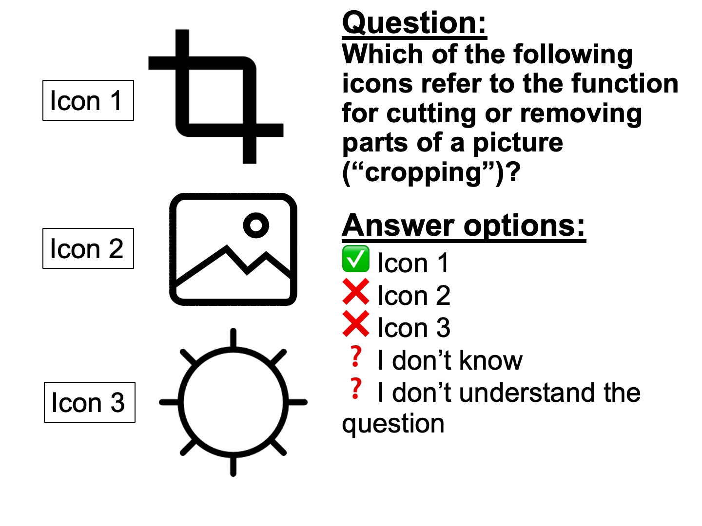

```{r, echo=FALSE, results='asis', message=FALSE, warning=FALSE}
dashboardr::.page_config(accessibility = TRUE, modals = TRUE, crosstab_prefix = "digital_content_creation")
```

```{=html}
<style>
  /* DigIQ Unified Theme & Color Palette Overrides */
  html { scroll-behavior: smooth; }
  section.level2 { scroll-margin-top: 85px; }

  /* Navbar hover readability */
  .navbar a:hover, .navbar .navbar-brand:hover, .navbar .navbar-nav .nav-link:hover {
    color: #3D7271 !important;
  }
  .navbar a:hover svg, .navbar .aa-DetachedSearchButton:hover svg, .navbar button:hover svg {
    fill: #3D7271 !important;
    stroke: #3D7271 !important;
  }

  /* Underline tabsets in DigIQ Teal & Terracotta instead of default royal blue */
  .panel-tabset .nav-item a::after {
    background-color: #E28D50 !important;
  }
  .panel-tabset .nav-tabs .nav-link.active {
    color: #0F6B5A !important;
    font-weight: 700 !important;
  }
  .panel-tabset .nav-tabs .nav-link.active::after {
    background-color: #3D7271 !important;
    height: 3px !important;
  }

  /* Question blockquotes in DigIQ Teal & Soft Mint */
  blockquote.blockquote {
    border-left: 5px solid #3D7271 !important;
    background: linear-gradient(90deg, #f2f8f6 0%, #f9fbfb 100%) !important;
    color: #243b3a !important;
    border-radius: 0 10px 10px 0 !important;
    padding: 14px 22px !important;
    box-shadow: 0 2px 6px rgba(61, 114, 113, 0.06) !important;
  }

  /* Clickable modal links inside question blockquotes */
  a.modal-link {
    display: inline-flex;
    align-items: center;
    gap: 4px;
    background-color: #e4f2ee;
    color: #0F6B5A !important;
    padding: 2px 9px;
    border-radius: 6px;
    border: 1px solid #b5ded2;
    font-weight: 600;
    text-decoration: none !important;
    transition: all 0.18s ease;
  }
  a.modal-link:hover {
    background-color: #3D7271;
    color: #ffffff !important;
    border-color: #3D7271;
    transform: translateY(-1px);
  }

  /* Wave 3 missing-data callout note on Performance sections */
  .dc-wave3-note {
    display: flex;
    align-items: flex-start;
    gap: 0.6rem;
    border-left: 4px solid #E28D50;
    background-color: #fdf6ef;
    color: #6e3b14;
    padding: 0.7rem 1.05rem;
    border-radius: 0 8px 8px 0;
    margin: 0.75rem 0 1rem 0;
    font-size: 0.93rem;
    line-height: 1.5;
  }
  .dc-wave3-note iconify-icon {
    color: #E28D50;
    font-size: 1.2rem;
    flex-shrink: 0;
    margin-top: 0.12rem;
  }

  /* Landing page hero & info banner */
  .dc-hero {
    max-width: 920px;
    margin: 0.5rem auto 1.75rem auto;
    padding: 1.5rem 2rem;
    background: linear-gradient(135deg, #f4f9f7 0%, #ebf4f1 100%);
    border: 1px solid #d5e5e1;
    border-top: 4px solid #3D7271;
    border-radius: 14px;
    text-align: center;
    color: #243b3a;
    box-shadow: 0 4px 16px rgba(31, 63, 62, 0.05);
  }
  .dc-hero p:first-child {
    font-size: 1.18rem;
    font-weight: 600;
    color: #0F6B5A;
    margin-bottom: 0.65rem;
  }
  .dc-hero p:last-child {
    font-size: 1.01rem;
    line-height: 1.65;
    color: #334e4d;
    margin-bottom: 0;
  }

  /* Landing page 11-tile grid */
  .dc-links {
    display: grid;
    grid-template-columns: repeat(auto-fit, minmax(280px, 1fr));
    gap: 1.15rem;
    margin: 1.5rem 0 2rem 0;
  }
  @media (min-width: 1100px) {
    .dc-links {
      grid-template-columns: repeat(6, minmax(0, 1fr));
    }
    .dc-links > .dc-link {
      grid-column: span 2;
    }
    /* Center the final 2 cards (10 & 11) on the bottom row */
    .dc-links > .dc-link:nth-child(10) {
      grid-column: 2 / span 2;
    }
    .dc-links > .dc-link:nth-child(11) {
      grid-column: 4 / span 2;
    }
  }
  .dc-link {
    display: flex;
    flex-direction: column;
    justify-content: space-between;
    padding: 1.25rem 1.35rem;
    border-radius: 13px;
    border: 1px solid #d5e3e0;
    border-left: 6px solid #3D7271;
    background: #ffffff;
    color: inherit !important;
    text-decoration: none !important;
    text-align: left;
    box-shadow: 0 2px 10px rgba(31, 63, 62, 0.05);
    transition: transform 0.2s ease, box-shadow 0.2s ease, border-color 0.2s ease, background-color 0.2s ease;
  }
  .dc-link:hover {
    transform: translateY(-4px);
    box-shadow: 0 12px 24px rgba(31, 63, 62, 0.12);
    border-color: #3D7271;
    border-left-color: #E28D50;
    background: #fbfdfc;
  }
  .dc-card-header {
    display: flex;
    align-items: center;
    gap: 0.75rem;
    margin-bottom: 0.6rem;
  }
  .dc-card-icon {
    width: 42px;
    height: 42px;
    border-radius: 11px;
    background: linear-gradient(135deg, #e6f4f0 0%, #c7e6d5 100%);
    color: #0F6B5A;
    display: inline-flex;
    align-items: center;
    justify-content: center;
    font-size: 1.35rem;
    flex-shrink: 0;
    transition: background 0.2s ease, color 0.2s ease, transform 0.2s ease;
  }
  .dc-link:hover .dc-card-icon {
    background: #3D7271;
    color: #ffffff;
    transform: scale(1.05);
  }
  .dc-link-title {
    font-weight: 700;
    color: #1f3f3e;
    font-size: 1.06rem;
    line-height: 1.25;
    flex-grow: 1;
    transition: color 0.2s ease;
  }
  .dc-link:hover .dc-link-title {
    color: #0F6B5A;
  }
  .dc-card-arrow {
    color: #9ab3b0;
    font-size: 1.05rem;
    transition: transform 0.2s ease, color 0.2s ease;
    flex-shrink: 0;
  }
  .dc-link:hover .dc-card-arrow {
    transform: translateX(4px);
    color: #E28D50;
  }
  .dc-link-text {
    font-size: 0.91rem;
    line-height: 1.5;
    color: #4a5b5a;
    margin-bottom: 0.9rem;
    flex-grow: 1;
  }
  .dc-card-tags {
    display: flex;
    flex-wrap: wrap;
    gap: 0.4rem;
    padding-top: 0.65rem;
    border-top: 1px solid #edf3f2;
  }
  .dc-tag {
    display: inline-flex;
    align-items: center;
    gap: 0.28rem;
    font-size: 0.74rem;
    font-weight: 600;
    padding: 0.2rem 0.55rem;
    border-radius: 999px;
    letter-spacing: 0.01em;
  }
  .dc-tag-skills {
    background-color: #e6f4f0;
    color: #0F6B5A;
    border: 1px solid #bfe3d7;
  }
  .dc-tag-knowledge {
    background-color: #fef6dc;
    color: #825600;
    border: 1px solid #f0d57d;
  }
  .dc-tag-perf {
    background-color: #fdede2;
    color: #9c4215;
    border: 1px solid #eeb998;
  }

  /* Dimension page intro card & clickable measurement jump-pills */
  .dc-dim-intro {
    background: linear-gradient(135deg, #f6faf9 0%, #ecf4f2 100%);
    border: 1px solid #d3e3e0;
    border-left: 6px solid #3D7271;
    border-radius: 13px;
    padding: 1.25rem 1.5rem;
    margin: 0.75rem 0 1.75rem 0;
    box-shadow: 0 3px 12px rgba(31, 63, 62, 0.05);
  }
  .dc-dim-intro > p {
    font-size: 1.03rem;
    line-height: 1.65;
    color: #243b3a;
    margin-bottom: 0.85rem;
  }
  .dc-jump-row {
    display: flex;
    flex-wrap: wrap;
    align-items: center;
    gap: 0.45rem;
    padding-top: 0.75rem;
    border-top: 1px solid rgba(61, 114, 113, 0.15);
    font-size: 0.96rem;
    color: #2f4b4a;
  }
  .dc-jump-label {
    font-weight: 600;
    color: #1f3f3e;
    margin-right: 0.15rem;
  }
  .dc-jump-sep {
    color: #546e6d;
    margin-right: 0.1rem;
  }
  a.dc-jump-pill {
    display: inline-flex;
    align-items: center;
    gap: 0.38rem;
    padding: 0.32rem 0.82rem;
    border-radius: 999px;
    font-size: 0.89rem;
    font-weight: 600;
    text-decoration: none !important;
    transition: transform 0.18s ease, box-shadow 0.18s ease, background-color 0.18s ease, color 0.18s ease, border-color 0.18s ease;
    box-shadow: 0 1px 4px rgba(0, 0, 0, 0.05);
  }
  a.dc-jump-pill:hover {
    transform: translateY(-2px);
    box-shadow: 0 5px 12px rgba(31, 63, 62, 0.15);
  }
  .dc-jump-arrow {
    font-size: 0.8rem;
    opacity: 0.8;
    transition: transform 0.18s ease;
  }
  a.dc-jump-pill:hover .dc-jump-arrow {
    transform: translateY(2px);
    opacity: 1;
  }
  a.dc-jump-skills {
    background-color: #e6f4f0;
    color: #0F6B5A !important;
    border: 1px solid #b3ddd0;
  }
  a.dc-jump-skills:hover {
    background-color: #3D7271;
    color: #ffffff !important;
    border-color: #3D7271;
  }
  a.dc-jump-knowledge {
    background-color: #fef6dc;
    color: #7d5200 !important;
    border: 1px solid #ebd076;
  }
  a.dc-jump-knowledge:hover {
    background-color: #c98f12;
    color: #ffffff !important;
    border-color: #c98f12;
  }
  a.dc-jump-perf {
    background-color: #fdede2;
    color: #9c4215 !important;
    border: 1px solid #ebb491;
  }
  a.dc-jump-perf:hover {
    background-color: #E28D50;
    color: #ffffff !important;
    border-color: #E28D50;
  }
</style>
```

::: {.dc-dim-intro}
**Digital Content Creation Competence** cover the ability to create and modify digital content: making presentations, combining different media, editing images/music/video, and understanding copyright rules around digital content.

```{=html}
<div class='dc-jump-row'><span class='dc-jump-label'>It is measured in three ways:</span> <a class='dc-jump-pill dc-jump-skills' href='#content-creation-skills'><iconify-icon inline icon='ph:lightning-fill'></iconify-icon> <span>self-assessed skills</span> <span class='dc-jump-arrow'>&#8595;</span></a><span class='dc-jump-sep'>,</span> <a class='dc-jump-pill dc-jump-knowledge' href='#content-creation-knowledge'><iconify-icon inline icon='ph:book-open-fill'></iconify-icon> <span>items testing knowledge</span> <span class='dc-jump-arrow'>&#8595;</span></a><span class='dc-jump-sep'>, and</span> <a class='dc-jump-pill dc-jump-perf' href='#content-creation-performance'><iconify-icon inline icon='ph:clipboard-text'></iconify-icon> <span>performance/behavior</span> <span class='dc-jump-arrow'>&#8595;</span></a><span class='dc-jump-sep'>.</span></div>
```
:::

```{r setup}
#| echo: false
#| warning: false
#| message: false
#| error: false
#| results: 'hide'

# Load dashboardr (includes dplyr, highcharter as dependencies)
library(dashboardr)

# Global chunk options
knitr::opts_chunk$set(
  echo = FALSE,
  warning = FALSE,
  message = FALSE,
  error = FALSE,
  fig.width = 12,
  fig.height = 8,
  dpi = 300
)

# Load data
data <- readRDS('dataset_large_5307obs.rds')

# Data summary
cat('Dataset loaded:', nrow(data), 'rows,', ncol(data), 'columns\n')

# Create filtered datasets
# Each filter is applied once and reused across visualizations

data_filtered_984a0efe <- dashboardr::.convert_haven(data) %>% dplyr::filter(wave == 1)
data_filtered_4af682fd <- dashboardr::.convert_haven(data) %>% dplyr::filter(wave == 2)
data_filtered_5311412c <- dashboardr::.convert_haven(data) %>% dplyr::filter(wave == 3)
data_filtered_f45d3309 <- dashboardr::.convert_haven(data) %>% dplyr::filter(wave %in% c(1, 2))

```

##  Content Creation Skills


**Skills** measures participants’ *self-assessed ability* to perform a wide range of digital tasks. These items capture how confident people feel doing things like searching for information.
```{r, echo=FALSE, message=FALSE, warning=FALSE}
create_blockquote("Think about the extent to which each sentence applies to you, if you would have to do this activity now and without help. Please be honest. It is very normal that you never do some things. We'd like to know this. If you don't understand what the question means, please choose 'I don't understand the question.' Do you recognize yourself in the following statements?", preset = "question")
```


::: {.panel-tabset}

###  Wave 1


::: {.panel-tabset}

#####  Overall


```{r dccs-wave1-overall}
# Digital Content Creation Skills
result <- viz_stackedbars(
  data = data_filtered_984a0efe,
  title = "Digital Content Creation Skills",
  x_vars = c("SCrea2", "SCrea3", "SCrea4", "SCrea5"),
  x_var_labels = c("I can make a presentation on the computer (for example in Powerpoint)", "I can make something that combines different digital media (for example a movie with music)", "I can change existing digital images, music and video", "I can make a photo or video more attractive (for example with a filter or Photoshop)"),
  stacked_type = "percent",
  color_palette = c("#3D7271", "#E28D50", "#F5D76E", "#C7E6D5", "#0F6B5A", "#BABACD"),
  horizontal = TRUE,
  x_label = "",
  stack_breaks = c(0.5, 2.5, 3.5, 5.5),
  stack_bin_labels = c("(Completely) Untrue (1-2)", "Not true and not untrue (3)", "(Completely) True (4-5)"),
  stack_order = c("(Completely) True (4-5)", "Not true and not untrue (3)", "(Completely) Untrue (1-2)"),
  stack_label = NULL,
  weight_var = "weging_GAMO"
)

result
```


#####  Age


::: {.panel-tabset}

######  Question 1


```{r dccs-wave1-age-item1}
# I can make a presentation on the computer (for example in Powerpoint)
result <- viz_stackedbar(
  data = data_filtered_984a0efe,
  title = "I can make a presentation on the computer (for example in Powerpoint)",
  stacked_type = "percent",
  horizontal = TRUE,
  stack_breaks = c(0.5, 2.5, 3.5, 5.5),
  stack_bin_labels = c("(Completely) Untrue (1-2)", "Not true and not untrue (3)", "(Completely) True (4-5)"),
  stack_order = c("(Completely) True (4-5)", "Not true and not untrue (3)", "(Completely) Untrue (1-2)"),
  color_palette = c("#3D7271", "#E28D50", "#F5D76E", "#C7E6D5", "#0F6B5A", "#BABACD"),
  weight_var = "weging_GAMO",
  x_var = "AgeGroup",
  x_label = "Age",
  stack_var = "SCrea2"
)

result
```


######  Question 2


```{r dccs-wave1-age-item2}
# I can make something that combines different digital media (for example a movie with music)
result <- viz_stackedbar(
  data = data_filtered_984a0efe,
  title = "I can make something that combines different digital media (for example a movie with music)",
  stacked_type = "percent",
  horizontal = TRUE,
  stack_breaks = c(0.5, 2.5, 3.5, 5.5),
  stack_bin_labels = c("(Completely) Untrue (1-2)", "Not true and not untrue (3)", "(Completely) True (4-5)"),
  stack_order = c("(Completely) True (4-5)", "Not true and not untrue (3)", "(Completely) Untrue (1-2)"),
  color_palette = c("#3D7271", "#E28D50", "#F5D76E", "#C7E6D5", "#0F6B5A", "#BABACD"),
  weight_var = "weging_GAMO",
  x_var = "AgeGroup",
  x_label = "Age",
  stack_var = "SCrea3"
)

result
```


######  Question 3


```{r dccs-wave1-age-item3}
# I can change existing digital images, music and video
result <- viz_stackedbar(
  data = data_filtered_984a0efe,
  title = "I can change existing digital images, music and video",
  stacked_type = "percent",
  horizontal = TRUE,
  stack_breaks = c(0.5, 2.5, 3.5, 5.5),
  stack_bin_labels = c("(Completely) Untrue (1-2)", "Not true and not untrue (3)", "(Completely) True (4-5)"),
  stack_order = c("(Completely) True (4-5)", "Not true and not untrue (3)", "(Completely) Untrue (1-2)"),
  color_palette = c("#3D7271", "#E28D50", "#F5D76E", "#C7E6D5", "#0F6B5A", "#BABACD"),
  weight_var = "weging_GAMO",
  x_var = "AgeGroup",
  x_label = "Age",
  stack_var = "SCrea4"
)

result
```


######  Question 4


```{r dccs-wave1-age-item4}
# I can make a photo or video more attractive (for example with a filter or Photoshop)
result <- viz_stackedbar(
  data = data_filtered_984a0efe,
  title = "I can make a photo or video more attractive (for example with a filter or Photoshop)",
  stacked_type = "percent",
  horizontal = TRUE,
  stack_breaks = c(0.5, 2.5, 3.5, 5.5),
  stack_bin_labels = c("(Completely) Untrue (1-2)", "Not true and not untrue (3)", "(Completely) True (4-5)"),
  stack_order = c("(Completely) True (4-5)", "Not true and not untrue (3)", "(Completely) Untrue (1-2)"),
  color_palette = c("#3D7271", "#E28D50", "#F5D76E", "#C7E6D5", "#0F6B5A", "#BABACD"),
  weight_var = "weging_GAMO",
  x_var = "AgeGroup",
  x_label = "Age",
  stack_var = "SCrea5"
)

result
```


:::


#####  Gender


::: {.panel-tabset}

######  Question 1


```{r dccs-wave1-gender-item1}
# I can make a presentation on the computer (for example in Powerpoint)
result <- viz_stackedbar(
  data = data_filtered_984a0efe,
  title = "I can make a presentation on the computer (for example in Powerpoint)",
  stacked_type = "percent",
  horizontal = TRUE,
  stack_breaks = c(0.5, 2.5, 3.5, 5.5),
  stack_bin_labels = c("(Completely) Untrue (1-2)", "Not true and not untrue (3)", "(Completely) True (4-5)"),
  stack_order = c("(Completely) True (4-5)", "Not true and not untrue (3)", "(Completely) Untrue (1-2)"),
  color_palette = c("#3D7271", "#E28D50", "#F5D76E", "#C7E6D5", "#0F6B5A", "#BABACD"),
  weight_var = "weging_GAMO",
  x_var = "geslacht",
  x_label = "Gender",
  stack_var = "SCrea2"
)

result
```


######  Question 2


```{r dccs-wave1-gender-item2}
# I can make something that combines different digital media (for example a movie with music)
result <- viz_stackedbar(
  data = data_filtered_984a0efe,
  title = "I can make something that combines different digital media (for example a movie with music)",
  stacked_type = "percent",
  horizontal = TRUE,
  stack_breaks = c(0.5, 2.5, 3.5, 5.5),
  stack_bin_labels = c("(Completely) Untrue (1-2)", "Not true and not untrue (3)", "(Completely) True (4-5)"),
  stack_order = c("(Completely) True (4-5)", "Not true and not untrue (3)", "(Completely) Untrue (1-2)"),
  color_palette = c("#3D7271", "#E28D50", "#F5D76E", "#C7E6D5", "#0F6B5A", "#BABACD"),
  weight_var = "weging_GAMO",
  x_var = "geslacht",
  x_label = "Gender",
  stack_var = "SCrea3"
)

result
```


######  Question 3


```{r dccs-wave1-gender-item3}
# I can change existing digital images, music and video
result <- viz_stackedbar(
  data = data_filtered_984a0efe,
  title = "I can change existing digital images, music and video",
  stacked_type = "percent",
  horizontal = TRUE,
  stack_breaks = c(0.5, 2.5, 3.5, 5.5),
  stack_bin_labels = c("(Completely) Untrue (1-2)", "Not true and not untrue (3)", "(Completely) True (4-5)"),
  stack_order = c("(Completely) True (4-5)", "Not true and not untrue (3)", "(Completely) Untrue (1-2)"),
  color_palette = c("#3D7271", "#E28D50", "#F5D76E", "#C7E6D5", "#0F6B5A", "#BABACD"),
  weight_var = "weging_GAMO",
  x_var = "geslacht",
  x_label = "Gender",
  stack_var = "SCrea4"
)

result
```


######  Question 4


```{r dccs-wave1-gender-item4}
# I can make a photo or video more attractive (for example with a filter or Photoshop)
result <- viz_stackedbar(
  data = data_filtered_984a0efe,
  title = "I can make a photo or video more attractive (for example with a filter or Photoshop)",
  stacked_type = "percent",
  horizontal = TRUE,
  stack_breaks = c(0.5, 2.5, 3.5, 5.5),
  stack_bin_labels = c("(Completely) Untrue (1-2)", "Not true and not untrue (3)", "(Completely) True (4-5)"),
  stack_order = c("(Completely) True (4-5)", "Not true and not untrue (3)", "(Completely) Untrue (1-2)"),
  color_palette = c("#3D7271", "#E28D50", "#F5D76E", "#C7E6D5", "#0F6B5A", "#BABACD"),
  weight_var = "weging_GAMO",
  x_var = "geslacht",
  x_label = "Gender",
  stack_var = "SCrea5"
)

result
```


:::


#####  Education


::: {.panel-tabset}

######  Question 1


```{r dccs-wave1-edu-item1}
# I can make a presentation on the computer (for example in Powerpoint)
result <- viz_stackedbar(
  data = data_filtered_984a0efe,
  title = "I can make a presentation on the computer (for example in Powerpoint)",
  stacked_type = "percent",
  horizontal = TRUE,
  stack_breaks = c(0.5, 2.5, 3.5, 5.5),
  stack_bin_labels = c("(Completely) Untrue (1-2)", "Not true and not untrue (3)", "(Completely) True (4-5)"),
  stack_order = c("(Completely) True (4-5)", "Not true and not untrue (3)", "(Completely) Untrue (1-2)"),
  color_palette = c("#3D7271", "#E28D50", "#F5D76E", "#C7E6D5", "#0F6B5A", "#BABACD"),
  weight_var = "weging_GAMO",
  x_var = "Education",
  x_label = "Education",
  stack_var = "SCrea2"
)

result
```


######  Question 2


```{r dccs-wave1-edu-item2}
# I can make something that combines different digital media (for example a movie with music)
result <- viz_stackedbar(
  data = data_filtered_984a0efe,
  title = "I can make something that combines different digital media (for example a movie with music)",
  stacked_type = "percent",
  horizontal = TRUE,
  stack_breaks = c(0.5, 2.5, 3.5, 5.5),
  stack_bin_labels = c("(Completely) Untrue (1-2)", "Not true and not untrue (3)", "(Completely) True (4-5)"),
  stack_order = c("(Completely) True (4-5)", "Not true and not untrue (3)", "(Completely) Untrue (1-2)"),
  color_palette = c("#3D7271", "#E28D50", "#F5D76E", "#C7E6D5", "#0F6B5A", "#BABACD"),
  weight_var = "weging_GAMO",
  x_var = "Education",
  x_label = "Education",
  stack_var = "SCrea3"
)

result
```


######  Question 3


```{r dccs-wave1-edu-item3}
# I can change existing digital images, music and video
result <- viz_stackedbar(
  data = data_filtered_984a0efe,
  title = "I can change existing digital images, music and video",
  stacked_type = "percent",
  horizontal = TRUE,
  stack_breaks = c(0.5, 2.5, 3.5, 5.5),
  stack_bin_labels = c("(Completely) Untrue (1-2)", "Not true and not untrue (3)", "(Completely) True (4-5)"),
  stack_order = c("(Completely) True (4-5)", "Not true and not untrue (3)", "(Completely) Untrue (1-2)"),
  color_palette = c("#3D7271", "#E28D50", "#F5D76E", "#C7E6D5", "#0F6B5A", "#BABACD"),
  weight_var = "weging_GAMO",
  x_var = "Education",
  x_label = "Education",
  stack_var = "SCrea4"
)

result
```


######  Question 4


```{r dccs-wave1-edu-item4}
# I can make a photo or video more attractive (for example with a filter or Photoshop)
result <- viz_stackedbar(
  data = data_filtered_984a0efe,
  title = "I can make a photo or video more attractive (for example with a filter or Photoshop)",
  stacked_type = "percent",
  horizontal = TRUE,
  stack_breaks = c(0.5, 2.5, 3.5, 5.5),
  stack_bin_labels = c("(Completely) Untrue (1-2)", "Not true and not untrue (3)", "(Completely) True (4-5)"),
  stack_order = c("(Completely) True (4-5)", "Not true and not untrue (3)", "(Completely) Untrue (1-2)"),
  color_palette = c("#3D7271", "#E28D50", "#F5D76E", "#C7E6D5", "#0F6B5A", "#BABACD"),
  weight_var = "weging_GAMO",
  x_var = "Education",
  x_label = "Education",
  stack_var = "SCrea5"
)

result
```


:::


#####  Migration Background


::: {.panel-tabset}

######  Question 1


```{r dccs-wave1-mig-item1}
# I can make a presentation on the computer (for example in Powerpoint)
result <- viz_stackedbar(
  data = data_filtered_984a0efe,
  title = "I can make a presentation on the computer (for example in Powerpoint)",
  stacked_type = "percent",
  horizontal = TRUE,
  stack_breaks = c(0.5, 2.5, 3.5, 5.5),
  stack_bin_labels = c("(Completely) Untrue (1-2)", "Not true and not untrue (3)", "(Completely) True (4-5)"),
  stack_order = c("(Completely) True (4-5)", "Not true and not untrue (3)", "(Completely) Untrue (1-2)"),
  color_palette = c("#3D7271", "#E28D50", "#F5D76E", "#C7E6D5", "#0F6B5A", "#BABACD"),
  weight_var = "weging_GAMO",
  x_var = "MigrationBackground",
  x_label = "Migration Background",
  stack_var = "SCrea2"
)

result
```


######  Question 2


```{r dccs-wave1-mig-item2}
# I can make something that combines different digital media (for example a movie with music)
result <- viz_stackedbar(
  data = data_filtered_984a0efe,
  title = "I can make something that combines different digital media (for example a movie with music)",
  stacked_type = "percent",
  horizontal = TRUE,
  stack_breaks = c(0.5, 2.5, 3.5, 5.5),
  stack_bin_labels = c("(Completely) Untrue (1-2)", "Not true and not untrue (3)", "(Completely) True (4-5)"),
  stack_order = c("(Completely) True (4-5)", "Not true and not untrue (3)", "(Completely) Untrue (1-2)"),
  color_palette = c("#3D7271", "#E28D50", "#F5D76E", "#C7E6D5", "#0F6B5A", "#BABACD"),
  weight_var = "weging_GAMO",
  x_var = "MigrationBackground",
  x_label = "Migration Background",
  stack_var = "SCrea3"
)

result
```


######  Question 3


```{r dccs-wave1-mig-item3}
# I can change existing digital images, music and video
result <- viz_stackedbar(
  data = data_filtered_984a0efe,
  title = "I can change existing digital images, music and video",
  stacked_type = "percent",
  horizontal = TRUE,
  stack_breaks = c(0.5, 2.5, 3.5, 5.5),
  stack_bin_labels = c("(Completely) Untrue (1-2)", "Not true and not untrue (3)", "(Completely) True (4-5)"),
  stack_order = c("(Completely) True (4-5)", "Not true and not untrue (3)", "(Completely) Untrue (1-2)"),
  color_palette = c("#3D7271", "#E28D50", "#F5D76E", "#C7E6D5", "#0F6B5A", "#BABACD"),
  weight_var = "weging_GAMO",
  x_var = "MigrationBackground",
  x_label = "Migration Background",
  stack_var = "SCrea4"
)

result
```


######  Question 4


```{r dccs-wave1-mig-item4}
# I can make a photo or video more attractive (for example with a filter or Photoshop)
result <- viz_stackedbar(
  data = data_filtered_984a0efe,
  title = "I can make a photo or video more attractive (for example with a filter or Photoshop)",
  stacked_type = "percent",
  horizontal = TRUE,
  stack_breaks = c(0.5, 2.5, 3.5, 5.5),
  stack_bin_labels = c("(Completely) Untrue (1-2)", "Not true and not untrue (3)", "(Completely) True (4-5)"),
  stack_order = c("(Completely) True (4-5)", "Not true and not untrue (3)", "(Completely) Untrue (1-2)"),
  color_palette = c("#3D7271", "#E28D50", "#F5D76E", "#C7E6D5", "#0F6B5A", "#BABACD"),
  weight_var = "weging_GAMO",
  x_var = "MigrationBackground",
  x_label = "Migration Background",
  stack_var = "SCrea5"
)

result
```


:::


:::


###  Wave 2


::: {.panel-tabset}

#####  Overall


```{r dccs-wave2-overall}
# Digital Content Creation Skills
result <- viz_stackedbars(
  data = data_filtered_4af682fd,
  title = "Digital Content Creation Skills",
  x_vars = c("SCrea2", "SCrea3", "SCrea4", "SCrea5"),
  x_var_labels = c("I can make a presentation on the computer (for example in Powerpoint)", "I can make something that combines different digital media (for example a movie with music)", "I can change existing digital images, music and video", "I can make a photo or video more attractive (for example with a filter or Photoshop)"),
  stacked_type = "percent",
  color_palette = c("#3D7271", "#E28D50", "#F5D76E", "#C7E6D5", "#0F6B5A", "#BABACD"),
  horizontal = TRUE,
  x_label = "",
  stack_breaks = c(0.5, 2.5, 3.5, 5.5),
  stack_bin_labels = c("(Completely) Untrue (1-2)", "Not true and not untrue (3)", "(Completely) True (4-5)"),
  stack_order = c("(Completely) True (4-5)", "Not true and not untrue (3)", "(Completely) Untrue (1-2)"),
  stack_label = NULL,
  weight_var = "weging_GAMO"
)

result
```


#####  Age


::: {.panel-tabset}

######  Question 1


```{r dccs-wave2-age-item1}
# I can make a presentation on the computer (for example in Powerpoint)
result <- viz_stackedbar(
  data = data_filtered_4af682fd,
  title = "I can make a presentation on the computer (for example in Powerpoint)",
  stacked_type = "percent",
  horizontal = TRUE,
  stack_breaks = c(0.5, 2.5, 3.5, 5.5),
  stack_bin_labels = c("(Completely) Untrue (1-2)", "Not true and not untrue (3)", "(Completely) True (4-5)"),
  stack_order = c("(Completely) True (4-5)", "Not true and not untrue (3)", "(Completely) Untrue (1-2)"),
  color_palette = c("#3D7271", "#E28D50", "#F5D76E", "#C7E6D5", "#0F6B5A", "#BABACD"),
  weight_var = "weging_GAMO",
  x_var = "AgeGroup",
  x_label = "Age",
  stack_var = "SCrea2"
)

result
```


######  Question 2


```{r dccs-wave2-age-item2}
# I can make something that combines different digital media (for example a movie with music)
result <- viz_stackedbar(
  data = data_filtered_4af682fd,
  title = "I can make something that combines different digital media (for example a movie with music)",
  stacked_type = "percent",
  horizontal = TRUE,
  stack_breaks = c(0.5, 2.5, 3.5, 5.5),
  stack_bin_labels = c("(Completely) Untrue (1-2)", "Not true and not untrue (3)", "(Completely) True (4-5)"),
  stack_order = c("(Completely) True (4-5)", "Not true and not untrue (3)", "(Completely) Untrue (1-2)"),
  color_palette = c("#3D7271", "#E28D50", "#F5D76E", "#C7E6D5", "#0F6B5A", "#BABACD"),
  weight_var = "weging_GAMO",
  x_var = "AgeGroup",
  x_label = "Age",
  stack_var = "SCrea3"
)

result
```


######  Question 3


```{r dccs-wave2-age-item3}
# I can change existing digital images, music and video
result <- viz_stackedbar(
  data = data_filtered_4af682fd,
  title = "I can change existing digital images, music and video",
  stacked_type = "percent",
  horizontal = TRUE,
  stack_breaks = c(0.5, 2.5, 3.5, 5.5),
  stack_bin_labels = c("(Completely) Untrue (1-2)", "Not true and not untrue (3)", "(Completely) True (4-5)"),
  stack_order = c("(Completely) True (4-5)", "Not true and not untrue (3)", "(Completely) Untrue (1-2)"),
  color_palette = c("#3D7271", "#E28D50", "#F5D76E", "#C7E6D5", "#0F6B5A", "#BABACD"),
  weight_var = "weging_GAMO",
  x_var = "AgeGroup",
  x_label = "Age",
  stack_var = "SCrea4"
)

result
```


######  Question 4


```{r dccs-wave2-age-item4}
# I can make a photo or video more attractive (for example with a filter or Photoshop)
result <- viz_stackedbar(
  data = data_filtered_4af682fd,
  title = "I can make a photo or video more attractive (for example with a filter or Photoshop)",
  stacked_type = "percent",
  horizontal = TRUE,
  stack_breaks = c(0.5, 2.5, 3.5, 5.5),
  stack_bin_labels = c("(Completely) Untrue (1-2)", "Not true and not untrue (3)", "(Completely) True (4-5)"),
  stack_order = c("(Completely) True (4-5)", "Not true and not untrue (3)", "(Completely) Untrue (1-2)"),
  color_palette = c("#3D7271", "#E28D50", "#F5D76E", "#C7E6D5", "#0F6B5A", "#BABACD"),
  weight_var = "weging_GAMO",
  x_var = "AgeGroup",
  x_label = "Age",
  stack_var = "SCrea5"
)

result
```


:::


#####  Gender


::: {.panel-tabset}

######  Question 1


```{r dccs-wave2-gender-item1}
# I can make a presentation on the computer (for example in Powerpoint)
result <- viz_stackedbar(
  data = data_filtered_4af682fd,
  title = "I can make a presentation on the computer (for example in Powerpoint)",
  stacked_type = "percent",
  horizontal = TRUE,
  stack_breaks = c(0.5, 2.5, 3.5, 5.5),
  stack_bin_labels = c("(Completely) Untrue (1-2)", "Not true and not untrue (3)", "(Completely) True (4-5)"),
  stack_order = c("(Completely) True (4-5)", "Not true and not untrue (3)", "(Completely) Untrue (1-2)"),
  color_palette = c("#3D7271", "#E28D50", "#F5D76E", "#C7E6D5", "#0F6B5A", "#BABACD"),
  weight_var = "weging_GAMO",
  x_var = "geslacht",
  x_label = "Gender",
  stack_var = "SCrea2"
)

result
```


######  Question 2


```{r dccs-wave2-gender-item2}
# I can make something that combines different digital media (for example a movie with music)
result <- viz_stackedbar(
  data = data_filtered_4af682fd,
  title = "I can make something that combines different digital media (for example a movie with music)",
  stacked_type = "percent",
  horizontal = TRUE,
  stack_breaks = c(0.5, 2.5, 3.5, 5.5),
  stack_bin_labels = c("(Completely) Untrue (1-2)", "Not true and not untrue (3)", "(Completely) True (4-5)"),
  stack_order = c("(Completely) True (4-5)", "Not true and not untrue (3)", "(Completely) Untrue (1-2)"),
  color_palette = c("#3D7271", "#E28D50", "#F5D76E", "#C7E6D5", "#0F6B5A", "#BABACD"),
  weight_var = "weging_GAMO",
  x_var = "geslacht",
  x_label = "Gender",
  stack_var = "SCrea3"
)

result
```


######  Question 3


```{r dccs-wave2-gender-item3}
# I can change existing digital images, music and video
result <- viz_stackedbar(
  data = data_filtered_4af682fd,
  title = "I can change existing digital images, music and video",
  stacked_type = "percent",
  horizontal = TRUE,
  stack_breaks = c(0.5, 2.5, 3.5, 5.5),
  stack_bin_labels = c("(Completely) Untrue (1-2)", "Not true and not untrue (3)", "(Completely) True (4-5)"),
  stack_order = c("(Completely) True (4-5)", "Not true and not untrue (3)", "(Completely) Untrue (1-2)"),
  color_palette = c("#3D7271", "#E28D50", "#F5D76E", "#C7E6D5", "#0F6B5A", "#BABACD"),
  weight_var = "weging_GAMO",
  x_var = "geslacht",
  x_label = "Gender",
  stack_var = "SCrea4"
)

result
```


######  Question 4


```{r dccs-wave2-gender-item4}
# I can make a photo or video more attractive (for example with a filter or Photoshop)
result <- viz_stackedbar(
  data = data_filtered_4af682fd,
  title = "I can make a photo or video more attractive (for example with a filter or Photoshop)",
  stacked_type = "percent",
  horizontal = TRUE,
  stack_breaks = c(0.5, 2.5, 3.5, 5.5),
  stack_bin_labels = c("(Completely) Untrue (1-2)", "Not true and not untrue (3)", "(Completely) True (4-5)"),
  stack_order = c("(Completely) True (4-5)", "Not true and not untrue (3)", "(Completely) Untrue (1-2)"),
  color_palette = c("#3D7271", "#E28D50", "#F5D76E", "#C7E6D5", "#0F6B5A", "#BABACD"),
  weight_var = "weging_GAMO",
  x_var = "geslacht",
  x_label = "Gender",
  stack_var = "SCrea5"
)

result
```


:::


#####  Education


::: {.panel-tabset}

######  Question 1


```{r dccs-wave2-edu-item1}
# I can make a presentation on the computer (for example in Powerpoint)
result <- viz_stackedbar(
  data = data_filtered_4af682fd,
  title = "I can make a presentation on the computer (for example in Powerpoint)",
  stacked_type = "percent",
  horizontal = TRUE,
  stack_breaks = c(0.5, 2.5, 3.5, 5.5),
  stack_bin_labels = c("(Completely) Untrue (1-2)", "Not true and not untrue (3)", "(Completely) True (4-5)"),
  stack_order = c("(Completely) True (4-5)", "Not true and not untrue (3)", "(Completely) Untrue (1-2)"),
  color_palette = c("#3D7271", "#E28D50", "#F5D76E", "#C7E6D5", "#0F6B5A", "#BABACD"),
  weight_var = "weging_GAMO",
  x_var = "Education",
  x_label = "Education",
  stack_var = "SCrea2"
)

result
```


######  Question 2


```{r dccs-wave2-edu-item2}
# I can make something that combines different digital media (for example a movie with music)
result <- viz_stackedbar(
  data = data_filtered_4af682fd,
  title = "I can make something that combines different digital media (for example a movie with music)",
  stacked_type = "percent",
  horizontal = TRUE,
  stack_breaks = c(0.5, 2.5, 3.5, 5.5),
  stack_bin_labels = c("(Completely) Untrue (1-2)", "Not true and not untrue (3)", "(Completely) True (4-5)"),
  stack_order = c("(Completely) True (4-5)", "Not true and not untrue (3)", "(Completely) Untrue (1-2)"),
  color_palette = c("#3D7271", "#E28D50", "#F5D76E", "#C7E6D5", "#0F6B5A", "#BABACD"),
  weight_var = "weging_GAMO",
  x_var = "Education",
  x_label = "Education",
  stack_var = "SCrea3"
)

result
```


######  Question 3


```{r dccs-wave2-edu-item3}
# I can change existing digital images, music and video
result <- viz_stackedbar(
  data = data_filtered_4af682fd,
  title = "I can change existing digital images, music and video",
  stacked_type = "percent",
  horizontal = TRUE,
  stack_breaks = c(0.5, 2.5, 3.5, 5.5),
  stack_bin_labels = c("(Completely) Untrue (1-2)", "Not true and not untrue (3)", "(Completely) True (4-5)"),
  stack_order = c("(Completely) True (4-5)", "Not true and not untrue (3)", "(Completely) Untrue (1-2)"),
  color_palette = c("#3D7271", "#E28D50", "#F5D76E", "#C7E6D5", "#0F6B5A", "#BABACD"),
  weight_var = "weging_GAMO",
  x_var = "Education",
  x_label = "Education",
  stack_var = "SCrea4"
)

result
```


######  Question 4


```{r dccs-wave2-edu-item4}
# I can make a photo or video more attractive (for example with a filter or Photoshop)
result <- viz_stackedbar(
  data = data_filtered_4af682fd,
  title = "I can make a photo or video more attractive (for example with a filter or Photoshop)",
  stacked_type = "percent",
  horizontal = TRUE,
  stack_breaks = c(0.5, 2.5, 3.5, 5.5),
  stack_bin_labels = c("(Completely) Untrue (1-2)", "Not true and not untrue (3)", "(Completely) True (4-5)"),
  stack_order = c("(Completely) True (4-5)", "Not true and not untrue (3)", "(Completely) Untrue (1-2)"),
  color_palette = c("#3D7271", "#E28D50", "#F5D76E", "#C7E6D5", "#0F6B5A", "#BABACD"),
  weight_var = "weging_GAMO",
  x_var = "Education",
  x_label = "Education",
  stack_var = "SCrea5"
)

result
```


:::


#####  Migration Background


::: {.panel-tabset}

######  Question 1


```{r dccs-wave2-mig-item1}
# I can make a presentation on the computer (for example in Powerpoint)
result <- viz_stackedbar(
  data = data_filtered_4af682fd,
  title = "I can make a presentation on the computer (for example in Powerpoint)",
  stacked_type = "percent",
  horizontal = TRUE,
  stack_breaks = c(0.5, 2.5, 3.5, 5.5),
  stack_bin_labels = c("(Completely) Untrue (1-2)", "Not true and not untrue (3)", "(Completely) True (4-5)"),
  stack_order = c("(Completely) True (4-5)", "Not true and not untrue (3)", "(Completely) Untrue (1-2)"),
  color_palette = c("#3D7271", "#E28D50", "#F5D76E", "#C7E6D5", "#0F6B5A", "#BABACD"),
  weight_var = "weging_GAMO",
  x_var = "MigrationBackground",
  x_label = "Migration Background",
  stack_var = "SCrea2"
)

result
```


######  Question 2


```{r dccs-wave2-mig-item2}
# I can make something that combines different digital media (for example a movie with music)
result <- viz_stackedbar(
  data = data_filtered_4af682fd,
  title = "I can make something that combines different digital media (for example a movie with music)",
  stacked_type = "percent",
  horizontal = TRUE,
  stack_breaks = c(0.5, 2.5, 3.5, 5.5),
  stack_bin_labels = c("(Completely) Untrue (1-2)", "Not true and not untrue (3)", "(Completely) True (4-5)"),
  stack_order = c("(Completely) True (4-5)", "Not true and not untrue (3)", "(Completely) Untrue (1-2)"),
  color_palette = c("#3D7271", "#E28D50", "#F5D76E", "#C7E6D5", "#0F6B5A", "#BABACD"),
  weight_var = "weging_GAMO",
  x_var = "MigrationBackground",
  x_label = "Migration Background",
  stack_var = "SCrea3"
)

result
```


######  Question 3


```{r dccs-wave2-mig-item3}
# I can change existing digital images, music and video
result <- viz_stackedbar(
  data = data_filtered_4af682fd,
  title = "I can change existing digital images, music and video",
  stacked_type = "percent",
  horizontal = TRUE,
  stack_breaks = c(0.5, 2.5, 3.5, 5.5),
  stack_bin_labels = c("(Completely) Untrue (1-2)", "Not true and not untrue (3)", "(Completely) True (4-5)"),
  stack_order = c("(Completely) True (4-5)", "Not true and not untrue (3)", "(Completely) Untrue (1-2)"),
  color_palette = c("#3D7271", "#E28D50", "#F5D76E", "#C7E6D5", "#0F6B5A", "#BABACD"),
  weight_var = "weging_GAMO",
  x_var = "MigrationBackground",
  x_label = "Migration Background",
  stack_var = "SCrea4"
)

result
```


######  Question 4


```{r dccs-wave2-mig-item4}
# I can make a photo or video more attractive (for example with a filter or Photoshop)
result <- viz_stackedbar(
  data = data_filtered_4af682fd,
  title = "I can make a photo or video more attractive (for example with a filter or Photoshop)",
  stacked_type = "percent",
  horizontal = TRUE,
  stack_breaks = c(0.5, 2.5, 3.5, 5.5),
  stack_bin_labels = c("(Completely) Untrue (1-2)", "Not true and not untrue (3)", "(Completely) True (4-5)"),
  stack_order = c("(Completely) True (4-5)", "Not true and not untrue (3)", "(Completely) Untrue (1-2)"),
  color_palette = c("#3D7271", "#E28D50", "#F5D76E", "#C7E6D5", "#0F6B5A", "#BABACD"),
  weight_var = "weging_GAMO",
  x_var = "MigrationBackground",
  x_label = "Migration Background",
  stack_var = "SCrea5"
)

result
```


:::


:::


###  Wave 3


::: {.panel-tabset}

#####  Overall


```{r dccs-wave3-overall}
# Digital Content Creation Skills
result <- viz_stackedbars(
  data = data_filtered_5311412c,
  title = "Digital Content Creation Skills",
  x_vars = c("SCrea2", "SCrea3", "SCrea4", "SCrea5"),
  x_var_labels = c("I can make a presentation on the computer (for example in Powerpoint)", "I can make something that combines different digital media (for example a movie with music)", "I can change existing digital images, music and video", "I can make a photo or video more attractive (for example with a filter or Photoshop)"),
  stacked_type = "percent",
  color_palette = c("#3D7271", "#E28D50", "#F5D76E", "#C7E6D5", "#0F6B5A", "#BABACD"),
  horizontal = TRUE,
  x_label = "",
  stack_breaks = c(0.5, 2.5, 3.5, 5.5),
  stack_bin_labels = c("(Completely) Untrue (1-2)", "Not true and not untrue (3)", "(Completely) True (4-5)"),
  stack_order = c("(Completely) True (4-5)", "Not true and not untrue (3)", "(Completely) Untrue (1-2)"),
  stack_label = NULL,
  weight_var = "weging_GAMO"
)

result
```


#####  Age


::: {.panel-tabset}

######  Question 1


```{r dccs-wave3-age-item1}
# I can make a presentation on the computer (for example in Powerpoint)
result <- viz_stackedbar(
  data = data_filtered_5311412c,
  title = "I can make a presentation on the computer (for example in Powerpoint)",
  stacked_type = "percent",
  horizontal = TRUE,
  stack_breaks = c(0.5, 2.5, 3.5, 5.5),
  stack_bin_labels = c("(Completely) Untrue (1-2)", "Not true and not untrue (3)", "(Completely) True (4-5)"),
  stack_order = c("(Completely) True (4-5)", "Not true and not untrue (3)", "(Completely) Untrue (1-2)"),
  color_palette = c("#3D7271", "#E28D50", "#F5D76E", "#C7E6D5", "#0F6B5A", "#BABACD"),
  weight_var = "weging_GAMO",
  x_var = "AgeGroup",
  x_label = "Age",
  stack_var = "SCrea2"
)

result
```


######  Question 2


```{r dccs-wave3-age-item2}
# I can make something that combines different digital media (for example a movie with music)
result <- viz_stackedbar(
  data = data_filtered_5311412c,
  title = "I can make something that combines different digital media (for example a movie with music)",
  stacked_type = "percent",
  horizontal = TRUE,
  stack_breaks = c(0.5, 2.5, 3.5, 5.5),
  stack_bin_labels = c("(Completely) Untrue (1-2)", "Not true and not untrue (3)", "(Completely) True (4-5)"),
  stack_order = c("(Completely) True (4-5)", "Not true and not untrue (3)", "(Completely) Untrue (1-2)"),
  color_palette = c("#3D7271", "#E28D50", "#F5D76E", "#C7E6D5", "#0F6B5A", "#BABACD"),
  weight_var = "weging_GAMO",
  x_var = "AgeGroup",
  x_label = "Age",
  stack_var = "SCrea3"
)

result
```


######  Question 3


```{r dccs-wave3-age-item3}
# I can change existing digital images, music and video
result <- viz_stackedbar(
  data = data_filtered_5311412c,
  title = "I can change existing digital images, music and video",
  stacked_type = "percent",
  horizontal = TRUE,
  stack_breaks = c(0.5, 2.5, 3.5, 5.5),
  stack_bin_labels = c("(Completely) Untrue (1-2)", "Not true and not untrue (3)", "(Completely) True (4-5)"),
  stack_order = c("(Completely) True (4-5)", "Not true and not untrue (3)", "(Completely) Untrue (1-2)"),
  color_palette = c("#3D7271", "#E28D50", "#F5D76E", "#C7E6D5", "#0F6B5A", "#BABACD"),
  weight_var = "weging_GAMO",
  x_var = "AgeGroup",
  x_label = "Age",
  stack_var = "SCrea4"
)

result
```


######  Question 4


```{r dccs-wave3-age-item4}
# I can make a photo or video more attractive (for example with a filter or Photoshop)
result <- viz_stackedbar(
  data = data_filtered_5311412c,
  title = "I can make a photo or video more attractive (for example with a filter or Photoshop)",
  stacked_type = "percent",
  horizontal = TRUE,
  stack_breaks = c(0.5, 2.5, 3.5, 5.5),
  stack_bin_labels = c("(Completely) Untrue (1-2)", "Not true and not untrue (3)", "(Completely) True (4-5)"),
  stack_order = c("(Completely) True (4-5)", "Not true and not untrue (3)", "(Completely) Untrue (1-2)"),
  color_palette = c("#3D7271", "#E28D50", "#F5D76E", "#C7E6D5", "#0F6B5A", "#BABACD"),
  weight_var = "weging_GAMO",
  x_var = "AgeGroup",
  x_label = "Age",
  stack_var = "SCrea5"
)

result
```


:::


#####  Gender


::: {.panel-tabset}

######  Question 1


```{r dccs-wave3-gender-item1}
# I can make a presentation on the computer (for example in Powerpoint)
result <- viz_stackedbar(
  data = data_filtered_5311412c,
  title = "I can make a presentation on the computer (for example in Powerpoint)",
  stacked_type = "percent",
  horizontal = TRUE,
  stack_breaks = c(0.5, 2.5, 3.5, 5.5),
  stack_bin_labels = c("(Completely) Untrue (1-2)", "Not true and not untrue (3)", "(Completely) True (4-5)"),
  stack_order = c("(Completely) True (4-5)", "Not true and not untrue (3)", "(Completely) Untrue (1-2)"),
  color_palette = c("#3D7271", "#E28D50", "#F5D76E", "#C7E6D5", "#0F6B5A", "#BABACD"),
  weight_var = "weging_GAMO",
  x_var = "geslacht",
  x_label = "Gender",
  stack_var = "SCrea2"
)

result
```


######  Question 2


```{r dccs-wave3-gender-item2}
# I can make something that combines different digital media (for example a movie with music)
result <- viz_stackedbar(
  data = data_filtered_5311412c,
  title = "I can make something that combines different digital media (for example a movie with music)",
  stacked_type = "percent",
  horizontal = TRUE,
  stack_breaks = c(0.5, 2.5, 3.5, 5.5),
  stack_bin_labels = c("(Completely) Untrue (1-2)", "Not true and not untrue (3)", "(Completely) True (4-5)"),
  stack_order = c("(Completely) True (4-5)", "Not true and not untrue (3)", "(Completely) Untrue (1-2)"),
  color_palette = c("#3D7271", "#E28D50", "#F5D76E", "#C7E6D5", "#0F6B5A", "#BABACD"),
  weight_var = "weging_GAMO",
  x_var = "geslacht",
  x_label = "Gender",
  stack_var = "SCrea3"
)

result
```


######  Question 3


```{r dccs-wave3-gender-item3}
# I can change existing digital images, music and video
result <- viz_stackedbar(
  data = data_filtered_5311412c,
  title = "I can change existing digital images, music and video",
  stacked_type = "percent",
  horizontal = TRUE,
  stack_breaks = c(0.5, 2.5, 3.5, 5.5),
  stack_bin_labels = c("(Completely) Untrue (1-2)", "Not true and not untrue (3)", "(Completely) True (4-5)"),
  stack_order = c("(Completely) True (4-5)", "Not true and not untrue (3)", "(Completely) Untrue (1-2)"),
  color_palette = c("#3D7271", "#E28D50", "#F5D76E", "#C7E6D5", "#0F6B5A", "#BABACD"),
  weight_var = "weging_GAMO",
  x_var = "geslacht",
  x_label = "Gender",
  stack_var = "SCrea4"
)

result
```


######  Question 4


```{r dccs-wave3-gender-item4}
# I can make a photo or video more attractive (for example with a filter or Photoshop)
result <- viz_stackedbar(
  data = data_filtered_5311412c,
  title = "I can make a photo or video more attractive (for example with a filter or Photoshop)",
  stacked_type = "percent",
  horizontal = TRUE,
  stack_breaks = c(0.5, 2.5, 3.5, 5.5),
  stack_bin_labels = c("(Completely) Untrue (1-2)", "Not true and not untrue (3)", "(Completely) True (4-5)"),
  stack_order = c("(Completely) True (4-5)", "Not true and not untrue (3)", "(Completely) Untrue (1-2)"),
  color_palette = c("#3D7271", "#E28D50", "#F5D76E", "#C7E6D5", "#0F6B5A", "#BABACD"),
  weight_var = "weging_GAMO",
  x_var = "geslacht",
  x_label = "Gender",
  stack_var = "SCrea5"
)

result
```


:::


#####  Education


::: {.panel-tabset}

######  Question 1


```{r dccs-wave3-edu-item1}
# I can make a presentation on the computer (for example in Powerpoint)
result <- viz_stackedbar(
  data = data_filtered_5311412c,
  title = "I can make a presentation on the computer (for example in Powerpoint)",
  stacked_type = "percent",
  horizontal = TRUE,
  stack_breaks = c(0.5, 2.5, 3.5, 5.5),
  stack_bin_labels = c("(Completely) Untrue (1-2)", "Not true and not untrue (3)", "(Completely) True (4-5)"),
  stack_order = c("(Completely) True (4-5)", "Not true and not untrue (3)", "(Completely) Untrue (1-2)"),
  color_palette = c("#3D7271", "#E28D50", "#F5D76E", "#C7E6D5", "#0F6B5A", "#BABACD"),
  weight_var = "weging_GAMO",
  x_var = "Education",
  x_label = "Education",
  stack_var = "SCrea2"
)

result
```


######  Question 2


```{r dccs-wave3-edu-item2}
# I can make something that combines different digital media (for example a movie with music)
result <- viz_stackedbar(
  data = data_filtered_5311412c,
  title = "I can make something that combines different digital media (for example a movie with music)",
  stacked_type = "percent",
  horizontal = TRUE,
  stack_breaks = c(0.5, 2.5, 3.5, 5.5),
  stack_bin_labels = c("(Completely) Untrue (1-2)", "Not true and not untrue (3)", "(Completely) True (4-5)"),
  stack_order = c("(Completely) True (4-5)", "Not true and not untrue (3)", "(Completely) Untrue (1-2)"),
  color_palette = c("#3D7271", "#E28D50", "#F5D76E", "#C7E6D5", "#0F6B5A", "#BABACD"),
  weight_var = "weging_GAMO",
  x_var = "Education",
  x_label = "Education",
  stack_var = "SCrea3"
)

result
```


######  Question 3


```{r dccs-wave3-edu-item3}
# I can change existing digital images, music and video
result <- viz_stackedbar(
  data = data_filtered_5311412c,
  title = "I can change existing digital images, music and video",
  stacked_type = "percent",
  horizontal = TRUE,
  stack_breaks = c(0.5, 2.5, 3.5, 5.5),
  stack_bin_labels = c("(Completely) Untrue (1-2)", "Not true and not untrue (3)", "(Completely) True (4-5)"),
  stack_order = c("(Completely) True (4-5)", "Not true and not untrue (3)", "(Completely) Untrue (1-2)"),
  color_palette = c("#3D7271", "#E28D50", "#F5D76E", "#C7E6D5", "#0F6B5A", "#BABACD"),
  weight_var = "weging_GAMO",
  x_var = "Education",
  x_label = "Education",
  stack_var = "SCrea4"
)

result
```


######  Question 4


```{r dccs-wave3-edu-item4}
# I can make a photo or video more attractive (for example with a filter or Photoshop)
result <- viz_stackedbar(
  data = data_filtered_5311412c,
  title = "I can make a photo or video more attractive (for example with a filter or Photoshop)",
  stacked_type = "percent",
  horizontal = TRUE,
  stack_breaks = c(0.5, 2.5, 3.5, 5.5),
  stack_bin_labels = c("(Completely) Untrue (1-2)", "Not true and not untrue (3)", "(Completely) True (4-5)"),
  stack_order = c("(Completely) True (4-5)", "Not true and not untrue (3)", "(Completely) Untrue (1-2)"),
  color_palette = c("#3D7271", "#E28D50", "#F5D76E", "#C7E6D5", "#0F6B5A", "#BABACD"),
  weight_var = "weging_GAMO",
  x_var = "Education",
  x_label = "Education",
  stack_var = "SCrea5"
)

result
```


:::


#####  Migration Background


::: {.panel-tabset}

######  Question 1


```{r dccs-wave3-mig-item1}
# I can make a presentation on the computer (for example in Powerpoint)
result <- viz_stackedbar(
  data = data_filtered_5311412c,
  title = "I can make a presentation on the computer (for example in Powerpoint)",
  stacked_type = "percent",
  horizontal = TRUE,
  stack_breaks = c(0.5, 2.5, 3.5, 5.5),
  stack_bin_labels = c("(Completely) Untrue (1-2)", "Not true and not untrue (3)", "(Completely) True (4-5)"),
  stack_order = c("(Completely) True (4-5)", "Not true and not untrue (3)", "(Completely) Untrue (1-2)"),
  color_palette = c("#3D7271", "#E28D50", "#F5D76E", "#C7E6D5", "#0F6B5A", "#BABACD"),
  weight_var = "weging_GAMO",
  x_var = "MigrationBackground",
  x_label = "Migration Background",
  stack_var = "SCrea2"
)

result
```


######  Question 2


```{r dccs-wave3-mig-item2}
# I can make something that combines different digital media (for example a movie with music)
result <- viz_stackedbar(
  data = data_filtered_5311412c,
  title = "I can make something that combines different digital media (for example a movie with music)",
  stacked_type = "percent",
  horizontal = TRUE,
  stack_breaks = c(0.5, 2.5, 3.5, 5.5),
  stack_bin_labels = c("(Completely) Untrue (1-2)", "Not true and not untrue (3)", "(Completely) True (4-5)"),
  stack_order = c("(Completely) True (4-5)", "Not true and not untrue (3)", "(Completely) Untrue (1-2)"),
  color_palette = c("#3D7271", "#E28D50", "#F5D76E", "#C7E6D5", "#0F6B5A", "#BABACD"),
  weight_var = "weging_GAMO",
  x_var = "MigrationBackground",
  x_label = "Migration Background",
  stack_var = "SCrea3"
)

result
```


######  Question 3


```{r dccs-wave3-mig-item3}
# I can change existing digital images, music and video
result <- viz_stackedbar(
  data = data_filtered_5311412c,
  title = "I can change existing digital images, music and video",
  stacked_type = "percent",
  horizontal = TRUE,
  stack_breaks = c(0.5, 2.5, 3.5, 5.5),
  stack_bin_labels = c("(Completely) Untrue (1-2)", "Not true and not untrue (3)", "(Completely) True (4-5)"),
  stack_order = c("(Completely) True (4-5)", "Not true and not untrue (3)", "(Completely) Untrue (1-2)"),
  color_palette = c("#3D7271", "#E28D50", "#F5D76E", "#C7E6D5", "#0F6B5A", "#BABACD"),
  weight_var = "weging_GAMO",
  x_var = "MigrationBackground",
  x_label = "Migration Background",
  stack_var = "SCrea4"
)

result
```


######  Question 4


```{r dccs-wave3-mig-item4}
# I can make a photo or video more attractive (for example with a filter or Photoshop)
result <- viz_stackedbar(
  data = data_filtered_5311412c,
  title = "I can make a photo or video more attractive (for example with a filter or Photoshop)",
  stacked_type = "percent",
  horizontal = TRUE,
  stack_breaks = c(0.5, 2.5, 3.5, 5.5),
  stack_bin_labels = c("(Completely) Untrue (1-2)", "Not true and not untrue (3)", "(Completely) True (4-5)"),
  stack_order = c("(Completely) True (4-5)", "Not true and not untrue (3)", "(Completely) Untrue (1-2)"),
  color_palette = c("#3D7271", "#E28D50", "#F5D76E", "#C7E6D5", "#0F6B5A", "#BABACD"),
  weight_var = "weging_GAMO",
  x_var = "MigrationBackground",
  x_label = "Migration Background",
  stack_var = "SCrea5"
)

result
```


:::


:::


###  Over Time


::: {.panel-tabset}

#####  Overall


::: {.panel-tabset}

######  Question 1


```{r dccs-overtime-overall-item1}
# I can make a presentation on the computer (for example in Powerpoint)
result <- viz_timeline(
  data = data,
  title = "I can make a presentation on the computer (for example in Powerpoint)",
  time_var = "wave_time_label",
  chart_type = "line",
  y_filter = c(4, 5),
  y_filter_label = "Percentage of Respondents",
  y_filter_combine = TRUE,
  x_label = "",
  y_label = "Percentage of Respondents",
  color_palette = c("#3D7271", "#E28D50", "#F5D76E", "#C7E6D5", "#0F6B5A", "#BABACD"),
  y_min = 0,
  y_max = 100,
  weight_var = "weging_GAMO",
  y_var = "SCrea2"
)

result
```


######  Question 2


```{r dccs-overtime-overall-item2}
# I can make something that combines different digital media (for example a movie with music)
result <- viz_timeline(
  data = data,
  title = "I can make something that combines different digital media (for example a movie with music)",
  time_var = "wave_time_label",
  chart_type = "line",
  y_filter = c(4, 5),
  y_filter_label = "Percentage of Respondents",
  y_filter_combine = TRUE,
  x_label = "",
  y_label = "Percentage of Respondents",
  color_palette = c("#3D7271", "#E28D50", "#F5D76E", "#C7E6D5", "#0F6B5A", "#BABACD"),
  y_min = 0,
  y_max = 100,
  weight_var = "weging_GAMO",
  y_var = "SCrea3"
)

result
```


######  Question 3


```{r dccs-overtime-overall-item3}
# I can change existing digital images, music and video
result <- viz_timeline(
  data = data,
  title = "I can change existing digital images, music and video",
  time_var = "wave_time_label",
  chart_type = "line",
  y_filter = c(4, 5),
  y_filter_label = "Percentage of Respondents",
  y_filter_combine = TRUE,
  x_label = "",
  y_label = "Percentage of Respondents",
  color_palette = c("#3D7271", "#E28D50", "#F5D76E", "#C7E6D5", "#0F6B5A", "#BABACD"),
  y_min = 0,
  y_max = 100,
  weight_var = "weging_GAMO",
  y_var = "SCrea4"
)

result
```


######  Question 4


```{r dccs-overtime-overall-item4}
# I can make a photo or video more attractive (for example with a filter or Photoshop)
result <- viz_timeline(
  data = data,
  title = "I can make a photo or video more attractive (for example with a filter or Photoshop)",
  time_var = "wave_time_label",
  chart_type = "line",
  y_filter = c(4, 5),
  y_filter_label = "Percentage of Respondents",
  y_filter_combine = TRUE,
  x_label = "",
  y_label = "Percentage of Respondents",
  color_palette = c("#3D7271", "#E28D50", "#F5D76E", "#C7E6D5", "#0F6B5A", "#BABACD"),
  y_min = 0,
  y_max = 100,
  weight_var = "weging_GAMO",
  y_var = "SCrea5"
)

result
```


:::


#####  Age


::: {.panel-tabset}

######  Question 1


```{r dccs-overtime-age-item1}
# I can make a presentation on the computer (for example in Powerpoint)
result <- viz_timeline(
  data = data,
  title = "I can make a presentation on the computer (for example in Powerpoint)",
  time_var = "wave_time_label",
  chart_type = "line",
  y_filter = c(4, 5),
  x_label = "",
  y_label = "Percentage of Respondents",
  color_palette = c("#3D7271", "#E28D50", "#F5D76E", "#C7E6D5", "#0F6B5A", "#BABACD"),
  y_min = 0,
  y_max = 100,
  weight_var = "weging_GAMO",
  y_var = "SCrea2",
  group_var = "AgeGroup"
)

result
```


######  Question 2


```{r dccs-overtime-age-item2}
# I can make something that combines different digital media (for example a movie with music)
result <- viz_timeline(
  data = data,
  title = "I can make something that combines different digital media (for example a movie with music)",
  time_var = "wave_time_label",
  chart_type = "line",
  y_filter = c(4, 5),
  x_label = "",
  y_label = "Percentage of Respondents",
  color_palette = c("#3D7271", "#E28D50", "#F5D76E", "#C7E6D5", "#0F6B5A", "#BABACD"),
  y_min = 0,
  y_max = 100,
  weight_var = "weging_GAMO",
  y_var = "SCrea3",
  group_var = "AgeGroup"
)

result
```


######  Question 3


```{r dccs-overtime-age-item3}
# I can change existing digital images, music and video
result <- viz_timeline(
  data = data,
  title = "I can change existing digital images, music and video",
  time_var = "wave_time_label",
  chart_type = "line",
  y_filter = c(4, 5),
  x_label = "",
  y_label = "Percentage of Respondents",
  color_palette = c("#3D7271", "#E28D50", "#F5D76E", "#C7E6D5", "#0F6B5A", "#BABACD"),
  y_min = 0,
  y_max = 100,
  weight_var = "weging_GAMO",
  y_var = "SCrea4",
  group_var = "AgeGroup"
)

result
```


######  Question 4


```{r dccs-overtime-age-item4}
# I can make a photo or video more attractive (for example with a filter or Photoshop)
result <- viz_timeline(
  data = data,
  title = "I can make a photo or video more attractive (for example with a filter or Photoshop)",
  time_var = "wave_time_label",
  chart_type = "line",
  y_filter = c(4, 5),
  x_label = "",
  y_label = "Percentage of Respondents",
  color_palette = c("#3D7271", "#E28D50", "#F5D76E", "#C7E6D5", "#0F6B5A", "#BABACD"),
  y_min = 0,
  y_max = 100,
  weight_var = "weging_GAMO",
  y_var = "SCrea5",
  group_var = "AgeGroup"
)

result
```


:::


#####  Gender


::: {.panel-tabset}

######  Question 1


```{r dccs-overtime-gender-item1}
# I can make a presentation on the computer (for example in Powerpoint)
result <- viz_timeline(
  data = data,
  title = "I can make a presentation on the computer (for example in Powerpoint)",
  time_var = "wave_time_label",
  chart_type = "line",
  y_filter = c(4, 5),
  x_label = "",
  y_label = "Percentage of Respondents",
  color_palette = c("#3D7271", "#E28D50", "#F5D76E", "#C7E6D5", "#0F6B5A", "#BABACD"),
  y_min = 0,
  y_max = 100,
  weight_var = "weging_GAMO",
  y_var = "SCrea2",
  group_var = "geslacht"
)

result
```


######  Question 2


```{r dccs-overtime-gender-item2}
# I can make something that combines different digital media (for example a movie with music)
result <- viz_timeline(
  data = data,
  title = "I can make something that combines different digital media (for example a movie with music)",
  time_var = "wave_time_label",
  chart_type = "line",
  y_filter = c(4, 5),
  x_label = "",
  y_label = "Percentage of Respondents",
  color_palette = c("#3D7271", "#E28D50", "#F5D76E", "#C7E6D5", "#0F6B5A", "#BABACD"),
  y_min = 0,
  y_max = 100,
  weight_var = "weging_GAMO",
  y_var = "SCrea3",
  group_var = "geslacht"
)

result
```


######  Question 3


```{r dccs-overtime-gender-item3}
# I can change existing digital images, music and video
result <- viz_timeline(
  data = data,
  title = "I can change existing digital images, music and video",
  time_var = "wave_time_label",
  chart_type = "line",
  y_filter = c(4, 5),
  x_label = "",
  y_label = "Percentage of Respondents",
  color_palette = c("#3D7271", "#E28D50", "#F5D76E", "#C7E6D5", "#0F6B5A", "#BABACD"),
  y_min = 0,
  y_max = 100,
  weight_var = "weging_GAMO",
  y_var = "SCrea4",
  group_var = "geslacht"
)

result
```


######  Question 4


```{r dccs-overtime-gender-item4}
# I can make a photo or video more attractive (for example with a filter or Photoshop)
result <- viz_timeline(
  data = data,
  title = "I can make a photo or video more attractive (for example with a filter or Photoshop)",
  time_var = "wave_time_label",
  chart_type = "line",
  y_filter = c(4, 5),
  x_label = "",
  y_label = "Percentage of Respondents",
  color_palette = c("#3D7271", "#E28D50", "#F5D76E", "#C7E6D5", "#0F6B5A", "#BABACD"),
  y_min = 0,
  y_max = 100,
  weight_var = "weging_GAMO",
  y_var = "SCrea5",
  group_var = "geslacht"
)

result
```


:::


#####  Education


::: {.panel-tabset}

######  Question 1


```{r dccs-overtime-edu-item1}
# I can make a presentation on the computer (for example in Powerpoint)
result <- viz_timeline(
  data = data,
  title = "I can make a presentation on the computer (for example in Powerpoint)",
  time_var = "wave_time_label",
  chart_type = "line",
  y_filter = c(4, 5),
  x_label = "",
  y_label = "Percentage of Respondents",
  color_palette = c("#3D7271", "#E28D50", "#F5D76E", "#C7E6D5", "#0F6B5A", "#BABACD"),
  y_min = 0,
  y_max = 100,
  weight_var = "weging_GAMO",
  y_var = "SCrea2",
  group_var = "Education"
)

result
```


######  Question 2


```{r dccs-overtime-edu-item2}
# I can make something that combines different digital media (for example a movie with music)
result <- viz_timeline(
  data = data,
  title = "I can make something that combines different digital media (for example a movie with music)",
  time_var = "wave_time_label",
  chart_type = "line",
  y_filter = c(4, 5),
  x_label = "",
  y_label = "Percentage of Respondents",
  color_palette = c("#3D7271", "#E28D50", "#F5D76E", "#C7E6D5", "#0F6B5A", "#BABACD"),
  y_min = 0,
  y_max = 100,
  weight_var = "weging_GAMO",
  y_var = "SCrea3",
  group_var = "Education"
)

result
```


######  Question 3


```{r dccs-overtime-edu-item3}
# I can change existing digital images, music and video
result <- viz_timeline(
  data = data,
  title = "I can change existing digital images, music and video",
  time_var = "wave_time_label",
  chart_type = "line",
  y_filter = c(4, 5),
  x_label = "",
  y_label = "Percentage of Respondents",
  color_palette = c("#3D7271", "#E28D50", "#F5D76E", "#C7E6D5", "#0F6B5A", "#BABACD"),
  y_min = 0,
  y_max = 100,
  weight_var = "weging_GAMO",
  y_var = "SCrea4",
  group_var = "Education"
)

result
```


######  Question 4


```{r dccs-overtime-edu-item4}
# I can make a photo or video more attractive (for example with a filter or Photoshop)
result <- viz_timeline(
  data = data,
  title = "I can make a photo or video more attractive (for example with a filter or Photoshop)",
  time_var = "wave_time_label",
  chart_type = "line",
  y_filter = c(4, 5),
  x_label = "",
  y_label = "Percentage of Respondents",
  color_palette = c("#3D7271", "#E28D50", "#F5D76E", "#C7E6D5", "#0F6B5A", "#BABACD"),
  y_min = 0,
  y_max = 100,
  weight_var = "weging_GAMO",
  y_var = "SCrea5",
  group_var = "Education"
)

result
```


:::


#####  Migration Background


::: {.panel-tabset}

######  Question 1


```{r dccs-overtime-mig-item1}
# I can make a presentation on the computer (for example in Powerpoint)
result <- viz_timeline(
  data = data,
  title = "I can make a presentation on the computer (for example in Powerpoint)",
  time_var = "wave_time_label",
  chart_type = "line",
  y_filter = c(4, 5),
  x_label = "",
  y_label = "Percentage of Respondents",
  color_palette = c("#3D7271", "#E28D50", "#F5D76E", "#C7E6D5", "#0F6B5A", "#BABACD"),
  y_min = 0,
  y_max = 100,
  weight_var = "weging_GAMO",
  y_var = "SCrea2",
  group_var = "MigrationBackground"
)

result
```


######  Question 2


```{r dccs-overtime-mig-item2}
# I can make something that combines different digital media (for example a movie with music)
result <- viz_timeline(
  data = data,
  title = "I can make something that combines different digital media (for example a movie with music)",
  time_var = "wave_time_label",
  chart_type = "line",
  y_filter = c(4, 5),
  x_label = "",
  y_label = "Percentage of Respondents",
  color_palette = c("#3D7271", "#E28D50", "#F5D76E", "#C7E6D5", "#0F6B5A", "#BABACD"),
  y_min = 0,
  y_max = 100,
  weight_var = "weging_GAMO",
  y_var = "SCrea3",
  group_var = "MigrationBackground"
)

result
```


######  Question 3


```{r dccs-overtime-mig-item3}
# I can change existing digital images, music and video
result <- viz_timeline(
  data = data,
  title = "I can change existing digital images, music and video",
  time_var = "wave_time_label",
  chart_type = "line",
  y_filter = c(4, 5),
  x_label = "",
  y_label = "Percentage of Respondents",
  color_palette = c("#3D7271", "#E28D50", "#F5D76E", "#C7E6D5", "#0F6B5A", "#BABACD"),
  y_min = 0,
  y_max = 100,
  weight_var = "weging_GAMO",
  y_var = "SCrea4",
  group_var = "MigrationBackground"
)

result
```


######  Question 4


```{r dccs-overtime-mig-item4}
# I can make a photo or video more attractive (for example with a filter or Photoshop)
result <- viz_timeline(
  data = data,
  title = "I can make a photo or video more attractive (for example with a filter or Photoshop)",
  time_var = "wave_time_label",
  chart_type = "line",
  y_filter = c(4, 5),
  x_label = "",
  y_label = "Percentage of Respondents",
  color_palette = c("#3D7271", "#E28D50", "#F5D76E", "#C7E6D5", "#0F6B5A", "#BABACD"),
  y_min = 0,
  y_max = 100,
  weight_var = "weging_GAMO",
  y_var = "SCrea5",
  group_var = "MigrationBackground"
)

result
```


:::


:::


:::

##  Content Creation Knowledge


**Knowledge** measures what participants *know* about the digital world. These items test factual understanding by having respondents indicate whether statements are true or false.
```{r, echo=FALSE, message=FALSE, warning=FALSE}
create_blockquote("The following statements are about the internet. Please indicate if the sentence is true or untrue, according to you. If you don't know, please choose 'I don't know'. You don't have to guess. If you don't understand the question, please choose 'I don't understand the question.' Nearly everyone will not know or understand questions. This is normal and something that we want to know.", preset = "question")
```


::: {.panel-tabset}

###  Wave 1


::: {.panel-tabset}

#####  Overall


```{r kcrea-wave1-overall}
# 
result <- viz_stackedbars(
  data = data_filtered_984a0efe,
  title = "",
  x_vars = c("KCrea2RC", "KCrea3RC"),
  x_var_labels = c("Some people are paid to use products in the videos they make. (Correct Statement)", "You can change and share existing videos, as long as you don't make money by doing it. (False Statement)"),
  stacked_type = "percent",
  color_palette = c("#3D7271", "#E28D50", "#F5D76E", "#C7E6D5", "#0F6B5A", "#BABACD"),
  horizontal = TRUE,
  x_label = "",
  stack_breaks = c(0, 10, 20, 30),
  stack_bin_labels = c("Correctly Answered", "Incorrectly Answered", "Don't know/Understand"),
  stack_map_values = list("1" = "Correctly Answered", "0" = "Incorrectly Answered"),
  stack_order = c("Correctly Answered", "Incorrectly Answered", "Don't know/Understand"),
  stack_label = NULL,
  weight_var = "weging_GAMO"
)

result
```


#####  Age


::: {.panel-tabset}

######  Question 1


```{r kcrea-wave1-age-item1}
# Some people are paid to use products in the videos they make. (Correct Statement)
result <- viz_stackedbar(
  data = data_filtered_984a0efe,
  title = "Some people are paid to use products in the videos they make. (Correct Statement)",
  stacked_type = "percent",
  horizontal = TRUE,
  stack_breaks = c(0, 10, 20, 30),
  stack_bin_labels = c("Correctly Answered", "Incorrectly Answered", "Don't know/Understand"),
  stack_map_values = list("1" = "Correctly Answered", "0" = "Incorrectly Answered"),
  stack_order = c("Correctly Answered", "Incorrectly Answered", "Don't know/Understand"),
  color_palette = c("#3D7271", "#E28D50", "#F5D76E", "#C7E6D5", "#0F6B5A", "#BABACD"),
  weight_var = "weging_GAMO",
  x_var = "AgeGroup",
  x_label = "Age",
  stack_var = "KCrea2RC"
)

result
```


######  Question 2


```{r kcrea-wave1-age-item2}
# You can change and share existing videos, as long as you don't make money by doing it. (False Statement)
result <- viz_stackedbar(
  data = data_filtered_984a0efe,
  title = "You can change and share existing videos, as long as you don't make money by doing it. (False Statement)",
  stacked_type = "percent",
  horizontal = TRUE,
  stack_breaks = c(0, 10, 20, 30),
  stack_bin_labels = c("Correctly Answered", "Incorrectly Answered", "Don't know/Understand"),
  stack_map_values = list("1" = "Correctly Answered", "0" = "Incorrectly Answered"),
  stack_order = c("Correctly Answered", "Incorrectly Answered", "Don't know/Understand"),
  color_palette = c("#3D7271", "#E28D50", "#F5D76E", "#C7E6D5", "#0F6B5A", "#BABACD"),
  weight_var = "weging_GAMO",
  x_var = "AgeGroup",
  x_label = "Age",
  stack_var = "KCrea3RC"
)

result
```


:::


#####  Gender


::: {.panel-tabset}

######  Question 1


```{r kcrea-wave1-gender-item1}
# Some people are paid to use products in the videos they make. (Correct Statement)
result <- viz_stackedbar(
  data = data_filtered_984a0efe,
  title = "Some people are paid to use products in the videos they make. (Correct Statement)",
  stacked_type = "percent",
  horizontal = TRUE,
  stack_breaks = c(0, 10, 20, 30),
  stack_bin_labels = c("Correctly Answered", "Incorrectly Answered", "Don't know/Understand"),
  stack_map_values = list("1" = "Correctly Answered", "0" = "Incorrectly Answered"),
  stack_order = c("Correctly Answered", "Incorrectly Answered", "Don't know/Understand"),
  color_palette = c("#3D7271", "#E28D50", "#F5D76E", "#C7E6D5", "#0F6B5A", "#BABACD"),
  weight_var = "weging_GAMO",
  x_var = "geslacht",
  x_label = "Gender",
  stack_var = "KCrea2RC"
)

result
```


######  Question 2


```{r kcrea-wave1-gender-item2}
# You can change and share existing videos, as long as you don't make money by doing it. (False Statement)
result <- viz_stackedbar(
  data = data_filtered_984a0efe,
  title = "You can change and share existing videos, as long as you don't make money by doing it. (False Statement)",
  stacked_type = "percent",
  horizontal = TRUE,
  stack_breaks = c(0, 10, 20, 30),
  stack_bin_labels = c("Correctly Answered", "Incorrectly Answered", "Don't know/Understand"),
  stack_map_values = list("1" = "Correctly Answered", "0" = "Incorrectly Answered"),
  stack_order = c("Correctly Answered", "Incorrectly Answered", "Don't know/Understand"),
  color_palette = c("#3D7271", "#E28D50", "#F5D76E", "#C7E6D5", "#0F6B5A", "#BABACD"),
  weight_var = "weging_GAMO",
  x_var = "geslacht",
  x_label = "Gender",
  stack_var = "KCrea3RC"
)

result
```


:::


#####  Education


::: {.panel-tabset}

######  Question 1


```{r kcrea-wave1-edu-item1}
# Some people are paid to use products in the videos they make. (Correct Statement)
result <- viz_stackedbar(
  data = data_filtered_984a0efe,
  title = "Some people are paid to use products in the videos they make. (Correct Statement)",
  stacked_type = "percent",
  horizontal = TRUE,
  stack_breaks = c(0, 10, 20, 30),
  stack_bin_labels = c("Correctly Answered", "Incorrectly Answered", "Don't know/Understand"),
  stack_map_values = list("1" = "Correctly Answered", "0" = "Incorrectly Answered"),
  stack_order = c("Correctly Answered", "Incorrectly Answered", "Don't know/Understand"),
  color_palette = c("#3D7271", "#E28D50", "#F5D76E", "#C7E6D5", "#0F6B5A", "#BABACD"),
  weight_var = "weging_GAMO",
  x_var = "Education",
  x_label = "Education",
  stack_var = "KCrea2RC"
)

result
```


######  Question 2


```{r kcrea-wave1-edu-item2}
# You can change and share existing videos, as long as you don't make money by doing it. (False Statement)
result <- viz_stackedbar(
  data = data_filtered_984a0efe,
  title = "You can change and share existing videos, as long as you don't make money by doing it. (False Statement)",
  stacked_type = "percent",
  horizontal = TRUE,
  stack_breaks = c(0, 10, 20, 30),
  stack_bin_labels = c("Correctly Answered", "Incorrectly Answered", "Don't know/Understand"),
  stack_map_values = list("1" = "Correctly Answered", "0" = "Incorrectly Answered"),
  stack_order = c("Correctly Answered", "Incorrectly Answered", "Don't know/Understand"),
  color_palette = c("#3D7271", "#E28D50", "#F5D76E", "#C7E6D5", "#0F6B5A", "#BABACD"),
  weight_var = "weging_GAMO",
  x_var = "Education",
  x_label = "Education",
  stack_var = "KCrea3RC"
)

result
```


:::


#####  Migration Background


::: {.panel-tabset}

######  Question 1


```{r kcrea-wave1-mig-item1}
# Some people are paid to use products in the videos they make. (Correct Statement)
result <- viz_stackedbar(
  data = data_filtered_984a0efe,
  title = "Some people are paid to use products in the videos they make. (Correct Statement)",
  stacked_type = "percent",
  horizontal = TRUE,
  stack_breaks = c(0, 10, 20, 30),
  stack_bin_labels = c("Correctly Answered", "Incorrectly Answered", "Don't know/Understand"),
  stack_map_values = list("1" = "Correctly Answered", "0" = "Incorrectly Answered"),
  stack_order = c("Correctly Answered", "Incorrectly Answered", "Don't know/Understand"),
  color_palette = c("#3D7271", "#E28D50", "#F5D76E", "#C7E6D5", "#0F6B5A", "#BABACD"),
  weight_var = "weging_GAMO",
  x_var = "MigrationBackground",
  x_label = "Migration Background",
  stack_var = "KCrea2RC"
)

result
```


######  Question 2


```{r kcrea-wave1-mig-item2}
# You can change and share existing videos, as long as you don't make money by doing it. (False Statement)
result <- viz_stackedbar(
  data = data_filtered_984a0efe,
  title = "You can change and share existing videos, as long as you don't make money by doing it. (False Statement)",
  stacked_type = "percent",
  horizontal = TRUE,
  stack_breaks = c(0, 10, 20, 30),
  stack_bin_labels = c("Correctly Answered", "Incorrectly Answered", "Don't know/Understand"),
  stack_map_values = list("1" = "Correctly Answered", "0" = "Incorrectly Answered"),
  stack_order = c("Correctly Answered", "Incorrectly Answered", "Don't know/Understand"),
  color_palette = c("#3D7271", "#E28D50", "#F5D76E", "#C7E6D5", "#0F6B5A", "#BABACD"),
  weight_var = "weging_GAMO",
  x_var = "MigrationBackground",
  x_label = "Migration Background",
  stack_var = "KCrea3RC"
)

result
```


:::


:::


###  Wave 2


::: {.panel-tabset}

#####  Overall


```{r kcrea-wave2-overall}
# 
result <- viz_stackedbars(
  data = data_filtered_4af682fd,
  title = "",
  x_vars = c("KCrea2RC", "KCrea3RC"),
  x_var_labels = c("Some people are paid to use products in the videos they make. (Correct Statement)", "You can change and share existing videos, as long as you don't make money by doing it. (False Statement)"),
  stacked_type = "percent",
  color_palette = c("#3D7271", "#E28D50", "#F5D76E", "#C7E6D5", "#0F6B5A", "#BABACD"),
  horizontal = TRUE,
  x_label = "",
  stack_breaks = c(0, 10, 20, 30),
  stack_bin_labels = c("Correctly Answered", "Incorrectly Answered", "Don't know/Understand"),
  stack_map_values = list("1" = "Correctly Answered", "0" = "Incorrectly Answered"),
  stack_order = c("Correctly Answered", "Incorrectly Answered", "Don't know/Understand"),
  stack_label = NULL,
  weight_var = "weging_GAMO"
)

result
```


#####  Age


::: {.panel-tabset}

######  Question 1


```{r kcrea-wave2-age-item1}
# Some people are paid to use products in the videos they make. (Correct Statement)
result <- viz_stackedbar(
  data = data_filtered_4af682fd,
  title = "Some people are paid to use products in the videos they make. (Correct Statement)",
  stacked_type = "percent",
  horizontal = TRUE,
  stack_breaks = c(0, 10, 20, 30),
  stack_bin_labels = c("Correctly Answered", "Incorrectly Answered", "Don't know/Understand"),
  stack_map_values = list("1" = "Correctly Answered", "0" = "Incorrectly Answered"),
  stack_order = c("Correctly Answered", "Incorrectly Answered", "Don't know/Understand"),
  color_palette = c("#3D7271", "#E28D50", "#F5D76E", "#C7E6D5", "#0F6B5A", "#BABACD"),
  weight_var = "weging_GAMO",
  x_var = "AgeGroup",
  x_label = "Age",
  stack_var = "KCrea2RC"
)

result
```


######  Question 2


```{r kcrea-wave2-age-item2}
# You can change and share existing videos, as long as you don't make money by doing it. (False Statement)
result <- viz_stackedbar(
  data = data_filtered_4af682fd,
  title = "You can change and share existing videos, as long as you don't make money by doing it. (False Statement)",
  stacked_type = "percent",
  horizontal = TRUE,
  stack_breaks = c(0, 10, 20, 30),
  stack_bin_labels = c("Correctly Answered", "Incorrectly Answered", "Don't know/Understand"),
  stack_map_values = list("1" = "Correctly Answered", "0" = "Incorrectly Answered"),
  stack_order = c("Correctly Answered", "Incorrectly Answered", "Don't know/Understand"),
  color_palette = c("#3D7271", "#E28D50", "#F5D76E", "#C7E6D5", "#0F6B5A", "#BABACD"),
  weight_var = "weging_GAMO",
  x_var = "AgeGroup",
  x_label = "Age",
  stack_var = "KCrea3RC"
)

result
```


:::


#####  Gender


::: {.panel-tabset}

######  Question 1


```{r kcrea-wave2-gender-item1}
# Some people are paid to use products in the videos they make. (Correct Statement)
result <- viz_stackedbar(
  data = data_filtered_4af682fd,
  title = "Some people are paid to use products in the videos they make. (Correct Statement)",
  stacked_type = "percent",
  horizontal = TRUE,
  stack_breaks = c(0, 10, 20, 30),
  stack_bin_labels = c("Correctly Answered", "Incorrectly Answered", "Don't know/Understand"),
  stack_map_values = list("1" = "Correctly Answered", "0" = "Incorrectly Answered"),
  stack_order = c("Correctly Answered", "Incorrectly Answered", "Don't know/Understand"),
  color_palette = c("#3D7271", "#E28D50", "#F5D76E", "#C7E6D5", "#0F6B5A", "#BABACD"),
  weight_var = "weging_GAMO",
  x_var = "geslacht",
  x_label = "Gender",
  stack_var = "KCrea2RC"
)

result
```


######  Question 2


```{r kcrea-wave2-gender-item2}
# You can change and share existing videos, as long as you don't make money by doing it. (False Statement)
result <- viz_stackedbar(
  data = data_filtered_4af682fd,
  title = "You can change and share existing videos, as long as you don't make money by doing it. (False Statement)",
  stacked_type = "percent",
  horizontal = TRUE,
  stack_breaks = c(0, 10, 20, 30),
  stack_bin_labels = c("Correctly Answered", "Incorrectly Answered", "Don't know/Understand"),
  stack_map_values = list("1" = "Correctly Answered", "0" = "Incorrectly Answered"),
  stack_order = c("Correctly Answered", "Incorrectly Answered", "Don't know/Understand"),
  color_palette = c("#3D7271", "#E28D50", "#F5D76E", "#C7E6D5", "#0F6B5A", "#BABACD"),
  weight_var = "weging_GAMO",
  x_var = "geslacht",
  x_label = "Gender",
  stack_var = "KCrea3RC"
)

result
```


:::


#####  Education


::: {.panel-tabset}

######  Question 1


```{r kcrea-wave2-edu-item1}
# Some people are paid to use products in the videos they make. (Correct Statement)
result <- viz_stackedbar(
  data = data_filtered_4af682fd,
  title = "Some people are paid to use products in the videos they make. (Correct Statement)",
  stacked_type = "percent",
  horizontal = TRUE,
  stack_breaks = c(0, 10, 20, 30),
  stack_bin_labels = c("Correctly Answered", "Incorrectly Answered", "Don't know/Understand"),
  stack_map_values = list("1" = "Correctly Answered", "0" = "Incorrectly Answered"),
  stack_order = c("Correctly Answered", "Incorrectly Answered", "Don't know/Understand"),
  color_palette = c("#3D7271", "#E28D50", "#F5D76E", "#C7E6D5", "#0F6B5A", "#BABACD"),
  weight_var = "weging_GAMO",
  x_var = "Education",
  x_label = "Education",
  stack_var = "KCrea2RC"
)

result
```


######  Question 2


```{r kcrea-wave2-edu-item2}
# You can change and share existing videos, as long as you don't make money by doing it. (False Statement)
result <- viz_stackedbar(
  data = data_filtered_4af682fd,
  title = "You can change and share existing videos, as long as you don't make money by doing it. (False Statement)",
  stacked_type = "percent",
  horizontal = TRUE,
  stack_breaks = c(0, 10, 20, 30),
  stack_bin_labels = c("Correctly Answered", "Incorrectly Answered", "Don't know/Understand"),
  stack_map_values = list("1" = "Correctly Answered", "0" = "Incorrectly Answered"),
  stack_order = c("Correctly Answered", "Incorrectly Answered", "Don't know/Understand"),
  color_palette = c("#3D7271", "#E28D50", "#F5D76E", "#C7E6D5", "#0F6B5A", "#BABACD"),
  weight_var = "weging_GAMO",
  x_var = "Education",
  x_label = "Education",
  stack_var = "KCrea3RC"
)

result
```


:::


#####  Migration Background


::: {.panel-tabset}

######  Question 1


```{r kcrea-wave2-mig-item1}
# Some people are paid to use products in the videos they make. (Correct Statement)
result <- viz_stackedbar(
  data = data_filtered_4af682fd,
  title = "Some people are paid to use products in the videos they make. (Correct Statement)",
  stacked_type = "percent",
  horizontal = TRUE,
  stack_breaks = c(0, 10, 20, 30),
  stack_bin_labels = c("Correctly Answered", "Incorrectly Answered", "Don't know/Understand"),
  stack_map_values = list("1" = "Correctly Answered", "0" = "Incorrectly Answered"),
  stack_order = c("Correctly Answered", "Incorrectly Answered", "Don't know/Understand"),
  color_palette = c("#3D7271", "#E28D50", "#F5D76E", "#C7E6D5", "#0F6B5A", "#BABACD"),
  weight_var = "weging_GAMO",
  x_var = "MigrationBackground",
  x_label = "Migration Background",
  stack_var = "KCrea2RC"
)

result
```


######  Question 2


```{r kcrea-wave2-mig-item2}
# You can change and share existing videos, as long as you don't make money by doing it. (False Statement)
result <- viz_stackedbar(
  data = data_filtered_4af682fd,
  title = "You can change and share existing videos, as long as you don't make money by doing it. (False Statement)",
  stacked_type = "percent",
  horizontal = TRUE,
  stack_breaks = c(0, 10, 20, 30),
  stack_bin_labels = c("Correctly Answered", "Incorrectly Answered", "Don't know/Understand"),
  stack_map_values = list("1" = "Correctly Answered", "0" = "Incorrectly Answered"),
  stack_order = c("Correctly Answered", "Incorrectly Answered", "Don't know/Understand"),
  color_palette = c("#3D7271", "#E28D50", "#F5D76E", "#C7E6D5", "#0F6B5A", "#BABACD"),
  weight_var = "weging_GAMO",
  x_var = "MigrationBackground",
  x_label = "Migration Background",
  stack_var = "KCrea3RC"
)

result
```


:::


:::


###  Wave 3


::: {.panel-tabset}

#####  Overall


```{r kcrea-wave3-overall}
# 
result <- viz_stackedbars(
  data = data_filtered_5311412c,
  title = "",
  x_vars = c("KCrea2RC", "KCrea3RC"),
  x_var_labels = c("Some people are paid to use products in the videos they make. (Correct Statement)", "You can change and share existing videos, as long as you don't make money by doing it. (False Statement)"),
  stacked_type = "percent",
  color_palette = c("#3D7271", "#E28D50", "#F5D76E", "#C7E6D5", "#0F6B5A", "#BABACD"),
  horizontal = TRUE,
  x_label = "",
  stack_breaks = c(0, 10, 20, 30),
  stack_bin_labels = c("Correctly Answered", "Incorrectly Answered", "Don't know/Understand"),
  stack_map_values = list("1" = "Correctly Answered", "0" = "Incorrectly Answered"),
  stack_order = c("Correctly Answered", "Incorrectly Answered", "Don't know/Understand"),
  stack_label = NULL,
  weight_var = "weging_GAMO"
)

result
```


#####  Age


::: {.panel-tabset}

######  Question 1


```{r kcrea-wave3-age-item1}
# Some people are paid to use products in the videos they make. (Correct Statement)
result <- viz_stackedbar(
  data = data_filtered_5311412c,
  title = "Some people are paid to use products in the videos they make. (Correct Statement)",
  stacked_type = "percent",
  horizontal = TRUE,
  stack_breaks = c(0, 10, 20, 30),
  stack_bin_labels = c("Correctly Answered", "Incorrectly Answered", "Don't know/Understand"),
  stack_map_values = list("1" = "Correctly Answered", "0" = "Incorrectly Answered"),
  stack_order = c("Correctly Answered", "Incorrectly Answered", "Don't know/Understand"),
  color_palette = c("#3D7271", "#E28D50", "#F5D76E", "#C7E6D5", "#0F6B5A", "#BABACD"),
  weight_var = "weging_GAMO",
  x_var = "AgeGroup",
  x_label = "Age",
  stack_var = "KCrea2RC"
)

result
```


######  Question 2


```{r kcrea-wave3-age-item2}
# You can change and share existing videos, as long as you don't make money by doing it. (False Statement)
result <- viz_stackedbar(
  data = data_filtered_5311412c,
  title = "You can change and share existing videos, as long as you don't make money by doing it. (False Statement)",
  stacked_type = "percent",
  horizontal = TRUE,
  stack_breaks = c(0, 10, 20, 30),
  stack_bin_labels = c("Correctly Answered", "Incorrectly Answered", "Don't know/Understand"),
  stack_map_values = list("1" = "Correctly Answered", "0" = "Incorrectly Answered"),
  stack_order = c("Correctly Answered", "Incorrectly Answered", "Don't know/Understand"),
  color_palette = c("#3D7271", "#E28D50", "#F5D76E", "#C7E6D5", "#0F6B5A", "#BABACD"),
  weight_var = "weging_GAMO",
  x_var = "AgeGroup",
  x_label = "Age",
  stack_var = "KCrea3RC"
)

result
```


:::


#####  Gender


::: {.panel-tabset}

######  Question 1


```{r kcrea-wave3-gender-item1}
# Some people are paid to use products in the videos they make. (Correct Statement)
result <- viz_stackedbar(
  data = data_filtered_5311412c,
  title = "Some people are paid to use products in the videos they make. (Correct Statement)",
  stacked_type = "percent",
  horizontal = TRUE,
  stack_breaks = c(0, 10, 20, 30),
  stack_bin_labels = c("Correctly Answered", "Incorrectly Answered", "Don't know/Understand"),
  stack_map_values = list("1" = "Correctly Answered", "0" = "Incorrectly Answered"),
  stack_order = c("Correctly Answered", "Incorrectly Answered", "Don't know/Understand"),
  color_palette = c("#3D7271", "#E28D50", "#F5D76E", "#C7E6D5", "#0F6B5A", "#BABACD"),
  weight_var = "weging_GAMO",
  x_var = "geslacht",
  x_label = "Gender",
  stack_var = "KCrea2RC"
)

result
```


######  Question 2


```{r kcrea-wave3-gender-item2}
# You can change and share existing videos, as long as you don't make money by doing it. (False Statement)
result <- viz_stackedbar(
  data = data_filtered_5311412c,
  title = "You can change and share existing videos, as long as you don't make money by doing it. (False Statement)",
  stacked_type = "percent",
  horizontal = TRUE,
  stack_breaks = c(0, 10, 20, 30),
  stack_bin_labels = c("Correctly Answered", "Incorrectly Answered", "Don't know/Understand"),
  stack_map_values = list("1" = "Correctly Answered", "0" = "Incorrectly Answered"),
  stack_order = c("Correctly Answered", "Incorrectly Answered", "Don't know/Understand"),
  color_palette = c("#3D7271", "#E28D50", "#F5D76E", "#C7E6D5", "#0F6B5A", "#BABACD"),
  weight_var = "weging_GAMO",
  x_var = "geslacht",
  x_label = "Gender",
  stack_var = "KCrea3RC"
)

result
```


:::


#####  Education


::: {.panel-tabset}

######  Question 1


```{r kcrea-wave3-edu-item1}
# Some people are paid to use products in the videos they make. (Correct Statement)
result <- viz_stackedbar(
  data = data_filtered_5311412c,
  title = "Some people are paid to use products in the videos they make. (Correct Statement)",
  stacked_type = "percent",
  horizontal = TRUE,
  stack_breaks = c(0, 10, 20, 30),
  stack_bin_labels = c("Correctly Answered", "Incorrectly Answered", "Don't know/Understand"),
  stack_map_values = list("1" = "Correctly Answered", "0" = "Incorrectly Answered"),
  stack_order = c("Correctly Answered", "Incorrectly Answered", "Don't know/Understand"),
  color_palette = c("#3D7271", "#E28D50", "#F5D76E", "#C7E6D5", "#0F6B5A", "#BABACD"),
  weight_var = "weging_GAMO",
  x_var = "Education",
  x_label = "Education",
  stack_var = "KCrea2RC"
)

result
```


######  Question 2


```{r kcrea-wave3-edu-item2}
# You can change and share existing videos, as long as you don't make money by doing it. (False Statement)
result <- viz_stackedbar(
  data = data_filtered_5311412c,
  title = "You can change and share existing videos, as long as you don't make money by doing it. (False Statement)",
  stacked_type = "percent",
  horizontal = TRUE,
  stack_breaks = c(0, 10, 20, 30),
  stack_bin_labels = c("Correctly Answered", "Incorrectly Answered", "Don't know/Understand"),
  stack_map_values = list("1" = "Correctly Answered", "0" = "Incorrectly Answered"),
  stack_order = c("Correctly Answered", "Incorrectly Answered", "Don't know/Understand"),
  color_palette = c("#3D7271", "#E28D50", "#F5D76E", "#C7E6D5", "#0F6B5A", "#BABACD"),
  weight_var = "weging_GAMO",
  x_var = "Education",
  x_label = "Education",
  stack_var = "KCrea3RC"
)

result
```


:::


#####  Migration Background


::: {.panel-tabset}

######  Question 1


```{r kcrea-wave3-mig-item1}
# Some people are paid to use products in the videos they make. (Correct Statement)
result <- viz_stackedbar(
  data = data_filtered_5311412c,
  title = "Some people are paid to use products in the videos they make. (Correct Statement)",
  stacked_type = "percent",
  horizontal = TRUE,
  stack_breaks = c(0, 10, 20, 30),
  stack_bin_labels = c("Correctly Answered", "Incorrectly Answered", "Don't know/Understand"),
  stack_map_values = list("1" = "Correctly Answered", "0" = "Incorrectly Answered"),
  stack_order = c("Correctly Answered", "Incorrectly Answered", "Don't know/Understand"),
  color_palette = c("#3D7271", "#E28D50", "#F5D76E", "#C7E6D5", "#0F6B5A", "#BABACD"),
  weight_var = "weging_GAMO",
  x_var = "MigrationBackground",
  x_label = "Migration Background",
  stack_var = "KCrea2RC"
)

result
```


######  Question 2


```{r kcrea-wave3-mig-item2}
# You can change and share existing videos, as long as you don't make money by doing it. (False Statement)
result <- viz_stackedbar(
  data = data_filtered_5311412c,
  title = "You can change and share existing videos, as long as you don't make money by doing it. (False Statement)",
  stacked_type = "percent",
  horizontal = TRUE,
  stack_breaks = c(0, 10, 20, 30),
  stack_bin_labels = c("Correctly Answered", "Incorrectly Answered", "Don't know/Understand"),
  stack_map_values = list("1" = "Correctly Answered", "0" = "Incorrectly Answered"),
  stack_order = c("Correctly Answered", "Incorrectly Answered", "Don't know/Understand"),
  color_palette = c("#3D7271", "#E28D50", "#F5D76E", "#C7E6D5", "#0F6B5A", "#BABACD"),
  weight_var = "weging_GAMO",
  x_var = "MigrationBackground",
  x_label = "Migration Background",
  stack_var = "KCrea3RC"
)

result
```


:::


:::


###  Over Time


::: {.panel-tabset}

#####  Overall


::: {.panel-tabset}

######  Question 1


```{r kcrea-overtime-overall-item1}
# Some people are paid to use products in the videos they make. (Correct Statement)
result <- viz_timeline(
  data = data,
  title = "Some people are paid to use products in the videos they make. (Correct Statement)",
  time_var = "wave_time_label",
  chart_type = "line",
  y_filter = 1,
  y_min = 0,
  y_max = 100,
  y_filter_label = "Percentage who selected/answered correctly",
  y_filter_combine = TRUE,
  x_label = "",
  y_label = "Percentage who selected/answered correctly",
  color_palette = c("#3D7271", "#E28D50", "#F5D76E", "#C7E6D5", "#0F6B5A", "#BABACD"),
  weight_var = "weging_GAMO",
  y_var = "KCrea2RC"
)

result
```


######  Question 2


```{r kcrea-overtime-overall-item2}
# You can change and share existing videos, as long as you don't make money by doing it. (False Statement)
result <- viz_timeline(
  data = data,
  title = "You can change and share existing videos, as long as you don't make money by doing it. (False Statement)",
  time_var = "wave_time_label",
  chart_type = "line",
  y_filter = 1,
  y_min = 0,
  y_max = 100,
  y_filter_label = "Percentage who selected/answered correctly",
  y_filter_combine = TRUE,
  x_label = "",
  y_label = "Percentage who selected/answered correctly",
  color_palette = c("#3D7271", "#E28D50", "#F5D76E", "#C7E6D5", "#0F6B5A", "#BABACD"),
  weight_var = "weging_GAMO",
  y_var = "KCrea3RC"
)

result
```


:::


#####  Age


::: {.panel-tabset}

######  Question 1


```{r kcrea-overtime-age-item1}
# Some people are paid to use products in the videos they make. (Correct Statement)
result <- viz_timeline(
  data = data,
  title = "Some people are paid to use products in the videos they make. (Correct Statement)",
  time_var = "wave_time_label",
  chart_type = "line",
  y_filter = 1,
  y_min = 0,
  y_max = 100,
  x_label = "",
  y_label = "Percentage who selected/answered correctly",
  color_palette = c("#3D7271", "#E28D50", "#F5D76E", "#C7E6D5", "#0F6B5A", "#BABACD"),
  y_filter_label = NULL,
  weight_var = "weging_GAMO",
  y_var = "KCrea2RC",
  group_var = "AgeGroup"
)

result
```


######  Question 2


```{r kcrea-overtime-age-item2}
# You can change and share existing videos, as long as you don't make money by doing it. (False Statement)
result <- viz_timeline(
  data = data,
  title = "You can change and share existing videos, as long as you don't make money by doing it. (False Statement)",
  time_var = "wave_time_label",
  chart_type = "line",
  y_filter = 1,
  y_min = 0,
  y_max = 100,
  x_label = "",
  y_label = "Percentage who selected/answered correctly",
  color_palette = c("#3D7271", "#E28D50", "#F5D76E", "#C7E6D5", "#0F6B5A", "#BABACD"),
  y_filter_label = NULL,
  weight_var = "weging_GAMO",
  y_var = "KCrea3RC",
  group_var = "AgeGroup"
)

result
```


:::


#####  Gender


::: {.panel-tabset}

######  Question 1


```{r kcrea-overtime-gender-item1}
# Some people are paid to use products in the videos they make. (Correct Statement)
result <- viz_timeline(
  data = data,
  title = "Some people are paid to use products in the videos they make. (Correct Statement)",
  time_var = "wave_time_label",
  chart_type = "line",
  y_filter = 1,
  y_min = 0,
  y_max = 100,
  x_label = "",
  y_label = "Percentage who selected/answered correctly",
  color_palette = c("#3D7271", "#E28D50", "#F5D76E", "#C7E6D5", "#0F6B5A", "#BABACD"),
  y_filter_label = NULL,
  weight_var = "weging_GAMO",
  y_var = "KCrea2RC",
  group_var = "geslacht"
)

result
```


######  Question 2


```{r kcrea-overtime-gender-item2}
# You can change and share existing videos, as long as you don't make money by doing it. (False Statement)
result <- viz_timeline(
  data = data,
  title = "You can change and share existing videos, as long as you don't make money by doing it. (False Statement)",
  time_var = "wave_time_label",
  chart_type = "line",
  y_filter = 1,
  y_min = 0,
  y_max = 100,
  x_label = "",
  y_label = "Percentage who selected/answered correctly",
  color_palette = c("#3D7271", "#E28D50", "#F5D76E", "#C7E6D5", "#0F6B5A", "#BABACD"),
  y_filter_label = NULL,
  weight_var = "weging_GAMO",
  y_var = "KCrea3RC",
  group_var = "geslacht"
)

result
```


:::


#####  Education


::: {.panel-tabset}

######  Question 1


```{r kcrea-overtime-edu-item1}
# Some people are paid to use products in the videos they make. (Correct Statement)
result <- viz_timeline(
  data = data,
  title = "Some people are paid to use products in the videos they make. (Correct Statement)",
  time_var = "wave_time_label",
  chart_type = "line",
  y_filter = 1,
  y_min = 0,
  y_max = 100,
  x_label = "",
  y_label = "Percentage who selected/answered correctly",
  color_palette = c("#3D7271", "#E28D50", "#F5D76E", "#C7E6D5", "#0F6B5A", "#BABACD"),
  y_filter_label = NULL,
  weight_var = "weging_GAMO",
  y_var = "KCrea2RC",
  group_var = "Education"
)

result
```


######  Question 2


```{r kcrea-overtime-edu-item2}
# You can change and share existing videos, as long as you don't make money by doing it. (False Statement)
result <- viz_timeline(
  data = data,
  title = "You can change and share existing videos, as long as you don't make money by doing it. (False Statement)",
  time_var = "wave_time_label",
  chart_type = "line",
  y_filter = 1,
  y_min = 0,
  y_max = 100,
  x_label = "",
  y_label = "Percentage who selected/answered correctly",
  color_palette = c("#3D7271", "#E28D50", "#F5D76E", "#C7E6D5", "#0F6B5A", "#BABACD"),
  y_filter_label = NULL,
  weight_var = "weging_GAMO",
  y_var = "KCrea3RC",
  group_var = "Education"
)

result
```


:::


#####  Migration Background


::: {.panel-tabset}

######  Question 1


```{r kcrea-overtime-mig-item1}
# Some people are paid to use products in the videos they make. (Correct Statement)
result <- viz_timeline(
  data = data,
  title = "Some people are paid to use products in the videos they make. (Correct Statement)",
  time_var = "wave_time_label",
  chart_type = "line",
  y_filter = 1,
  y_min = 0,
  y_max = 100,
  x_label = "",
  y_label = "Percentage who selected/answered correctly",
  color_palette = c("#3D7271", "#E28D50", "#F5D76E", "#C7E6D5", "#0F6B5A", "#BABACD"),
  y_filter_label = NULL,
  weight_var = "weging_GAMO",
  y_var = "KCrea2RC",
  group_var = "MigrationBackground"
)

result
```


######  Question 2


```{r kcrea-overtime-mig-item2}
# You can change and share existing videos, as long as you don't make money by doing it. (False Statement)
result <- viz_timeline(
  data = data,
  title = "You can change and share existing videos, as long as you don't make money by doing it. (False Statement)",
  time_var = "wave_time_label",
  chart_type = "line",
  y_filter = 1,
  y_min = 0,
  y_max = 100,
  x_label = "",
  y_label = "Percentage who selected/answered correctly",
  color_palette = c("#3D7271", "#E28D50", "#F5D76E", "#C7E6D5", "#0F6B5A", "#BABACD"),
  y_filter_label = NULL,
  weight_var = "weging_GAMO",
  y_var = "KCrea3RC",
  group_var = "MigrationBackground"
)

result
```


:::


:::


:::

##  Content Creation Performance


**Performance** measures participants' practical digital skills across a range of real-life tasks. Instead of self-reports, these items test what people *can actually do*: for example, searching for reliable information.

<div class="dc-wave3-note"><iconify-icon inline icon="ph:info-fill"></iconify-icon> <span><strong>Note:</strong> These performance items were only measured in a similar way for Wave 1 and Wave 2, and therefore Wave 3 data is missing.</span></div>
```{r, echo=FALSE, message=FALSE, warning=FALSE}
create_blockquote('Which of the <a href=\"#PDCCS1R\" class=\"modal-link\">following icons</a> refer to the function for cutting or removing parts of a picture (\"cropping\")?', preset = 'question')
```


::: {.panel-tabset}

###  Wave 1


::: {.panel-tabset}

#####  Overall


```{r perf-dccs-wave1-overall}
# Which of the following icons refer to the function for cutting or removing parts of  a picture ('cropping')?
result <- viz_stackedbars(
  data = data_filtered_984a0efe,
  title = "Which of the following icons refer to the function for cutting or removing parts of  a picture ('cropping')?",
  x_vars = "PDCCS1R",
  x_var_labels = "Which of the following icons refer to the function for cutting or removing parts of  a picture ('cropping')?",
  stacked_type = "percent",
  color_palette = c("#3D7271", "#E28D50", "#F5D76E", "#C7E6D5", "#0F6B5A", "#BABACD"),
  horizontal = TRUE,
  x_label = "",
  stack_breaks = c(0, 10, 20, 30),
  stack_bin_labels = c("Incorrect", "Correct"),
  stack_map_values = list("1" = "Correct", "0" = "Incorrect"),
  stack_order = c("Correct", "Incorrect"),
  stack_label = NULL,
  weight_var = "weging_GAMO"
)

result
```


#####  Age


```{r perf-dccs-wave1-age}
# Which of the following icons refer to the function for cutting or removing parts of  a picture ('cropping')?
result <- viz_stackedbar(
  data = data_filtered_984a0efe,
  title = "Which of the following icons refer to the function for cutting or removing parts of  a picture ('cropping')?",
  stacked_type = "percent",
  horizontal = TRUE,
  stack_breaks = c(0, 10, 20, 30),
  stack_bin_labels = c("Incorrect", "Correct"),
  stack_map_values = list("1" = "Correct", "0" = "Incorrect"),
  stack_order = c("Correct", "Incorrect"),
  color_palette = c("#3D7271", "#E28D50", "#F5D76E", "#C7E6D5", "#0F6B5A", "#BABACD"),
  weight_var = "weging_GAMO",
  x_var = "AgeGroup",
  x_label = "Age",
  stack_var = "PDCCS1R"
)

result
```


#####  Gender


```{r perf-dccs-wave1-gender}
# Which of the following icons refer to the function for cutting or removing parts of  a picture ('cropping')?
result <- viz_stackedbar(
  data = data_filtered_984a0efe,
  title = "Which of the following icons refer to the function for cutting or removing parts of  a picture ('cropping')?",
  stacked_type = "percent",
  horizontal = TRUE,
  stack_breaks = c(0, 10, 20, 30),
  stack_bin_labels = c("Incorrect", "Correct"),
  stack_map_values = list("1" = "Correct", "0" = "Incorrect"),
  stack_order = c("Correct", "Incorrect"),
  color_palette = c("#3D7271", "#E28D50", "#F5D76E", "#C7E6D5", "#0F6B5A", "#BABACD"),
  weight_var = "weging_GAMO",
  x_var = "geslacht",
  x_label = "Gender",
  stack_var = "PDCCS1R"
)

result
```


#####  Education


```{r perf-dccs-wave1-edu}
# Which of the following icons refer to the function for cutting or removing parts of  a picture ('cropping')?
result <- viz_stackedbar(
  data = data_filtered_984a0efe,
  title = "Which of the following icons refer to the function for cutting or removing parts of  a picture ('cropping')?",
  stacked_type = "percent",
  horizontal = TRUE,
  stack_breaks = c(0, 10, 20, 30),
  stack_bin_labels = c("Incorrect", "Correct"),
  stack_map_values = list("1" = "Correct", "0" = "Incorrect"),
  stack_order = c("Correct", "Incorrect"),
  color_palette = c("#3D7271", "#E28D50", "#F5D76E", "#C7E6D5", "#0F6B5A", "#BABACD"),
  weight_var = "weging_GAMO",
  x_var = "Education",
  x_label = "Education",
  stack_var = "PDCCS1R"
)

result
```


#####  Migration Background


```{r perf-dccs-wave1-mig}
# Which of the following icons refer to the function for cutting or removing parts of  a picture ('cropping')?
result <- viz_stackedbar(
  data = data_filtered_984a0efe,
  title = "Which of the following icons refer to the function for cutting or removing parts of  a picture ('cropping')?",
  stacked_type = "percent",
  horizontal = TRUE,
  stack_breaks = c(0, 10, 20, 30),
  stack_bin_labels = c("Incorrect", "Correct"),
  stack_map_values = list("1" = "Correct", "0" = "Incorrect"),
  stack_order = c("Correct", "Incorrect"),
  color_palette = c("#3D7271", "#E28D50", "#F5D76E", "#C7E6D5", "#0F6B5A", "#BABACD"),
  weight_var = "weging_GAMO",
  x_var = "MigrationBackground",
  x_label = "Migration Background",
  stack_var = "PDCCS1R"
)

result
```


:::


###  Wave 2


::: {.panel-tabset}

#####  Overall


```{r perf-dccs-wave2-overall}
# Which of the following icons refer to the function for cutting or removing parts of  a picture ('cropping')?
result <- viz_stackedbars(
  data = data_filtered_4af682fd,
  title = "Which of the following icons refer to the function for cutting or removing parts of  a picture ('cropping')?",
  x_vars = "PDCCS1R",
  x_var_labels = "Which of the following icons refer to the function for cutting or removing parts of  a picture ('cropping')?",
  stacked_type = "percent",
  color_palette = c("#3D7271", "#E28D50", "#F5D76E", "#C7E6D5", "#0F6B5A", "#BABACD"),
  horizontal = TRUE,
  x_label = "",
  stack_breaks = c(0, 10, 20, 30),
  stack_bin_labels = c("Incorrect", "Correct"),
  stack_map_values = list("1" = "Correct", "0" = "Incorrect"),
  stack_order = c("Correct", "Incorrect"),
  stack_label = NULL,
  weight_var = "weging_GAMO"
)

result
```


#####  Age


```{r perf-dccs-wave2-age}
# Which of the following icons refer to the function for cutting or removing parts of  a picture ('cropping')?
result <- viz_stackedbar(
  data = data_filtered_4af682fd,
  title = "Which of the following icons refer to the function for cutting or removing parts of  a picture ('cropping')?",
  stacked_type = "percent",
  horizontal = TRUE,
  stack_breaks = c(0, 10, 20, 30),
  stack_bin_labels = c("Incorrect", "Correct"),
  stack_map_values = list("1" = "Correct", "0" = "Incorrect"),
  stack_order = c("Correct", "Incorrect"),
  color_palette = c("#3D7271", "#E28D50", "#F5D76E", "#C7E6D5", "#0F6B5A", "#BABACD"),
  weight_var = "weging_GAMO",
  x_var = "AgeGroup",
  x_label = "Age",
  stack_var = "PDCCS1R"
)

result
```


#####  Gender


```{r perf-dccs-wave2-gender}
# Which of the following icons refer to the function for cutting or removing parts of  a picture ('cropping')?
result <- viz_stackedbar(
  data = data_filtered_4af682fd,
  title = "Which of the following icons refer to the function for cutting or removing parts of  a picture ('cropping')?",
  stacked_type = "percent",
  horizontal = TRUE,
  stack_breaks = c(0, 10, 20, 30),
  stack_bin_labels = c("Incorrect", "Correct"),
  stack_map_values = list("1" = "Correct", "0" = "Incorrect"),
  stack_order = c("Correct", "Incorrect"),
  color_palette = c("#3D7271", "#E28D50", "#F5D76E", "#C7E6D5", "#0F6B5A", "#BABACD"),
  weight_var = "weging_GAMO",
  x_var = "geslacht",
  x_label = "Gender",
  stack_var = "PDCCS1R"
)

result
```


#####  Education


```{r perf-dccs-wave2-edu}
# Which of the following icons refer to the function for cutting or removing parts of  a picture ('cropping')?
result <- viz_stackedbar(
  data = data_filtered_4af682fd,
  title = "Which of the following icons refer to the function for cutting or removing parts of  a picture ('cropping')?",
  stacked_type = "percent",
  horizontal = TRUE,
  stack_breaks = c(0, 10, 20, 30),
  stack_bin_labels = c("Incorrect", "Correct"),
  stack_map_values = list("1" = "Correct", "0" = "Incorrect"),
  stack_order = c("Correct", "Incorrect"),
  color_palette = c("#3D7271", "#E28D50", "#F5D76E", "#C7E6D5", "#0F6B5A", "#BABACD"),
  weight_var = "weging_GAMO",
  x_var = "Education",
  x_label = "Education",
  stack_var = "PDCCS1R"
)

result
```


#####  Migration Background


```{r perf-dccs-wave2-mig}
# Which of the following icons refer to the function for cutting or removing parts of  a picture ('cropping')?
result <- viz_stackedbar(
  data = data_filtered_4af682fd,
  title = "Which of the following icons refer to the function for cutting or removing parts of  a picture ('cropping')?",
  stacked_type = "percent",
  horizontal = TRUE,
  stack_breaks = c(0, 10, 20, 30),
  stack_bin_labels = c("Incorrect", "Correct"),
  stack_map_values = list("1" = "Correct", "0" = "Incorrect"),
  stack_order = c("Correct", "Incorrect"),
  color_palette = c("#3D7271", "#E28D50", "#F5D76E", "#C7E6D5", "#0F6B5A", "#BABACD"),
  weight_var = "weging_GAMO",
  x_var = "MigrationBackground",
  x_label = "Migration Background",
  stack_var = "PDCCS1R"
)

result
```


:::


###  Over Time


::: {.panel-tabset}

#####  Overall


```{r perf-dccs-overtime-overall}
# Which of the following icons refer to the function for cutting or removing parts of  a picture ('cropping')?
result <- viz_timeline(
  data = data_filtered_f45d3309,
  title = "Which of the following icons refer to the function for cutting or removing parts of  a picture ('cropping')?",
  time_var = "wave_time_label",
  chart_type = "line",
  y_filter = 1,
  y_min = 0,
  y_max = 100,
  y_filter_label = "Percentage who selected/answered correctly",
  y_filter_combine = TRUE,
  x_label = "",
  y_label = "Percentage who selected/answered correctly",
  color_palette = c("#3D7271", "#E28D50", "#F5D76E", "#C7E6D5", "#0F6B5A", "#BABACD"),
  weight_var = "weging_GAMO",
  y_var = "PDCCS1R"
)

result
```


#####  Age


```{r perf-dccs-overtime-age}
# Which of the following icons refer to the function for cutting or removing parts of  a picture ('cropping')?
result <- viz_timeline(
  data = data_filtered_f45d3309,
  title = "Which of the following icons refer to the function for cutting or removing parts of  a picture ('cropping')?",
  time_var = "wave_time_label",
  chart_type = "line",
  y_filter = 1,
  y_min = 0,
  y_max = 100,
  x_label = "",
  y_label = "Percentage who selected/answered correctly",
  color_palette = c("#3D7271", "#E28D50", "#F5D76E", "#C7E6D5", "#0F6B5A", "#BABACD"),
  y_filter_label = NULL,
  weight_var = "weging_GAMO",
  y_var = "PDCCS1R",
  group_var = "AgeGroup"
)

result
```


#####  Gender


```{r perf-dccs-overtime-gender}
# Which of the following icons refer to the function for cutting or removing parts of  a picture ('cropping')?
result <- viz_timeline(
  data = data_filtered_f45d3309,
  title = "Which of the following icons refer to the function for cutting or removing parts of  a picture ('cropping')?",
  time_var = "wave_time_label",
  chart_type = "line",
  y_filter = 1,
  y_min = 0,
  y_max = 100,
  x_label = "",
  y_label = "Percentage who selected/answered correctly",
  color_palette = c("#3D7271", "#E28D50", "#F5D76E", "#C7E6D5", "#0F6B5A", "#BABACD"),
  y_filter_label = NULL,
  weight_var = "weging_GAMO",
  y_var = "PDCCS1R",
  group_var = "geslacht"
)

result
```


#####  Education


```{r perf-dccs-overtime-edu}
# Which of the following icons refer to the function for cutting or removing parts of  a picture ('cropping')?
result <- viz_timeline(
  data = data_filtered_f45d3309,
  title = "Which of the following icons refer to the function for cutting or removing parts of  a picture ('cropping')?",
  time_var = "wave_time_label",
  chart_type = "line",
  y_filter = 1,
  y_min = 0,
  y_max = 100,
  x_label = "",
  y_label = "Percentage who selected/answered correctly",
  color_palette = c("#3D7271", "#E28D50", "#F5D76E", "#C7E6D5", "#0F6B5A", "#BABACD"),
  y_filter_label = NULL,
  weight_var = "weging_GAMO",
  y_var = "PDCCS1R",
  group_var = "Education"
)

result
```


#####  Migration Background


```{r perf-dccs-overtime-mig}
# Which of the following icons refer to the function for cutting or removing parts of  a picture ('cropping')?
result <- viz_timeline(
  data = data_filtered_f45d3309,
  title = "Which of the following icons refer to the function for cutting or removing parts of  a picture ('cropping')?",
  time_var = "wave_time_label",
  chart_type = "line",
  y_filter = 1,
  y_min = 0,
  y_max = 100,
  x_label = "",
  y_label = "Percentage who selected/answered correctly",
  color_palette = c("#3D7271", "#E28D50", "#F5D76E", "#C7E6D5", "#0F6B5A", "#BABACD"),
  y_filter_label = NULL,
  weight_var = "weging_GAMO",
  y_var = "PDCCS1R",
  group_var = "MigrationBackground"
)

result
```


:::


:::


```{r, echo=FALSE, results='asis'}
dashboardr::modal_content(
  modal_id = 'PDCCS1R',
  text = '<h2>More info</h2>
'
)
```

