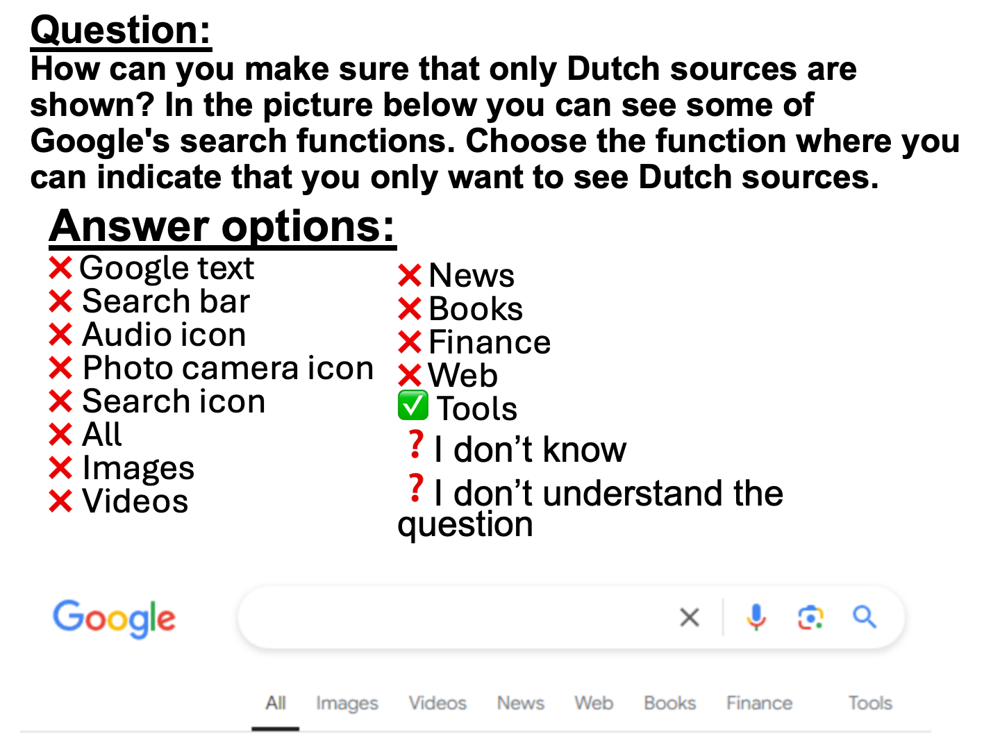

```{r, echo=FALSE, results='asis', message=FALSE, warning=FALSE}
dashboardr::.page_config(accessibility = TRUE, modals = TRUE, crosstab_prefix = "strategic_information")
```

```{=html}
<style>
  /* DigIQ Unified Theme & Editorial Observatory Styling */
  html { scroll-behavior: smooth; }
  section.level2 { scroll-margin-top: 85px; }

  /* Navbar hover readability */
  .navbar a:hover, .navbar .navbar-brand:hover, .navbar .navbar-nav .nav-link:hover {
    color: #3D7271 !important;
  }
  .navbar a:hover svg, .navbar .aa-DetachedSearchButton:hover svg, .navbar button:hover svg {
    fill: #3D7271 !important;
    stroke: #3D7271 !important;
  }

  /* Underline tabsets in DigIQ Teal & Terracotta instead of default royal blue */
  .panel-tabset .nav-item a::after {
    background-color: #E28D50 !important;
  }
  .panel-tabset .nav-tabs .nav-link.active {
    color: #0F6B5A !important;
    font-weight: 700 !important;
  }
  .panel-tabset .nav-tabs .nav-link.active::after {
    background-color: #3D7271 !important;
    height: 3px !important;
  }

  /* Question blockquotes in clean DigIQ Teal */
  blockquote.blockquote {
    border-left: 4px solid #3D7271 !important;
    background: linear-gradient(90deg, #f4f9f8 0%, #fafcfc 100%) !important;
    color: #1e3332 !important;
    border-radius: 0 8px 8px 0 !important;
    padding: 13px 20px !important;
    box-shadow: 0 1px 4px rgba(15, 45, 43, 0.04) !important;
  }

  /* Clickable modal links inside question blockquotes */
  a.modal-link {
    color: #0F6B5A !important;
    font-weight: 600;
    text-decoration: underline !important;
    text-decoration-color: rgba(15, 107, 90, 0.45) !important;
    text-underline-offset: 3px;
    transition: color 0.15s ease, text-decoration-color 0.15s ease;
  }
  a.modal-link:hover {
    color: #E28D50 !important;
    text-decoration-color: #E28D50 !important;
  }

  /* Wave 3 missing-data callout note on Performance sections */
  .dc-wave3-note {
    display: flex;
    align-items: flex-start;
    gap: 0.65rem;
    border: 1px solid #ebd5c3;
    border-left: 4px solid #E28D50;
    background: linear-gradient(90deg, #fdf8f3 0%, #fffcfa 100%);
    color: #5c3314;
    padding: 0.7rem 1.05rem;
    border-radius: 0 8px 8px 0;
    margin: 0.75rem 0 1.1rem 0;
    font-size: 0.92rem;
    line-height: 1.5;
  }
  .dc-wave3-note iconify-icon {
    color: #E28D50;
    font-size: 1.15rem;
    flex-shrink: 0;
    margin-top: 0.14rem;
  }

  /* Landing page: hide redundant Quarto title header & style Editorial Observatory Hero */
  body:has(.dc-observatory-hero) #title-block-header {
    display: none;
  }
  .dc-observatory-hero {
    position: relative;
    overflow: hidden;
    margin: 0.5rem 0 2rem 0;
    padding: 2.2rem 2.5rem 1.75rem 2.5rem;
    border-radius: 16px;
    background:
      radial-gradient(circle at 96% 8%, rgba(61, 114, 113, 0.11) 0%, transparent 45%),
      radial-gradient(circle at 4% 95%, rgba(226, 141, 80, 0.08) 0%, transparent 40%),
      linear-gradient(180deg, #ffffff 0%, #f7fbfa 100%);
    border: 1px solid #d5e3e0;
    box-shadow: 0 1px 3px rgba(15, 45, 43, 0.03), 0 10px 30px -8px rgba(15, 45, 43, 0.07);
  }
  .dc-observatory-hero::before {
    content: '';
    position: absolute;
    top: 0; left: 0; right: 0;
    height: 4px;
    background: linear-gradient(90deg, #0F6B5A 0%, #3D7271 62%, #E28D50 100%);
  }
  .dc-hero-eyebrow {
    display: inline-flex;
    align-items: center;
    gap: 0.5rem;
    font-size: 0.75rem;
    font-weight: 700;
    letter-spacing: 0.09em;
    text-transform: uppercase;
    color: #0F6B5A;
    background: #eaf4f1;
    border: 1px solid #cbe2dc;
    padding: 0.28rem 0.75rem;
    border-radius: 999px;
    margin-bottom: 0.95rem;
  }
  .dc-hero-dot {
    width: 7px;
    height: 7px;
    border-radius: 50%;
    background-color: #E28D50;
    box-shadow: 0 0 0 3px rgba(226, 141, 80, 0.22);
  }
  .dc-hero-title {
    font-size: 2rem;
    font-weight: 800;
    letter-spacing: -0.025em;
    color: #122928;
    margin: 0 0 0.75rem 0;
    line-height: 1.2;
  }
  .dc-hero-lead p {
    font-size: 1.03rem;
    line-height: 1.65;
    color: #364f4d;
    max-width: 880px;
    margin: 0 0 0.55rem 0;
  }
  .dc-hero-lead p:first-child {
    font-weight: 600;
    color: #1c3b39;
  }
  .dc-hero-metrics {
    display: grid;
    grid-template-columns: repeat(auto-fit, minmax(195px, 1fr));
    gap: 0.9rem;
    margin-top: 1.45rem;
    padding-top: 1.25rem;
    border-top: 1px solid #e1ecea;
  }
  .dc-metric-item {
    display: flex;
    align-items: center;
    gap: 0.75rem;
    padding: 0.65rem 0.9rem;
    background: rgba(255, 255, 255, 0.85);
    border: 1px solid #e2ecea;
    border-radius: 10px;
  }
  .dc-metric-icon {
    width: 36px;
    height: 36px;
    border-radius: 8px;
    background: #eef6f4;
    color: #3D7271;
    display: inline-flex;
    align-items: center;
    justify-content: center;
    font-size: 1.2rem;
    flex-shrink: 0;
  }
  .dc-metric-val {
    font-size: 0.98rem;
    font-weight: 700;
    color: #142d2c;
    line-height: 1.2;
  }
  .dc-metric-sub {
    font-size: 0.78rem;
    color: #5b7472;
    margin-top: 0.1rem;
  }

  /* Landing page 11-tile Bento Grid */
  .dc-links {
    display: grid;
    grid-template-columns: repeat(auto-fit, minmax(285px, 1fr));
    gap: 1.15rem;
    margin: 1.25rem 0 2.25rem 0;
  }
  @media (min-width: 1100px) {
    .dc-links {
      grid-template-columns: repeat(6, minmax(0, 1fr));
    }
    .dc-links > .dc-link {
      grid-column: span 2;
    }
    /* Center the final 2 AI cards (10 & 11) on the bottom row */
    .dc-links > .dc-link:nth-child(10) {
      grid-column: 2 / span 2;
    }
    .dc-links > .dc-link:nth-child(11) {
      grid-column: 4 / span 2;
    }
  }
  .dc-link {
    position: relative;
    overflow: hidden;
    display: flex;
    flex-direction: column;
    justify-content: space-between;
    padding: 1.35rem 1.4rem 1.15rem 1.4rem;
    border-radius: 13px;
    border: 1px solid #dce7e5;
    border-left: 4px solid #3D7271;
    background: #ffffff;
    color: inherit !important;
    text-decoration: none !important;
    text-align: left;
    box-shadow: 0 1px 2px rgba(15, 40, 38, 0.03), 0 6px 18px -4px rgba(15, 40, 38, 0.05);
    transition: transform 0.22s cubic-bezier(0.16, 1, 0.3, 1), box-shadow 0.22s cubic-bezier(0.16, 1, 0.3, 1), border-color 0.2s ease;
  }
  .dc-link::after {
    content: '';
    position: absolute;
    top: 0; left: 0; right: 0;
    height: 2px;
    background: linear-gradient(90deg, #3D7271, #E28D50);
    opacity: 0;
    transition: opacity 0.22s ease;
  }
  .dc-link:hover {
    transform: translateY(-4px);
    box-shadow: 0 4px 8px rgba(15, 40, 38, 0.04), 0 16px 32px -6px rgba(15, 40, 38, 0.11);
    border-color: #b8cfcc;
    border-left-color: #E28D50;
  }
  .dc-link:hover::after {
    opacity: 1;
  }
  .dc-card-watermark {
    position: absolute;
    right: -10px;
    bottom: -14px;
    font-size: 5.4rem;
    color: #3D7271;
    opacity: 0.04;
    pointer-events: none;
    transition: transform 0.3s ease, opacity 0.3s ease, color 0.3s ease;
  }
  .dc-link:hover .dc-card-watermark {
    transform: scale(1.08) rotate(-5deg);
    opacity: 0.075;
    color: #0F6B5A;
  }
  .dc-card-top {
    display: flex;
    align-items: center;
    justify-content: space-between;
    gap: 0.75rem;
    margin-bottom: 0.75rem;
  }
  .dc-card-title-group {
    display: flex;
    align-items: center;
    gap: 0.7rem;
    min-width: 0;
  }
  .dc-card-emblem {
    width: 38px;
    height: 38px;
    border-radius: 9px;
    background: #eef5f3;
    border: 1px solid #d5e6e2;
    color: #0F6B5A;
    display: inline-flex;
    align-items: center;
    justify-content: center;
    font-size: 1.22rem;
    flex-shrink: 0;
    transition: background-color 0.2s ease, color 0.2s ease, border-color 0.2s ease, transform 0.2s ease;
  }
  .dc-link:hover .dc-card-emblem {
    background: #3D7271;
    border-color: #3D7271;
    color: #ffffff;
    transform: scale(1.04);
  }
  .dc-link-title {
    font-weight: 700;
    color: #142c2b;
    font-size: 1.05rem;
    letter-spacing: -0.01em;
    line-height: 1.25;
    transition: color 0.2s ease;
  }
  .dc-link:hover .dc-link-title {
    color: #0F6B5A;
  }
  .dc-card-num {
    font-family: 'Fira Code', monospace;
    font-size: 0.73rem;
    font-weight: 600;
    color: #7c9694;
    background: #f3f7f6;
    border: 1px solid #e3ecea;
    padding: 0.14rem 0.48rem;
    border-radius: 6px;
    flex-shrink: 0;
    transition: color 0.2s ease, border-color 0.2s ease, background-color 0.2s ease;
  }
  .dc-link:hover .dc-card-num {
    color: #9c4215;
    background: #fdf3eb;
    border-color: #f0cdb4;
  }
  .dc-link-text {
    position: relative;
    z-index: 1;
    font-size: 0.91rem;
    line-height: 1.54;
    color: #495e5d;
    margin-bottom: 1rem;
    flex-grow: 1;
  }
  .dc-card-footer {
    position: relative;
    z-index: 1;
    display: flex;
    align-items: center;
    justify-content: space-between;
    padding-top: 0.65rem;
    border-top: 1px solid #eff4f3;
    font-size: 0.8rem;
    font-weight: 600;
    color: #3D7271;
    letter-spacing: 0.01em;
    transition: color 0.2s ease;
  }
  .dc-card-cta-arrow {
    display: inline-flex;
    align-items: center;
    font-size: 0.95rem;
    color: #88a3a0;
    transition: transform 0.2s ease, color 0.2s ease;
  }
  .dc-link:hover .dc-card-footer {
    color: #0F6B5A;
  }
  .dc-link:hover .dc-card-cta-arrow {
    transform: translateX(4px);
    color: #E28D50;
  }

  /* Dimension page intro panel & unified architectural jump-chips */
  .dc-dim-intro {
    background: #ffffff;
    border: 1px solid #d8e4e2;
    border-left: 5px solid #3D7271;
    border-radius: 12px;
    padding: 1.2rem 1.45rem;
    margin: 0.65rem 0 1.65rem 0;
    box-shadow: 0 2px 12px rgba(15, 45, 43, 0.04);
  }
  .dc-dim-intro > p {
    font-size: 1.01rem;
    line-height: 1.65;
    color: #213736;
    margin-bottom: 0.8rem;
  }
  .dc-jump-row {
    display: flex;
    flex-wrap: wrap;
    align-items: center;
    gap: 0.45rem;
    padding-top: 0.7rem;
    border-top: 1px solid #e7f0ee;
    font-size: 0.92rem;
    color: #425958;
    margin: 0;
  }
  .dc-jump-label {
    font-weight: 600;
    color: #1b3332;
    margin-right: 0.15rem;
  }
  a.dc-jump-link {
    display: inline-flex;
    align-items: center;
    gap: 0.35rem;
    padding: 0.24rem 0.7rem;
    border-radius: 7px;
    background: #f3f8f7;
    border: 1px solid #cde0dd;
    color: #0F6B5A !important;
    font-size: 0.86rem;
    font-weight: 600;
    text-decoration: none !important;
    transition: all 0.16s ease;
  }
  a.dc-jump-link:hover {
    background: #3D7271;
    border-color: #3D7271;
    color: #ffffff !important;
    transform: translateY(-1px);
    box-shadow: 0 3px 8px rgba(61, 114, 113, 0.18);
  }
</style>

<script>
(function() {
  function initDigIQNavEnhancements() {
    // 1. Page-aware Language Switcher (preserves current page filename & #hash)
    var langLinks = document.querySelectorAll('a.nav-link[href*="favstats.github.io/digicomp"]');
    var path = window.location.pathname || '';
    var parts = path.split('/').filter(Boolean);
    var lastPart = parts.length ? parts[parts.length - 1] : 'index.html';
    var pageFile = (lastPart.indexOf('.html') !== -1) ? lastPart : 'index.html';
    var isEN = path.indexOf('/en/') !== -1 || (parts.length && parts[parts.length - 1] === 'en');

    function updateLangHrefs() {
      var hash = window.location.hash || '';
      langLinks.forEach(function(link) {
        if (isEN) {
          link.setAttribute('href', '../' + pageFile + hash);
          link.setAttribute('title', 'Bekijk deze pagina in het Nederlands');
        } else {
          link.setAttribute('href', './en/' + pageFile + hash);
          link.setAttribute('title', 'View this page in English');
        }
      });
    }
    updateLangHrefs();
    window.addEventListener('hashchange', updateLangHrefs);

    // 2. Cross-Navigation Link to Sister Dashboard (/burgerschap & /citizenship)
    var moreMenus = document.querySelectorAll('ul.dropdown-menu[aria-labelledby*="more-info"], ul.dropdown-menu[aria-labelledby*="meer-informatie"]');
    moreMenus.forEach(function(menu) {
      if (menu.querySelector('.dc-sister-dashboard-link')) return;
      var dividerLi = document.createElement('li');
      dividerLi.innerHTML = '<hr class="dropdown-divider">';
      var itemLi = document.createElement('li');
      var targetHref = isEN ? '../citizenship/index.html' : './burgerschap/index.html';
      var targetLabel = isEN ? 'Digital Citizenship' : 'Digitaal Burgerschap';
      itemLi.innerHTML = '<a class="dropdown-item dc-sister-dashboard-link" href="' + targetHref + '"><span class="dropdown-text"><iconify-icon role="img" inline="" icon="ph:users-three-fill"></iconify-icon> ' + targetLabel + '</span></a>';
      menu.appendChild(dividerLi);
      menu.appendChild(itemLi);
    });
  }
  if (document.readyState === 'loading') {
    document.addEventListener('DOMContentLoaded', initDigIQNavEnhancements);
  } else {
    initDigIQNavEnhancements();
  }
})();
</script>

```

::: {.dc-dim-intro}
**Strategic Information Competence** is the ability to effectively search for and locate information online. This includes choosing good keywords, using search functions, and finding answers to questions on the internet.

```{=html}
<div class='dc-jump-row'><span class='dc-jump-label'>It is measured in three ways:</span> <a class='dc-jump-link' href='#skills'><iconify-icon inline icon='ph:lightning-fill'></iconify-icon> <span>self-assessed skills</span> &#8595;</a> <a class='dc-jump-link' href='#knowledge'><iconify-icon inline icon='ph:book-open-fill'></iconify-icon> <span>items testing knowledge</span> &#8595;</a> <span>and</span> <a class='dc-jump-link' href='#performance'><iconify-icon inline icon='ph:clipboard-text'></iconify-icon> <span>performance/behavior</span> &#8595;</a></div>
```
:::

```{r setup}
#| echo: false
#| warning: false
#| message: false
#| error: false
#| results: 'hide'

# Load dashboardr (includes dplyr, highcharter as dependencies)
library(dashboardr)

# Global chunk options
knitr::opts_chunk$set(
  echo = FALSE,
  warning = FALSE,
  message = FALSE,
  error = FALSE,
  fig.width = 12,
  fig.height = 8,
  dpi = 300
)

# Load data
data <- readRDS('dataset_large_5307obs.rds')

# Data summary
cat('Dataset loaded:', nrow(data), 'rows,', ncol(data), 'columns\n')

# Create filtered datasets
# Each filter is applied once and reused across visualizations

data_filtered_984a0efe <- dashboardr::.convert_haven(data) %>% dplyr::filter(wave == 1)
data_filtered_4af682fd <- dashboardr::.convert_haven(data) %>% dplyr::filter(wave == 2)
data_filtered_5311412c <- dashboardr::.convert_haven(data) %>% dplyr::filter(wave == 3)
data_filtered_f45d3309 <- dashboardr::.convert_haven(data) %>% dplyr::filter(wave %in% c(1, 2))

```

##  Skills


**Skills** measures participants’ *self-assessed ability* to perform a wide range of digital tasks. These items capture how confident people feel doing things like searching for information.
```{r, echo=FALSE, message=FALSE, warning=FALSE}
create_blockquote("Think about the extent to which each sentence applies to you, if you would have to do this activity now and without help. Please be honest. It is very normal that you never do some things. We'd like to know this. If you don't understand what the question means, please choose 'I don't understand the question.' Do you recognize yourself in the following statements?", preset = "question")
```


::: {.panel-tabset}

###  Wave 1


::: {.panel-tabset}

#####  Overall


```{r sis-wave1-overall}
# Strategic Information Skills
result <- viz_stackedbars(
  data = data_filtered_984a0efe,
  title = "Strategic Information Skills",
  x_vars = c("SInfo1", "SInfo3_V2", "SInfo4"),
  x_var_labels = c("I know how to choose good keywords for online searches (for example with Google)", "I know how I can find answers to my questions on the internet", "I know how I can use search functions in search engines (for example with Google)"),
  stacked_type = "percent",
  color_palette = c("#3D7271", "#E28D50", "#F5D76E", "#C7E6D5", "#0F6B5A", "#BABACD"),
  horizontal = TRUE,
  x_label = "",
  stack_breaks = c(0.5, 2.5, 3.5, 5.5),
  stack_bin_labels = c("(Completely) Untrue (1-2)", "Not true and not untrue (3)", "(Completely) True (4-5)"),
  stack_order = c("(Completely) True (4-5)", "Not true and not untrue (3)", "(Completely) Untrue (1-2)"),
  stack_label = NULL,
  weight_var = "weging_GAMO"
)

result
```


#####  Age


::: {.panel-tabset}

######  Question 1


```{r sis-wave1-age-item1}
# I know how to choose good keywords for online searches (for example with Google)
result <- viz_stackedbar(
  data = data_filtered_984a0efe,
  title = "I know how to choose good keywords for online searches (for example with Google)",
  stacked_type = "percent",
  horizontal = TRUE,
  stack_breaks = c(0.5, 2.5, 3.5, 5.5),
  stack_bin_labels = c("(Completely) Untrue (1-2)", "Not true and not untrue (3)", "(Completely) True (4-5)"),
  stack_order = c("(Completely) True (4-5)", "Not true and not untrue (3)", "(Completely) Untrue (1-2)"),
  color_palette = c("#3D7271", "#E28D50", "#F5D76E", "#C7E6D5", "#0F6B5A", "#BABACD"),
  weight_var = "weging_GAMO",
  x_var = "AgeGroup",
  x_label = "Age",
  stack_var = "SInfo1"
)

result
```


######  Question 2


```{r sis-wave1-age-item2}
# I know how I can find answers to my questions on the internet
result <- viz_stackedbar(
  data = data_filtered_984a0efe,
  title = "I know how I can find answers to my questions on the internet",
  stacked_type = "percent",
  horizontal = TRUE,
  stack_breaks = c(0.5, 2.5, 3.5, 5.5),
  stack_bin_labels = c("(Completely) Untrue (1-2)", "Not true and not untrue (3)", "(Completely) True (4-5)"),
  stack_order = c("(Completely) True (4-5)", "Not true and not untrue (3)", "(Completely) Untrue (1-2)"),
  color_palette = c("#3D7271", "#E28D50", "#F5D76E", "#C7E6D5", "#0F6B5A", "#BABACD"),
  weight_var = "weging_GAMO",
  x_var = "AgeGroup",
  x_label = "Age",
  stack_var = "SInfo3_V2"
)

result
```


######  Question 3


```{r sis-wave1-age-item3}
# I know how I can use search functions in search engines (for example with Google)
result <- viz_stackedbar(
  data = data_filtered_984a0efe,
  title = "I know how I can use search functions in search engines (for example with Google)",
  stacked_type = "percent",
  horizontal = TRUE,
  stack_breaks = c(0.5, 2.5, 3.5, 5.5),
  stack_bin_labels = c("(Completely) Untrue (1-2)", "Not true and not untrue (3)", "(Completely) True (4-5)"),
  stack_order = c("(Completely) True (4-5)", "Not true and not untrue (3)", "(Completely) Untrue (1-2)"),
  color_palette = c("#3D7271", "#E28D50", "#F5D76E", "#C7E6D5", "#0F6B5A", "#BABACD"),
  weight_var = "weging_GAMO",
  x_var = "AgeGroup",
  x_label = "Age",
  stack_var = "SInfo4"
)

result
```


:::


#####  Gender


::: {.panel-tabset}

######  Question 1


```{r sis-wave1-gender-item1}
# I know how to choose good keywords for online searches (for example with Google)
result <- viz_stackedbar(
  data = data_filtered_984a0efe,
  title = "I know how to choose good keywords for online searches (for example with Google)",
  stacked_type = "percent",
  horizontal = TRUE,
  stack_breaks = c(0.5, 2.5, 3.5, 5.5),
  stack_bin_labels = c("(Completely) Untrue (1-2)", "Not true and not untrue (3)", "(Completely) True (4-5)"),
  stack_order = c("(Completely) True (4-5)", "Not true and not untrue (3)", "(Completely) Untrue (1-2)"),
  color_palette = c("#3D7271", "#E28D50", "#F5D76E", "#C7E6D5", "#0F6B5A", "#BABACD"),
  weight_var = "weging_GAMO",
  x_var = "geslacht",
  x_label = "Gender",
  stack_var = "SInfo1"
)

result
```


######  Question 2


```{r sis-wave1-gender-item2}
# I know how I can find answers to my questions on the internet
result <- viz_stackedbar(
  data = data_filtered_984a0efe,
  title = "I know how I can find answers to my questions on the internet",
  stacked_type = "percent",
  horizontal = TRUE,
  stack_breaks = c(0.5, 2.5, 3.5, 5.5),
  stack_bin_labels = c("(Completely) Untrue (1-2)", "Not true and not untrue (3)", "(Completely) True (4-5)"),
  stack_order = c("(Completely) True (4-5)", "Not true and not untrue (3)", "(Completely) Untrue (1-2)"),
  color_palette = c("#3D7271", "#E28D50", "#F5D76E", "#C7E6D5", "#0F6B5A", "#BABACD"),
  weight_var = "weging_GAMO",
  x_var = "geslacht",
  x_label = "Gender",
  stack_var = "SInfo3_V2"
)

result
```


######  Question 3


```{r sis-wave1-gender-item3}
# I know how I can use search functions in search engines (for example with Google)
result <- viz_stackedbar(
  data = data_filtered_984a0efe,
  title = "I know how I can use search functions in search engines (for example with Google)",
  stacked_type = "percent",
  horizontal = TRUE,
  stack_breaks = c(0.5, 2.5, 3.5, 5.5),
  stack_bin_labels = c("(Completely) Untrue (1-2)", "Not true and not untrue (3)", "(Completely) True (4-5)"),
  stack_order = c("(Completely) True (4-5)", "Not true and not untrue (3)", "(Completely) Untrue (1-2)"),
  color_palette = c("#3D7271", "#E28D50", "#F5D76E", "#C7E6D5", "#0F6B5A", "#BABACD"),
  weight_var = "weging_GAMO",
  x_var = "geslacht",
  x_label = "Gender",
  stack_var = "SInfo4"
)

result
```


:::


#####  Education


::: {.panel-tabset}

######  Question 1


```{r sis-wave1-edu-item1}
# I know how to choose good keywords for online searches (for example with Google)
result <- viz_stackedbar(
  data = data_filtered_984a0efe,
  title = "I know how to choose good keywords for online searches (for example with Google)",
  stacked_type = "percent",
  horizontal = TRUE,
  stack_breaks = c(0.5, 2.5, 3.5, 5.5),
  stack_bin_labels = c("(Completely) Untrue (1-2)", "Not true and not untrue (3)", "(Completely) True (4-5)"),
  stack_order = c("(Completely) True (4-5)", "Not true and not untrue (3)", "(Completely) Untrue (1-2)"),
  color_palette = c("#3D7271", "#E28D50", "#F5D76E", "#C7E6D5", "#0F6B5A", "#BABACD"),
  weight_var = "weging_GAMO",
  x_var = "Education",
  x_label = "Education",
  stack_var = "SInfo1"
)

result
```


######  Question 2


```{r sis-wave1-edu-item2}
# I know how I can find answers to my questions on the internet
result <- viz_stackedbar(
  data = data_filtered_984a0efe,
  title = "I know how I can find answers to my questions on the internet",
  stacked_type = "percent",
  horizontal = TRUE,
  stack_breaks = c(0.5, 2.5, 3.5, 5.5),
  stack_bin_labels = c("(Completely) Untrue (1-2)", "Not true and not untrue (3)", "(Completely) True (4-5)"),
  stack_order = c("(Completely) True (4-5)", "Not true and not untrue (3)", "(Completely) Untrue (1-2)"),
  color_palette = c("#3D7271", "#E28D50", "#F5D76E", "#C7E6D5", "#0F6B5A", "#BABACD"),
  weight_var = "weging_GAMO",
  x_var = "Education",
  x_label = "Education",
  stack_var = "SInfo3_V2"
)

result
```


######  Question 3


```{r sis-wave1-edu-item3}
# I know how I can use search functions in search engines (for example with Google)
result <- viz_stackedbar(
  data = data_filtered_984a0efe,
  title = "I know how I can use search functions in search engines (for example with Google)",
  stacked_type = "percent",
  horizontal = TRUE,
  stack_breaks = c(0.5, 2.5, 3.5, 5.5),
  stack_bin_labels = c("(Completely) Untrue (1-2)", "Not true and not untrue (3)", "(Completely) True (4-5)"),
  stack_order = c("(Completely) True (4-5)", "Not true and not untrue (3)", "(Completely) Untrue (1-2)"),
  color_palette = c("#3D7271", "#E28D50", "#F5D76E", "#C7E6D5", "#0F6B5A", "#BABACD"),
  weight_var = "weging_GAMO",
  x_var = "Education",
  x_label = "Education",
  stack_var = "SInfo4"
)

result
```


:::


#####  Migration Background


::: {.panel-tabset}

######  Question 1


```{r sis-wave1-mig-item1}
# I know how to choose good keywords for online searches (for example with Google)
result <- viz_stackedbar(
  data = data_filtered_984a0efe,
  title = "I know how to choose good keywords for online searches (for example with Google)",
  stacked_type = "percent",
  horizontal = TRUE,
  stack_breaks = c(0.5, 2.5, 3.5, 5.5),
  stack_bin_labels = c("(Completely) Untrue (1-2)", "Not true and not untrue (3)", "(Completely) True (4-5)"),
  stack_order = c("(Completely) True (4-5)", "Not true and not untrue (3)", "(Completely) Untrue (1-2)"),
  color_palette = c("#3D7271", "#E28D50", "#F5D76E", "#C7E6D5", "#0F6B5A", "#BABACD"),
  weight_var = "weging_GAMO",
  x_var = "MigrationBackground",
  x_label = "Migration Background",
  stack_var = "SInfo1"
)

result
```


######  Question 2


```{r sis-wave1-mig-item2}
# I know how I can find answers to my questions on the internet
result <- viz_stackedbar(
  data = data_filtered_984a0efe,
  title = "I know how I can find answers to my questions on the internet",
  stacked_type = "percent",
  horizontal = TRUE,
  stack_breaks = c(0.5, 2.5, 3.5, 5.5),
  stack_bin_labels = c("(Completely) Untrue (1-2)", "Not true and not untrue (3)", "(Completely) True (4-5)"),
  stack_order = c("(Completely) True (4-5)", "Not true and not untrue (3)", "(Completely) Untrue (1-2)"),
  color_palette = c("#3D7271", "#E28D50", "#F5D76E", "#C7E6D5", "#0F6B5A", "#BABACD"),
  weight_var = "weging_GAMO",
  x_var = "MigrationBackground",
  x_label = "Migration Background",
  stack_var = "SInfo3_V2"
)

result
```


######  Question 3


```{r sis-wave1-mig-item3}
# I know how I can use search functions in search engines (for example with Google)
result <- viz_stackedbar(
  data = data_filtered_984a0efe,
  title = "I know how I can use search functions in search engines (for example with Google)",
  stacked_type = "percent",
  horizontal = TRUE,
  stack_breaks = c(0.5, 2.5, 3.5, 5.5),
  stack_bin_labels = c("(Completely) Untrue (1-2)", "Not true and not untrue (3)", "(Completely) True (4-5)"),
  stack_order = c("(Completely) True (4-5)", "Not true and not untrue (3)", "(Completely) Untrue (1-2)"),
  color_palette = c("#3D7271", "#E28D50", "#F5D76E", "#C7E6D5", "#0F6B5A", "#BABACD"),
  weight_var = "weging_GAMO",
  x_var = "MigrationBackground",
  x_label = "Migration Background",
  stack_var = "SInfo4"
)

result
```


:::


:::


###  Wave 2


::: {.panel-tabset}

#####  Overall


```{r sis-wave2-overall}
# Strategic Information Skills
result <- viz_stackedbars(
  data = data_filtered_4af682fd,
  title = "Strategic Information Skills",
  x_vars = c("SInfo1", "SInfo3_V2", "SInfo4"),
  x_var_labels = c("I know how to choose good keywords for online searches (for example with Google)", "I know how I can find answers to my questions on the internet", "I know how I can use search functions in search engines (for example with Google)"),
  stacked_type = "percent",
  color_palette = c("#3D7271", "#E28D50", "#F5D76E", "#C7E6D5", "#0F6B5A", "#BABACD"),
  horizontal = TRUE,
  x_label = "",
  stack_breaks = c(0.5, 2.5, 3.5, 5.5),
  stack_bin_labels = c("(Completely) Untrue (1-2)", "Not true and not untrue (3)", "(Completely) True (4-5)"),
  stack_order = c("(Completely) True (4-5)", "Not true and not untrue (3)", "(Completely) Untrue (1-2)"),
  stack_label = NULL,
  weight_var = "weging_GAMO"
)

result
```


#####  Age


::: {.panel-tabset}

######  Question 1


```{r sis-wave2-age-item1}
# I know how to choose good keywords for online searches (for example with Google)
result <- viz_stackedbar(
  data = data_filtered_4af682fd,
  title = "I know how to choose good keywords for online searches (for example with Google)",
  stacked_type = "percent",
  horizontal = TRUE,
  stack_breaks = c(0.5, 2.5, 3.5, 5.5),
  stack_bin_labels = c("(Completely) Untrue (1-2)", "Not true and not untrue (3)", "(Completely) True (4-5)"),
  stack_order = c("(Completely) True (4-5)", "Not true and not untrue (3)", "(Completely) Untrue (1-2)"),
  color_palette = c("#3D7271", "#E28D50", "#F5D76E", "#C7E6D5", "#0F6B5A", "#BABACD"),
  weight_var = "weging_GAMO",
  x_var = "AgeGroup",
  x_label = "Age",
  stack_var = "SInfo1"
)

result
```


######  Question 2


```{r sis-wave2-age-item2}
# I know how I can find answers to my questions on the internet
result <- viz_stackedbar(
  data = data_filtered_4af682fd,
  title = "I know how I can find answers to my questions on the internet",
  stacked_type = "percent",
  horizontal = TRUE,
  stack_breaks = c(0.5, 2.5, 3.5, 5.5),
  stack_bin_labels = c("(Completely) Untrue (1-2)", "Not true and not untrue (3)", "(Completely) True (4-5)"),
  stack_order = c("(Completely) True (4-5)", "Not true and not untrue (3)", "(Completely) Untrue (1-2)"),
  color_palette = c("#3D7271", "#E28D50", "#F5D76E", "#C7E6D5", "#0F6B5A", "#BABACD"),
  weight_var = "weging_GAMO",
  x_var = "AgeGroup",
  x_label = "Age",
  stack_var = "SInfo3_V2"
)

result
```


######  Question 3


```{r sis-wave2-age-item3}
# I know how I can use search functions in search engines (for example with Google)
result <- viz_stackedbar(
  data = data_filtered_4af682fd,
  title = "I know how I can use search functions in search engines (for example with Google)",
  stacked_type = "percent",
  horizontal = TRUE,
  stack_breaks = c(0.5, 2.5, 3.5, 5.5),
  stack_bin_labels = c("(Completely) Untrue (1-2)", "Not true and not untrue (3)", "(Completely) True (4-5)"),
  stack_order = c("(Completely) True (4-5)", "Not true and not untrue (3)", "(Completely) Untrue (1-2)"),
  color_palette = c("#3D7271", "#E28D50", "#F5D76E", "#C7E6D5", "#0F6B5A", "#BABACD"),
  weight_var = "weging_GAMO",
  x_var = "AgeGroup",
  x_label = "Age",
  stack_var = "SInfo4"
)

result
```


:::


#####  Gender


::: {.panel-tabset}

######  Question 1


```{r sis-wave2-gender-item1}
# I know how to choose good keywords for online searches (for example with Google)
result <- viz_stackedbar(
  data = data_filtered_4af682fd,
  title = "I know how to choose good keywords for online searches (for example with Google)",
  stacked_type = "percent",
  horizontal = TRUE,
  stack_breaks = c(0.5, 2.5, 3.5, 5.5),
  stack_bin_labels = c("(Completely) Untrue (1-2)", "Not true and not untrue (3)", "(Completely) True (4-5)"),
  stack_order = c("(Completely) True (4-5)", "Not true and not untrue (3)", "(Completely) Untrue (1-2)"),
  color_palette = c("#3D7271", "#E28D50", "#F5D76E", "#C7E6D5", "#0F6B5A", "#BABACD"),
  weight_var = "weging_GAMO",
  x_var = "geslacht",
  x_label = "Gender",
  stack_var = "SInfo1"
)

result
```


######  Question 2


```{r sis-wave2-gender-item2}
# I know how I can find answers to my questions on the internet
result <- viz_stackedbar(
  data = data_filtered_4af682fd,
  title = "I know how I can find answers to my questions on the internet",
  stacked_type = "percent",
  horizontal = TRUE,
  stack_breaks = c(0.5, 2.5, 3.5, 5.5),
  stack_bin_labels = c("(Completely) Untrue (1-2)", "Not true and not untrue (3)", "(Completely) True (4-5)"),
  stack_order = c("(Completely) True (4-5)", "Not true and not untrue (3)", "(Completely) Untrue (1-2)"),
  color_palette = c("#3D7271", "#E28D50", "#F5D76E", "#C7E6D5", "#0F6B5A", "#BABACD"),
  weight_var = "weging_GAMO",
  x_var = "geslacht",
  x_label = "Gender",
  stack_var = "SInfo3_V2"
)

result
```


######  Question 3


```{r sis-wave2-gender-item3}
# I know how I can use search functions in search engines (for example with Google)
result <- viz_stackedbar(
  data = data_filtered_4af682fd,
  title = "I know how I can use search functions in search engines (for example with Google)",
  stacked_type = "percent",
  horizontal = TRUE,
  stack_breaks = c(0.5, 2.5, 3.5, 5.5),
  stack_bin_labels = c("(Completely) Untrue (1-2)", "Not true and not untrue (3)", "(Completely) True (4-5)"),
  stack_order = c("(Completely) True (4-5)", "Not true and not untrue (3)", "(Completely) Untrue (1-2)"),
  color_palette = c("#3D7271", "#E28D50", "#F5D76E", "#C7E6D5", "#0F6B5A", "#BABACD"),
  weight_var = "weging_GAMO",
  x_var = "geslacht",
  x_label = "Gender",
  stack_var = "SInfo4"
)

result
```


:::


#####  Education


::: {.panel-tabset}

######  Question 1


```{r sis-wave2-edu-item1}
# I know how to choose good keywords for online searches (for example with Google)
result <- viz_stackedbar(
  data = data_filtered_4af682fd,
  title = "I know how to choose good keywords for online searches (for example with Google)",
  stacked_type = "percent",
  horizontal = TRUE,
  stack_breaks = c(0.5, 2.5, 3.5, 5.5),
  stack_bin_labels = c("(Completely) Untrue (1-2)", "Not true and not untrue (3)", "(Completely) True (4-5)"),
  stack_order = c("(Completely) True (4-5)", "Not true and not untrue (3)", "(Completely) Untrue (1-2)"),
  color_palette = c("#3D7271", "#E28D50", "#F5D76E", "#C7E6D5", "#0F6B5A", "#BABACD"),
  weight_var = "weging_GAMO",
  x_var = "Education",
  x_label = "Education",
  stack_var = "SInfo1"
)

result
```


######  Question 2


```{r sis-wave2-edu-item2}
# I know how I can find answers to my questions on the internet
result <- viz_stackedbar(
  data = data_filtered_4af682fd,
  title = "I know how I can find answers to my questions on the internet",
  stacked_type = "percent",
  horizontal = TRUE,
  stack_breaks = c(0.5, 2.5, 3.5, 5.5),
  stack_bin_labels = c("(Completely) Untrue (1-2)", "Not true and not untrue (3)", "(Completely) True (4-5)"),
  stack_order = c("(Completely) True (4-5)", "Not true and not untrue (3)", "(Completely) Untrue (1-2)"),
  color_palette = c("#3D7271", "#E28D50", "#F5D76E", "#C7E6D5", "#0F6B5A", "#BABACD"),
  weight_var = "weging_GAMO",
  x_var = "Education",
  x_label = "Education",
  stack_var = "SInfo3_V2"
)

result
```


######  Question 3


```{r sis-wave2-edu-item3}
# I know how I can use search functions in search engines (for example with Google)
result <- viz_stackedbar(
  data = data_filtered_4af682fd,
  title = "I know how I can use search functions in search engines (for example with Google)",
  stacked_type = "percent",
  horizontal = TRUE,
  stack_breaks = c(0.5, 2.5, 3.5, 5.5),
  stack_bin_labels = c("(Completely) Untrue (1-2)", "Not true and not untrue (3)", "(Completely) True (4-5)"),
  stack_order = c("(Completely) True (4-5)", "Not true and not untrue (3)", "(Completely) Untrue (1-2)"),
  color_palette = c("#3D7271", "#E28D50", "#F5D76E", "#C7E6D5", "#0F6B5A", "#BABACD"),
  weight_var = "weging_GAMO",
  x_var = "Education",
  x_label = "Education",
  stack_var = "SInfo4"
)

result
```


:::


#####  Migration Background


::: {.panel-tabset}

######  Question 1


```{r sis-wave2-mig-item1}
# I know how to choose good keywords for online searches (for example with Google)
result <- viz_stackedbar(
  data = data_filtered_4af682fd,
  title = "I know how to choose good keywords for online searches (for example with Google)",
  stacked_type = "percent",
  horizontal = TRUE,
  stack_breaks = c(0.5, 2.5, 3.5, 5.5),
  stack_bin_labels = c("(Completely) Untrue (1-2)", "Not true and not untrue (3)", "(Completely) True (4-5)"),
  stack_order = c("(Completely) True (4-5)", "Not true and not untrue (3)", "(Completely) Untrue (1-2)"),
  color_palette = c("#3D7271", "#E28D50", "#F5D76E", "#C7E6D5", "#0F6B5A", "#BABACD"),
  weight_var = "weging_GAMO",
  x_var = "MigrationBackground",
  x_label = "Migration Background",
  stack_var = "SInfo1"
)

result
```


######  Question 2


```{r sis-wave2-mig-item2}
# I know how I can find answers to my questions on the internet
result <- viz_stackedbar(
  data = data_filtered_4af682fd,
  title = "I know how I can find answers to my questions on the internet",
  stacked_type = "percent",
  horizontal = TRUE,
  stack_breaks = c(0.5, 2.5, 3.5, 5.5),
  stack_bin_labels = c("(Completely) Untrue (1-2)", "Not true and not untrue (3)", "(Completely) True (4-5)"),
  stack_order = c("(Completely) True (4-5)", "Not true and not untrue (3)", "(Completely) Untrue (1-2)"),
  color_palette = c("#3D7271", "#E28D50", "#F5D76E", "#C7E6D5", "#0F6B5A", "#BABACD"),
  weight_var = "weging_GAMO",
  x_var = "MigrationBackground",
  x_label = "Migration Background",
  stack_var = "SInfo3_V2"
)

result
```


######  Question 3


```{r sis-wave2-mig-item3}
# I know how I can use search functions in search engines (for example with Google)
result <- viz_stackedbar(
  data = data_filtered_4af682fd,
  title = "I know how I can use search functions in search engines (for example with Google)",
  stacked_type = "percent",
  horizontal = TRUE,
  stack_breaks = c(0.5, 2.5, 3.5, 5.5),
  stack_bin_labels = c("(Completely) Untrue (1-2)", "Not true and not untrue (3)", "(Completely) True (4-5)"),
  stack_order = c("(Completely) True (4-5)", "Not true and not untrue (3)", "(Completely) Untrue (1-2)"),
  color_palette = c("#3D7271", "#E28D50", "#F5D76E", "#C7E6D5", "#0F6B5A", "#BABACD"),
  weight_var = "weging_GAMO",
  x_var = "MigrationBackground",
  x_label = "Migration Background",
  stack_var = "SInfo4"
)

result
```


:::


:::


###  Wave 3


::: {.panel-tabset}

#####  Overall


```{r sis-wave3-overall}
# Strategic Information Skills
result <- viz_stackedbars(
  data = data_filtered_5311412c,
  title = "Strategic Information Skills",
  x_vars = c("SInfo1", "SInfo3_V2", "SInfo4"),
  x_var_labels = c("I know how to choose good keywords for online searches (for example with Google)", "I know how I can find answers to my questions on the internet", "I know how I can use search functions in search engines (for example with Google)"),
  stacked_type = "percent",
  color_palette = c("#3D7271", "#E28D50", "#F5D76E", "#C7E6D5", "#0F6B5A", "#BABACD"),
  horizontal = TRUE,
  x_label = "",
  stack_breaks = c(0.5, 2.5, 3.5, 5.5),
  stack_bin_labels = c("(Completely) Untrue (1-2)", "Not true and not untrue (3)", "(Completely) True (4-5)"),
  stack_order = c("(Completely) True (4-5)", "Not true and not untrue (3)", "(Completely) Untrue (1-2)"),
  stack_label = NULL,
  weight_var = "weging_GAMO"
)

result
```


#####  Age


::: {.panel-tabset}

######  Question 1


```{r sis-wave3-age-item1}
# I know how to choose good keywords for online searches (for example with Google)
result <- viz_stackedbar(
  data = data_filtered_5311412c,
  title = "I know how to choose good keywords for online searches (for example with Google)",
  stacked_type = "percent",
  horizontal = TRUE,
  stack_breaks = c(0.5, 2.5, 3.5, 5.5),
  stack_bin_labels = c("(Completely) Untrue (1-2)", "Not true and not untrue (3)", "(Completely) True (4-5)"),
  stack_order = c("(Completely) True (4-5)", "Not true and not untrue (3)", "(Completely) Untrue (1-2)"),
  color_palette = c("#3D7271", "#E28D50", "#F5D76E", "#C7E6D5", "#0F6B5A", "#BABACD"),
  weight_var = "weging_GAMO",
  x_var = "AgeGroup",
  x_label = "Age",
  stack_var = "SInfo1"
)

result
```


######  Question 2


```{r sis-wave3-age-item2}
# I know how I can find answers to my questions on the internet
result <- viz_stackedbar(
  data = data_filtered_5311412c,
  title = "I know how I can find answers to my questions on the internet",
  stacked_type = "percent",
  horizontal = TRUE,
  stack_breaks = c(0.5, 2.5, 3.5, 5.5),
  stack_bin_labels = c("(Completely) Untrue (1-2)", "Not true and not untrue (3)", "(Completely) True (4-5)"),
  stack_order = c("(Completely) True (4-5)", "Not true and not untrue (3)", "(Completely) Untrue (1-2)"),
  color_palette = c("#3D7271", "#E28D50", "#F5D76E", "#C7E6D5", "#0F6B5A", "#BABACD"),
  weight_var = "weging_GAMO",
  x_var = "AgeGroup",
  x_label = "Age",
  stack_var = "SInfo3_V2"
)

result
```


######  Question 3


```{r sis-wave3-age-item3}
# I know how I can use search functions in search engines (for example with Google)
result <- viz_stackedbar(
  data = data_filtered_5311412c,
  title = "I know how I can use search functions in search engines (for example with Google)",
  stacked_type = "percent",
  horizontal = TRUE,
  stack_breaks = c(0.5, 2.5, 3.5, 5.5),
  stack_bin_labels = c("(Completely) Untrue (1-2)", "Not true and not untrue (3)", "(Completely) True (4-5)"),
  stack_order = c("(Completely) True (4-5)", "Not true and not untrue (3)", "(Completely) Untrue (1-2)"),
  color_palette = c("#3D7271", "#E28D50", "#F5D76E", "#C7E6D5", "#0F6B5A", "#BABACD"),
  weight_var = "weging_GAMO",
  x_var = "AgeGroup",
  x_label = "Age",
  stack_var = "SInfo4"
)

result
```


:::


#####  Gender


::: {.panel-tabset}

######  Question 1


```{r sis-wave3-gender-item1}
# I know how to choose good keywords for online searches (for example with Google)
result <- viz_stackedbar(
  data = data_filtered_5311412c,
  title = "I know how to choose good keywords for online searches (for example with Google)",
  stacked_type = "percent",
  horizontal = TRUE,
  stack_breaks = c(0.5, 2.5, 3.5, 5.5),
  stack_bin_labels = c("(Completely) Untrue (1-2)", "Not true and not untrue (3)", "(Completely) True (4-5)"),
  stack_order = c("(Completely) True (4-5)", "Not true and not untrue (3)", "(Completely) Untrue (1-2)"),
  color_palette = c("#3D7271", "#E28D50", "#F5D76E", "#C7E6D5", "#0F6B5A", "#BABACD"),
  weight_var = "weging_GAMO",
  x_var = "geslacht",
  x_label = "Gender",
  stack_var = "SInfo1"
)

result
```


######  Question 2


```{r sis-wave3-gender-item2}
# I know how I can find answers to my questions on the internet
result <- viz_stackedbar(
  data = data_filtered_5311412c,
  title = "I know how I can find answers to my questions on the internet",
  stacked_type = "percent",
  horizontal = TRUE,
  stack_breaks = c(0.5, 2.5, 3.5, 5.5),
  stack_bin_labels = c("(Completely) Untrue (1-2)", "Not true and not untrue (3)", "(Completely) True (4-5)"),
  stack_order = c("(Completely) True (4-5)", "Not true and not untrue (3)", "(Completely) Untrue (1-2)"),
  color_palette = c("#3D7271", "#E28D50", "#F5D76E", "#C7E6D5", "#0F6B5A", "#BABACD"),
  weight_var = "weging_GAMO",
  x_var = "geslacht",
  x_label = "Gender",
  stack_var = "SInfo3_V2"
)

result
```


######  Question 3


```{r sis-wave3-gender-item3}
# I know how I can use search functions in search engines (for example with Google)
result <- viz_stackedbar(
  data = data_filtered_5311412c,
  title = "I know how I can use search functions in search engines (for example with Google)",
  stacked_type = "percent",
  horizontal = TRUE,
  stack_breaks = c(0.5, 2.5, 3.5, 5.5),
  stack_bin_labels = c("(Completely) Untrue (1-2)", "Not true and not untrue (3)", "(Completely) True (4-5)"),
  stack_order = c("(Completely) True (4-5)", "Not true and not untrue (3)", "(Completely) Untrue (1-2)"),
  color_palette = c("#3D7271", "#E28D50", "#F5D76E", "#C7E6D5", "#0F6B5A", "#BABACD"),
  weight_var = "weging_GAMO",
  x_var = "geslacht",
  x_label = "Gender",
  stack_var = "SInfo4"
)

result
```


:::


#####  Education


::: {.panel-tabset}

######  Question 1


```{r sis-wave3-edu-item1}
# I know how to choose good keywords for online searches (for example with Google)
result <- viz_stackedbar(
  data = data_filtered_5311412c,
  title = "I know how to choose good keywords for online searches (for example with Google)",
  stacked_type = "percent",
  horizontal = TRUE,
  stack_breaks = c(0.5, 2.5, 3.5, 5.5),
  stack_bin_labels = c("(Completely) Untrue (1-2)", "Not true and not untrue (3)", "(Completely) True (4-5)"),
  stack_order = c("(Completely) True (4-5)", "Not true and not untrue (3)", "(Completely) Untrue (1-2)"),
  color_palette = c("#3D7271", "#E28D50", "#F5D76E", "#C7E6D5", "#0F6B5A", "#BABACD"),
  weight_var = "weging_GAMO",
  x_var = "Education",
  x_label = "Education",
  stack_var = "SInfo1"
)

result
```


######  Question 2


```{r sis-wave3-edu-item2}
# I know how I can find answers to my questions on the internet
result <- viz_stackedbar(
  data = data_filtered_5311412c,
  title = "I know how I can find answers to my questions on the internet",
  stacked_type = "percent",
  horizontal = TRUE,
  stack_breaks = c(0.5, 2.5, 3.5, 5.5),
  stack_bin_labels = c("(Completely) Untrue (1-2)", "Not true and not untrue (3)", "(Completely) True (4-5)"),
  stack_order = c("(Completely) True (4-5)", "Not true and not untrue (3)", "(Completely) Untrue (1-2)"),
  color_palette = c("#3D7271", "#E28D50", "#F5D76E", "#C7E6D5", "#0F6B5A", "#BABACD"),
  weight_var = "weging_GAMO",
  x_var = "Education",
  x_label = "Education",
  stack_var = "SInfo3_V2"
)

result
```


######  Question 3


```{r sis-wave3-edu-item3}
# I know how I can use search functions in search engines (for example with Google)
result <- viz_stackedbar(
  data = data_filtered_5311412c,
  title = "I know how I can use search functions in search engines (for example with Google)",
  stacked_type = "percent",
  horizontal = TRUE,
  stack_breaks = c(0.5, 2.5, 3.5, 5.5),
  stack_bin_labels = c("(Completely) Untrue (1-2)", "Not true and not untrue (3)", "(Completely) True (4-5)"),
  stack_order = c("(Completely) True (4-5)", "Not true and not untrue (3)", "(Completely) Untrue (1-2)"),
  color_palette = c("#3D7271", "#E28D50", "#F5D76E", "#C7E6D5", "#0F6B5A", "#BABACD"),
  weight_var = "weging_GAMO",
  x_var = "Education",
  x_label = "Education",
  stack_var = "SInfo4"
)

result
```


:::


#####  Migration Background


::: {.panel-tabset}

######  Question 1


```{r sis-wave3-mig-item1}
# I know how to choose good keywords for online searches (for example with Google)
result <- viz_stackedbar(
  data = data_filtered_5311412c,
  title = "I know how to choose good keywords for online searches (for example with Google)",
  stacked_type = "percent",
  horizontal = TRUE,
  stack_breaks = c(0.5, 2.5, 3.5, 5.5),
  stack_bin_labels = c("(Completely) Untrue (1-2)", "Not true and not untrue (3)", "(Completely) True (4-5)"),
  stack_order = c("(Completely) True (4-5)", "Not true and not untrue (3)", "(Completely) Untrue (1-2)"),
  color_palette = c("#3D7271", "#E28D50", "#F5D76E", "#C7E6D5", "#0F6B5A", "#BABACD"),
  weight_var = "weging_GAMO",
  x_var = "MigrationBackground",
  x_label = "Migration Background",
  stack_var = "SInfo1"
)

result
```


######  Question 2


```{r sis-wave3-mig-item2}
# I know how I can find answers to my questions on the internet
result <- viz_stackedbar(
  data = data_filtered_5311412c,
  title = "I know how I can find answers to my questions on the internet",
  stacked_type = "percent",
  horizontal = TRUE,
  stack_breaks = c(0.5, 2.5, 3.5, 5.5),
  stack_bin_labels = c("(Completely) Untrue (1-2)", "Not true and not untrue (3)", "(Completely) True (4-5)"),
  stack_order = c("(Completely) True (4-5)", "Not true and not untrue (3)", "(Completely) Untrue (1-2)"),
  color_palette = c("#3D7271", "#E28D50", "#F5D76E", "#C7E6D5", "#0F6B5A", "#BABACD"),
  weight_var = "weging_GAMO",
  x_var = "MigrationBackground",
  x_label = "Migration Background",
  stack_var = "SInfo3_V2"
)

result
```


######  Question 3


```{r sis-wave3-mig-item3}
# I know how I can use search functions in search engines (for example with Google)
result <- viz_stackedbar(
  data = data_filtered_5311412c,
  title = "I know how I can use search functions in search engines (for example with Google)",
  stacked_type = "percent",
  horizontal = TRUE,
  stack_breaks = c(0.5, 2.5, 3.5, 5.5),
  stack_bin_labels = c("(Completely) Untrue (1-2)", "Not true and not untrue (3)", "(Completely) True (4-5)"),
  stack_order = c("(Completely) True (4-5)", "Not true and not untrue (3)", "(Completely) Untrue (1-2)"),
  color_palette = c("#3D7271", "#E28D50", "#F5D76E", "#C7E6D5", "#0F6B5A", "#BABACD"),
  weight_var = "weging_GAMO",
  x_var = "MigrationBackground",
  x_label = "Migration Background",
  stack_var = "SInfo4"
)

result
```


:::


:::


###  Over Time


::: {.panel-tabset}

#####  Overall


::: {.panel-tabset}

######  Question 1


```{r sis-overtime-overall-item1}
# I know how to choose good keywords for online searches (for example with Google)
result <- viz_timeline(
  data = data,
  title = "I know how to choose good keywords for online searches (for example with Google)",
  time_var = "wave_time_label",
  chart_type = "line",
  y_filter = c(4, 5),
  y_filter_label = "Percentage of Respondents",
  y_filter_combine = TRUE,
  x_label = "",
  y_label = "Percentage of Respondents",
  color_palette = c("#3D7271", "#E28D50", "#F5D76E", "#C7E6D5", "#0F6B5A", "#BABACD"),
  y_min = 0,
  y_max = 100,
  weight_var = "weging_GAMO",
  y_var = "SInfo1"
)

result
```


######  Question 2


```{r sis-overtime-overall-item2}
# I know how I can find answers to my questions on the internet
result <- viz_timeline(
  data = data,
  title = "I know how I can find answers to my questions on the internet",
  time_var = "wave_time_label",
  chart_type = "line",
  y_filter = c(4, 5),
  y_filter_label = "Percentage of Respondents",
  y_filter_combine = TRUE,
  x_label = "",
  y_label = "Percentage of Respondents",
  color_palette = c("#3D7271", "#E28D50", "#F5D76E", "#C7E6D5", "#0F6B5A", "#BABACD"),
  y_min = 0,
  y_max = 100,
  weight_var = "weging_GAMO",
  y_var = "SInfo3_V2"
)

result
```


######  Question 3


```{r sis-overtime-overall-item3}
# I know how I can use search functions in search engines (for example with Google)
result <- viz_timeline(
  data = data,
  title = "I know how I can use search functions in search engines (for example with Google)",
  time_var = "wave_time_label",
  chart_type = "line",
  y_filter = c(4, 5),
  y_filter_label = "Percentage of Respondents",
  y_filter_combine = TRUE,
  x_label = "",
  y_label = "Percentage of Respondents",
  color_palette = c("#3D7271", "#E28D50", "#F5D76E", "#C7E6D5", "#0F6B5A", "#BABACD"),
  y_min = 0,
  y_max = 100,
  weight_var = "weging_GAMO",
  y_var = "SInfo4"
)

result
```


:::


#####  Age


::: {.panel-tabset}

######  Question 1


```{r sis-overtime-age-item1}
# I know how to choose good keywords for online searches (for example with Google)
result <- viz_timeline(
  data = data,
  title = "I know how to choose good keywords for online searches (for example with Google)",
  time_var = "wave_time_label",
  chart_type = "line",
  y_filter = c(4, 5),
  x_label = "",
  y_label = "Percentage of Respondents",
  color_palette = c("#3D7271", "#E28D50", "#F5D76E", "#C7E6D5", "#0F6B5A", "#BABACD"),
  y_min = 0,
  y_max = 100,
  weight_var = "weging_GAMO",
  y_var = "SInfo1",
  group_var = "AgeGroup"
)

result
```


######  Question 2


```{r sis-overtime-age-item2}
# I know how I can find answers to my questions on the internet
result <- viz_timeline(
  data = data,
  title = "I know how I can find answers to my questions on the internet",
  time_var = "wave_time_label",
  chart_type = "line",
  y_filter = c(4, 5),
  x_label = "",
  y_label = "Percentage of Respondents",
  color_palette = c("#3D7271", "#E28D50", "#F5D76E", "#C7E6D5", "#0F6B5A", "#BABACD"),
  y_min = 0,
  y_max = 100,
  weight_var = "weging_GAMO",
  y_var = "SInfo3_V2",
  group_var = "AgeGroup"
)

result
```


######  Question 3


```{r sis-overtime-age-item3}
# I know how I can use search functions in search engines (for example with Google)
result <- viz_timeline(
  data = data,
  title = "I know how I can use search functions in search engines (for example with Google)",
  time_var = "wave_time_label",
  chart_type = "line",
  y_filter = c(4, 5),
  x_label = "",
  y_label = "Percentage of Respondents",
  color_palette = c("#3D7271", "#E28D50", "#F5D76E", "#C7E6D5", "#0F6B5A", "#BABACD"),
  y_min = 0,
  y_max = 100,
  weight_var = "weging_GAMO",
  y_var = "SInfo4",
  group_var = "AgeGroup"
)

result
```


:::


#####  Gender


::: {.panel-tabset}

######  Question 1


```{r sis-overtime-gender-item1}
# I know how to choose good keywords for online searches (for example with Google)
result <- viz_timeline(
  data = data,
  title = "I know how to choose good keywords for online searches (for example with Google)",
  time_var = "wave_time_label",
  chart_type = "line",
  y_filter = c(4, 5),
  x_label = "",
  y_label = "Percentage of Respondents",
  color_palette = c("#3D7271", "#E28D50", "#F5D76E", "#C7E6D5", "#0F6B5A", "#BABACD"),
  y_min = 0,
  y_max = 100,
  weight_var = "weging_GAMO",
  y_var = "SInfo1",
  group_var = "geslacht"
)

result
```


######  Question 2


```{r sis-overtime-gender-item2}
# I know how I can find answers to my questions on the internet
result <- viz_timeline(
  data = data,
  title = "I know how I can find answers to my questions on the internet",
  time_var = "wave_time_label",
  chart_type = "line",
  y_filter = c(4, 5),
  x_label = "",
  y_label = "Percentage of Respondents",
  color_palette = c("#3D7271", "#E28D50", "#F5D76E", "#C7E6D5", "#0F6B5A", "#BABACD"),
  y_min = 0,
  y_max = 100,
  weight_var = "weging_GAMO",
  y_var = "SInfo3_V2",
  group_var = "geslacht"
)

result
```


######  Question 3


```{r sis-overtime-gender-item3}
# I know how I can use search functions in search engines (for example with Google)
result <- viz_timeline(
  data = data,
  title = "I know how I can use search functions in search engines (for example with Google)",
  time_var = "wave_time_label",
  chart_type = "line",
  y_filter = c(4, 5),
  x_label = "",
  y_label = "Percentage of Respondents",
  color_palette = c("#3D7271", "#E28D50", "#F5D76E", "#C7E6D5", "#0F6B5A", "#BABACD"),
  y_min = 0,
  y_max = 100,
  weight_var = "weging_GAMO",
  y_var = "SInfo4",
  group_var = "geslacht"
)

result
```


:::


#####  Education


::: {.panel-tabset}

######  Question 1


```{r sis-overtime-edu-item1}
# I know how to choose good keywords for online searches (for example with Google)
result <- viz_timeline(
  data = data,
  title = "I know how to choose good keywords for online searches (for example with Google)",
  time_var = "wave_time_label",
  chart_type = "line",
  y_filter = c(4, 5),
  x_label = "",
  y_label = "Percentage of Respondents",
  color_palette = c("#3D7271", "#E28D50", "#F5D76E", "#C7E6D5", "#0F6B5A", "#BABACD"),
  y_min = 0,
  y_max = 100,
  weight_var = "weging_GAMO",
  y_var = "SInfo1",
  group_var = "Education"
)

result
```


######  Question 2


```{r sis-overtime-edu-item2}
# I know how I can find answers to my questions on the internet
result <- viz_timeline(
  data = data,
  title = "I know how I can find answers to my questions on the internet",
  time_var = "wave_time_label",
  chart_type = "line",
  y_filter = c(4, 5),
  x_label = "",
  y_label = "Percentage of Respondents",
  color_palette = c("#3D7271", "#E28D50", "#F5D76E", "#C7E6D5", "#0F6B5A", "#BABACD"),
  y_min = 0,
  y_max = 100,
  weight_var = "weging_GAMO",
  y_var = "SInfo3_V2",
  group_var = "Education"
)

result
```


######  Question 3


```{r sis-overtime-edu-item3}
# I know how I can use search functions in search engines (for example with Google)
result <- viz_timeline(
  data = data,
  title = "I know how I can use search functions in search engines (for example with Google)",
  time_var = "wave_time_label",
  chart_type = "line",
  y_filter = c(4, 5),
  x_label = "",
  y_label = "Percentage of Respondents",
  color_palette = c("#3D7271", "#E28D50", "#F5D76E", "#C7E6D5", "#0F6B5A", "#BABACD"),
  y_min = 0,
  y_max = 100,
  weight_var = "weging_GAMO",
  y_var = "SInfo4",
  group_var = "Education"
)

result
```


:::


#####  Migration Background


::: {.panel-tabset}

######  Question 1


```{r sis-overtime-mig-item1}
# I know how to choose good keywords for online searches (for example with Google)
result <- viz_timeline(
  data = data,
  title = "I know how to choose good keywords for online searches (for example with Google)",
  time_var = "wave_time_label",
  chart_type = "line",
  y_filter = c(4, 5),
  x_label = "",
  y_label = "Percentage of Respondents",
  color_palette = c("#3D7271", "#E28D50", "#F5D76E", "#C7E6D5", "#0F6B5A", "#BABACD"),
  y_min = 0,
  y_max = 100,
  weight_var = "weging_GAMO",
  y_var = "SInfo1",
  group_var = "MigrationBackground"
)

result
```


######  Question 2


```{r sis-overtime-mig-item2}
# I know how I can find answers to my questions on the internet
result <- viz_timeline(
  data = data,
  title = "I know how I can find answers to my questions on the internet",
  time_var = "wave_time_label",
  chart_type = "line",
  y_filter = c(4, 5),
  x_label = "",
  y_label = "Percentage of Respondents",
  color_palette = c("#3D7271", "#E28D50", "#F5D76E", "#C7E6D5", "#0F6B5A", "#BABACD"),
  y_min = 0,
  y_max = 100,
  weight_var = "weging_GAMO",
  y_var = "SInfo3_V2",
  group_var = "MigrationBackground"
)

result
```


######  Question 3


```{r sis-overtime-mig-item3}
# I know how I can use search functions in search engines (for example with Google)
result <- viz_timeline(
  data = data,
  title = "I know how I can use search functions in search engines (for example with Google)",
  time_var = "wave_time_label",
  chart_type = "line",
  y_filter = c(4, 5),
  x_label = "",
  y_label = "Percentage of Respondents",
  color_palette = c("#3D7271", "#E28D50", "#F5D76E", "#C7E6D5", "#0F6B5A", "#BABACD"),
  y_min = 0,
  y_max = 100,
  weight_var = "weging_GAMO",
  y_var = "SInfo4",
  group_var = "MigrationBackground"
)

result
```


:::


:::


:::

##  Knowledge


**Knowledge** measures what participants *know* about the digital world. These items test factual understanding by having respondents indicate whether statements are true or false.
```{r, echo=FALSE, message=FALSE, warning=FALSE}
create_blockquote("The following statements are about the internet. Please indicate if the sentence is true or untrue, according to you. If you don't know, please choose 'I don't know'. You don't have to guess. If you don't understand the question, please choose 'I don't understand the question.' Nearly everyone will not know or understand questions. This is normal and something that we want to know.", preset = "question")
```


::: {.panel-tabset}

###  Wave 1


::: {.panel-tabset}

#####  Overall


```{r kinfo-wave1-overall}
# 
result <- viz_stackedbars(
  data = data_filtered_984a0efe,
  title = "",
  x_vars = c("KInfo1RC", "KInfo2RC"),
  x_var_labels = c("The first search result is always the best information source. (False Statement)", "Everyone gets the same information when they search for the same things online. (False Statement)"),
  stacked_type = "percent",
  color_palette = c("#3D7271", "#E28D50", "#F5D76E", "#C7E6D5", "#0F6B5A", "#BABACD"),
  horizontal = TRUE,
  x_label = "",
  stack_breaks = c(0, 10, 20, 30),
  stack_bin_labels = c("Correctly Answered", "Incorrectly Answered", "Don't know/Understand"),
  stack_map_values = list("1" = "Correctly Answered", "0" = "Incorrectly Answered"),
  stack_order = c("Correctly Answered", "Incorrectly Answered", "Don't know/Understand"),
  stack_label = NULL,
  weight_var = "weging_GAMO"
)

result
```


#####  Age


::: {.panel-tabset}

######  Question 1


```{r kinfo-wave1-age-item1}
# The first search result is always the best information source. (False Statement)
result <- viz_stackedbar(
  data = data_filtered_984a0efe,
  title = "The first search result is always the best information source. (False Statement)",
  stacked_type = "percent",
  horizontal = TRUE,
  stack_breaks = c(0, 10, 20, 30),
  stack_bin_labels = c("Correctly Answered", "Incorrectly Answered", "Don't know/Understand"),
  stack_map_values = list("1" = "Correctly Answered", "0" = "Incorrectly Answered"),
  stack_order = c("Correctly Answered", "Incorrectly Answered", "Don't know/Understand"),
  color_palette = c("#3D7271", "#E28D50", "#F5D76E", "#C7E6D5", "#0F6B5A", "#BABACD"),
  weight_var = "weging_GAMO",
  x_var = "AgeGroup",
  x_label = "Age",
  stack_var = "KInfo1RC"
)

result
```


######  Question 2


```{r kinfo-wave1-age-item2}
# Everyone gets the same information when they search for the same things online. (False Statement)
result <- viz_stackedbar(
  data = data_filtered_984a0efe,
  title = "Everyone gets the same information when they search for the same things online. (False Statement)",
  stacked_type = "percent",
  horizontal = TRUE,
  stack_breaks = c(0, 10, 20, 30),
  stack_bin_labels = c("Correctly Answered", "Incorrectly Answered", "Don't know/Understand"),
  stack_map_values = list("1" = "Correctly Answered", "0" = "Incorrectly Answered"),
  stack_order = c("Correctly Answered", "Incorrectly Answered", "Don't know/Understand"),
  color_palette = c("#3D7271", "#E28D50", "#F5D76E", "#C7E6D5", "#0F6B5A", "#BABACD"),
  weight_var = "weging_GAMO",
  x_var = "AgeGroup",
  x_label = "Age",
  stack_var = "KInfo2RC"
)

result
```


:::


#####  Gender


::: {.panel-tabset}

######  Question 1


```{r kinfo-wave1-gender-item1}
# The first search result is always the best information source. (False Statement)
result <- viz_stackedbar(
  data = data_filtered_984a0efe,
  title = "The first search result is always the best information source. (False Statement)",
  stacked_type = "percent",
  horizontal = TRUE,
  stack_breaks = c(0, 10, 20, 30),
  stack_bin_labels = c("Correctly Answered", "Incorrectly Answered", "Don't know/Understand"),
  stack_map_values = list("1" = "Correctly Answered", "0" = "Incorrectly Answered"),
  stack_order = c("Correctly Answered", "Incorrectly Answered", "Don't know/Understand"),
  color_palette = c("#3D7271", "#E28D50", "#F5D76E", "#C7E6D5", "#0F6B5A", "#BABACD"),
  weight_var = "weging_GAMO",
  x_var = "geslacht",
  x_label = "Gender",
  stack_var = "KInfo1RC"
)

result
```


######  Question 2


```{r kinfo-wave1-gender-item2}
# Everyone gets the same information when they search for the same things online. (False Statement)
result <- viz_stackedbar(
  data = data_filtered_984a0efe,
  title = "Everyone gets the same information when they search for the same things online. (False Statement)",
  stacked_type = "percent",
  horizontal = TRUE,
  stack_breaks = c(0, 10, 20, 30),
  stack_bin_labels = c("Correctly Answered", "Incorrectly Answered", "Don't know/Understand"),
  stack_map_values = list("1" = "Correctly Answered", "0" = "Incorrectly Answered"),
  stack_order = c("Correctly Answered", "Incorrectly Answered", "Don't know/Understand"),
  color_palette = c("#3D7271", "#E28D50", "#F5D76E", "#C7E6D5", "#0F6B5A", "#BABACD"),
  weight_var = "weging_GAMO",
  x_var = "geslacht",
  x_label = "Gender",
  stack_var = "KInfo2RC"
)

result
```


:::


#####  Education


::: {.panel-tabset}

######  Question 1


```{r kinfo-wave1-edu-item1}
# The first search result is always the best information source. (False Statement)
result <- viz_stackedbar(
  data = data_filtered_984a0efe,
  title = "The first search result is always the best information source. (False Statement)",
  stacked_type = "percent",
  horizontal = TRUE,
  stack_breaks = c(0, 10, 20, 30),
  stack_bin_labels = c("Correctly Answered", "Incorrectly Answered", "Don't know/Understand"),
  stack_map_values = list("1" = "Correctly Answered", "0" = "Incorrectly Answered"),
  stack_order = c("Correctly Answered", "Incorrectly Answered", "Don't know/Understand"),
  color_palette = c("#3D7271", "#E28D50", "#F5D76E", "#C7E6D5", "#0F6B5A", "#BABACD"),
  weight_var = "weging_GAMO",
  x_var = "Education",
  x_label = "Education",
  stack_var = "KInfo1RC"
)

result
```


######  Question 2


```{r kinfo-wave1-edu-item2}
# Everyone gets the same information when they search for the same things online. (False Statement)
result <- viz_stackedbar(
  data = data_filtered_984a0efe,
  title = "Everyone gets the same information when they search for the same things online. (False Statement)",
  stacked_type = "percent",
  horizontal = TRUE,
  stack_breaks = c(0, 10, 20, 30),
  stack_bin_labels = c("Correctly Answered", "Incorrectly Answered", "Don't know/Understand"),
  stack_map_values = list("1" = "Correctly Answered", "0" = "Incorrectly Answered"),
  stack_order = c("Correctly Answered", "Incorrectly Answered", "Don't know/Understand"),
  color_palette = c("#3D7271", "#E28D50", "#F5D76E", "#C7E6D5", "#0F6B5A", "#BABACD"),
  weight_var = "weging_GAMO",
  x_var = "Education",
  x_label = "Education",
  stack_var = "KInfo2RC"
)

result
```


:::


#####  Migration Background


::: {.panel-tabset}

######  Question 1


```{r kinfo-wave1-mig-item1}
# The first search result is always the best information source. (False Statement)
result <- viz_stackedbar(
  data = data_filtered_984a0efe,
  title = "The first search result is always the best information source. (False Statement)",
  stacked_type = "percent",
  horizontal = TRUE,
  stack_breaks = c(0, 10, 20, 30),
  stack_bin_labels = c("Correctly Answered", "Incorrectly Answered", "Don't know/Understand"),
  stack_map_values = list("1" = "Correctly Answered", "0" = "Incorrectly Answered"),
  stack_order = c("Correctly Answered", "Incorrectly Answered", "Don't know/Understand"),
  color_palette = c("#3D7271", "#E28D50", "#F5D76E", "#C7E6D5", "#0F6B5A", "#BABACD"),
  weight_var = "weging_GAMO",
  x_var = "MigrationBackground",
  x_label = "Migration Background",
  stack_var = "KInfo1RC"
)

result
```


######  Question 2


```{r kinfo-wave1-mig-item2}
# Everyone gets the same information when they search for the same things online. (False Statement)
result <- viz_stackedbar(
  data = data_filtered_984a0efe,
  title = "Everyone gets the same information when they search for the same things online. (False Statement)",
  stacked_type = "percent",
  horizontal = TRUE,
  stack_breaks = c(0, 10, 20, 30),
  stack_bin_labels = c("Correctly Answered", "Incorrectly Answered", "Don't know/Understand"),
  stack_map_values = list("1" = "Correctly Answered", "0" = "Incorrectly Answered"),
  stack_order = c("Correctly Answered", "Incorrectly Answered", "Don't know/Understand"),
  color_palette = c("#3D7271", "#E28D50", "#F5D76E", "#C7E6D5", "#0F6B5A", "#BABACD"),
  weight_var = "weging_GAMO",
  x_var = "MigrationBackground",
  x_label = "Migration Background",
  stack_var = "KInfo2RC"
)

result
```


:::


:::


###  Wave 2


::: {.panel-tabset}

#####  Overall


```{r kinfo-wave2-overall}
# 
result <- viz_stackedbars(
  data = data_filtered_4af682fd,
  title = "",
  x_vars = c("KInfo1RC", "KInfo2RC"),
  x_var_labels = c("The first search result is always the best information source. (False Statement)", "Everyone gets the same information when they search for the same things online. (False Statement)"),
  stacked_type = "percent",
  color_palette = c("#3D7271", "#E28D50", "#F5D76E", "#C7E6D5", "#0F6B5A", "#BABACD"),
  horizontal = TRUE,
  x_label = "",
  stack_breaks = c(0, 10, 20, 30),
  stack_bin_labels = c("Correctly Answered", "Incorrectly Answered", "Don't know/Understand"),
  stack_map_values = list("1" = "Correctly Answered", "0" = "Incorrectly Answered"),
  stack_order = c("Correctly Answered", "Incorrectly Answered", "Don't know/Understand"),
  stack_label = NULL,
  weight_var = "weging_GAMO"
)

result
```


#####  Age


::: {.panel-tabset}

######  Question 1


```{r kinfo-wave2-age-item1}
# The first search result is always the best information source. (False Statement)
result <- viz_stackedbar(
  data = data_filtered_4af682fd,
  title = "The first search result is always the best information source. (False Statement)",
  stacked_type = "percent",
  horizontal = TRUE,
  stack_breaks = c(0, 10, 20, 30),
  stack_bin_labels = c("Correctly Answered", "Incorrectly Answered", "Don't know/Understand"),
  stack_map_values = list("1" = "Correctly Answered", "0" = "Incorrectly Answered"),
  stack_order = c("Correctly Answered", "Incorrectly Answered", "Don't know/Understand"),
  color_palette = c("#3D7271", "#E28D50", "#F5D76E", "#C7E6D5", "#0F6B5A", "#BABACD"),
  weight_var = "weging_GAMO",
  x_var = "AgeGroup",
  x_label = "Age",
  stack_var = "KInfo1RC"
)

result
```


######  Question 2


```{r kinfo-wave2-age-item2}
# Everyone gets the same information when they search for the same things online. (False Statement)
result <- viz_stackedbar(
  data = data_filtered_4af682fd,
  title = "Everyone gets the same information when they search for the same things online. (False Statement)",
  stacked_type = "percent",
  horizontal = TRUE,
  stack_breaks = c(0, 10, 20, 30),
  stack_bin_labels = c("Correctly Answered", "Incorrectly Answered", "Don't know/Understand"),
  stack_map_values = list("1" = "Correctly Answered", "0" = "Incorrectly Answered"),
  stack_order = c("Correctly Answered", "Incorrectly Answered", "Don't know/Understand"),
  color_palette = c("#3D7271", "#E28D50", "#F5D76E", "#C7E6D5", "#0F6B5A", "#BABACD"),
  weight_var = "weging_GAMO",
  x_var = "AgeGroup",
  x_label = "Age",
  stack_var = "KInfo2RC"
)

result
```


:::


#####  Gender


::: {.panel-tabset}

######  Question 1


```{r kinfo-wave2-gender-item1}
# The first search result is always the best information source. (False Statement)
result <- viz_stackedbar(
  data = data_filtered_4af682fd,
  title = "The first search result is always the best information source. (False Statement)",
  stacked_type = "percent",
  horizontal = TRUE,
  stack_breaks = c(0, 10, 20, 30),
  stack_bin_labels = c("Correctly Answered", "Incorrectly Answered", "Don't know/Understand"),
  stack_map_values = list("1" = "Correctly Answered", "0" = "Incorrectly Answered"),
  stack_order = c("Correctly Answered", "Incorrectly Answered", "Don't know/Understand"),
  color_palette = c("#3D7271", "#E28D50", "#F5D76E", "#C7E6D5", "#0F6B5A", "#BABACD"),
  weight_var = "weging_GAMO",
  x_var = "geslacht",
  x_label = "Gender",
  stack_var = "KInfo1RC"
)

result
```


######  Question 2


```{r kinfo-wave2-gender-item2}
# Everyone gets the same information when they search for the same things online. (False Statement)
result <- viz_stackedbar(
  data = data_filtered_4af682fd,
  title = "Everyone gets the same information when they search for the same things online. (False Statement)",
  stacked_type = "percent",
  horizontal = TRUE,
  stack_breaks = c(0, 10, 20, 30),
  stack_bin_labels = c("Correctly Answered", "Incorrectly Answered", "Don't know/Understand"),
  stack_map_values = list("1" = "Correctly Answered", "0" = "Incorrectly Answered"),
  stack_order = c("Correctly Answered", "Incorrectly Answered", "Don't know/Understand"),
  color_palette = c("#3D7271", "#E28D50", "#F5D76E", "#C7E6D5", "#0F6B5A", "#BABACD"),
  weight_var = "weging_GAMO",
  x_var = "geslacht",
  x_label = "Gender",
  stack_var = "KInfo2RC"
)

result
```


:::


#####  Education


::: {.panel-tabset}

######  Question 1


```{r kinfo-wave2-edu-item1}
# The first search result is always the best information source. (False Statement)
result <- viz_stackedbar(
  data = data_filtered_4af682fd,
  title = "The first search result is always the best information source. (False Statement)",
  stacked_type = "percent",
  horizontal = TRUE,
  stack_breaks = c(0, 10, 20, 30),
  stack_bin_labels = c("Correctly Answered", "Incorrectly Answered", "Don't know/Understand"),
  stack_map_values = list("1" = "Correctly Answered", "0" = "Incorrectly Answered"),
  stack_order = c("Correctly Answered", "Incorrectly Answered", "Don't know/Understand"),
  color_palette = c("#3D7271", "#E28D50", "#F5D76E", "#C7E6D5", "#0F6B5A", "#BABACD"),
  weight_var = "weging_GAMO",
  x_var = "Education",
  x_label = "Education",
  stack_var = "KInfo1RC"
)

result
```


######  Question 2


```{r kinfo-wave2-edu-item2}
# Everyone gets the same information when they search for the same things online. (False Statement)
result <- viz_stackedbar(
  data = data_filtered_4af682fd,
  title = "Everyone gets the same information when they search for the same things online. (False Statement)",
  stacked_type = "percent",
  horizontal = TRUE,
  stack_breaks = c(0, 10, 20, 30),
  stack_bin_labels = c("Correctly Answered", "Incorrectly Answered", "Don't know/Understand"),
  stack_map_values = list("1" = "Correctly Answered", "0" = "Incorrectly Answered"),
  stack_order = c("Correctly Answered", "Incorrectly Answered", "Don't know/Understand"),
  color_palette = c("#3D7271", "#E28D50", "#F5D76E", "#C7E6D5", "#0F6B5A", "#BABACD"),
  weight_var = "weging_GAMO",
  x_var = "Education",
  x_label = "Education",
  stack_var = "KInfo2RC"
)

result
```


:::


#####  Migration Background


::: {.panel-tabset}

######  Question 1


```{r kinfo-wave2-mig-item1}
# The first search result is always the best information source. (False Statement)
result <- viz_stackedbar(
  data = data_filtered_4af682fd,
  title = "The first search result is always the best information source. (False Statement)",
  stacked_type = "percent",
  horizontal = TRUE,
  stack_breaks = c(0, 10, 20, 30),
  stack_bin_labels = c("Correctly Answered", "Incorrectly Answered", "Don't know/Understand"),
  stack_map_values = list("1" = "Correctly Answered", "0" = "Incorrectly Answered"),
  stack_order = c("Correctly Answered", "Incorrectly Answered", "Don't know/Understand"),
  color_palette = c("#3D7271", "#E28D50", "#F5D76E", "#C7E6D5", "#0F6B5A", "#BABACD"),
  weight_var = "weging_GAMO",
  x_var = "MigrationBackground",
  x_label = "Migration Background",
  stack_var = "KInfo1RC"
)

result
```


######  Question 2


```{r kinfo-wave2-mig-item2}
# Everyone gets the same information when they search for the same things online. (False Statement)
result <- viz_stackedbar(
  data = data_filtered_4af682fd,
  title = "Everyone gets the same information when they search for the same things online. (False Statement)",
  stacked_type = "percent",
  horizontal = TRUE,
  stack_breaks = c(0, 10, 20, 30),
  stack_bin_labels = c("Correctly Answered", "Incorrectly Answered", "Don't know/Understand"),
  stack_map_values = list("1" = "Correctly Answered", "0" = "Incorrectly Answered"),
  stack_order = c("Correctly Answered", "Incorrectly Answered", "Don't know/Understand"),
  color_palette = c("#3D7271", "#E28D50", "#F5D76E", "#C7E6D5", "#0F6B5A", "#BABACD"),
  weight_var = "weging_GAMO",
  x_var = "MigrationBackground",
  x_label = "Migration Background",
  stack_var = "KInfo2RC"
)

result
```


:::


:::


###  Wave 3


::: {.panel-tabset}

#####  Overall


```{r kinfo-wave3-overall}
# 
result <- viz_stackedbars(
  data = data_filtered_5311412c,
  title = "",
  x_vars = c("KInfo1RC", "KInfo2RC"),
  x_var_labels = c("The first search result is always the best information source. (False Statement)", "Everyone gets the same information when they search for the same things online. (False Statement)"),
  stacked_type = "percent",
  color_palette = c("#3D7271", "#E28D50", "#F5D76E", "#C7E6D5", "#0F6B5A", "#BABACD"),
  horizontal = TRUE,
  x_label = "",
  stack_breaks = c(0, 10, 20, 30),
  stack_bin_labels = c("Correctly Answered", "Incorrectly Answered", "Don't know/Understand"),
  stack_map_values = list("1" = "Correctly Answered", "0" = "Incorrectly Answered"),
  stack_order = c("Correctly Answered", "Incorrectly Answered", "Don't know/Understand"),
  stack_label = NULL,
  weight_var = "weging_GAMO"
)

result
```


#####  Age


::: {.panel-tabset}

######  Question 1


```{r kinfo-wave3-age-item1}
# The first search result is always the best information source. (False Statement)
result <- viz_stackedbar(
  data = data_filtered_5311412c,
  title = "The first search result is always the best information source. (False Statement)",
  stacked_type = "percent",
  horizontal = TRUE,
  stack_breaks = c(0, 10, 20, 30),
  stack_bin_labels = c("Correctly Answered", "Incorrectly Answered", "Don't know/Understand"),
  stack_map_values = list("1" = "Correctly Answered", "0" = "Incorrectly Answered"),
  stack_order = c("Correctly Answered", "Incorrectly Answered", "Don't know/Understand"),
  color_palette = c("#3D7271", "#E28D50", "#F5D76E", "#C7E6D5", "#0F6B5A", "#BABACD"),
  weight_var = "weging_GAMO",
  x_var = "AgeGroup",
  x_label = "Age",
  stack_var = "KInfo1RC"
)

result
```


######  Question 2


```{r kinfo-wave3-age-item2}
# Everyone gets the same information when they search for the same things online. (False Statement)
result <- viz_stackedbar(
  data = data_filtered_5311412c,
  title = "Everyone gets the same information when they search for the same things online. (False Statement)",
  stacked_type = "percent",
  horizontal = TRUE,
  stack_breaks = c(0, 10, 20, 30),
  stack_bin_labels = c("Correctly Answered", "Incorrectly Answered", "Don't know/Understand"),
  stack_map_values = list("1" = "Correctly Answered", "0" = "Incorrectly Answered"),
  stack_order = c("Correctly Answered", "Incorrectly Answered", "Don't know/Understand"),
  color_palette = c("#3D7271", "#E28D50", "#F5D76E", "#C7E6D5", "#0F6B5A", "#BABACD"),
  weight_var = "weging_GAMO",
  x_var = "AgeGroup",
  x_label = "Age",
  stack_var = "KInfo2RC"
)

result
```


:::


#####  Gender


::: {.panel-tabset}

######  Question 1


```{r kinfo-wave3-gender-item1}
# The first search result is always the best information source. (False Statement)
result <- viz_stackedbar(
  data = data_filtered_5311412c,
  title = "The first search result is always the best information source. (False Statement)",
  stacked_type = "percent",
  horizontal = TRUE,
  stack_breaks = c(0, 10, 20, 30),
  stack_bin_labels = c("Correctly Answered", "Incorrectly Answered", "Don't know/Understand"),
  stack_map_values = list("1" = "Correctly Answered", "0" = "Incorrectly Answered"),
  stack_order = c("Correctly Answered", "Incorrectly Answered", "Don't know/Understand"),
  color_palette = c("#3D7271", "#E28D50", "#F5D76E", "#C7E6D5", "#0F6B5A", "#BABACD"),
  weight_var = "weging_GAMO",
  x_var = "geslacht",
  x_label = "Gender",
  stack_var = "KInfo1RC"
)

result
```


######  Question 2


```{r kinfo-wave3-gender-item2}
# Everyone gets the same information when they search for the same things online. (False Statement)
result <- viz_stackedbar(
  data = data_filtered_5311412c,
  title = "Everyone gets the same information when they search for the same things online. (False Statement)",
  stacked_type = "percent",
  horizontal = TRUE,
  stack_breaks = c(0, 10, 20, 30),
  stack_bin_labels = c("Correctly Answered", "Incorrectly Answered", "Don't know/Understand"),
  stack_map_values = list("1" = "Correctly Answered", "0" = "Incorrectly Answered"),
  stack_order = c("Correctly Answered", "Incorrectly Answered", "Don't know/Understand"),
  color_palette = c("#3D7271", "#E28D50", "#F5D76E", "#C7E6D5", "#0F6B5A", "#BABACD"),
  weight_var = "weging_GAMO",
  x_var = "geslacht",
  x_label = "Gender",
  stack_var = "KInfo2RC"
)

result
```


:::


#####  Education


::: {.panel-tabset}

######  Question 1


```{r kinfo-wave3-edu-item1}
# The first search result is always the best information source. (False Statement)
result <- viz_stackedbar(
  data = data_filtered_5311412c,
  title = "The first search result is always the best information source. (False Statement)",
  stacked_type = "percent",
  horizontal = TRUE,
  stack_breaks = c(0, 10, 20, 30),
  stack_bin_labels = c("Correctly Answered", "Incorrectly Answered", "Don't know/Understand"),
  stack_map_values = list("1" = "Correctly Answered", "0" = "Incorrectly Answered"),
  stack_order = c("Correctly Answered", "Incorrectly Answered", "Don't know/Understand"),
  color_palette = c("#3D7271", "#E28D50", "#F5D76E", "#C7E6D5", "#0F6B5A", "#BABACD"),
  weight_var = "weging_GAMO",
  x_var = "Education",
  x_label = "Education",
  stack_var = "KInfo1RC"
)

result
```


######  Question 2


```{r kinfo-wave3-edu-item2}
# Everyone gets the same information when they search for the same things online. (False Statement)
result <- viz_stackedbar(
  data = data_filtered_5311412c,
  title = "Everyone gets the same information when they search for the same things online. (False Statement)",
  stacked_type = "percent",
  horizontal = TRUE,
  stack_breaks = c(0, 10, 20, 30),
  stack_bin_labels = c("Correctly Answered", "Incorrectly Answered", "Don't know/Understand"),
  stack_map_values = list("1" = "Correctly Answered", "0" = "Incorrectly Answered"),
  stack_order = c("Correctly Answered", "Incorrectly Answered", "Don't know/Understand"),
  color_palette = c("#3D7271", "#E28D50", "#F5D76E", "#C7E6D5", "#0F6B5A", "#BABACD"),
  weight_var = "weging_GAMO",
  x_var = "Education",
  x_label = "Education",
  stack_var = "KInfo2RC"
)

result
```


:::


#####  Migration Background


::: {.panel-tabset}

######  Question 1


```{r kinfo-wave3-mig-item1}
# The first search result is always the best information source. (False Statement)
result <- viz_stackedbar(
  data = data_filtered_5311412c,
  title = "The first search result is always the best information source. (False Statement)",
  stacked_type = "percent",
  horizontal = TRUE,
  stack_breaks = c(0, 10, 20, 30),
  stack_bin_labels = c("Correctly Answered", "Incorrectly Answered", "Don't know/Understand"),
  stack_map_values = list("1" = "Correctly Answered", "0" = "Incorrectly Answered"),
  stack_order = c("Correctly Answered", "Incorrectly Answered", "Don't know/Understand"),
  color_palette = c("#3D7271", "#E28D50", "#F5D76E", "#C7E6D5", "#0F6B5A", "#BABACD"),
  weight_var = "weging_GAMO",
  x_var = "MigrationBackground",
  x_label = "Migration Background",
  stack_var = "KInfo1RC"
)

result
```


######  Question 2


```{r kinfo-wave3-mig-item2}
# Everyone gets the same information when they search for the same things online. (False Statement)
result <- viz_stackedbar(
  data = data_filtered_5311412c,
  title = "Everyone gets the same information when they search for the same things online. (False Statement)",
  stacked_type = "percent",
  horizontal = TRUE,
  stack_breaks = c(0, 10, 20, 30),
  stack_bin_labels = c("Correctly Answered", "Incorrectly Answered", "Don't know/Understand"),
  stack_map_values = list("1" = "Correctly Answered", "0" = "Incorrectly Answered"),
  stack_order = c("Correctly Answered", "Incorrectly Answered", "Don't know/Understand"),
  color_palette = c("#3D7271", "#E28D50", "#F5D76E", "#C7E6D5", "#0F6B5A", "#BABACD"),
  weight_var = "weging_GAMO",
  x_var = "MigrationBackground",
  x_label = "Migration Background",
  stack_var = "KInfo2RC"
)

result
```


:::


:::


###  Over Time


::: {.panel-tabset}

#####  Overall


::: {.panel-tabset}

######  Question 1


```{r kinfo-overtime-overall-item1}
# The first search result is always the best information source. (False Statement)
result <- viz_timeline(
  data = data,
  title = "The first search result is always the best information source. (False Statement)",
  time_var = "wave_time_label",
  chart_type = "line",
  y_filter = 1,
  y_min = 0,
  y_max = 100,
  y_filter_label = "Percentage who selected/answered correctly",
  y_filter_combine = TRUE,
  x_label = "",
  y_label = "Percentage who selected/answered correctly",
  color_palette = c("#3D7271", "#E28D50", "#F5D76E", "#C7E6D5", "#0F6B5A", "#BABACD"),
  weight_var = "weging_GAMO",
  y_var = "KInfo1RC"
)

result
```


######  Question 2


```{r kinfo-overtime-overall-item2}
# Everyone gets the same information when they search for the same things online. (False Statement)
result <- viz_timeline(
  data = data,
  title = "Everyone gets the same information when they search for the same things online. (False Statement)",
  time_var = "wave_time_label",
  chart_type = "line",
  y_filter = 1,
  y_min = 0,
  y_max = 100,
  y_filter_label = "Percentage who selected/answered correctly",
  y_filter_combine = TRUE,
  x_label = "",
  y_label = "Percentage who selected/answered correctly",
  color_palette = c("#3D7271", "#E28D50", "#F5D76E", "#C7E6D5", "#0F6B5A", "#BABACD"),
  weight_var = "weging_GAMO",
  y_var = "KInfo2RC"
)

result
```


:::


#####  Age


::: {.panel-tabset}

######  Question 1


```{r kinfo-overtime-age-item1}
# The first search result is always the best information source. (False Statement)
result <- viz_timeline(
  data = data,
  title = "The first search result is always the best information source. (False Statement)",
  time_var = "wave_time_label",
  chart_type = "line",
  y_filter = 1,
  y_min = 0,
  y_max = 100,
  x_label = "",
  y_label = "Percentage who selected/answered correctly",
  color_palette = c("#3D7271", "#E28D50", "#F5D76E", "#C7E6D5", "#0F6B5A", "#BABACD"),
  y_filter_label = NULL,
  weight_var = "weging_GAMO",
  y_var = "KInfo1RC",
  group_var = "AgeGroup"
)

result
```


######  Question 2


```{r kinfo-overtime-age-item2}
# Everyone gets the same information when they search for the same things online. (False Statement)
result <- viz_timeline(
  data = data,
  title = "Everyone gets the same information when they search for the same things online. (False Statement)",
  time_var = "wave_time_label",
  chart_type = "line",
  y_filter = 1,
  y_min = 0,
  y_max = 100,
  x_label = "",
  y_label = "Percentage who selected/answered correctly",
  color_palette = c("#3D7271", "#E28D50", "#F5D76E", "#C7E6D5", "#0F6B5A", "#BABACD"),
  y_filter_label = NULL,
  weight_var = "weging_GAMO",
  y_var = "KInfo2RC",
  group_var = "AgeGroup"
)

result
```


:::


#####  Gender


::: {.panel-tabset}

######  Question 1


```{r kinfo-overtime-gender-item1}
# The first search result is always the best information source. (False Statement)
result <- viz_timeline(
  data = data,
  title = "The first search result is always the best information source. (False Statement)",
  time_var = "wave_time_label",
  chart_type = "line",
  y_filter = 1,
  y_min = 0,
  y_max = 100,
  x_label = "",
  y_label = "Percentage who selected/answered correctly",
  color_palette = c("#3D7271", "#E28D50", "#F5D76E", "#C7E6D5", "#0F6B5A", "#BABACD"),
  y_filter_label = NULL,
  weight_var = "weging_GAMO",
  y_var = "KInfo1RC",
  group_var = "geslacht"
)

result
```


######  Question 2


```{r kinfo-overtime-gender-item2}
# Everyone gets the same information when they search for the same things online. (False Statement)
result <- viz_timeline(
  data = data,
  title = "Everyone gets the same information when they search for the same things online. (False Statement)",
  time_var = "wave_time_label",
  chart_type = "line",
  y_filter = 1,
  y_min = 0,
  y_max = 100,
  x_label = "",
  y_label = "Percentage who selected/answered correctly",
  color_palette = c("#3D7271", "#E28D50", "#F5D76E", "#C7E6D5", "#0F6B5A", "#BABACD"),
  y_filter_label = NULL,
  weight_var = "weging_GAMO",
  y_var = "KInfo2RC",
  group_var = "geslacht"
)

result
```


:::


#####  Education


::: {.panel-tabset}

######  Question 1


```{r kinfo-overtime-edu-item1}
# The first search result is always the best information source. (False Statement)
result <- viz_timeline(
  data = data,
  title = "The first search result is always the best information source. (False Statement)",
  time_var = "wave_time_label",
  chart_type = "line",
  y_filter = 1,
  y_min = 0,
  y_max = 100,
  x_label = "",
  y_label = "Percentage who selected/answered correctly",
  color_palette = c("#3D7271", "#E28D50", "#F5D76E", "#C7E6D5", "#0F6B5A", "#BABACD"),
  y_filter_label = NULL,
  weight_var = "weging_GAMO",
  y_var = "KInfo1RC",
  group_var = "Education"
)

result
```


######  Question 2


```{r kinfo-overtime-edu-item2}
# Everyone gets the same information when they search for the same things online. (False Statement)
result <- viz_timeline(
  data = data,
  title = "Everyone gets the same information when they search for the same things online. (False Statement)",
  time_var = "wave_time_label",
  chart_type = "line",
  y_filter = 1,
  y_min = 0,
  y_max = 100,
  x_label = "",
  y_label = "Percentage who selected/answered correctly",
  color_palette = c("#3D7271", "#E28D50", "#F5D76E", "#C7E6D5", "#0F6B5A", "#BABACD"),
  y_filter_label = NULL,
  weight_var = "weging_GAMO",
  y_var = "KInfo2RC",
  group_var = "Education"
)

result
```


:::


#####  Migration Background


::: {.panel-tabset}

######  Question 1


```{r kinfo-overtime-mig-item1}
# The first search result is always the best information source. (False Statement)
result <- viz_timeline(
  data = data,
  title = "The first search result is always the best information source. (False Statement)",
  time_var = "wave_time_label",
  chart_type = "line",
  y_filter = 1,
  y_min = 0,
  y_max = 100,
  x_label = "",
  y_label = "Percentage who selected/answered correctly",
  color_palette = c("#3D7271", "#E28D50", "#F5D76E", "#C7E6D5", "#0F6B5A", "#BABACD"),
  y_filter_label = NULL,
  weight_var = "weging_GAMO",
  y_var = "KInfo1RC",
  group_var = "MigrationBackground"
)

result
```


######  Question 2


```{r kinfo-overtime-mig-item2}
# Everyone gets the same information when they search for the same things online. (False Statement)
result <- viz_timeline(
  data = data,
  title = "Everyone gets the same information when they search for the same things online. (False Statement)",
  time_var = "wave_time_label",
  chart_type = "line",
  y_filter = 1,
  y_min = 0,
  y_max = 100,
  x_label = "",
  y_label = "Percentage who selected/answered correctly",
  color_palette = c("#3D7271", "#E28D50", "#F5D76E", "#C7E6D5", "#0F6B5A", "#BABACD"),
  y_filter_label = NULL,
  weight_var = "weging_GAMO",
  y_var = "KInfo2RC",
  group_var = "MigrationBackground"
)

result
```


:::


:::


:::

##  Performance


**Performance** measures participants' practical digital skills across a range of real-life tasks. Instead of self-reports, these items test what people *can actually do*: for example, searching for reliable information.

<div class="dc-wave3-note"><iconify-icon inline icon="ph:info-fill"></iconify-icon> <span><strong>Note:</strong> These performance items were only measured in a similar way for Wave 1 and Wave 2, and therefore Wave 3 data is missing.</span></div>
```{r, echo=FALSE, message=FALSE, warning=FALSE}
create_blockquote('What search terms would you use to look up Femke Bol\'s birthplace on Google? (Q1) How can you make sure that only Dutch sources are shown? Click on <a href=\"#PSIS2R\" class=\"modal-link\">the spot in the image</a> where you can indicate this. (Q2)', preset = 'question')
```


::: {.panel-tabset}

###  Wave 1


::: {.panel-tabset}

#####  Overall


```{r perf-sis-wave1-overall}
# 
result <- viz_stackedbars(
  data = data_filtered_984a0efe,
  title = "",
  x_vars = c("PSIS1RC", "PSIS2R"),
  x_var_labels = c("Femke Bol is a Dutch athlete. If you want to look up her birthplace on Google, what search term(s) would you use? Fill it in below:", "How can you make sure that only Dutch sources are shown? Click on the spot in the image where you can indicate this."),
  stacked_type = "percent",
  color_palette = c("#3D7271", "#E28D50", "#F5D76E", "#C7E6D5", "#0F6B5A", "#BABACD"),
  horizontal = TRUE,
  x_label = "",
  stack_breaks = c(0, 10, 20, 30),
  stack_bin_labels = c("Incorrect", "Correct"),
  stack_map_values = list("1" = "Correct", "0" = "Incorrect"),
  stack_order = c("Correct", "Incorrect"),
  stack_label = NULL,
  weight_var = "weging_GAMO"
)

result
```


#####  Age


::: {.panel-tabset}

######  Question 1


```{r perf-sis-wave1-age-item1}
# Femke Bol is a Dutch athlete. If you want to look up her birthplace on Google, what search term(s) would you use? Fill it in below:
result <- viz_stackedbar(
  data = data_filtered_984a0efe,
  title = "Femke Bol is a Dutch athlete. If you want to look up her birthplace on Google, what search term(s) would you use? Fill it in below:",
  stacked_type = "percent",
  horizontal = TRUE,
  stack_breaks = c(0, 10, 20, 30),
  stack_bin_labels = c("Incorrect", "Correct"),
  stack_map_values = list("1" = "Correct", "0" = "Incorrect"),
  stack_order = c("Correct", "Incorrect"),
  color_palette = c("#3D7271", "#E28D50", "#F5D76E", "#C7E6D5", "#0F6B5A", "#BABACD"),
  weight_var = "weging_GAMO",
  x_var = "AgeGroup",
  x_label = "Age",
  stack_var = "PSIS1RC"
)

result
```


######  Question 2


```{r perf-sis-wave1-age-item2}
# How can you make sure that only Dutch sources are shown? Click on the spot in the image where you can indicate this.
result <- viz_stackedbar(
  data = data_filtered_984a0efe,
  title = "How can you make sure that only Dutch sources are shown? Click on the spot in the image where you can indicate this.",
  stacked_type = "percent",
  horizontal = TRUE,
  stack_breaks = c(0, 10, 20, 30),
  stack_bin_labels = c("Incorrect", "Correct"),
  stack_map_values = list("1" = "Correct", "0" = "Incorrect"),
  stack_order = c("Correct", "Incorrect"),
  color_palette = c("#3D7271", "#E28D50", "#F5D76E", "#C7E6D5", "#0F6B5A", "#BABACD"),
  weight_var = "weging_GAMO",
  x_var = "AgeGroup",
  x_label = "Age",
  stack_var = "PSIS2R"
)

result
```


:::


#####  Gender


::: {.panel-tabset}

######  Question 1


```{r perf-sis-wave1-gender-item1}
# Femke Bol is a Dutch athlete. If you want to look up her birthplace on Google, what search term(s) would you use? Fill it in below:
result <- viz_stackedbar(
  data = data_filtered_984a0efe,
  title = "Femke Bol is a Dutch athlete. If you want to look up her birthplace on Google, what search term(s) would you use? Fill it in below:",
  stacked_type = "percent",
  horizontal = TRUE,
  stack_breaks = c(0, 10, 20, 30),
  stack_bin_labels = c("Incorrect", "Correct"),
  stack_map_values = list("1" = "Correct", "0" = "Incorrect"),
  stack_order = c("Correct", "Incorrect"),
  color_palette = c("#3D7271", "#E28D50", "#F5D76E", "#C7E6D5", "#0F6B5A", "#BABACD"),
  weight_var = "weging_GAMO",
  x_var = "geslacht",
  x_label = "Gender",
  stack_var = "PSIS1RC"
)

result
```


######  Question 2


```{r perf-sis-wave1-gender-item2}
# How can you make sure that only Dutch sources are shown? Click on the spot in the image where you can indicate this.
result <- viz_stackedbar(
  data = data_filtered_984a0efe,
  title = "How can you make sure that only Dutch sources are shown? Click on the spot in the image where you can indicate this.",
  stacked_type = "percent",
  horizontal = TRUE,
  stack_breaks = c(0, 10, 20, 30),
  stack_bin_labels = c("Incorrect", "Correct"),
  stack_map_values = list("1" = "Correct", "0" = "Incorrect"),
  stack_order = c("Correct", "Incorrect"),
  color_palette = c("#3D7271", "#E28D50", "#F5D76E", "#C7E6D5", "#0F6B5A", "#BABACD"),
  weight_var = "weging_GAMO",
  x_var = "geslacht",
  x_label = "Gender",
  stack_var = "PSIS2R"
)

result
```


:::


#####  Education


::: {.panel-tabset}

######  Question 1


```{r perf-sis-wave1-edu-item1}
# Femke Bol is a Dutch athlete. If you want to look up her birthplace on Google, what search term(s) would you use? Fill it in below:
result <- viz_stackedbar(
  data = data_filtered_984a0efe,
  title = "Femke Bol is a Dutch athlete. If you want to look up her birthplace on Google, what search term(s) would you use? Fill it in below:",
  stacked_type = "percent",
  horizontal = TRUE,
  stack_breaks = c(0, 10, 20, 30),
  stack_bin_labels = c("Incorrect", "Correct"),
  stack_map_values = list("1" = "Correct", "0" = "Incorrect"),
  stack_order = c("Correct", "Incorrect"),
  color_palette = c("#3D7271", "#E28D50", "#F5D76E", "#C7E6D5", "#0F6B5A", "#BABACD"),
  weight_var = "weging_GAMO",
  x_var = "Education",
  x_label = "Education",
  stack_var = "PSIS1RC"
)

result
```


######  Question 2


```{r perf-sis-wave1-edu-item2}
# How can you make sure that only Dutch sources are shown? Click on the spot in the image where you can indicate this.
result <- viz_stackedbar(
  data = data_filtered_984a0efe,
  title = "How can you make sure that only Dutch sources are shown? Click on the spot in the image where you can indicate this.",
  stacked_type = "percent",
  horizontal = TRUE,
  stack_breaks = c(0, 10, 20, 30),
  stack_bin_labels = c("Incorrect", "Correct"),
  stack_map_values = list("1" = "Correct", "0" = "Incorrect"),
  stack_order = c("Correct", "Incorrect"),
  color_palette = c("#3D7271", "#E28D50", "#F5D76E", "#C7E6D5", "#0F6B5A", "#BABACD"),
  weight_var = "weging_GAMO",
  x_var = "Education",
  x_label = "Education",
  stack_var = "PSIS2R"
)

result
```


:::


#####  Migration Background


::: {.panel-tabset}

######  Question 1


```{r perf-sis-wave1-mig-item1}
# Femke Bol is a Dutch athlete. If you want to look up her birthplace on Google, what search term(s) would you use? Fill it in below:
result <- viz_stackedbar(
  data = data_filtered_984a0efe,
  title = "Femke Bol is a Dutch athlete. If you want to look up her birthplace on Google, what search term(s) would you use? Fill it in below:",
  stacked_type = "percent",
  horizontal = TRUE,
  stack_breaks = c(0, 10, 20, 30),
  stack_bin_labels = c("Incorrect", "Correct"),
  stack_map_values = list("1" = "Correct", "0" = "Incorrect"),
  stack_order = c("Correct", "Incorrect"),
  color_palette = c("#3D7271", "#E28D50", "#F5D76E", "#C7E6D5", "#0F6B5A", "#BABACD"),
  weight_var = "weging_GAMO",
  x_var = "MigrationBackground",
  x_label = "Migration Background",
  stack_var = "PSIS1RC"
)

result
```


######  Question 2


```{r perf-sis-wave1-mig-item2}
# How can you make sure that only Dutch sources are shown? Click on the spot in the image where you can indicate this.
result <- viz_stackedbar(
  data = data_filtered_984a0efe,
  title = "How can you make sure that only Dutch sources are shown? Click on the spot in the image where you can indicate this.",
  stacked_type = "percent",
  horizontal = TRUE,
  stack_breaks = c(0, 10, 20, 30),
  stack_bin_labels = c("Incorrect", "Correct"),
  stack_map_values = list("1" = "Correct", "0" = "Incorrect"),
  stack_order = c("Correct", "Incorrect"),
  color_palette = c("#3D7271", "#E28D50", "#F5D76E", "#C7E6D5", "#0F6B5A", "#BABACD"),
  weight_var = "weging_GAMO",
  x_var = "MigrationBackground",
  x_label = "Migration Background",
  stack_var = "PSIS2R"
)

result
```


:::


:::


###  Wave 2


::: {.panel-tabset}

#####  Overall


```{r perf-sis-wave2-overall}
# 
result <- viz_stackedbars(
  data = data_filtered_4af682fd,
  title = "",
  x_vars = c("PSIS1RC", "PSIS2R"),
  x_var_labels = c("Femke Bol is a Dutch athlete. If you want to look up her birthplace on Google, what search term(s) would you use? Fill it in below:", "How can you make sure that only Dutch sources are shown? Click on the spot in the image where you can indicate this."),
  stacked_type = "percent",
  color_palette = c("#3D7271", "#E28D50", "#F5D76E", "#C7E6D5", "#0F6B5A", "#BABACD"),
  horizontal = TRUE,
  x_label = "",
  stack_breaks = c(0, 10, 20, 30),
  stack_bin_labels = c("Incorrect", "Correct"),
  stack_map_values = list("1" = "Correct", "0" = "Incorrect"),
  stack_order = c("Correct", "Incorrect"),
  stack_label = NULL,
  weight_var = "weging_GAMO"
)

result
```


#####  Age


::: {.panel-tabset}

######  Question 1


```{r perf-sis-wave2-age-item1}
# Femke Bol is a Dutch athlete. If you want to look up her birthplace on Google, what search term(s) would you use? Fill it in below:
result <- viz_stackedbar(
  data = data_filtered_4af682fd,
  title = "Femke Bol is a Dutch athlete. If you want to look up her birthplace on Google, what search term(s) would you use? Fill it in below:",
  stacked_type = "percent",
  horizontal = TRUE,
  stack_breaks = c(0, 10, 20, 30),
  stack_bin_labels = c("Incorrect", "Correct"),
  stack_map_values = list("1" = "Correct", "0" = "Incorrect"),
  stack_order = c("Correct", "Incorrect"),
  color_palette = c("#3D7271", "#E28D50", "#F5D76E", "#C7E6D5", "#0F6B5A", "#BABACD"),
  weight_var = "weging_GAMO",
  x_var = "AgeGroup",
  x_label = "Age",
  stack_var = "PSIS1RC"
)

result
```


######  Question 2


```{r perf-sis-wave2-age-item2}
# How can you make sure that only Dutch sources are shown? Click on the spot in the image where you can indicate this.
result <- viz_stackedbar(
  data = data_filtered_4af682fd,
  title = "How can you make sure that only Dutch sources are shown? Click on the spot in the image where you can indicate this.",
  stacked_type = "percent",
  horizontal = TRUE,
  stack_breaks = c(0, 10, 20, 30),
  stack_bin_labels = c("Incorrect", "Correct"),
  stack_map_values = list("1" = "Correct", "0" = "Incorrect"),
  stack_order = c("Correct", "Incorrect"),
  color_palette = c("#3D7271", "#E28D50", "#F5D76E", "#C7E6D5", "#0F6B5A", "#BABACD"),
  weight_var = "weging_GAMO",
  x_var = "AgeGroup",
  x_label = "Age",
  stack_var = "PSIS2R"
)

result
```


:::


#####  Gender


::: {.panel-tabset}

######  Question 1


```{r perf-sis-wave2-gender-item1}
# Femke Bol is a Dutch athlete. If you want to look up her birthplace on Google, what search term(s) would you use? Fill it in below:
result <- viz_stackedbar(
  data = data_filtered_4af682fd,
  title = "Femke Bol is a Dutch athlete. If you want to look up her birthplace on Google, what search term(s) would you use? Fill it in below:",
  stacked_type = "percent",
  horizontal = TRUE,
  stack_breaks = c(0, 10, 20, 30),
  stack_bin_labels = c("Incorrect", "Correct"),
  stack_map_values = list("1" = "Correct", "0" = "Incorrect"),
  stack_order = c("Correct", "Incorrect"),
  color_palette = c("#3D7271", "#E28D50", "#F5D76E", "#C7E6D5", "#0F6B5A", "#BABACD"),
  weight_var = "weging_GAMO",
  x_var = "geslacht",
  x_label = "Gender",
  stack_var = "PSIS1RC"
)

result
```


######  Question 2


```{r perf-sis-wave2-gender-item2}
# How can you make sure that only Dutch sources are shown? Click on the spot in the image where you can indicate this.
result <- viz_stackedbar(
  data = data_filtered_4af682fd,
  title = "How can you make sure that only Dutch sources are shown? Click on the spot in the image where you can indicate this.",
  stacked_type = "percent",
  horizontal = TRUE,
  stack_breaks = c(0, 10, 20, 30),
  stack_bin_labels = c("Incorrect", "Correct"),
  stack_map_values = list("1" = "Correct", "0" = "Incorrect"),
  stack_order = c("Correct", "Incorrect"),
  color_palette = c("#3D7271", "#E28D50", "#F5D76E", "#C7E6D5", "#0F6B5A", "#BABACD"),
  weight_var = "weging_GAMO",
  x_var = "geslacht",
  x_label = "Gender",
  stack_var = "PSIS2R"
)

result
```


:::


#####  Education


::: {.panel-tabset}

######  Question 1


```{r perf-sis-wave2-edu-item1}
# Femke Bol is a Dutch athlete. If you want to look up her birthplace on Google, what search term(s) would you use? Fill it in below:
result <- viz_stackedbar(
  data = data_filtered_4af682fd,
  title = "Femke Bol is a Dutch athlete. If you want to look up her birthplace on Google, what search term(s) would you use? Fill it in below:",
  stacked_type = "percent",
  horizontal = TRUE,
  stack_breaks = c(0, 10, 20, 30),
  stack_bin_labels = c("Incorrect", "Correct"),
  stack_map_values = list("1" = "Correct", "0" = "Incorrect"),
  stack_order = c("Correct", "Incorrect"),
  color_palette = c("#3D7271", "#E28D50", "#F5D76E", "#C7E6D5", "#0F6B5A", "#BABACD"),
  weight_var = "weging_GAMO",
  x_var = "Education",
  x_label = "Education",
  stack_var = "PSIS1RC"
)

result
```


######  Question 2


```{r perf-sis-wave2-edu-item2}
# How can you make sure that only Dutch sources are shown? Click on the spot in the image where you can indicate this.
result <- viz_stackedbar(
  data = data_filtered_4af682fd,
  title = "How can you make sure that only Dutch sources are shown? Click on the spot in the image where you can indicate this.",
  stacked_type = "percent",
  horizontal = TRUE,
  stack_breaks = c(0, 10, 20, 30),
  stack_bin_labels = c("Incorrect", "Correct"),
  stack_map_values = list("1" = "Correct", "0" = "Incorrect"),
  stack_order = c("Correct", "Incorrect"),
  color_palette = c("#3D7271", "#E28D50", "#F5D76E", "#C7E6D5", "#0F6B5A", "#BABACD"),
  weight_var = "weging_GAMO",
  x_var = "Education",
  x_label = "Education",
  stack_var = "PSIS2R"
)

result
```


:::


#####  Migration Background


::: {.panel-tabset}

######  Question 1


```{r perf-sis-wave2-mig-item1}
# Femke Bol is a Dutch athlete. If you want to look up her birthplace on Google, what search term(s) would you use? Fill it in below:
result <- viz_stackedbar(
  data = data_filtered_4af682fd,
  title = "Femke Bol is a Dutch athlete. If you want to look up her birthplace on Google, what search term(s) would you use? Fill it in below:",
  stacked_type = "percent",
  horizontal = TRUE,
  stack_breaks = c(0, 10, 20, 30),
  stack_bin_labels = c("Incorrect", "Correct"),
  stack_map_values = list("1" = "Correct", "0" = "Incorrect"),
  stack_order = c("Correct", "Incorrect"),
  color_palette = c("#3D7271", "#E28D50", "#F5D76E", "#C7E6D5", "#0F6B5A", "#BABACD"),
  weight_var = "weging_GAMO",
  x_var = "MigrationBackground",
  x_label = "Migration Background",
  stack_var = "PSIS1RC"
)

result
```


######  Question 2


```{r perf-sis-wave2-mig-item2}
# How can you make sure that only Dutch sources are shown? Click on the spot in the image where you can indicate this.
result <- viz_stackedbar(
  data = data_filtered_4af682fd,
  title = "How can you make sure that only Dutch sources are shown? Click on the spot in the image where you can indicate this.",
  stacked_type = "percent",
  horizontal = TRUE,
  stack_breaks = c(0, 10, 20, 30),
  stack_bin_labels = c("Incorrect", "Correct"),
  stack_map_values = list("1" = "Correct", "0" = "Incorrect"),
  stack_order = c("Correct", "Incorrect"),
  color_palette = c("#3D7271", "#E28D50", "#F5D76E", "#C7E6D5", "#0F6B5A", "#BABACD"),
  weight_var = "weging_GAMO",
  x_var = "MigrationBackground",
  x_label = "Migration Background",
  stack_var = "PSIS2R"
)

result
```


:::


:::


###  Over Time


::: {.panel-tabset}

#####  Overall


::: {.panel-tabset}

######  Question 1


```{r perf-sis-overtime-overall-item1}
# Femke Bol is a Dutch athlete. If you want to look up her birthplace on Google, what search term(s) would you use? Fill it in below:
result <- viz_timeline(
  data = data_filtered_f45d3309,
  title = "Femke Bol is a Dutch athlete. If you want to look up her birthplace on Google, what search term(s) would you use? Fill it in below:",
  time_var = "wave_time_label",
  chart_type = "line",
  y_filter = 1,
  y_min = 0,
  y_max = 100,
  y_filter_label = "Percentage who selected/answered correctly",
  y_filter_combine = TRUE,
  x_label = "",
  y_label = "Percentage who selected/answered correctly",
  color_palette = c("#3D7271", "#E28D50", "#F5D76E", "#C7E6D5", "#0F6B5A", "#BABACD"),
  weight_var = "weging_GAMO",
  y_var = "PSIS1RC"
)

result
```


######  Question 2


```{r perf-sis-overtime-overall-item2}
# How can you make sure that only Dutch sources are shown? Click on the spot in the image where you can indicate this.
result <- viz_timeline(
  data = data_filtered_f45d3309,
  title = "How can you make sure that only Dutch sources are shown? Click on the spot in the image where you can indicate this.",
  time_var = "wave_time_label",
  chart_type = "line",
  y_filter = 1,
  y_min = 0,
  y_max = 100,
  y_filter_label = "Percentage who selected/answered correctly",
  y_filter_combine = TRUE,
  x_label = "",
  y_label = "Percentage who selected/answered correctly",
  color_palette = c("#3D7271", "#E28D50", "#F5D76E", "#C7E6D5", "#0F6B5A", "#BABACD"),
  weight_var = "weging_GAMO",
  y_var = "PSIS2R"
)

result
```


:::


#####  Age


::: {.panel-tabset}

######  Question 1


```{r perf-sis-overtime-age-item1}
# Femke Bol is a Dutch athlete. If you want to look up her birthplace on Google, what search term(s) would you use? Fill it in below:
result <- viz_timeline(
  data = data_filtered_f45d3309,
  title = "Femke Bol is a Dutch athlete. If you want to look up her birthplace on Google, what search term(s) would you use? Fill it in below:",
  time_var = "wave_time_label",
  chart_type = "line",
  y_filter = 1,
  y_min = 0,
  y_max = 100,
  x_label = "",
  y_label = "Percentage who selected/answered correctly",
  color_palette = c("#3D7271", "#E28D50", "#F5D76E", "#C7E6D5", "#0F6B5A", "#BABACD"),
  y_filter_label = NULL,
  weight_var = "weging_GAMO",
  y_var = "PSIS1RC",
  group_var = "AgeGroup"
)

result
```


######  Question 2


```{r perf-sis-overtime-age-item2}
# How can you make sure that only Dutch sources are shown? Click on the spot in the image where you can indicate this.
result <- viz_timeline(
  data = data_filtered_f45d3309,
  title = "How can you make sure that only Dutch sources are shown? Click on the spot in the image where you can indicate this.",
  time_var = "wave_time_label",
  chart_type = "line",
  y_filter = 1,
  y_min = 0,
  y_max = 100,
  x_label = "",
  y_label = "Percentage who selected/answered correctly",
  color_palette = c("#3D7271", "#E28D50", "#F5D76E", "#C7E6D5", "#0F6B5A", "#BABACD"),
  y_filter_label = NULL,
  weight_var = "weging_GAMO",
  y_var = "PSIS2R",
  group_var = "AgeGroup"
)

result
```


:::


#####  Gender


::: {.panel-tabset}

######  Question 1


```{r perf-sis-overtime-gender-item1}
# Femke Bol is a Dutch athlete. If you want to look up her birthplace on Google, what search term(s) would you use? Fill it in below:
result <- viz_timeline(
  data = data_filtered_f45d3309,
  title = "Femke Bol is a Dutch athlete. If you want to look up her birthplace on Google, what search term(s) would you use? Fill it in below:",
  time_var = "wave_time_label",
  chart_type = "line",
  y_filter = 1,
  y_min = 0,
  y_max = 100,
  x_label = "",
  y_label = "Percentage who selected/answered correctly",
  color_palette = c("#3D7271", "#E28D50", "#F5D76E", "#C7E6D5", "#0F6B5A", "#BABACD"),
  y_filter_label = NULL,
  weight_var = "weging_GAMO",
  y_var = "PSIS1RC",
  group_var = "geslacht"
)

result
```


######  Question 2


```{r perf-sis-overtime-gender-item2}
# How can you make sure that only Dutch sources are shown? Click on the spot in the image where you can indicate this.
result <- viz_timeline(
  data = data_filtered_f45d3309,
  title = "How can you make sure that only Dutch sources are shown? Click on the spot in the image where you can indicate this.",
  time_var = "wave_time_label",
  chart_type = "line",
  y_filter = 1,
  y_min = 0,
  y_max = 100,
  x_label = "",
  y_label = "Percentage who selected/answered correctly",
  color_palette = c("#3D7271", "#E28D50", "#F5D76E", "#C7E6D5", "#0F6B5A", "#BABACD"),
  y_filter_label = NULL,
  weight_var = "weging_GAMO",
  y_var = "PSIS2R",
  group_var = "geslacht"
)

result
```


:::


#####  Education


::: {.panel-tabset}

######  Question 1


```{r perf-sis-overtime-edu-item1}
# Femke Bol is a Dutch athlete. If you want to look up her birthplace on Google, what search term(s) would you use? Fill it in below:
result <- viz_timeline(
  data = data_filtered_f45d3309,
  title = "Femke Bol is a Dutch athlete. If you want to look up her birthplace on Google, what search term(s) would you use? Fill it in below:",
  time_var = "wave_time_label",
  chart_type = "line",
  y_filter = 1,
  y_min = 0,
  y_max = 100,
  x_label = "",
  y_label = "Percentage who selected/answered correctly",
  color_palette = c("#3D7271", "#E28D50", "#F5D76E", "#C7E6D5", "#0F6B5A", "#BABACD"),
  y_filter_label = NULL,
  weight_var = "weging_GAMO",
  y_var = "PSIS1RC",
  group_var = "Education"
)

result
```


######  Question 2


```{r perf-sis-overtime-edu-item2}
# How can you make sure that only Dutch sources are shown? Click on the spot in the image where you can indicate this.
result <- viz_timeline(
  data = data_filtered_f45d3309,
  title = "How can you make sure that only Dutch sources are shown? Click on the spot in the image where you can indicate this.",
  time_var = "wave_time_label",
  chart_type = "line",
  y_filter = 1,
  y_min = 0,
  y_max = 100,
  x_label = "",
  y_label = "Percentage who selected/answered correctly",
  color_palette = c("#3D7271", "#E28D50", "#F5D76E", "#C7E6D5", "#0F6B5A", "#BABACD"),
  y_filter_label = NULL,
  weight_var = "weging_GAMO",
  y_var = "PSIS2R",
  group_var = "Education"
)

result
```


:::


#####  Migration Background


::: {.panel-tabset}

######  Question 1


```{r perf-sis-overtime-mig-item1}
# Femke Bol is a Dutch athlete. If you want to look up her birthplace on Google, what search term(s) would you use? Fill it in below:
result <- viz_timeline(
  data = data_filtered_f45d3309,
  title = "Femke Bol is a Dutch athlete. If you want to look up her birthplace on Google, what search term(s) would you use? Fill it in below:",
  time_var = "wave_time_label",
  chart_type = "line",
  y_filter = 1,
  y_min = 0,
  y_max = 100,
  x_label = "",
  y_label = "Percentage who selected/answered correctly",
  color_palette = c("#3D7271", "#E28D50", "#F5D76E", "#C7E6D5", "#0F6B5A", "#BABACD"),
  y_filter_label = NULL,
  weight_var = "weging_GAMO",
  y_var = "PSIS1RC",
  group_var = "MigrationBackground"
)

result
```


######  Question 2


```{r perf-sis-overtime-mig-item2}
# How can you make sure that only Dutch sources are shown? Click on the spot in the image where you can indicate this.
result <- viz_timeline(
  data = data_filtered_f45d3309,
  title = "How can you make sure that only Dutch sources are shown? Click on the spot in the image where you can indicate this.",
  time_var = "wave_time_label",
  chart_type = "line",
  y_filter = 1,
  y_min = 0,
  y_max = 100,
  x_label = "",
  y_label = "Percentage who selected/answered correctly",
  color_palette = c("#3D7271", "#E28D50", "#F5D76E", "#C7E6D5", "#0F6B5A", "#BABACD"),
  y_filter_label = NULL,
  weight_var = "weging_GAMO",
  y_var = "PSIS2R",
  group_var = "MigrationBackground"
)

result
```


:::


:::


:::


```{r, echo=FALSE, results='asis'}
dashboardr::modal_content(
  modal_id = 'PSIS2R',
  text = '<h2>More info</h2>
'
)
```

